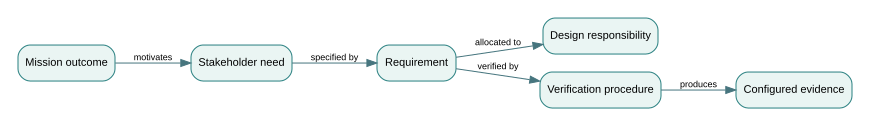

# 1. From a mission need to a defensible system claim

*Graduate-depth architecture sequence · Part I · Northstar regional mobility teaching system*

**Prerequisites.** System boundaries, stakeholder analysis, elementary logic, measurement error and requirements verification. **Use with:** Book I (systems engineering), Book III (MBSE), Book VI (concept design), Book VIII (test and evaluation).

## 1.1 The real problem is translation, not documentation

The statement *“Northstar must provide dependable emergency mobility”* is meaningful as an aspiration but not yet testable. A municipality imagines accessibility and timely transport; dispatch engineers imagine vehicle utilization; operations staff imagine service continuity; and the safety authority may imagine no dispatch into a hazardous route. Each viewpoint is legitimate, and each selects different evidence. Systems engineering begins by making these interpretations explicit rather than silently choosing the easiest metric.

For this text we use a **fictional** emergency transport dispatcher with two or three vehicles, an eligibility and prioritization policy, a human operator, an intermittent telemetry feed, and an independently managed road-status service. The *system of interest* includes dispatcher software, its human-machine interface, fleet communications and operating procedures. Vehicles, roads, weather, outside hospitals and the reporting service are modeled as cooperating or external elements, depending on the decision under study. A boundary is therefore a **contract about responsibility and evidence**, not a claim that the environment cannot affect system behavior.

Write the operational objective as a predicate on an observable run. For example, let $R$ be the set of eligible requests received during a declared operating window, let $C\subseteq R$ be those completed, and let $W_i$ denote the wait from accepted request to pickup. One possible service claim is

\[
\text{Service}(\omega) = \bigl(|C|/|R|\ge 0.90\bigr)\land\bigl(Q_{0.90}(\{W_i:i\in C\})\le 20\,\mathrm{min}\bigr).
\]

Here $\omega$ denotes one fully specified operating run. This predicate is **not automatically acceptable**: a 90th-percentile wait among completed requests can improve when slow requests are rejected. The denominator and the treatment of rejected, canceled, inaccessible and censored requests must be explicit. A safety requirement is commonly a separate hard condition, not a term that can be traded away for lower mean wait.

A more decision-useful claim states the population, period and operating context: *Under specified demand and road-availability scenarios, with at most one disabled vehicle and a functioning operator console, at least 90% of eligible requests are completed within the three-hour evaluation window; all rejected requests are counted; and the system never dispatches a vehicle onto a known closed route.* This is still a **candidate requirement**. It requires measurable definitions of *known*, *closed*, *eligible*, and *dispatch*. It also says nothing about fairness across neighborhoods. The intended lesson is not to memorize this phrasing; it is to expose the decisions that a vague mission statement hides.

## 1.2 Trace the meaning through four layers

An operational mission is not the same kind of object as a stakeholder need, system requirement, design decision, or test result. Treating them as one undifferentiated list causes circular verification. A traceable engineering chain can be represented as a directed typed graph:

\[
M\xrightarrow{\text{motivates}}N\xrightarrow{\text{specified by}}R\xrightarrow{\text{allocated to}}D\xrightarrow{\text{verified by}}T\xrightarrow{\text{produces}}E.
\]

$M$ is a mission outcome, $N$ a stakeholder need, $R$ a normative requirement, $D$ a designed responsibility, $T$ a verification procedure and $E$ observed evidence. The arrow labels matter: a design component should not *verify* a requirement by existing, and a test should not *satisfy* a requirement merely because someone wrote a test description. The evidence must be produced against a configured design, during a stated scenario, using an accepted measurement procedure.

A useful trace review examines **coverage in both directions**. Forward: does each required outcome have an implementable responsibility and a test? Backward: why does each major design function exist, and which stakeholder or hazard does it serve? Forward coverage without backward justification can create unnecessary complexity. Backward justification without forward evidence makes assurance empty.

The first research-level distinction is **syntactic consistency versus semantic adequacy**. A repository can enforce that every requirement has a link to some test; this establishes structural completeness of a graph. It cannot establish that the test actually measures the intended phenomenon. For example, linking a requirement about timely pickup to a unit test that checks whether a timestamp exists is syntactically valid but semantically weak. Judgment about the evidence claim cannot be automated away.

## 1.3 Operational definitions as measurement contracts

For a wait-time measure, define $t_r$ as the acceptance timestamp and $t_p$ as the verified pickup timestamp, both on a common clock. Then $W=t_p-t_r$. If the pickup event is missing, **do not** silently remove the request; classify it as censored, failed or unresolved under the evaluation policy. If two subsystems use clocks with error bounded by $\varepsilon_r$ and $\varepsilon_p$, the error in computed wait is bounded by

\[
|\widehat W-W|\le\varepsilon_r+\varepsilon_p.
\]

With independent centered clock errors the variance may instead be combined statistically, but independence must be argued; a shared time-service fault produces correlated errors. A ±30-second uncertainty at both endpoints can produce as much as a one-minute worst-case wait error. For a requirement stated as $W\le20$ minutes, observing $\widehat W=19.5$ minutes is not an unqualified pass under those worst-case bounds.

This leads to a central rule: **a verification method is part of the meaning of a requirement**. A requirement is not wholly operational until the evaluator knows how to measure and adjudicate it.

## 1.4 Allocation is a controlled design hypothesis

A requirement might be allocated jointly to route selection, dispatch scheduling, vehicle availability and operator intervention. A shared allocation must identify the contribution and interface of each element, or the team will create multiple “owners” with no accountable system behavior. Architecture allocation is best treated as a hypothesis: *If these elements provide these functions at these quality levels, then the emergent requirement can be met under stated scenarios.* Integration and evaluation test that hypothesis.

A system requirement can be verified by analysis, inspection, demonstration or test, depending on the assertion. A test does not automatically establish mission validation. A dispatcher could faithfully implement a 20-minute limit in a laboratory and still fail to help a neighborhood that has no accessible pickup locations. **Verification** asks whether the implemented system meets its specified requirements. **Validation** asks whether those requirements and the resulting system address the intended use and stakeholder needs in the applicable context.

## 1.5 Worked case: metric improvement by exclusion

Assume 12 eligible requests. Design A completes 10 with waits (minutes): 8, 9, 9, 10, 10, 11, 12, 14, 18, 19; two are unserved. Design B completes 8 with waits: 6, 7, 7, 8, 8, 9, 9, 10; four are unserved. Any completed-only wait percentile makes B appear faster. But coverage is $10/12=83.3\%$ for A and $8/12=66.7\%$ for B. Neither meets a 90% completion target. The correct scorecard reports both outcomes and an appropriate breakdown by accessibility status. A single favorable percentile cannot rescue a failed hard requirement.

A stronger design might measure *time-to-success or non-completion* across all eligible requests using a capped observation window, together with a separately reported completed-request wait distribution. Such a composite requires an explicit policy, but it avoids hiding operational failures by deleting them from analysis.

## 1.6 Threats to a defensible claim

Typical failure modes include: undefined operational modes; unspecified demand distribution; requirements mixing design solutions with stakeholder outcomes; evidence from a different software version; test coverage that ignores difficult neighborhoods; missing negative-case tests; and hazard controls being weighted as optional benefits. These are failures of the reasoning chain, not merely formatting defects.

A good review board asks: *What would disconfirm this claim?* If the answer is “nothing in our current test plan,” the claim is not yet being challenged scientifically. Propose an adversarial run with a closed road, incomplete telemetry and an accessible-vehicle request, and state which requirements could be violated. This leads naturally to model semantics and behavior contracts in the next chapters.

## Problems — attempt before opening solutions

1. A set of 50 eligible requests has 44 completions. Of those completed, 40 have waits at or below 20 minutes. Compute completion coverage and fraction of **all** eligible requests meeting the 20-minute target. Decide whether the two metrics can be substituted.
2. Endpoint clocks each have worst-case error 0.4 minutes. A measured wait is 19.6 minutes. Can the $20$-minute threshold be declared satisfied under worst-case reasoning?
3. Requirement `R7` links to component `D2` and test `T4`; `T4` has no recorded run, software revision or calibrated measurement. Identify the structural and semantic coverage claims that can and cannot be made.
4. A requirement says “the scheduler shall use optimization algorithm X.” Rewrite it as a design-independent system performance requirement and identify when an algorithm-specific requirement might still be appropriate.

Worked solutions and engineering interpretation

1. Coverage is $44/50=0.88$; all-request timely success is $40/50=0.80$. Completed-only timely fraction is $40/44\approx0.909$. This is a good example of why conditioning on completion can conceal service failure.
2. Worst-case wait can be $19.6+0.4+0.4=20.4$ minutes; the observation does not guarantee compliance. Repeated accurate measurements or a guard band may resolve the uncertainty.
3. A link graph can claim that a structural path exists. It cannot claim a passed test or admissible evidence because no configured observation exists. The model should differentiate `planned verification` from `verified at revision`.
4. For example, “under scenario set S, the dispatcher shall allocate at least 90% of eligible requests within stated timing and safety constraints.” Algorithm X may still be a justified design constraint when certification, compatibility, or a deliberate technical standard requires it; record that rationale separately.

## Applied laboratory and further study

[Mission-to-evidence lab](../labs/01-mission.html) · [Model files and Python](../code/model_checks.py) · [Cross-course concept index](../INDEX.html).

**References:** [NASA Systems Engineering Handbook](https://www.nasa.gov/reference/systems-engineering-handbook/), especially design, realization and technical management; [SEBoK](https://sebokwiki.org/wiki/Guide_to_the_Systems_Engineering_Body_of_Knowledge_(SEBoK)) for requirements, validation and verification. The fictional performance targets are instructional assumptions, not authoritative standards.

<!-- STEP04-ARCHITECTURE-START -->
---

## Step 04 advanced integration — bounded claims and measurement error (NS-AA4.1)

### A1. Define the target population before inspecting the results

The [controlled case inputs](../data/advanced-case.json) and [individual request outcomes](../data/advanced-requests.csv) describe **50 invented eligible requests**: 12 accessible and 38 standard. The population is declared before scoring, and two standard requests are unserved. Let \(I_i\) indicate that request \(i\) has a confirmed pickup and let \(W_i\) denote its measured wait when a pickup exists. For a wait ceiling \(\tau=20\) minutes, define the all-request timely fulfillment estimator

\[
\widehat F(\tau)=\frac{1}{N}\sum_{i=1}^{N}I_i\,\mathbf{1}(W_i\le\tau).
\]

An unserved request contributes zero, **not a deleted observation**. A separate completion estimator is \(\widehat C=N^{-1}\sum I_i\). The denominators remain \(N\), even when an outcome is missing. This specification prevents the erroneous calculation \(46/48=95.83\%\) from being reported as the mission fulfillment rate. The case yields \(48/50=96\%\) completion but only \(46/50=92\%\) measured timely fulfillment. The accessible subgroup yields \(11/12=91.67\%\) measured timely fulfillment.

These are descriptive proportions from a purposely constructed list, **not estimates of a representative population**. Confidence intervals, hypothesis tests, and probability guarantees require an explicit sampling or operational data-generating model. A simulated file with fifty rows does not become fifty statistically independent experimental replications merely because it has fifty IDs.

### A2. Convert timing uncertainty into a conservative compliance rule

Suppose each endpoint timestamp has bounded absolute error \(\epsilon=0.4\) minutes. A measured duration \(\widehat W=t_p^{obs}-t_r^{obs}\) has worst-case error \(|W-\widehat W|\le2\epsilon=0.8\) minutes. To **guarantee** a pickup occurred by \(\tau\) within this deterministic error envelope, require \(\widehat W+0.8\le20\). Hence the observed threshold becomes \(19.2\) minutes, not \(20\).

The case includes one accessible request at 19.6 minutes and two standard requests at 19.5 minutes. All three count as timely in the unguarded report, but none is guaranteed timely under the stated bound. The guarded count is therefore \(43/50=86\%\); accessible is \(10/12=83.33\%\). The illustrative requirements are 90% all-request timely fulfillment and 85% accessible timely fulfillment, so **both fail** after guard-banding, even though both unguarded summaries pass.

This is a *bounding exercise*, not a statement that actual clock errors always attain their worst-case signs. It is intentionally more conservative than a probabilistic measurement model. If errors are random, a separate calibration and dependence study could support a different adjudication rule, but must be approved before data inspection.

### A3. Show the boundary of a service claim

Meeting a threshold in one listed scenario cannot establish mission validation. Requests are invented; there is no evidence of neighborhood representativeness, disability-access consultation, clock calibration, dispatch safety, or demand surges. Nor does an observed subgroup proportion establish parity or fairness: service outcomes may differ in ways a two-group split does not reveal. An authorized stakeholder review must determine which disparities are relevant and what outcomes matter.

**Exercise.** If the endpoint bound were 0.1 minutes instead of 0.4, what would the guarded threshold be? Would the three borderline requests count? **Worked solution:** the total guard is \(0.2\) minutes, so the observed cutoff is \(19.8\). All three (19.5, 19.5, 19.6) would be included: guarded all-request fulfillment would be \(46/50=92\%\), accessible \(11/12=91.67\%\). This only changes a *measurement premise*; it does not validate that a 0.1-minute bound is real.

**Reproduce:** `python3 SE/K/A/code/advanced_case.py` from the repository root. The [case analysis source](../code/advanced_case.py) explicitly rejects duplicate requests, missing pickup times, and malformed groups. Continue with the [typed-evidence model in Part II](02-models.html).
<!-- STEP04-ARCHITECTURE-END -->
