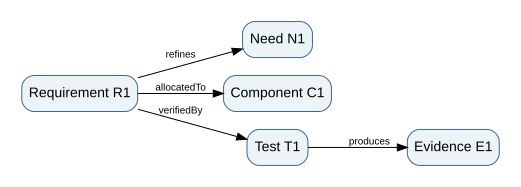

# 2. Model semantics: types, relations, constraints and consistency

*Graduate-depth architecture sequence · Part II · Northstar digital system model*

**Prerequisites.** Chapter 1, directed graphs, sets, relations, and basic programming-language types. **Use with:** MBSE, Digital and Mission Engineering, and System Design and Integration.

## 2.1 A model is a theory of a system

A useful architecture model makes claims that can be inspected, queried, challenged and revised. A drawing alone is a view, not necessarily a model: two boxes joined by a line do not tell us whether the line means physical flow, information exchange, responsibility, dependency or co-location. The same drawing can support mutually incompatible interpretations. A model becomes computationally useful only when its elements and relationships have explicit **types and semantics**.

Let $V$ be a set of elements and $E$ a set of directed relations. A typed multigraph is $G=(V,E,\tau_V,\tau_E)$, where $\tau_V$ maps each node to an element type and $\tau_E$ maps each edge to a relation type. We allow several relationships between the same ordered nodes because a requirement can be both allocated to and constrained by a particular component. The model's **metamodel** defines allowable element and relation types and their constraints.

For our teaching metamodel we distinguish `Need`, `Requirement`, `Function`, `Component`, `Interface`, `Test`, and `Evidence`. Some allowed edges are `refines(Requirement,Need)`, `allocatedTo(Requirement,Component)`, `realizes(Component,Function)`, `verifiedBy(Requirement,Test)`, and `produces(Test,Evidence)`. An edge `verifiedBy(Component,Need)` is rejected on type grounds. The metamodel does not prove the remaining links are true, but it prevents an entire class of category errors.

## 2.2 Semantics and the SysML v2 context

The OMG SysML v2 standard was adopted in 2025 and supplies a modeling language with formal semantic foundations, complementary textual and graphical representations, and an API/services specification. See the [official OMG specification](https://www.omg.org/spec/SysML/2.0). **Our exercises do not implement SysML v2 and are not a SysML conformance test**. They use a deliberately smaller, tool-neutral model to teach the underlying typed-relationship reasoning. This distinction is essential: a JSON graph is not a standards-compliant SysML model just because it describes requirements and components.

SysML language constructs enable structure, behavior, requirements and verification to be represented and interrelated. Professional use additionally requires a disciplined **modeling method**: agreed viewpoints, naming, units, ownership, baselines, review rules, version control and a strategy for model exchange. A model language makes representations possible; a modeling method decides which assertions must exist to support a question.

## 2.3 Express constraints as executable invariants

Suppose every high-criticality requirement must have an owner and at least one planned verification. Define $R_h$ as the set of such requirements. Then

\[
\forall r\in R_h:\quad \exists c\in C\;\mathrm{allocatedTo}(r,c)
\quad\land\quad \exists t\in T\;\mathrm{verifiedBy}(r,t).
\]

A stronger *evidence* condition also requires an acceptable evidence object produced by a test run against the applicable baseline. These are different maturity states. Our checker can establish syntactic coverage and simple version matching, but assessing whether the test truly exercises the right operational scenario remains a human engineering task.

A second invariant addresses interfaces: every published interface must identify its producer and consumer components; every data field must have a unit, version or schema, and a defined invalid-data response. Pure name matching is insufficient. A field named `position` can be latitude/longitude, a road-network segment, or a vehicle-local coordinate system. A systems model should not permit a data stream to appear meaningful when its reference frame is unresolved.

## 2.4 Change-impact analysis is graph traversal plus judgment

For a proposed change to a software component, traverse reverse `allocatedTo` and dependency edges to discover affected requirements, test procedures and evidence. Let $D(v)$ be the closure of all nodes reachable from changed node $v$ under selected dependency types. This is a **candidate impact set**, not proof that every reachable item must change or that every relevant effect has been captured. The result depends on completeness of the modeled relationships and the choice of edge types. Some propagation requires physics and dynamics, not graph topology alone.

For example, changing the telemetry timeout from 5 to 10 seconds might alter a software timer, operator cue, route freshness constraint, fault-detection latency, and a safety hazard. A graph with only allocation links will likely miss the temporal interaction. A better model includes `dependsOn`, `constrains`, and `hazardMitigatedBy` relationships, plus parametric constraints and behavioral properties. Do not falsely claim that traceability is an impact oracle.

## 2.5 Parametrics, dimensional analysis and constraint propagation

Consider a simplified energy budget for a route of $d$ km. Vehicle energy consumption is $e$ kWh/km, overhead per route is $h$ kWh, and reserve is $r$ kWh. Available battery energy is $B$ kWh. The requirement is

\[
B\ge ed+h+r.
\]

Suppose $d=24$ km, $e=0.62$ kWh/km, $h=1.8$ kWh, and $r=4.0$ kWh. Required energy is $14.88+1.8+4=20.68$ kWh. A 21 kWh usable battery leaves just 0.32 kWh margin under the nominal assumptions. If energy per km increases to 0.70 because of adverse weather, the required energy becomes 22.6 kWh: the baseline is infeasible. This is constraint propagation, not merely a weighted preference trade.

A unit checker should reject $d$ entered in miles when a parameter is declared in kilometers **unless conversion is explicit**. Correct unit metadata does not make the model physically credible, but silent unit errors can invalidate every downstream optimization and test threshold.

The local Python laboratory implements a minimal typed graph and energy-budget rule. It is not a replacement for a SysML tool; it is a transparent training instrument for recognizing properties of a larger model-based process.

## 2.6 Model viewpoints and information loss

An operational viewpoint emphasizes missions and actors; a logical viewpoint emphasizes functions and data; a physical viewpoint emphasizes components and interfaces; an assurance viewpoint emphasizes requirements, hazards and evidence. Each view intentionally hides some information. If two view diagrams disagree about the existence or ownership of a function, the underlying model should resolve that discrepancy. A model-driven workflow derives multiple views from shared underlying elements instead of manually synchronizing unrelated pictures.

A practical model review asks three questions: **completeness** (what relevant relationships are missing?), **consistency** (do the recorded relationships violate type, value or temporal constraints?), and **adequacy** (is the model capable of answering the actual engineering question?). Passing completeness and consistency checks never guarantees adequacy.

## 2.7 Worked change review

A dispatch-service update changes the maximum age of a route-permission token from 4 seconds to 9 seconds. The changed value is syntactically consistent with a nonnegative timeout and will pass most naive validation checks. But the hazard control requires that stale road-closure information not be acted upon after 5 seconds. The model therefore contains an inconsistent *cross-domain constraint*. The architecture engineer must connect token age, route freshness, message latency and hazard exposure. A software-only view cannot establish the relevant system-level effect.

A disciplined change request records the altered assumption, dependency closure, unresolved links, affected verification cases, required test environment, and the evidence needed to accept the new baseline. A changed model without refreshed evidence does not inherit the previous assurance claim.

## Problems — attempt before opening solutions

1. Specify a type violation and a semantic problem for `verifiedBy(R-1,T-1)`, where `R-1` requires safe emergency routing and `T-1` only checks JSON parsing.
2. A route is 30 km, $e=0.55$ kWh/km, $h=2$ kWh and reserve $r=3$ kWh. Is $B=22$ kWh sufficient? What if the unit for distance were actually miles?
3. A component revision changes an interface timeout. Explain why transitive graph reachability is neither sufficient nor always necessary for an impact decision.
4. Write a logical condition for every high-criticality requirement to have at least one allocated component and at least one verification procedure. Distinguish this from a pass condition.

Worked solutions

1. Both nodes could have correct types, so the relation need not violate the metamodel. It violates *semantic adequacy*: parsing is not evidence of safe routing. Reject claims that merely point at a test ID.
2. Energy is $30(0.55)+2+3=21.5$ kWh; nominal margin 0.5 kWh. If 30 miles were mistakenly treated as 30 km, the route would actually be about 48.28 km and the energy requirement about 31.55 kWh, which fails. Record the unit conversion explicitly.
3. The graph may omit environmental or dynamic mechanisms, generating false negatives. Conversely, some reachable dependencies may be insulated from change by a stable contract, generating false positives. Reachability is a review aid.
4. $\forall r\in R_h\;\exists c\in C,t\in T:[\mathrm{allocatedTo}(r,c)\land\mathrm{verifiedBy}(r,t)]$. To claim a pass, add acceptable configured evidence generated from $t$ under applicable conditions and evaluated against a criterion.

## Applied laboratory

[Typed-model validation lab](../labs/02-models.html) · [Editable JSON model](../data/model.json) · [Python checker](../code/model_checks.py) · [Sequence index](../INDEX.html).

**Primary reference:** [OMG SysML v2](https://www.omg.org/spec/SysML/2.0); [NASA Systems Engineering Handbook](https://www.nasa.gov/reference/systems-engineering-handbook/). The teaching metamodel is intentionally simplified.
