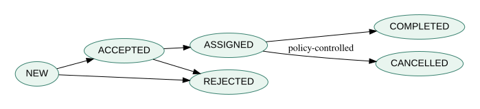

# 3. Behavioral contracts: state machines, concurrency and temporal safety

*Graduate-depth architecture sequence · Part III · The Northstar dispatcher as a transition system*

**Prerequisites.** Boolean logic, finite state machines, Chapter 2, basic concurrent programming. **Use with:** Object-Oriented Analysis and Design, Software Systems Engineering, MBSE and Safety Engineering.

## 3.1 Why structure cannot predict behavior

An architecture diagram can correctly show `Dispatcher`, `ReservationStore` and `RouteAuthority` components, yet fail to tell us whether two simultaneous reservation commands can allocate the same vehicle. Structural compatibility is a necessary but insufficient condition for behavioral correctness. The design must define **which changes of state are legal**, how concurrent messages are ordered and what must remain true over an entire execution.

A labeled transition system is $\mathcal T=(S,A,\rightarrow,S_0)$: $S$ is a set of states; $A$ a set of actions; $\rightarrow\subseteq S\times A\times S$ a transition relation; and $S_0$ the initial states. A transition $s\xrightarrow{a}s'$ means that action $a$ may carry the system from $s$ to $s'$ under defined guards. Each action can include a precondition, an effect and a postcondition. This is a mathematical model, not a claim that a deployed program automatically follows it.

For a request $r$, a simple state set is `NEW`, `ACCEPTED`, `ASSIGNED`, `COMPLETED`, `REJECTED`. Allowed transitions are `NEW→ACCEPTED`, `NEW→REJECTED`, `ACCEPTED→ASSIGNED`, `ACCEPTED→REJECTED`, and `ASSIGNED→COMPLETED` (a cancellation path may need adding). The tempting design of modeling only successful states is dangerous: a timeout, rejection or duplicate can then create an undefined condition that the software treats inconsistently.

## 3.2 Invariants and temporal properties

An **invariant** is a proposition required to hold in every reachable state. For example:

\[
\forall r:\;\operatorname{completed}(r)\Rightarrow\operatorname{assigned}(r)\text{ occurred earlier}.
\]

A state-local rule might instead say `COMPLETED` implies a nonempty vehicle assignment and verified pickup record. Invariant checking requires reasoning about all permitted transitions or exploring a finite state space. A sample unit test only covers a selected execution; it is not an exhaustive proof.

Safety and liveness express different obligations. A **safety** property says something bad never happens (for example, no two active requests hold the same exclusive vehicle). A **liveness** property says something good eventually happens (for example, each accepted request eventually completes or is explicitly resolved). Using linear temporal logic notation, with $G$ meaning “globally, from now on,” and $F$ meaning “eventually,” a boundedly interpreted liveness aspiration is

\[
G(\operatorname{accepted}(r)\Rightarrow F(\operatorname{completed}(r)\lor\operatorname{rejected}(r))).
\]

This formula by itself has **no real-time bound**. A system that leaves a request unresolved for a year and then rejects it may satisfy the eventuality. Real-time requirements need clocks, timed automata, bounded temporal logic, or an explicit elapsed-time monitor. Another subtlety: if the environment can stop delivering messages forever, liveness may be unachievable without a fairness or timeout assumption. State those assumptions explicitly.

## 3.3 Contracts and refinement

A component contract can be written as assumption $A$ and guarantee $G$: under permitted environmental behavior $A$, the component promises $G$. Contract reasoning becomes fragile when an assumed network guarantee is not provided by the actual deployment. Suppose the dispatch service assumes that every message is eventually delivered. A cellular network with unbounded loss violates that assumption; the component-level proof no longer establishes system-level liveness.

**Refinement** asks whether a concrete design implements the abstract behavior without violating its externally visible obligations. A refined model may add internal states or actions, but it should not introduce an externally observable trace forbidden by the abstract contract. One common verification approach is simulation or bisimulation relations between abstract and concrete transition systems. Such relations require formal definitions of what observations count and how internal steps are abstracted. Our training model uses simpler invariants and explicit counterexamples, not full model checking.

## 3.4 Idempotency is a state property, not a network promise

Messages can be duplicated when clients retry after a timeout. A well-designed reservation command uses a stable idempotency key to ensure the same logical request is applied at most once **within a defined retention and identity scope**. If a command `reserve(k,r)` has already been accepted, repeating the command with the same key should return its previous result rather than create a new allocation. However, reusing key $k$ with a *different payload* must be rejected or otherwise handled by a documented conflict policy.

This is not the same as exactly-once delivery. Networks often deliver zero, one or multiple copies of a request; application-level state, durable storage and transactional boundaries determine whether duplicate effects are prevented. If the idempotency store expires before a delayed retry arrives, the command can be applied twice unless another uniqueness constraint catches it.

For concurrency, consider two requests $r_1,r_2$ and one available vehicle $v$. Two threads each read “$v$ available,” then both commit assignments. A sequential implementation appears correct, but the interleaving violates the invariant $\sum_r\mathbf1[\operatorname{activeAssigned}(r,v)]\le1$. Prevention requires an atomic transaction, a compare-and-swap guarded update, or another concurrency control method covering the actual shared state. Locking a Python function without protecting a database update may not suffice.

## 3.5 Counterexample-driven analysis

An excellent method for learning model checking is to search for the shortest violating trace. Consider:

1. Request A checks vehicle V: available.
2. Request B checks vehicle V: available.
3. Request A assigns V and commits.
4. Request B assigns V and commits.

The final state violates exclusivity. To repair the model, make “check and assign” atomic, then verify that the guard is re-evaluated at commit. Next deliberately inject a crash after the assignment commits but before the response reaches the client. A retry must return the committed result; it must not create an additional assignment. This *crash-retry* case tests durability and idempotency together.

The accompanying source module implements a finite, single-process illustrative state machine with an atomic assignment operation. It does **not** prove distributed linearizability across independent databases. This limitation matters when you transfer the concept to production systems.

## 3.6 A temporal safety case

Northstar must not dispatch into a road that is known closed. It receives closure messages asynchronously with a `measured_at` timestamp. Define $F$ as the maximum acceptable freshness age and $t$ as current decision time. A simple dispatch guard is `status == OPEN` and $0\le t-\mathrm{measured\_at}\le F`. But consider a road that closes immediately after a still-fresh OPEN report. The guard cannot guarantee the physical road remains open; it only establishes compliance with an **information-age policy**. Strong safety claims need another layer: alternate sensing, route geofencing, conservative failure response, or operator confirmation.

This distinction between **epistemic state** (what the system believes) and **physical state** (what is actually true) is critical. A model that equates them has hidden its most important uncertainty. The behavioral contract should specify what happens when evidence becomes stale: fail closed, degrade to manual authorization, or use a constrained fallback. Those choices create new liveness, human-factors and capacity questions.

## 3.7 Verification strategy

Use layered evidence: unit tests for guards and state transitions; property-based tests across generated action sequences; concurrency stress tests for races; fault injection for crash-retry behavior; model-based tests derived from the state machine; and operational tests for fallback behavior. Negative cases, including stale timestamps, reordered events and conflicting duplicates, should be planned first rather than appended after demonstration success.

When finite-state exploration is tractable, enumerate reachable states and assert invariants. With $n$ requests and $m$ vehicles, a naive state representation can grow combinatorially. State abstraction, symmetry reduction and compositional contracts help manage the explosion, but their validity assumptions must be defended.

## Problems — attempt before opening solutions

1. State an invariant preventing duplicate active assignment of vehicle $v$. Explain why checking the invariant after a non-atomic read does not guarantee it at commit.
2. Express a liveness requirement for every accepted request to resolve, and identify two environmental assumptions needed for it to hold.
3. An `OPEN` route status was measured at $t=101$ s; the decision is at $t=107$ s with permitted age 5 s. Decide what the guard does. Does this prove the route is physically open?
4. A retry arrives with the same idempotency key but a different request payload. Define a safe policy and explain the identity-scope assumption.

Worked solutions

1. $\sum_r\mathbf1[\operatorname{activeAssigned}(r,v)]\le1$. Independent reads can both see availability before either writes. An atomic guarded commit or equivalent serialized update is required.
2. $G(\mathrm{accepted}(r)\Rightarrow F(\mathrm{completed}(r)\lor\mathrm{rejected}(r)))$. Fair scheduling and a timeout/recovery path are typical assumptions; for real-time resolution, add a time bound.
3. Age is 6 s, so fail the freshness guard. Even if it passed, recent observation is not proof of continuing physical openness.
4. Return a conflict rather than applying a different payload under the same key; scope keys to a known client/service and retain them long enough to cover plausible retries.

## Applied laboratory

[Transition-system and fault-injection lab](../labs/03-behavior.html) · [Executable state model](../code/model_checks.py) · [Sequence index](../INDEX.html).

**Further reading:** OMG SysML v2 behavior concepts (official language specification) and NIST SP 800-160 Volume 1 Rev. 1 for trustworthy systems security engineering. The formal-logic notation here is an instructional simplification.
