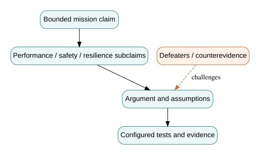

# 5. Assurance cases, evidence provenance and configuration change

*Graduate-depth architecture sequence · Part V · From a modeled claim to a bounded readiness decision*

**Prerequisites.** Chapters 1–4, reliability fundamentals, statistical inference and technical reviews. **Use with:** Test and Evaluation, Digital and Mission Engineering, Safety Engineering, Enterprise Systems Engineering.

## 5.1 Assurance is a structured argument, not a folder of test reports

An engineering team may have thousands of passing tests without knowing which system-level claim they support. Conversely, a persuasive narrative can be unsupported by actual verification data. An **assurance case** connects a claim to a reasoned argument and appropriate evidence under explicit context and assumptions. Its fundamental question is not “How many artifacts do we have?” but **“Why should this particular evidence change confidence in this particular claim?”**

For Northstar, consider the top claim: *The configured system can support the declared emergency mobility mission within an explicitly bounded operating envelope.* This is too broad for one test. Decompose it into claims about service performance, safe route dispatch, authorized decisions, degraded operation, and recoverability. Connect each subclaim to measurement procedures, scenario coverage, configured test results, and any residual counterevidence. This structure resembles Goal Structuring Notation concepts, but our diagrams are illustrative and not a certification template.

## 5.2 Separate claim, argument, evidence and defeater

A **claim** is a proposition whose truth matters. An **argument** explains why evidence supports the proposition in context. **Evidence** is a recorded observation or analysis result with provenance. A **defeater** is a credible reason the argument may fail: unrepresentative demand, unsupported independence, an untested failure mode, missing calibration, or a mismatch between tested and deployed revisions.

Suppose the claim is “the system satisfies a completion requirement in high-demand conditions.” Evidence consists of 60 synthetic simulation replications; 58 meet the threshold. The raw fraction is $58/60\approx96.7\%$. But are the replications independent? Were there several demand families? Is the model validated for this use? Did the simulator use the software version and routing logic proposed for release? A binomial interval conditional on independent representative Bernoulli replications is not enough to establish those premises.

In the case of **zero observed failures** over $n$ independent identically distributed trials with identical constant failure probability $p$, the one-sided $100(1-\alpha)\%$ upper confidence bound is

\[
p_U=1-\alpha^{1/n}.
\]

For $n=30$ and $\alpha=0.05$, $p_U\approx0.0950$. Seeing no failures in 30 favorable trials is consistent, at that confidence level, with a true failure rate approaching 9.5%. It does **not** establish a highly reliable safety-critical system. For a bound below 0.01 with zero failures, the required sample is

\[
n\ge\frac{\ln(0.05)}{\ln(0.99)}\approx298.1,
\]

so at least **299** independent identical trials would be needed; even this result is conditional on representativeness and stationarity. Repeating one easy run 299 times does not sample rare hazards effectively. Zero failures cannot exclude a structural blind spot.

## 5.3 Evidence must be specific to a configuration and scenario

A usable evidence record should identify: claim ID; requirement ID; test or analysis procedure; simulator and software revision; model assumptions; data-source hashes; operating scenario; calibration state; observed result; adjudication rule; reviewer; and unresolved anomalies. Without this information, a passing result may not transfer to the configuration being released.

Let a claim be supported at revision $v_1$ by evidence $e_1$. After changing a dispatch timeout and telemetry trust rule, the system is at revision $v_2$. Evidence is not automatically inherited: we need an explicit **equivalence argument**, an impact analysis, or new testing. Some evidence may remain applicable—for example, a hardware enclosure inspection unrelated to the software timeout—while end-to-end safety results may need complete renewal.

This is where model-based traceability becomes useful. A graph query can find evidence connected to changed nodes. An evidence-policy engine can flag mismatched configuration hashes. Neither establishes semantic equivalence; the technical review must judge whether the changed assumptions invalidate the inference. *Digital thread* should mean a trustworthy chain of relationships and provenance, not simply hyperlinks among documents.

## 5.4 Readiness depends on counterevidence

A mature assurance review actively seeks the strongest counterexample. For Northstar, suppose the baseline dispatch simulation meets completion targets but loses all accessible-vehicle service during a shared telemetry outage. The overall completed-request wait average may remain acceptable because only easy requests finish. The failure is not a small numerical deviation; it refutes the intended service claim for a key stakeholder group.

The review board should preserve the unfavorable run, identify affected requirements, revise the architecture or operational envelope, and require new evidence. A conditional **no-go for a declared mission** can be a successful engineering review outcome when it prevents unsupported readiness claims. The purpose is accurate decision-making, not achievement of a favorable badge.

## 5.5 Bayesian belief versus frequentist confidence

Evidence may be combined using Bayes' rule if a complete probabilistic hypothesis model is defensible. With hypothesis $H$, prior odds $O(H)$ and likelihood ratio $LR=P(E\mid H)/P(E\mid\neg H)$, posterior odds are

\[
O(H\mid E)=O(H)\times LR.
\]

A strong likelihood ratio can shift belief substantially, but it can be misleading if the evidence is selected after seeing results or if the hypotheses omit a common failure mechanism. A frequentist confidence interval is not a posterior probability for $H$, and it should not be described as “95% probability the requirement is true” without a Bayesian model. Engineers need to state which inferential framework they are using and what data-generating assumptions support it.

For example, take prior odds for a simplified hypothesis of adequate reliability as $1:4$ ($P(H)=0.2$) and an independently justified likelihood ratio of 6 from one selected test campaign. Posterior odds become $6:4=1.5:1$, giving posterior probability $1.5/2.5=0.6$. This numerical exercise does not create a defensible operational posterior unless both prior and likelihood ratio have been supported by an explicit model. It illustrates how evidence updates beliefs, not how a safety certification should be issued.

## 5.6 Argument architecture and graded conclusions

A useful review decision is **bounded**: *No readiness claim for autonomous dispatch is supported under road-closure uncertainty; limited supervised use may be supported within conditions X, Y and Z, provided the identified controls are present and additional tests are performed.* This is stronger than unconditional “pass/fail” language because it states the system's tested configuration, operational assumptions and exclusions.

A formal assurance inventory can categorize open issues as: blocking violation of a hard constraint; unresolved high-consequence hazard; insufficient evidence; test-environment mismatch; or lower-severity improvement. Risk acceptance should have named authority and stated scope. A spreadsheet row labeled `risk accepted` is not an independent safety argument.

A strong curriculum exercise asks students to build two cases: a **best defensible case** for deployment and a **critical countercase** explaining why the same evidence may be inadequate. This adversarial technique prevents confirmation bias. The final technical report should identify the evidence that would change the recommendation, not simply restate the current opinion.

## 5.7 Capstone integration: make a versioned argument

The five chapters form one chain: stakeholder outcome → measurable requirement → typed model → behavioral contract → quantitative budget → configured evidence. A change to telemetry age affects the requirement interpretation, type relationships, state guard, end-to-end delay, fault scenarios and evidence applicability. It therefore belongs in an integrated change review. No single diagram, simulation, unit test or Bayesian calculation closes the argument by itself.

Your final lab produces a versioned mini-assurance case for the fictional Northstar design. The evaluator should be able to answer, without interviewing the author: what claim is being made, which configuration was studied, what was observed, which assumptions matter, what alternative explanation is plausible, and what should be done next?

## Problems — attempt before opening solutions

1. Calculate the zero-failure upper bound for $n=30$ independent trials at 95% one-sided confidence. Explain why it is not a probability that the requirement is true.
2. Calculate the minimum integer $n$ to establish a zero-failure one-sided upper confidence bound below 1% under identical independent Bernoulli trials.
3. A model was validated at revision `v1`. At `v2`, a message timeout increases and a degraded-mode rule changes. Propose an evidence reuse and retest strategy.
4. A team claims 99% mean completion, but an accessibility subgroup receives 70%. Construct a meaningful defeater and a bounded top-level claim.

Worked solutions

1. $1-0.05^{1/30}\approx0.09503$. A confidence bound is a repeated-sampling coverage construction under specified assumptions, not a posterior probability assigned to a fixed system requirement.
2. $n\ge\ln(0.05)/\ln(0.99)\approx298.07$; the minimum integer is 299. Even 299 easy identical scenarios may not be representative of high-risk modes.
3. Retain unrelated evidence only with an explicit equivalence rationale. Re-run state-transition tests, stale-route fault tests, end-to-end timing checks and mission scenarios affected by the new timeout; preserve both revision hashes and the changed model contract.
4. The subgroup result defeats a universal access claim. A bounded statement might be “the reference configuration achieves the stated aggregate result on the synthetic sampled scenarios, but equitable mission access is unverified and the design is not ready for unrestricted deployment.”

## Laboratory and references

[Build a configuration-specific assurance case](../labs/05-assurance.html) · [Evidence register](../data/evidence.csv) · [Python consistency checks](../code/model_checks.py) · [Sequence index](../INDEX.html).

**Further reading:** [NASA Systems Engineering Handbook](https://www.nasa.gov/reference/systems-engineering-handbook/); [NIST SP 800-160 Vol. 1 Rev. 1](https://csrc.nist.gov/pubs/sp/800/160/v1/r1/final). These are independent references. The numerical examples and safety criteria are fictional teaching assumptions.
