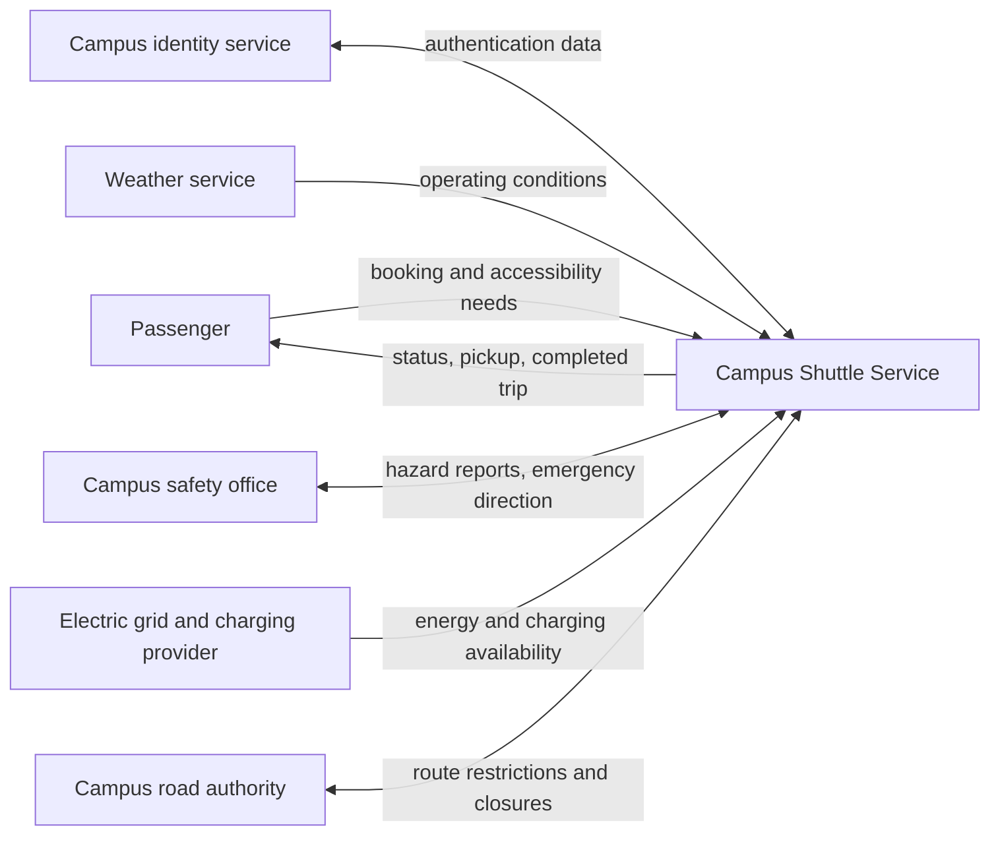
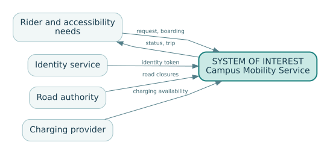

# Chapter 1 — What, exactly, is the system?

*Companion to EN.645.662, Week 1: systems, systems thinking, and the systems engineer.*

## A shuttle that works—and a service that fails

At 8:10 on a rainy morning, three autonomous shuttle vehicles are operational. Their batteries are charged; their self-diagnostics report no vehicle faults. A student opens the campus booking app, requests a ride, and waits. No shuttle appears. A dispatcher later discovers that the booking service has lost its connection to the fleet-management server. The vehicle supplier reports 100% fleet availability. The student reports a failed transport service. Both statements can be true.

This small contradiction is an entry point to systems engineering. A **component** can satisfy its specifications while the **system** fails to deliver its purpose. The student did not buy a vehicle subsystem; the student expected reliable transport from one place to another. The engineer must identify the object of accountability before judging whether its parts work.

A system is a set of interacting elements arranged to achieve a purpose within an environment. Those elements may include hardware, software, people, procedures, data, facilities, organizations, and policies. Calling something a system does not require that every element be designed by one contractor or controlled by one manager. What matters is the purposeful interaction and the whole-system behavior produced by that interaction.

An **element** is a part we choose not to decompose at the present level of description. A **subsystem** is a system that is itself part of a larger system. A vehicle is a subsystem of the campus mobility service and a system of interest for the vehicle designer. Neither label is absolute. It changes with the question we are trying to answer.

## 1.1 The system of interest is a decision

Suppose the campus asks: “Which new vehicles should we purchase?” A legitimate system of interest might be the autonomous vehicle, including its onboard sensors, computers, propulsion, braking, interfaces, and embedded safety behavior. Scheduling software and passenger service procedures are context or external dependencies. Now suppose the same campus asks: “How do we make evening travel accessible and dependable?” A vehicle-only boundary is inadequate; the relevant system of interest is the transportation service, including dispatch, operating policy, stops, service support, accessibility arrangements, and escalation processes.

A useful definition is therefore *the system of interest is the thing whose behavior and responsibilities we are engineering or assessing for a specified decision*. It is not simply the largest box on a diagram. The boundary allocates design authority, test responsibility, operational ownership, data obligations, and sustainment cost. An excluded element remains consequential if the mission depends on it. Moving mobile connectivity outside the contractual boundary does not make loss of connectivity cease to matter.

Consider two choices for our fictional Campus Shuttle Service:

| Question | Boundary A: vehicles and onboard control | Boundary B: end-to-end mobility service |
|---|---|---|
| Who engineers the booking app? | External campus IT | The service program or its subcontractor |
| Who defines service-level wait time? | External operator | Service system authority |
| What is verified at acceptance? | Vehicle functions and interfaces | Service functions, interfaces, and operating scenarios |
| Who owns a broken booking-to-dispatch handoff? | Shared interface issue | Program-level system defect, possibly with supplier action |
| What happens at retirement? | Vehicles are disposed of | Vehicles, customer data, operating processes, facilities, and service agreements are transitioned |

Neither choice is intrinsically superior. Boundary A might be appropriate for a procurement contract. Boundary B is more appropriate for evaluating the campus mobility mission. A mature engineering record states *which decision* justifies the selected boundary, and what residual dependencies remain.

## The mechanism beneath the method

A system boundary determines which exchanges must be controlled and which outcomes must be negotiated with an environment; redraw the boundary and an apparent subsystem defect may become an external dependency.

### Distinguishing related ideas

The boundary is not the physical perimeter: the shuttle's dispatch decision reaches into rider behavior, communications and agency rules even when those actors are not owned by the operator.

### Interpretation and boundary conditions

An accountable design names every crossing, its owner, and what happens when an external participant does something other than the nominal scenario.

## 1.2 Draw the context before decomposing the design

A **context diagram** places the selected system of interest at the center and shows external actors or systems with meaningful exchanges. Unlike a product breakdown, it is not primarily a parts inventory. It is a map of interactions and dependencies.

This picture is deliberately incomplete: it tells us *where* interfaces exist, not whether we have specified them well. A credible diagram adds direction, exchanged item, owner, operational condition, and failure behavior to its interface register. A blank arrow labeled “data” is rarely sufficient. What data? In which units? With what timestamp? How late may it arrive? How can the recipient detect an invalid message?

For example, the fleet dispatcher sends a proposed route to a vehicle. A preliminary contract might specify `vehicle_id`, `route_id`, `revision`, `created_at`, `valid_until`, `waypoint_sequence`, `acknowledgement_deadline`, and a response code. A route whose validity interval has expired should not be accepted as a fresh command. The contract must also state the action taken after timeout or communication loss; it is not enough to say that the vehicle “shall be safe.”

## 1.3 Functions, structures, and outcomes are different views

A **purpose** explains *why* the system exists: enabling accessible and reliable movement between campus destinations. A **function** describes *what* it must accomplish: receive requests, select a feasible vehicle, arrange pickup, move passengers, handle exceptions, retain records. A **physical architecture** assigns those functions to equipment, software, people, facilities, or external suppliers. An **operational outcome** describes the value achieved: passengers reach their destination under the conditions that matter.

The same function can be allocated differently. A human dispatcher might assign vehicles; an automated service might do it; a hybrid operation might automate routine assignment while delegating exceptions to an operator. A premature boundary and architecture can eliminate options before we have compared them.

One useful discipline is to keep four questions separate:

1. What outcome is needed, by whom, and under what circumstances?
2. What functions must occur to produce that outcome?
3. Which system elements and organizations are responsible for those functions?
4. What evidence would show that the resulting arrangement works?

As the design matures, these questions become linked rather than collapsed into one vague box labeled “shuttle platform.”

## 1.4 Why interaction generates properties that cannot be tested in isolation

Whole-system properties can depend on interactions. Service waiting time depends on booking demand, the number of available vehicles, travel times, boarding delays, dispatch policy, road restrictions, and faults. Even when every vehicle meets its own acceptance test, a synchronized class change can produce a request surge, congest the dispatch queue, and cause unacceptable waits. The property **emerges from the system** in the plain engineering sense that it is not determined by any one part alone.

This is not mystical. Consider a simple capacity illustration. Suppose three vehicles can each complete four trips per hour in ideal conditions. A naïve total is 12 trips per hour. If peak demand is ten trips per hour, that seems ample. But a vehicle out for charging, longer accessible boarding, and vehicle clustering near one stop can lower effective capacity and increase delay. Worse, average hourly demand hides short bursts. A one-hour total cannot prove that a 15-minute surge will be served promptly.

An engineer therefore asks which system-level measures must be observed directly. “Vehicle available” is a subsystem measure. “Percentage of accepted requests resulting in completed trips” is closer to a mission-level outcome. Later chapters develop this distinction using measures of effectiveness and performance; here the key point is that subsystem success is necessary for some missions but usually not sufficient.

## 1.5 People, organizations, and lifecycle are engineering elements

A common modeling failure is to represent people as external noise. Passengers, maintenance technicians, supervisors, accessibility coordinators, emergency responders, vendors, and regulators can create, detect, or resolve system failures. An emergency response procedure may be as important as a sensor. The chosen boundary must make these dependencies visible, even when a particular organization is outside the program's direct authority.

Lifecycle thinking broadens the picture further. Development requires test facilities, simulation data, configuration management, and independent review. Deployment needs training and operating permits. Operation requires incident management, software updates, and spares. Retirement may require secure data disposal, vehicle decommissioning, and continuity of essential mobility services. An early architecture that is inexpensive to acquire but impossible to maintain is not an effective system architecture.

A **supporting or enabling system** makes the target service possible without necessarily being part of the delivered end product. A charging depot, maintenance diagnostic system, or training program may be enabling systems. The distinction matters for ownership and evidence, but it must never be used to omit a dependency.

## 1.6 Systems engineers integrate; they do not replace specialists

The project manager manages scope, schedule, cost, commitments, and decision processes. Specialists design particular elements and produce evidence within their disciplines. A systems engineer integrates needs, interfaces, performance, architecture, risks, and verification across those boundaries. These roles collaborate: resolving a technical trade may require schedule and funding changes; a schedule change may alter technical risks. The systems engineer is not automatically the sole decision authority. Effective governance specifies who recommends, who reviews, and who approves.

This integration role explains why a beginner must learn to ask better questions before reaching for a modeling tool. Does a drawing show passengers and maintenance procedures, or only expensive hardware? Has a boundary excluded a stakeholder whose objectives determine mission success? Is there an owner for every safety-relevant interface? Have the consequences of operating in degraded conditions been assigned and verified?

## A deeper explanation: boundaries are hypotheses about responsibility

### Why the boundary is not a line around the hardware

A system boundary is often taught as a diagrammatic convention: draw a rectangle around the system and place the environment outside it. That is useful for orientation but insufficient for engineering. The rectangle is actually a **hypothesis about responsibility and causation**. It asserts which elements can be designed, specified, changed, tested, or governed together, and which must be treated as external but influential. A decision about where to draw it changes the meaning of every requirement that follows.

Consider an autonomous shuttle that reliably follows its route. If the system of interest is only the vehicle, passenger notification might be an external service. A test could establish that the vehicle recognizes a stop and opens its doors. If the system of interest is the *accessible mobility service*, the same test is plainly incomplete: a passenger who cannot understand the pickup message or reach the designated stop has not received the intended service. Nothing about the vehicle test was false. The mismatch arose because the engineering question was wider than the test boundary.

This distinction is easiest to understand by separating three boundaries. The **physical boundary** identifies equipment and places where matter, energy, or information crosses. The **control boundary** identifies who can make decisions or alter behavior. The **accountability boundary** identifies who must answer for the outcome, even when some causes lie outside their direct control. These boundaries may overlap, but they rarely coincide perfectly. A campus operator may be accountable for pickup reliability while having no authority to modify a city traffic signal. That does not make the signal irrelevant; it makes its behavior an assumption, dependency, or negotiated interface.

### The environment is not an afterthought

Treating the environment as a featureless cloud hides the most consequential interactions. For the shuttle, the environment includes road geometry, weather, communication coverage, pedestrians, operating policies, demand peaks, and people who interpret information differently. Each can affect service outcomes through a different mechanism. Weather changes sensing and braking; demand changes queues; an institutional rule changes whether a dispatch decision is permitted. These are not interchangeable disturbances.

A useful context diagram therefore carries *meaningful exchanges*, not merely arrows. “Vehicle ↔ operator” says little. “Vehicle transmits its last confirmed location with timestamp and quality flag; operator may issue an emergency stop command subject to authentication and network delay” is closer to an engineering interface. That description exposes what can be measured and what might fail. It also makes explicit that observing a vehicle position is different from knowing its present position when communications are delayed.

### Emergence does not mean magic or unpredictability

An emergent property is a property of interactions that cannot be established by examining components in isolation. It does **not** mean that the property is necessarily mysterious or impossible to model. A queue emerges from the interaction of arrivals, capacity, service times, and routing rules. Every shuttle could function correctly while the service develops extreme waits during a burst of demand. Conversely, a system-level bottleneck can sometimes be relieved without improving any individual vehicle, by altering the allocation rule or information timing.

The crucial step is to identify the *coupling mechanism*. Ask what exchanges or feedback loops create the property. Is it shared capacity? A common power source? Competition for operator attention? A delayed decision? Once identified, these mechanisms can be represented by flow diagrams, state models, causal graphs, or quantitative equations. Emergence then becomes a reason to model interactions carefully, not an excuse to stop explaining.

### Boundaries can be nested without contradicting one another

Systems engineering uses multiple levels because questions differ. The battery-management controller is a system for a software engineer; the shuttle is a system for a vehicle architect; the mobility service is a system for operations; and the regional emergency-access network can be a system of systems for an enterprise architect. Each has legitimate internal structure and external relationships. A boundary is wrong not because it is smaller or larger than another, but because it prevents the chosen analysis from answering its own stated question.

Suppose a safety review asks whether an emergency-stop command can halt movement within a defined time. The relevant boundary must include command generation, communication, authentication, controller processing, actuation, and the physical stopping dynamics. If the boundary excludes network delay, the result may be an accurate actuator calculation but an invalid end-to-end safety claim. A different review of motor efficiency need not include the passenger notification service. **Scope follows the claim.**

### A boundary is also a management choice

What appears technically external still requires management. An external service may be handled through an interface agreement, a contract, operational monitoring, an assumption with a contingency, or deliberate acceptance of risk. These are different ways to manage uncertainty and authority. Moving an element inside the system boundary can increase design control but also introduces cost, organizational responsibility, and lifecycle burden. Moving it outside can simplify the architecture while creating dependency risk.

The graduate-level insight is that system framing is never purely descriptive. It determines which failures are considered design failures, which are treated as environmental disturbances, and who is expected to produce evidence. A strong systems engineer does not merely draw the system; they explain how the chosen boundary changes the conclusions that can legitimately be drawn from the work.

## Deeper theory: system boundaries, service reliability, and accountable causation

### Boundaries select the causes an engineer is willing to explain

A system boundary is more than a diagramming convention. It specifies which variables are modeled as **endogenous** (determined by relationships within the analysis) and which are treated as **exogenous** (imposed by the environment). If dispatch-server availability is regarded as external to the vehicle, a vehicle reliability assessment can be correct while remaining irrelevant to the transport service. Moving dispatch inside the system of interest changes the set of failures the design must explain, the observations it must collect, and the people able to authorize corrective action. This is a modeling decision with contractual and ethical consequences, not a discovery of a unique natural perimeter.

Boundary choice should follow the decision question. A component-design review legitimately narrows attention to propulsion, braking, and vehicle control. A service-acceptance review cannot exclude ticketing, accessibility support, communications, dispatch, and emergency recovery merely because different organizations own them. The appropriate decomposition is therefore **question-dependent**: boundary, purpose, environmental assumptions, and authority must be recorded together. A boundary that excludes an uncontrollable actor can still represent that actor's behavior through an interface and a stated assumption; exclusion never licenses omission of its effects.

### Service reliability is a composition problem

Consider a trip that needs a booking transaction, dispatch decision, available vehicle, and completed pickup. Let events B, D, V, and P represent successful completion of those stages. The exact service success probability follows the probability chain rule:

`P(success) = P(B) × P(D|B) × P(V|B,D) × P(P|B,D,V)`.

Multiplying four published component availabilities instead is justified only if they describe these precise events with compatible denominators and if the required independence assumptions hold. In practice, a network outage can simultaneously disable booking and dispatch; peak demand can impair allocation and pickup; a severe storm can affect communications and vehicle operation. **Common-cause dependence** is often the central system-level mechanism. Even a high product of nominal subsystem reliabilities may obscure passengers who cannot use the service at all.

Availability, reliability, and effectiveness also differ. Availability concerns readiness at an instant; reliability concerns accomplishing a defined mission over an interval; effectiveness includes whether the mission was worth accomplishing for the beneficiary. A fleet can have 99% vehicle availability while delivering much lower on-time, accessible trip completion. Every metric therefore needs a unit of analysis, observation window, population, and exception policy before it can support a claim.

### Emergence can be investigated through interactions

An emergent property need not be mysterious. Queue growth, for example, arises when independently reasonable admission and dispatch rules interact through limited capacity. If requests enter at rate `lambda` and the system can sustainably complete `mu` requests per hour, a long-run queue will not stabilize when `lambda >= mu`, even if all software components pass their isolated functional tests. When `lambda` approaches `mu` from below, small variability can generate large waiting times. Understanding the emergent service failure requires observing how individual policies combine, not looking for a single defective component.

This viewpoint guards against two opposite mistakes: reducing every failure to a broken part, and invoking “complexity” as an excuse not to investigate. A credible causal explanation identifies interactions, feedback, constraints, and evidence that could distinguish competing hypotheses. For the shuttle, a time-aligned record of arrivals, accepted bookings, dispatch latency, trips served, cancellations, and weather could separate an admission-control failure from a vehicle-capacity limit.

### The boundary must support a defensible intervention

The final systems-engineering question is not only what caused the observed outcome but what change can alter it. If the campus cannot modify a vendor dispatch algorithm, it may nevertheless renegotiate an interface service level, design a manual fallback, adjust peak-hour admission policy, or redefine operational responsibilities. These interventions lie at different levels of the sociotechnical system and carry different verification burdens. One should not claim that fixing a vehicle component repairs an end-to-end service unless the causal path from intervention to service outcome has been demonstrated. The boundary is adequate when it lets the decision maker see the relevant failure mechanisms, feasible controls, and residual uncertainty.

## 1.7 Worked design review: two boundary options

The campus is considering an initial 90-day pilot with three vehicles, six stops, and one operator. You have two proposals. Proposal A purchases the vehicles and delegates dispatch to an existing campus service. Proposal B contracts a full mobility service, including dispatch and operational support. The numbers that follow are **invented teaching assumptions**, not vendor estimates.

Assume Proposal A costs $420,000 initially and Proposal B costs $510,000. A simplistic evaluation favors A. But the campus expects to spend $90,000 connecting the legacy dispatcher, $35,000 training operators, and $50,000 on a separate support agreement if it selects A. Its integrated planning cost becomes $595,000, subject to overlap and uncertainty. Proposal B may still need campus-side costs: identity integration $20,000 and oversight $15,000, yielding $545,000. This does **not** establish that B is better: it only demonstrates why comparing different boundaries using headline prices is invalid.

The proper next step is to define common scope and performance assumptions; document cost exclusions, interface risks, and lifecycle obligations; and compare options under equivalent mission needs. This is a boundary-normalization exercise, not yet a detailed cost estimate or trade study.

**Review finding:** Proposal A names no owner for communications-loss behavior. Its vehicles can report “nominal” while the service stops. The issue is not solved by adding a box labeled “network”; a specific responsible organization must supply an interface contract, degraded-mode procedure, test, and support commitment.

## 1.8 A practical boundary decision record

A useful record contains the decision question; boundary A and B; included and external elements; principal interfaces; retained dependencies; affected stakeholders; lifecycle consequences; evidence gaps; recommended boundary; accepting authority; and date/baseline. Treat the record as a controlled hypothesis. A later change in mission scope may justify changing the boundary, with corresponding updates to requirements, architecture, contracts, and verification.

Avoid two opposite errors. The first is declaring *everything* inside the boundary, creating an unmanageable contract with no meaningful interface ownership. The second is defining a narrow boundary to make the project appear easy while leaving critical mission dependencies unowned. The goal is accountable, reviewable scope—not maximal scope.

## 1.9 Check your understanding

Try these before opening the solutions.

**Question A.** A charging station is operated by an external company. Does that mean it can be removed from the context diagram? Explain which obligations remain.

**Question B.** Write a precise boundary statement for a campus pilot whose acceptance decision concerns *service reliability*, not vehicle procurement. Identify one external dependency.

**Question C.** Distinguish a system context diagram from a component hierarchy and describe one situation where each would be useful.

**Question D.** If the fleet has 100% vehicle uptime but riders complete only 70% of requested trips, is there a contradiction? What additional evidence would you request?

Worked solutions

**A.** No. Ownership and system boundary are separate from mission relevance. The station remains an external element whose energy, availability, access, maintenance, and failure behavior must be represented as interfaces or assumptions.

**B.** Example: “The system of interest is the campus-operated mobility service from accepted ride request through safe passenger drop-off, including booking, dispatch, vehicles, stops, and operator procedures; it excludes the public electric grid but includes the charging availability interface and contingency arrangements.” Alternative rationales are acceptable if responsibility is explicit.

**C.** A context diagram shows actors, external systems, and exchanges across the chosen boundary; a hierarchy shows system-to-subsystem composition. Context is useful for identifying external obligations; hierarchy is useful for decomposing design responsibility.

**D.** No contradiction: component availability and trip-completion effectiveness measure different things. Request transaction logs, demand by period, cancellations, coverage, dispatch faults, accessibility failures, and operating-domain exceptions, with definitions and denominators.

## 1.10 Put the chapter to work

Complete [Hypothetical Lab 1: The Boundary Hearing](../labs/lab-01-boundary-hearing.md). Then use the original [Week 1 assignment and rubric](../../../C/P0/EN645662.md) to produce `662_W01_SystemFraming_v1.0`. The hypothetical lab is **practice**, not a substitute for the course deliverable.

**Continue with:** [Chapter 2 — Life cycles are evidence strategies](02-lifecycle-evidence.md). **Related advanced reference:** [Mission to assurance](../../U/flagships/F01-requirements-to-assurance.md).

## Step 03 technical studio — specify the system before you optimize it

The Northstar shuttle is not just a vehicle. For the controlled example in [`northstar-reference-baseline.json`](../case/northstar-reference-baseline.json), the **system of interest** is a supervised campus mobility *service* supporting riders, dispatch, vehicle allocations, operator response, and passenger communications inside a restricted four-stop operating domain. The nearby public road network, mobile network, campus accessibility policy, and emergency responders are influential external systems, not necessarily components owned by the project. A boundary is an engineering decision about **responsibility and evidence**, not a declaration that the outside world is irrelevant.

### Boundary test: who owes the result?

Compare three statements: “the app displays confirmation,” “a rider receives confirmation,” and “the rider reaches the correct stop.” They refer to successively larger behaviors. The first can be verified with an app-level interface test. The second requires end-to-end notification evidence including network interruptions and user-interface states. The third requires operational services, signage, and human-factors evidence. A system boundary appropriate for one claim may be insufficient for another.

| Claim | Owned element | External dependency | Evidence needed |
|---|---|---|---|
| Booking acknowledgment | Rider app and dispatch service | Rider connectivity | Timestamped end-to-end transaction |
| Timely emergency status | Gateway and supervisor console | Network transport | Controlled timing and stale-message injection |
| Correct allocation | Dispatch and allocation database | Vehicle reporting | Conflicting-request and restart tests |

The **context diagram** should identify each external actor, exchanged material or information, failure-handling obligation, and authority. The **system decomposition** should explain which owned component is responsible for each requirement; a context boundary and an internal physical breakdown are different models.

### Solved boundary exercise

A team claims “all emergency statuses are delivered within 2.5 seconds,” having tested only the gateway's transmission time. Is the claim supported? **No.** Gateway transmission is only one segment of an end-to-end path; detection, network delivery, display, clock synchronization, lost-message behavior, and actual user recognition may change the observed result. A gateway-only result may support a *component claim*, but the system-level claim needs an end-to-end verification design with a stated workload and failure assumptions.

**Evidence boundary:** the Northstar case is entirely fictional. The boundary diagram and responsibility ledger make obligations testable; they do not by themselves show that the design performs as required.

## Step 03 reference deepening — a boundary changes the reliability claim

Choosing a system boundary determines which causes of failure the engineering team can investigate or control. Suppose a fictional reservation service needs three serial functions: the rider application is available with probability 0.995, the dispatch service with 0.990, and the communication link with 0.980 on a randomly selected request. **If** these events are independent over the observation interval, end-to-end availability for a request is

\[
P(\text{all available})=0.995(0.990)(0.980)=0.965349.
\]

A boundary drawn only around the dispatch service invites a claim of 99% availability, while the integrated service provides only about 96.5% under these assumptions. The difference is not a defect in multiplication: the claims refer to different systems of interest. If app, dispatch and network failures share a power or identity provider, independence is doubtful and the product is not justified.

**What to record:** stakeholder-visible outcome, entry/exit events, external actors, ownership of each interface, assumed common causes, and the acceptance observations needed to measure the full service. **Counterexample:** an external dispatch subcontractor falls outside organizational control but inside the rider's experienced service. Responsibility boundaries do not erase technical dependencies. A boundary decision record should distinguish system-of-interest scope from supplier accountability.

**Check your reasoning.** If the network improves to 0.995 while the other factors remain fixed and independent, request availability becomes \(0.995^2(0.990)\approx0.9801\), not 0.995. Evaluate the effect of moving or redesigning the boundary versus actually improving service behavior.
