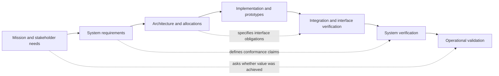

# Chapter 2 — A life cycle is a strategy for acquiring evidence

*Companion to EN.645.662, Week 2: life cycles, the systems-engineering engine, tailoring, and reviews.*

## The tempting calendar

The shuttle pilot has an opening date. A manager proposes a neat plan: requirements in January, design in February, implementation in March, testing in April, and opening in May. The plan has a persuasive simplicity. Yet an unproven dispatch algorithm, uncertain accessibility operations, and a new vehicle interface could make its neatness dangerous. If evidence of failure appears in April, the program may have no remaining capacity to reconsider the basic concept.

A life cycle is not merely a sequence of labels on a chart. It is an approach to **deciding what must be learned, built, reviewed, and controlled before the next irreversible commitment**. A good plan connects uncertainty and consequences to decision points. It allows iteration without permitting every decision to remain permanently unsettled.

## 2.1 Distinguish stages, processes, models, and baselines

A **stage** describes where the system is in its existence: concept exploration, development, integration, deployment, operation, sustainment, or retirement. A **life-cycle model** describes the intended pattern of progress and feedback among stages. A **systems-engineering process** is an activity such as stakeholder analysis, architecture definition, verification, or configuration management; it may recur in several stages. A **baseline** is an approved and controlled reference point for future change and evaluation. A **technical review** is a decision activity that examines evidence against defined criteria. These are different ideas, even though project plans often blur them.

For instance, technical requirements definition is not performed once and forever in a “requirements phase.” A new operational hazard can trigger additional requirements during integration. The result must pass the appropriate change control because it alters an approved baseline, but refusing all feedback would make the process brittle. Conversely, calling the project “agile” cannot justify ignoring interface control or independent safety review.

The traditional V-model is valuable as a **reasoning correspondence**: needs and requirements defined on the left are linked to progressively appropriate integration, verification, and validation activities on the right. It is not a claim that the organization must wait to plan tests until after design. In fact, testability should influence requirements from the beginning.

## 2.2 Compare patterns by the uncertainties they control

A **sequential** model stabilizes commitments and executes them in a more ordered progression. It can be efficient where interfaces are known, uncertainty is low, and changes are costly. It becomes risky if core assumptions remain untested until late stages.

An **incremental** model delivers an evolving capability in controlled slices. A first increment might provide supervised shuttle service on one route before adding further stops. An increment must still have an explicit operating domain and acceptance evidence; a partial system does not deserve weaker safety reasoning simply because it is smaller.

An **evolutionary** model learns from use and repeatedly revises architecture or functionality. That is useful where stakeholder behavior is uncertain, but can create uncontrolled architectural drift unless baselines, interfaces, and evidence are maintained.

A **spiral** model emphasizes recurring risk analysis and prototyping before commitment. A team identifies the largest uncertainty, chooses an experiment, reduces uncertainty, evaluates the result, and plans the next cycle. It is especially appropriate when one unresolved assumption could invalidate the proposed system concept.

**Agile-compatible systems engineering** uses shorter feedback loops and frequent integration while preserving engineering discipline. “Fast learning” and “fast deployment” are not synonyms. An experimental feature may be deployable to a restricted simulator long before it is appropriate for passengers.

The choice is not a popularity contest. Instead ask: What is uncertain? How costly is a wrong assumption? How quickly can evidence arrive? Which interfaces need stable contracts? Which obligations demand independent review? What can be learned with a prototype rather than a full commitment?

## 2.3 Tailoring is a controlled decision, not a deletion exercise

Tailoring modifies how much process, evidence, and formality are used for a particular project. A small, low-risk prototype may justify a brief architecture memo instead of a hundred-page document. But “small project” does not eliminate the need to establish what the prototype is allowed to do, who can operate it, and what failures it may induce.

Consider four shuttle uncertainties:

| Uncertainty | Consequence if wrong | Early evidence activity | Resulting control |
|---|---|---|---|
| Campus map coverage | Route unusable in some areas | Survey and route walkthrough | Operating-domain baseline |
| Booking/vehicle interface | Requests lost or duplicated | Contract tests with mocked messages | Interface version and regression tests |
| Accessible boarding | Exclusion or unsafe boarding | Representative scenario and mockup evaluation | Accessibility criteria and independent review |
| Peak demand | Excessive waiting or cancellation | Queue model and synthetic demand experiments | Capacity assumptions and monitoring plan |

For this case, an iterative concept-and-prototype strategy can coexist with formal entry and exit gates. Prototype dispatch in a sandbox, review the model assumptions, integrate one vehicle under supervision, then expand operating conditions only when evidence supports the expansion. Tailoring should be recorded with its rationale and residual risks.

## 2.4 Why reviews need questions, evidence, and authority

A review meeting is not a slideshow performance. A **decision review** should ask a specific question: “Is the stakeholder-need baseline sufficiently mature to proceed with preliminary architecture?” or “Does the integrated system have adequate evidence to operate within the proposed domain?”

Every review needs **entry criteria** (what materials and conditions must be present), **evaluation criteria** (what makes evidence acceptable), **possible decisions** (proceed, proceed with conditions, revise, stop), and **exit actions** (owners, due dates, verification of closure). A review that records only “approved” without the configuration considered or findings addressed does not preserve an engineering decision.

A requirement can be technically detailed but unjustified; a prototype can work in a lab but not under representative demand; a hazard can be listed but lack an effective mitigation. An effective board makes gaps visible and resists substituting activity count for readiness.

For the shuttle, imagine a Preliminary Concept Review where the board receives three architecture alternatives and a cost estimate but no degraded communications scenario. The board should not declare the concept mature solely because all expected slides are present. It can issue a conditional decision requiring a controlled interface model and test plan before architecture commitment.

## 2.5 Iteration, recursion, and technical debt

**Iteration** means repeating an activity to improve an artifact or resolve uncertainty. **Recursion** means applying the same engineering reasoning to different system levels: the overall shuttle service needs a lifecycle and requirements; its dispatch subsystem also needs requirements, architecture, interfaces, and evidence. Neither term means starting from nothing every time.

Iteration can be economical when cheap evidence arrives early. For example, a one-day interface simulation may reveal that the dispatch protocol cannot tolerate retries. Correcting the protocol before purchasing hardware could save months. But repeated changes without configuration discipline become technical debt: stakeholders no longer know which version of the requirement, architecture, test, or software is authoritative.

A practical control is to maintain a minimal **decision-and-evidence ledger**. For each consequential decision record the alternatives, supporting evidence, assumptions, approver, approved artifact versions, open findings, and expected reconsideration trigger. A later change should identify the impacted links rather than silently overwrite history.

### Why a life cycle is an epistemic strategy

A life cycle is often drawn as a sequence of boxes, but its deeper purpose is to **change what the organization can know** before a decision becomes expensive to reverse. Early in a program, uncertainty is mostly about the problem: whose needs matter, which operating conditions are credible, and whether a proposed capability would be useful. Later, uncertainty concerns embodiment: whether a selected architecture can be manufactured, integrated, sustained, and shown to meet its claims. Moving from concept to design without reducing the first kind of uncertainty can produce an exquisitely engineered solution to the wrong problem.

This distinction explains why iterative and sequential life cycles are not opposite philosophies. A sequential review can protect an expensive interface commitment; an iteration can cheaply test an uncertain operational assumption. The correct cadence depends on the *cost of learning later*. A flight-test article, a software mock-up, and a stakeholder simulation retire different uncertainties. A review should therefore ask what was unknown, what was learned, which claims remain conditional, and why the next commitment is now justified. Passing a calendar milestone alone is not evidence of maturation.

## Deeper theory: life cycles as the economics of learning

A development life cycle is often drawn as a succession of boxes, but that picture leaves out the most important feature: each box changes what the team knows and what it has already committed. Consider two uncertainties about the campus shuttle. The first concerns whether riders will accept an unfamiliar boarding arrangement; the second concerns whether the chosen battery can deliver the required duty cycle. The former may be explored with a mock boarding area at modest cost. The latter may require a representative powertrain test. A schedule that defers both questions to an end-of-project acceptance test treats them as though they have the same cost of learning. They do not. A life-cycle strategy should order investigations by the cost of acquiring evidence, the consequences of being wrong, and the increasing cost of changing the system after decisions become embedded in interfaces and contracts.

The useful theoretical idea is **sequential decision-making under uncertainty**. At any point the team has a state of knowledge, a set of available actions, and a distribution of possible outcomes. Building a prototype is an action because it changes that state of knowledge; authorizing procurement is another action because it restricts future alternatives. A conceptual decision can therefore be described by the expected future loss associated with committing now versus the cost of learning before committing. The *value of information* is not the value of data in isolation: it is the reduction in expected loss achievable **because a different decision might be made**. If a test cannot influence any relevant choice, its decision value may be small even when its measurements are accurate.

Suppose Northstar must select between a familiar dispatch interface costing 120 units and a novel interface costing 90 units if it works but causing 100 units of rework if it fails. The novel design has a hypothetical 30% failure probability. Its expected cost without further information is \(90+0.30(100)=120\) units, so cost alone makes the two options appear equivalent. If a representative early experiment costing 6 units can perfectly distinguish the success and failure cases, it changes the decision: select the novel option on success and the familiar one on failure. The resulting expected cost is \(6+0.70(90)+0.30(120)=105\) units. The numerical result is illustrative, but the reasoning is general: **the value lies in preserving an alternative until evidence arrives**. An imperfect experiment would require conditioning the decision on false positives and false negatives rather than assuming perfect discrimination.

### Why review gates are not mere calendar milestones

A credible gate has four parts: a proposed claim, evidence that is relevant to the claim, a decision rule, and an authority able to accept or reject the remaining risk. Passing a preliminary design review does not mean that every requirement is verified. It means that a particular level of design maturity, interface definition, technical feasibility, and open-risk control is sufficient for the next commitment. A gate without an explicit rejection condition is ceremonial. Conversely, a gate that requires production-level certainty before any prototype can be built creates a logical deadlock: the required evidence cannot be acquired without authorizing some work.

This distinction explains **iteration** and **recursion**. Iteration repeats an analysis or design activity as new evidence arrives; recursion applies the same reasoning at different levels, such as a vehicle subsystem and the regional service. Neither implies absence of discipline. Effective iteration records what was believed, what evidence changed it, and which baselines were superseded. An unrecorded change can make a later successful test uninterpretable because no one can identify the exact design tested.

### Tailoring without erasing assurance

A shuttle pilot and a nationwide transport system should not have identical documentation burdens, yet both need defensible evidence for high-consequence claims. Tailoring asks which artifacts and reviews are **necessary to control the system's distinctive uncertainties**. It does not ask which controls can be removed to make the schedule attractive. A rapidly changing software interface may justify frequent incremental integration tests, while a novel braking mechanism may justify dedicated physical qualification even in a highly iterative program. The relevant unit of planning is often a risk-reduction thread that cuts across nominal phases.

A useful mental model is a declining set of alternatives. Early work should keep feasible options open where uncertainty is high. Evidence should progressively narrow the set. Late changes are costly not because change is intrinsically bad, but because choices have accumulated in procurement, test facilities, safety arguments, people, and software dependencies. The life cycle is an architecture of commitments: it should make irreversible moves **after**, not before, the evidence that makes them rational.

## 2.6 Worked example: construct a risk-directed review sequence

Suppose the pilot has three critical commitments: a campus access approval, delivery of a vehicle interface, and an accessibility demonstration. The team knows the app design well but is uncertain about the vehicle integration behavior. A risk-directed plan should not spend the first month polishing the app while postponing interface testing.

One possible sequence is:

- **Gate 0 — Mission framing:** approve boundary, stakeholders, operating-domain assumptions, and major uncertainties. Evidence: Chapter 1 boundary memo and needs inventory.
- **Gate 1 — Concept feasibility:** show interface contract tests and initial demand simulations. Evidence: contract, reproducible cases, model limitations, and hazard review.
- **Gate 2 — Preliminary architecture:** choose among controlled alternatives with assigned interfaces, basic requirements, integration approach, and testability.
- **Gate 3 — Controlled integration:** demonstrate safe transition of critical state under faults, with configuration-specific evidence and independent findings.
- **Gate 4 — Restricted operational assessment:** evaluate intended-user scenarios under defined conditions. Do not expand the domain without revisiting assumptions and evidence.

This plan is **illustrative**, not a prescribed approval model. Actual operational and safety authority is governed by applicable requirements and institutions. The instructional point is that each gate protects against a particular class of premature commitment.

A useful exercise in sequencing is to ask what changes if a major interface fails the Gate 1 simulation. A rational answer is to revisit the contract or architecture before scaling procurement. “Continue on schedule and fix it during final testing” assumes the risk can be retired later without cost or safety consequences—an assumption that needs evidence.

## 2.7 The review decision as an evidence claim

A review recommendation should be phrased so that another engineer can audit it. Weak: “Design is ready for next phase.” Stronger: “The current dispatch architecture, revision A2, is adequate for constrained integration tests on a closed course because all defined message formats and timeout transitions have passed the test set listed in report T-14, except the open duplicate-after-restart finding; broader operational use is not authorized.”

Notice the explicit **claim, configuration, evidence, exceptions, and boundary**. That structure reappears throughout the knowledge library: requirements, verification, simulation credibility, and technical review are all about defending conditional claims.

## 2.8 Questions with explained answers

**1.** Does the V-model prohibit discovering a new requirement during integration? **No.** It makes the relationship between definition and later evidence visible. A new requirement needs impact analysis and configuration control.

**2.** Is a weekly sprint demonstration equivalent to system validation? **No.** A sprint demonstration can provide selected evidence, but validation asks whether stakeholder needs are met in intended use. It requires representative scenarios and appropriate authority.

**3.** What is the difference between a test and a review? **A test** produces evidence about a specified property under conditions. **A review** weighs that evidence alongside other claims, limitations, and findings to make a decision.

**4.** Why not use the same formal review checklist for every project? Because risk, complexity, uncertainty, and operating consequences differ. Tailoring should preserve the purpose of each control while adjusting its form and effort.

## 2.9 Apply it

Run [Hypothetical Lab 2: The Design-Gate Debate](../labs/lab-02-design-gate.md). Produce the original guide's Week 2 lifecycle-tailoring memo and review plan. If you cannot identify what evidence is needed *before* a commitment, your lifecycle is still just a calendar.

**Previous:** [Chapter 1](01-what-is-the-system.md). **Next:** [Chapter 3 — Needs become operational stories](03-needs-and-conops.md).
