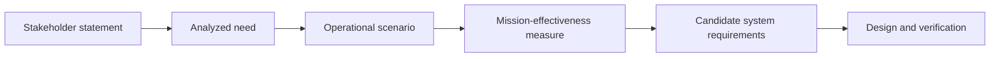

# Chapter 3 — Turn conflicting human needs into an operational concept

*Companion to EN.645.662, Week 3: mission, stakeholders, ConOps, scenarios, MOEs, MOPs, and TPMs.*

## One service, incompatible definitions of success

The campus sponsor asks for an affordable mobility pilot. Students want predictable travel after late classes. Passengers using wheelchairs need equitable boarding and access. Campus safety officers need a credible response to abnormal stops. Maintenance staff want enough time to inspect batteries and brakes. The vehicle supplier wants a stable operating domain. Each stakeholder is describing a real aspect of success, but the statements cannot simply be placed into one list and called “the requirements.”

Systems engineering begins by distinguishing *what people say*, *what they need*, and *what the engineered system will ultimately be required to do*. A student's statement, “The shuttle should always come in five minutes,” may express a legitimate need for predictability, but “always” is likely unachievable and “come” is ambiguous. Asking why the student cares may reveal the underlying need: dependable access to class at a tolerable uncertainty. This is not a license to ignore the original statement; it is a reason to preserve the statement, document the interpretation, and confirm the result with affected parties.

## 3.1 Stakeholders are not just end users

A stakeholder can influence, use, develop, maintain, regulate, fund, support, or be affected by the system across its life cycle. Some never board a vehicle. Dispatch operators, emergency responders, campus facilities, privacy personnel, disabled riders, maintenance technicians, road authorities, local residents, cybersecurity reviewers, and eventual disposal contractors can all matter.

Use a stakeholder register with distinct fields for **role**, **life-cycle involvement**, **expressed concerns**, **authority**, **potential harms**, **source of evidence**, and **unresolved conflicts**. “Student” is not necessarily one homogeneous population: mobility-device users, late-night riders, people without smartphones, and people traveling during peaks may experience different service outcomes. Averages across all riders can conceal inequity in one group.

The engineer's task is not to please everyone by writing contradictory promises. It is to surface conflicts early, understand which are negotiable, and document legitimate decision-making. A sponsor cannot automatically resolve a safety-critical design concern merely by preferring a cheaper alternative; appropriate technical, operational, legal, or safety authorities may have independent roles.

## The mechanism beneath the method

A stakeholder need describes a desired change in lived experience, whereas an operational concept explains how coordinated actors and system functions might produce it.

### Distinguishing related ideas

A scenario is not a requirement: it is a hypothesis that exposes temporal order, exceptional conditions and competing definitions of success.

### Interpretation and boundary conditions

For the shuttle, a faster average trip can coexist with longer waits for passengers needing assistance; scenarios must disclose the population and distribution of outcomes.

## 3.2 Build the chain from mission to need

A **mission statement** explains the effect the service is meant to produce and the population and context of that effect. An illustrative statement is: “Provide predictable, accessible travel between designated campus destinations during approved service hours, within a restricted operating domain.” It does not claim full autonomy or prescribe dispatch software. Those are possible implementation choices, not the basic reason the service exists.

A **stakeholder statement** records the person's original language: “I cannot risk missing an evening examination because a ride vanishes from the app.” A **stakeholder need** synthesizes the value sought: “Riders need dependable confirmation, status, and completion of accepted trips during evening service.” A **system requirement** will later translate that need into an observable obligation, such as defined status transitions and a time-bound response in specific operating conditions.

Consider the trace chain:

These connections are explanatory, not automatically one-to-one. One need can lead to multiple requirements. One requirement can support several needs. An operating scenario can expose missing needs. A traceability graph records these reasons so that a later change does not destroy the explanation of the system's intent.

## 3.3 A ConOps is a story about work in the real world

A **Concept of Operations (ConOps)** describes how actors and the system interact under intended conditions: whom it serves, where, when, by what operational processes, with which constraints, and with what exception handling. It is not a list of software screens. It is also not the detailed technical architecture. It should be understandable to nontechnical stakeholders while being specific enough to reveal engineering obligations.

For the shuttle, consider the following narrative. A rider arrives at a designated stop in light rain, requests a ride without a smartphone through a kiosk, receives an estimated boarding interval, and boards using an accessibility feature. Dispatch notices an unexpected road closure and offers a new route. An operator can inspect and override a proposed service cancellation; the rider receives a readable, audible status update. The service logs the exception and makes alternative transport available if the trip cannot proceed.

This story yields questions that a feature list might conceal. Who has authority to close a route? How does the kiosk authenticate a request without excluding people? How does a passenger know when a vehicle has arrived? What happens when a status message cannot be delivered? Can the operator distinguish a cancelled trip from a delayed one? What must be retained for later review without collecting unnecessary personal information?

A useful scenario record identifies the **actor**, **trigger**, **preconditions**, **operating domain**, **nominal sequence**, **off-nominal branches**, **observable outcome**, **evidence source**, and **unresolved questions**. Model at least nominal, degraded, emergency, and maintenance situations. A happy-path-only ConOps systematically hides precisely the interactions where systems fail.

## 3.4 The distinction among MOE, MOP, and TPM

A **measure of effectiveness (MOE)** concerns how well the mission is achieved in its operational context. A **measure of performance (MOP)** describes an observable property of the system that helps deliver that effect. A **technical performance measure (TPM)** monitors a selected technical characteristic during development against a plan or threshold. Labels can differ across organizations; their *decision purpose* matters more than rigid taxonomy.

Take evening travel. An MOE might be the proportion of requested eligible trips completed within the service promise, counting failures as failures. An MOP might be the 95th-percentile pickup delay during a specified demand profile. A TPM might track dispatch processing latency as software development proceeds. Low latency could be necessary for success without being sufficient: a dispatcher can rapidly reject every request and appear fast while delivering no rides.

Define the population and denominator. Suppose 100 passengers request eligible rides, 80 trips complete, and the remaining 20 are cancelled. If 76 completed trips have pickup waits under 15 minutes, then reporting “95% of served rides were timely” is numerically true because 76/80 = 95%. But only 76/100 = **76% of eligible requests** were both served and timely. The second measure may better reflect the mission. Both figures may be useful if their denominators and definitions are stated, but they support different decisions.

A related statistical warning is that a percentiles-only measure can be misleading when it excludes unserved demand. If the ten longest waits are simply dropped as cancellations, the apparent pickup-time percentile can improve while the service deteriorates. Treat cancellations, exclusions, and unmet demand as separate visible outcomes.

## 3.5 Construct a measure that can be audited

Start with a named **decision**: will the proposed service satisfy evening campus mobility needs? Then specify the *construct* (dependable completed travel); *observable* (eligible request completed within the promised interval); *population* (all eligible requests during defined hours); *time horizon* (e.g., four pilot weeks); *inclusions and exclusions* (with justified rules); *threshold* (derived from stakeholder analysis rather than invented as a permanent promise); *collection method*; and *decision authority*.

One provisional measure is:

> During the approved evening operating domain, the fraction of all eligible ride requests that result in a completed trip within 20 minutes of request acceptance, measured over four consecutive pilot weeks.

The 20-minute threshold is **hypothetical** and requires stakeholder validation, capacity analysis, and safety considerations before becoming a requirement. Reporting should separate accessibility users and service time windows so that aggregated success does not conceal unacceptable differences. That stratification is a design for fair evidence, not a claim that group membership causes any observed difference.

## Deeper theory: operational concepts as a bridge between purposes and mechanisms

Engineering begins with a problem stated in ordinary language, but ordinary language blends facts, preferences, experiences, and proposed solutions. A rider saying “the shuttle should arrive every five minutes” might be reporting long observed waits, anxiety about uncertain arrivals, a desire to avoid missing class, or a belief that fixed-frequency service is the only solution. An engineer who translates the sentence directly into a five-minute headway requirement has silently made two decisions: which concern matters and which architecture should solve it. Stakeholder analysis is therefore not just collecting statements. It is an inference problem in which the analyst seeks the needs, operating conditions, and harms that explain the statements.

A **Concept of Operations (ConOps)** preserves the operational logic before the design is fixed. It describes actors, missions, environments, abnormal situations, authority transitions, and what success looks like from outside the system. A use case such as *request pickup* is narrower: it represents a particular interaction and outcome. A ConOps can include use cases, but it must also make visible the relationships among them. For instance, a canceled trip might alter fleet availability, passenger information, accessibility assistance, and dispatcher workload. Treating it as only a software cancellation action conceals the larger operational behavior.

### Measures belong to different explanatory levels

A **measure of effectiveness (MOE)** asks whether stakeholders get a valuable result in the operational context. A **measure of performance (MOP)** characterizes what an engineered element or service accomplishes. A **technical performance measure (TPM)** tracks design maturity or a critical technical parameter as the design develops. These are not three competing names for the same metric. Consider passenger mobility: the percentage of riders arriving at an essential appointment within a tolerable window is an outcome MOE; on-time pickup percentage is a service MOP; vehicle range margin is a TPM. Better range can improve service availability, but only through an operational chain involving charging, dispatch, routes, staff and demand. A range margin is not evidence that mobility outcomes are equitable.

The causal logic can be written conceptually as \(\text{design capacity}\rightarrow\text{service behavior}\rightarrow\text{stakeholder outcome}\), with context and human action influencing both arrows. This is a **hypothesis**, not an identity. In a shuttle service, increasing fleet capacity may have no effect on missed appointments if the real bottleneck is inaccessible booking or an unreliable pickup notification. The chain must be investigated rather than assumed. This is why a ConOps should include unsuccessful and abnormal scenarios: they reveal the mechanisms connecting technical operation to lived outcomes.

### Operational scenarios make boundaries testable

A useful scenario states initial conditions, triggering event, participating actors, decision rights, sequence of events, and observable ending. Imagine a wheelchair user requests a pickup after a campus event when one vehicle has lost connectivity. The scenario should ask who confirms the reservation, how a stale vehicle location is recognized, when a dispatcher may override the assignment, and what the rider is told if no safe service remains. Each question challenges an implicit boundary. Is dispatch software the system of interest, or is the institutionally delivered mobility service the system? If a dispatcher is essential to successful recovery, excluding that role from operational analysis creates an incomplete design.

Metrics must then specify **denominator, population, observation period, and treatment of missing data**. “95% on-time” could count only completed trips, exclude denied requests, or average away poor service for riders with special needs. An apparently successful service metric can therefore improve while the actual mission deteriorates. An outcome measure should be auditable and difficult to improve by making difficult customers disappear from the dataset. Stratifying by route, operating condition, or access need may expose failures hidden by an aggregate mean, although group comparisons also require attention to sample size and privacy.

### Tradeoffs are partly normative, not only technical

Stakeholder conflicts cannot always be resolved by calculation because they concern different kinds of value. A sponsor prioritizing cost, a safety officer imposing a non-negotiable hazard constraint, and riders prioritizing equitable access are not all supplying interchangeable weights for a score. Some claims are **constraints**: they define what a permissible design must not violate. Others are preferences to be balanced among feasible designs. A weighted score that lets low cost compensate for an unacceptable safety condition is not a neutral engineering solution; it embeds a choice about what may be traded away.

The deeper purpose of operational analysis is to make those choices explicit early. The ConOps should state which needs are independently evidenced, which are provisional interpretations, who has authority to resolve conflicts, and which outcomes the system must demonstrate later. It is an evolving model of the work the system must support—not a marketing narrative and not a disguised architecture specification.

## 3.6 Worked case: conflict resolution without inventing consensus

Imagine five fictional stakeholder interviews:

| Stakeholder | Original statement | Analyzed concern | Potential conflict |
|---|---|---|---|
| Rider | “I need a shuttle every five minutes.” | Reliable, predictable pickup | Fleet budget |
| Accessibility advocate | “Boarding should never require another person's help.” | Independent accessible service | Vehicle and stop design |
| Safety officer | “Stop when uncertainty is high.” | Bounded hazardous behavior | Mission availability |
| Sponsor | “Operate with two vehicles.” | Affordability | Peak capacity and redundancy |
| Operator | “Do not send the vehicle into closed roads.” | Clear operational authority | Dispatch autonomy |

The engineer should not replace these with “The system shall meet all expectations.” Instead, preserve the source statements, create distinct need IDs, map each to scenarios, and record unresolved choices. For instance, a safety stop during sensor uncertainty protects one value but could strand a passenger. The ConOps should describe how that event is handled, communicated, and resolved, not pretend the goals have no tension.

Next, run a *conflict workshop*. Ask stakeholders whether the goals are hard constraints, performance preferences, or design hypotheses. An accessibility requirement may be binding; a proposed two-vehicle limit may be a budget assumption rather than a permanent technical constraint. Record who is authorized to resolve each trade and what evidence remains necessary. A disagreement without disposition is an engineering finding, not a reason to delete the difficult need.

## 3.7 From narrative to scenarios and candidate requirements

Take the scenario of communication loss while a rider is waiting. The rider need is timely, understandable information and a safe route to assistance. Candidate functions include detecting status freshness, declaring degraded service, presenting alternate contact methods, alerting an operator, and logging the event. Candidate requirements might specify message freshness, degraded-state transition, and a minimum operator-notification channel. Those candidate requirements are not yet validated simply because they sound measurable. The relevant stakeholders, operating authority, and failure evidence must inform thresholds and safe-state definitions.

It is important to keep trace **backward** as well as forward. When a requirement is challenged, we should find the source need and scenario that justify it. When an interview reveals a new need, we should locate affected scenarios, measures, requirements, and architecture. A collection of artifacts without this reasoning chain is not a coherent baseline.

## 3.8 Short problems and explained solutions

**A.** The dispatch system assigns 99% of requests in two seconds, but only 60% of requests result in a completed trip. Has the mission succeeded? **Not established.** Dispatch responsiveness is a system performance property; it does not prove the mission outcome. Review completion, wait, cancellation, accessibility, and exception data.

**B.** Is “The service shall be accessible” a stakeholder need or a complete requirement? **Neither classification is safe without context.** It expresses a legitimate intention but is ambiguous; first articulate the concrete needs and scenarios, then develop measurable system obligations under defined conditions.

**C.** Why is the maintenance technician in the stakeholder register? **Because sustainment and safe return-to-service affect availability and risk** across the lifecycle, even though the technician is not a passenger.

**D.** In a sample of 100 eligible requests, 10 are cancelled and 81 of the remaining 90 meet the time target. Calculate (i) timely among served and (ii) timely among requested. **Answers:** 81/90 = 90%; 81/100 = 81%. These estimate different performance constructs.

## 3.9 Apply the chapter

Run [Hypothetical Lab 3: The Stakeholder Hearing](../labs/lab-03-stakeholder-hearing.md) and produce the original guide's Week 3 `662_W03_NeedsConOps_v1.0` artifact, including at least one degraded scenario and a defensible measurement plan. Do not replace real stakeholder validation with fictional dialogue when preparing a real design.

**Previous:** [Chapter 2](02-lifecycle-evidence.md). **Next:** [Chapter 4 — Requirements as testable contracts](04-requirements.md).

## Step 03 technical studio — turn a stakeholder conflict into testable scenarios

An operational concept is not a list of stakeholder quotations. It is a model of how an intended capability behaves in particular settings, including failures, human decisions, and interactions across the boundary. For Northstar, use three invented stakeholder needs from the [controlled case](../case/northstar-reference-baseline.json): riders need intelligible booking status, dispatchers need timely emergency indications, and operators need accountable vehicle allocations.

### Scenario with an observable end state

**Normal scenario:** at 09:00 a rider requests a trip from one of four designated stops. The dispatch service checks eligibility and availability, reserves a vehicle, and sends a confirmation. The rider either receives a confirmed pickup instruction or an explicit rejection; silent ambiguity is not an acceptable outcome.

**Degraded scenario:** a network partition occurs after the allocation database commits a reservation but before the rider receives confirmation. The rider retries. The design must specify whether the retry is idempotent, whether an old allocation is retained or cancelled, and what the operator sees. A “successful booking” screen does not prove unique allocation. Record this scenario as a separate verification pathway.

**Human scenario:** an operator must decide whether to suspend service when status messages become stale. A dashboard that correctly renders a stale indicator may still fail its mission if the indicator is not understood or if staffing rules make the response impossible. This requires a representative human-in-the-loop evaluation, not solely a software unit test.

### Trace from need to engineering claim

| Need | Candidate requirement | Scenario and evidence |
|---|---|---|
| Understandable booking status | NS-R-01: confirmation within 8 seconds under a *specified workload* | Normal and partition/retry scenarios; end-to-end timestamps |
| Timely emergency awareness | NS-R-02: allocated maximum path budget of 2.5 seconds | Controlled message timing plus loss/staleness injections |
| Accountable allocation | NS-R-03: zero duplicate active allocations in a defined database boundary | Concurrent reservation and restart experiment |

A measurable requirement is not automatically a valid need translation. Ask whether 8 seconds is actually acceptable to representative riders, whether the test workload includes peak demand, and whether the failure response preserves accessibility. Those are **validation** questions distinct from verifying the written requirement.

### Solved critique

A ConOps lists only nominal trips and says “the system shall fail safely.” What is missing? At minimum, failure triggers, the responsible operator, degraded states, notification routes, recovery authority, and an explicit accepted operating domain. Without those, “safely” has no operationally observable meaning. The correct revision is not a longer adjective but an executable or walk-through scenario with decision points.

## Step 03 reference deepening — operational measures require denominators

A stated goal such as “reduce waiting time” does not identify which population, observation window or undesirable outcomes matter. In a teaching approximation, an M/M/1 queue with Poisson arrivals at six requests/hour and exponential service at nine requests/hour has traffic intensity \(\rho=\lambda/\mu=2/3\) and expected **total time in system**

\[
W=\frac{1}{\mu-\lambda}=\frac{1}{3}\text{ hour}=20\text{ minutes}.
\]

This is not automatically the time a rider waits at a curb. It includes the modeled service time and assumes a stable stationary queue with one server, independent arrivals and service times. At arrival rate 8/hour with unchanged capacity 9/hour, the expected total time rises to 60 minutes, showing why average-load performance alone can mask congestion near capacity.

Define a mission measure with a numerator and denominator: e.g. *the fraction of eligible booking attempts during designated service hours that receive an understandable acceptance or rejection within eight seconds*. Record exclusions, inaccessible channels, canceled requests and missing observations. A mean may hide the tail; add the 95th percentile, coverage by accessibility group, and a clear failure-denominator rule. A ConOps should state where staffing, network outages and emergency override change the operating mode.

**Practice:** Does reporting “95% of successful reservations completed within eight seconds” prove the same outcome? **Answer:** no; it conditions the denominator on successful reservations and may omit failed, timed-out or inaccessible attempts. The definition of success is part of the engineering requirement.
