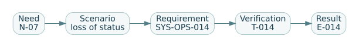

# Chapter 4 — Requirements are promises that must survive a test

*Companion to EN.645.662, Week 4: requirements definition, traceability, quality, verification planning, and change management.*

## The requirement that made everyone happy

A project meeting ends with agreement on a statement: “The shuttle shall provide safe and efficient transportation.” The sponsor likes the promise. The supplier believes it is easy to meet. The safety representative likes the emphasis on safety. Unfortunately, nobody has agreed on what would count as compliance. The words are agreeable because they postpone the difficult questions.

A good systems requirement turns an understood need into a design obligation whose satisfaction can be assessed. It must be *necessary*, stated at the right level, clear about its subject and operating conditions, feasible within the intended context, and supported by a credible verification approach. “Testable” is not a decorative adjective; it asks what observation could lead an independent reviewer to say the requirement passed or failed.

## 4.1 Learn to separate kinds of statement

A **stakeholder need** is a statement about desired value or capability in the world. “Passengers using mobility devices need to board independently” describes value from the rider's perspective. A **system requirement** allocates an obligation to the engineered system. A **derived requirement** emerges through analysis or design decomposition, and should retain rationale. A **design constraint** limits available solutions, perhaps because of an approved interface, regulation, or sponsor decision. An **architecture decision** records the solution selected. A **verification procedure** describes how evidence will be collected; it is not itself a requirement.

Those categories interact. A requirement saying “The vehicle shall use sensor model Q” can be valid as a genuine constraint if a justified interoperability decision mandates it. But when the underlying need is obstacle detection, specifying a sensor model without rationale restricts alternatives prematurely. The answer is not “never specify implementation”: it is “know which decision made it necessary.”

## The mechanism beneath the method

A requirement translates a desired outcome into a constrained and assessable claim, losing information if the measurement context is omitted.

### Distinguishing related ideas

A design decision is not a requirement merely because it is precise; mandating a particular sensor may unnecessarily preclude other ways of satisfying the detection need.

### Interpretation and boundary conditions

Operational range, conditions, exclusions, decision threshold and measurement procedure determine what a passing verification test actually establishes.

## 4.2 Anatomy of a useful requirement

Consider this fictional example:

> **SYS-OPS-014:** For each accepted ride request in the approved operating domain, the dispatch service shall emit a status event identifying either `assigned`, `rejected`, or `degraded` within eight seconds of acceptance for at least 99% of requests under test profile DP-01.

The precise number and profile are teaching assumptions. Yet the statement illustrates important components: **subject** (dispatch service), **trigger** (accepted request), **observable action** (emit status event), **conditions** (domain and test profile), and **criterion** (within eight seconds for 99%). Its metadata should clarify timestamp clocks, measurement tool, accepted load, rounding, event loss, retries, profile revision, exclusions, decision authority, and why eight seconds is mission-appropriate.

Contrast: “The shuttle shall be fast and user-friendly.” There is no defined observable, population, or decision threshold. A supplier could claim compliance based on a demonstration that never involves an actual rider. Rewriting this statement is not just wordsmithing: it requires returning to stakeholders and scenarios to discover what “fast” and “user-friendly” mean and which of those properties matter.

A useful requirement record includes an identifier, text, type, upstream sources, rationale, owner, applicability, criticality, allocation, verification method, planned acceptance rule, status, version, and open assumptions. These attributes become the backbone of traceability and change control.

## 4.3 The difference between requirement verification and requirement validation

**Requirement validation** asks whether a proposed requirement correctly captures a legitimate stakeholder need. We might validate SYS-OPS-014 by asking whether dispatch status latency actually contributes to acceptable service, or whether it confuses fast API response with timely pickup. **System verification** later asks whether the implemented dispatch system satisfies the approved SYS-OPS-014 requirement under the specified conditions. They are not interchangeable.

A measurement can be precise yet irrelevant. Imagine the service returns booking confirmations in 0.1 seconds but strands passengers for forty minutes. The confirmation requirement may pass, but the mobility mission may fail. This distinction is a central reason for maintaining a trace from outcome to need, system obligation, design, test, and evidence.

## 4.4 Write a test before finalizing the sentence

For each candidate requirement, ask an engineer who did not write it to draft a verification approach. If they must invent thresholds, redefine the event, or guess the operating conditions, the requirement probably is not ready. There are four conventional evidence methods: **test** (controlled observation with quantitative or pass/fail criteria), **analysis** (reasoned or computed demonstration from accepted assumptions), **inspection** (examining attributes or records), and **demonstration** (showing a function under defined conditions). Different organizations may classify some methods differently. The key is to choose a method that actually supports the claim.

For SYS-OPS-014, an independent test might generate a documented request profile, record acceptance timestamps and resulting status events, and calculate the fraction meeting the limit. The verification plan should state how lost messages are handled: excluding every unreturned request would bias the result. It should specify the software version, configuration, test environment, time source, offered load, accepted population, and defect disposition. This is much more informative than merely marking “Test” in a spreadsheet.

## 4.5 Traceability is more than a green spreadsheet

A trace link is an explained relationship.

 Need N-07, “Riders require dependable evening booking status,” may lead to SYS-OPS-014 and other requirements for fallback communication, operator escalation, and accessibility. Each requirement may be allocated to multiple elements and tested through several cases. The graph is many-to-many, and its links carry meaning.

An automated audit can check whether every approved requirement has an upstream source and at least one planned verification case. It cannot, by itself, judge whether the test measures the right thing. If SYS-OPS-014 is linked to a test that measures vehicle arrival time, the graph looks complete but the evidence is semantically mismatched.

We can define a crude planned trace coverage fraction:

\[
C_{\mathrm{planned}} = \frac{\#\{\text{approved requirements with a planned verification case}\}}{\#\{\text{approved requirements}\}}.
\]

Suppose 18 of 20 approved requirements have planned cases. Then planned coverage is 90%. That says nothing about whether cases have run, whether they passed, or whether one of the missing cases concerns a catastrophic hazard. Report **coverage, execution status, criticality, and evidence quality separately**. Never treat percentages alone as an assurance argument.

## 4.6 Decompose without losing the reason

A service need for accessible boarding might lead to a high-level requirement on boarding capability, further requirements on physical envelope and user information, and interface requirements between vehicle, stop, and operator. Each decomposition must preserve the underlying mission purpose. If a vehicle-level design meets the ramp deployment requirement but the stops have incompatible curb geometries, the end-to-end boarding need remains unmet.

Requirements should be *singular enough* to have intelligible pass/fail outcomes. “The vehicle shall detect pedestrians and update its display within two seconds” combines two obligations that can fail independently. Sometimes coupled requirements are legitimate, but splitting the observables usually makes allocation and verification clearer.

A requirement can also be too specific. “The system shall use a particular database” might hide an unjustified technology decision. Conversely, broad claims like “The system shall remain operational under all failures” are neither practical nor meaningful. A sound requirement specifies applicable failure cases, safe or degraded behavior, and the acceptance conditions for that behavior.

## Deeper theory — requirements as an operational theory of success

### The hidden model inside a requirement

A requirement looks like a sentence, but underneath it is a small *model of the world*. It identifies an object or actor, a condition in which the claim applies, an observable outcome, a threshold and a method by which somebody could decide whether the threshold was met. If any of these elements is missing, two readers can agree with the sentence while imagining different systems. Consider “The shuttle service shall be available 99% of the time.” One engineer may measure whether the booking API answers requests; a passenger may measure whether a usable accessible ride is actually available. Both can produce a legitimate-looking percentage. The word *available* has hidden the difference between service availability, fleet readiness and successfully delivered mobility.

A more defensible requirement has an explicitly scoped population and measurement: “During scheduled service hours, for reservation requests made from an eligible stop to an eligible destination, at least 95% shall receive an offer for an accessible vehicle within five minutes.” This still requires decisions about cancelled requests, network outages, time synchronization and the definition of “offer.” The purpose of refinement is not grammatical perfection; it is to align engineering effort with the operational phenomenon that matters. The same discipline applies to safety: “shall be safe” cannot be verified until the relevant hazards, operational conditions and tolerable risk criteria have been defined.

### Operationalization and construct validity

A *construct* is an idea we care about, such as accessibility, safety, trust or service quality. An *operational measure* is how we make that idea observable. The distinction matters because a measure can be highly repeatable but measure the wrong thing. Recording booking confirmations is an excellent way to measure booking-confirmation rate. It is a poor substitute for completed accessible journeys when vehicles routinely fail to arrive. Improving the proxy can then make reports look better without improving the mission. This is a form of metric substitution: the team optimizes what the instrument observes instead of what the stakeholder needs.

When translating a need into requirements, move through a chain: stakeholder consequence → operational scenario → system behavior → observable evidence. Each translation is an inference that needs justification. For the shuttle, the stakeholder consequence may be “people with limited mobility can reliably reach a campus clinic.” A scenario identifies the rider, booking channel, origin, destination and time window. Behaviors include accepting a request, assigning a suitable vehicle, confirming boarding and completing the trip. Measures may include denied-trip rate, wait time, missed appointments and successful completion. No single number covers the complete construct; a small set of complementary measures is usually safer.

### Quantifiers, populations and statistical claims

The logical structure of a requirement affects its verification burden. “Every accepted request is eventually resolved” is a universal behavioral claim. “At least 95% of accepted requests are resolved within ten minutes” is a population-frequency claim. The first invites exhaustive state exploration or invariant-based reasoning under an explicit model. The second calls for sampling, measurement and statistical inference. “The vehicle stops within two meters when the emergency stop is activated” is a conditional physical-performance claim requiring specified speeds, surfaces, payloads and measurement tolerances. These are not interchangeable verification problems.

Suppose 100 representative requests have no late responses. The observed success rate is 100%, but the result does **not** establish that the true late-response probability is zero. Under independent, identically distributed Bernoulli trials with a fixed late-response probability \(p\), the probability of observing zero late responses is \((1-p)^n\). Solving \((1-p_U)^n=0.05\) gives a one-sided 95% upper confidence bound:

\[
p_U=1-0.05^{1/n}.
\]

With \(n=100\), this is about 2.95%. The experiment supports a bound on the assumed *trial population*, not a claim about every storm, wireless dead zone or accessibility scenario. Repeated rides on one sunny route may have a sample size of 100 but an effective diversity far smaller than 100. The statistical mathematics can be flawless while the operational claim remains weak.

### Derivation, allocation and proof obligations

A system requirement may give rise to component requirements, but decomposition is not copying a system threshold into smaller sentences. If an end-to-end response must take no more than five seconds, then communications, dispatch computation, queue delay and operator handoff all consume pieces of the same timing budget. An allocation could reserve 0.5 seconds for transmission, 1 second for processing, 2 seconds for waiting and 1.5 seconds for human intervention. Such a budget is initially a hypothesis about architecture. It becomes defensible when the terms are measured or bounded under a coherent operational scenario. A component's successful unit test is evidence for one allocation, not direct proof that all end-to-end behavior meets the system requirement.

Traceability is valuable because it preserves the reasoning chain, but the existence of an arrow from need to requirement to test does not establish validity. Ask whether the requirement genuinely captures the need, whether the design implements the stated behavior, whether the test interrogates the relevant configuration, and whether its conditions represent the claimed operating domain. Each arrow has its own meaning and evidence obligations. A requirements baseline is therefore a controlled theory of what success means—not merely a list of sentences frozen for convenience.

### Why this matters at design reviews

At a review, the strongest question is not “Have all requirements been written?” but “If every listed requirement were satisfied, would the mission likely succeed, and what important failure could still escape?” This exposes missing boundary conditions, harmful interactions between requirements and metrics that incentivize the wrong behavior. Requirements maturity is an argument about fitness for purpose and testability, not document completion. It is possible to have a perfectly testable requirement that is irrelevant to stakeholder outcomes; such a requirement can waste enormous engineering effort precisely because it is easy to certify.

## 4.7 Worked numerical example: what does a 99% requirement mean?

Suppose a test observes 1,000 eligible requests; 992 produce an accepted status event within eight seconds. The observed success fraction is 992/1000 = **99.2%**, and the observed failure fraction is 0.8%. Under a rule requiring the *observed* fraction to be at least 99%, this fixture passes: 992 successes are at least the required 990.

But it does not follow that the true long-run success probability is at least 99% with high confidence. Even with independent, representative trials, the statistical uncertainty in a finite sample matters. Using a one-sided 95% Wilson lower confidence bound for 992 successes out of 1,000 yields approximately **98.59%**, below 99%. That is a different acceptance criterion. The team must agree in advance whether the requirement specifies an observed sample threshold, a confidence-supported reliability claim, or something else. Repeated tests from one deterministic simulation are not independent field observations.

The example teaches two lessons. First, an apparently numerical requirement may still lack a statistical decision rule. Second, a threshold borrowed from a meeting without stakeholder or safety justification is not automatically a valid requirement. Performance targets are engineering commitments that need rationale.

## 4.8 Change management: the story a changed number must tell

At a later design review, the campus requests status within four seconds rather than eight. A project that edits one cell and marks the task complete has lost configuration control. The changed criterion may affect load tests, software architecture, event monitoring, supplier contracts, operational guidance, risk analyses, and the evidence from the old baseline.

A defensible change record contains the proposed edit, rationale, affected needs, impacted requirements and interfaces, cost and schedule implications, verification updates, risk implications, approving authority, baseline revision, and closure evidence. Existing test results remain valuable historical evidence, but they do not automatically verify a changed criterion or a changed implementation.

This is why the course's requirement baseline is a configuration-controlled engineering artifact—not merely a worksheet of attractive statements.

## 4.9 Practice with solutions

**A. Diagnose:** “The service shall be secure and reliable.” **Answer:** At least two broad characteristics are combined, no operating conditions are specified, threats and failure modes are undefined, and there is no measurable acceptance rule. Decompose via threat scenarios, service continuity needs, and applicable authorities before writing verifiable requirements.

**B. Classify:** “The campus requires compatibility with its existing identity provider.” **Answer:** This is a stakeholder constraint/need. A system requirement may allocate the interoperability behavior to the booking interface, with schema, protocols, failure modes, and test conditions.

**C. Compute:** 37 requirements are approved and 34 have an assigned verification case. **Answer:** Planned case coverage = 34/37 ≈ 91.9%. Identify all three gaps by criticality and do not call the system 91.9% verified.

**D. Evaluate:** A vehicle ramp completes its motion within 30 seconds on a bench. Does that validate independent boarding? **Answer:** No. It may verify a narrow device function. Validation requires intended-user and environmental scenarios, including stop geometry, communication, support, and failure behavior, with suitable safeguards and approvals.

**E. Repair a trace:** A test measures booking API response time, but the linked requirement concerns pickup wait. **Answer:** Correct the evidence mapping or create a relevant test. The data cannot be relabeled as pickup-time evidence.

## 4.10 Apply the chapter

Complete [Hypothetical Lab 4: The Requirements Clinic](../labs/lab-04-requirements-clinic.md). Use its deliberately defective statements to practice diagnosis, then produce the full original Week 4 `662_W04_RequirementsBaseline_v1.0` with sources, candidate requirements, verification methods, and trace links. The actual course guide defines the much larger quantity and assessment gate; the fictional clinic is a worked rehearsal.

**Previous:** [Chapter 3](03-needs-and-conops.md). **Related reference:** [From mission to assurance](../../U/flagships/F01-requirements-to-assurance.md).

## Extended worked problems and lab

Study the [worked problem workshop on evidence applicability and requirements](../practice/trace.md), then complete the [extended laboratory](../practice/lab-trace.md). The exercises are separate from the original assessed coursework.
