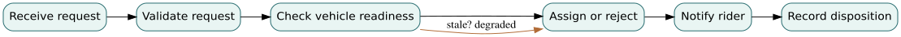

# Chapter 5 — Before the Boxes: Functional Architecture and System Behavior

*EN.645.662 · Week 5. Read after [Chapter 4](04-requirements.md); then perform [Hypothetical Lab 5](../labs/lab-05-functional-architecture.md). This chapter teaches the logic needed for the original course's functional architecture baseline.*

## A vehicle is not a function

Imagine that the Northstar shuttle team begins design by drawing three boxes labeled *shuttle*, *phone app*, and *control center*. The diagram is recognizable, but a question immediately exposes its weakness: who decides that a passenger may board when the network disappears? One designer says the app; another says the vehicle; an operator assumes the control center. A drawing of things has obscured the allocation of responsibilities. Before selecting hardware or assigning work to software teams, we need to understand the **behavior** required to deliver the mission.

A function is a transformation or service expressed independently of a particular implementation: **Receive trip request**, **Assess eligibility**, **Assign mobility resource**, **Inform passenger**, **Authorize boarding**, **Detect unsafe operating condition**, **Enter minimal-risk condition**. The last two functions are as important as the nominal ones. A system that works only when everything else works is incompletely defined.

Functional architecture asks which transformations must occur, what information and control flow between them, which events change the system's state, and which performance constraints must survive their composition. Physical architecture subsequently asks *which elements perform them*. Separating the two is not a demand for absolute technology neutrality. It is a way to postpone irreversible commitments until we understand what the system owes its users.

## 5.1 Derive behavior from a scenario, not from imagination

Begin with a Week 3 operational scenario: a rider requests an accessible trip at 19:10, receives an assignment, reaches the designated stop, boards, and completes the journey. Trace the scenario as events: request submitted → eligibility checked → trip accepted → resource assigned → rider notified → vehicle arrives → safe boarding authorized → trip completed. Each transition implies functions and information. For example, “board safely” implies checking vehicle position, door state, boarding-zone condition, and any required human intervention. These details do not naturally fall out of a simple function tree.

Create three complementary views:

1. **Functional hierarchy:** the parent capability, its child functions, and their purpose. It shows coverage and decomposition, not temporal order.
2. **Behavior/flow view:** events, sequences, decisions, and exchanged data. It reveals races, missing feedback, and timing constraints.
3. **State view:** permitted states and transitions, including guards on transitions. It exposes invalid combinations and how failures should be handled.

For the dispatch function, use states `Received`, `Validated`, `Assigned`, `Rejected`, `Degraded`, and `Closed`. An incoming request may go from `Received` to `Validated` only if the request has a usable identifier and eligibility data. It may go from `Validated` to `Assigned` if a safe resource is available, or to `Rejected` if service is unavailable. A communications fault may lead to `Degraded`, requiring a defined timeout and human-notification path. The diagram should not allow a request to become `Assigned` twice without an explicit reason, and it must not silently disappear.

## 5.2 Good decomposition has an engineering stopping rule

“Provide transportation” is too broad to estimate, allocate, or verify. “Increment the booking counter” is probably too implementation-specific for an early conceptual baseline. Decompose until the team can identify inputs and outputs, likely owners, critical constraints, relevant hazards, and a plausible verification strategy. That is a purpose-dependent stopping rule, not a magic maximum number of hierarchy levels.

Consider `Manage trip assignment`. Its child functions could be `Validate request`, `Determine feasible vehicles`, `Evaluate dispatch options`, `Commit assignment`, `Publish decision`, and `Record audit event`. A tempting mistake is to use a product name in each function: `Call database`, `Run algorithm X`, `Update mobile widget`. Those are possible *realizations* of functions, not the technology-neutral obligations. They become appropriate later only when the architecture decision is justified.

Use **verb–object** names because they force an engineer to articulate a transformation. “GPS” is a thing; “Estimate vehicle position” is a function. “Control center” is an organizational element; “Authorize remote intervention” is a function. When the function cannot be named without its product, try asking what externally observable service that product provides.

## 5.3 Flow dictionaries make arrows meaningful

Suppose a drawing has an arrow from `Commit assignment` to `Notify passenger`. Write an explicit flow record rather than leaving the arrow unlabeled: `AssignmentDecision` includes request ID, vehicle ID or rejection code, effective time, version, and status; the event is emitted within an agreed time budget after acceptance and includes a correlation identifier. State whether it is *data*, *control*, or *physical flow*. Define producer and consumer, units where relevant, error behavior, and how duplicate or late messages are treated.

A second flow might be `VehicleReadiness`, including current location, door status, health indicator, and freshness timestamp. A stale location is not equivalent to an unavailable vehicle, and treating the two as identical could create unsafe dispatch decisions. Define a guard such as “Do not authorize boarding from a readiness report older than the allocated freshness limit.” The limit itself is a proposed requirement requiring analysis and stakeholder approval.

A function model becomes testable when you can pose an adversarial question: *What happens if this flow is absent, late, inconsistent, duplicated, or structurally valid but semantically wrong?* Those are the same questions that later drive interface design and integration tests.

## 5.4 Performance budgets compose across functions

Suppose Northstar proposes that the period from accepting a booking to notifying the rider must be no more than eight seconds under a specified nominal test profile. The team provisionally allocates 0.5 seconds to request intake, 1.0 to validation, 3.0 to assignment computation, 1.0 to committing the decision, 1.0 to notification delivery, and 1.5 seconds to contingency margin. The proposed total is:

\[
T_{\mathrm{budget}}=0.5+1.0+3.0+1.0+1.0+1.5=8.0\ \mathrm{s}.
\]

This is an **engineering budget**, not evidence the real implementation meets it. A sequential sum may be too conservative for overlapping functions, yet dangerously optimistic if queues, retries, or timeouts are ignored. Record which pieces execute in parallel, how the end-to-end measurement starts and stops, and how rare high delays are represented. A 99th-percentile requirement cannot be justified by adding average task times. The relevant performance measure and its acceptance rule must be agreed before treating the allocation as a compliant design.

Allocation may expose contradictions. If a critical decision requires fresh vehicle state but the telemetry interface reports only every ten seconds, a one-second freshness allocation may be physically impossible without changing the concept. That is a valuable result of functional analysis: it exposes questions early, when revisions are relatively cheap.

## 5.5 Trace both directions

Start from each approved operational scenario and show the functions needed to make it succeed. Then start from each critical function and ask which need, hazard control, or requirement justifies its existence. This is a two-way test. A function with no supporting need may be a speculative feature; a need with no supporting function is a potential omission. The exact relationship may be many-to-many: accessible boarding requires several functions, and `Notify passenger` may serve multiple stakeholder needs.

A **trace matrix** is not proof of semantic correctness. A row linking `Enter minimal-risk condition` to a requirement on booking confirmations is technically complete as a database row but conceptually incoherent. Add relation type and rationale, and read a sample of critical traces as an independent reviewer. Also mark unresolved allocations as unresolved; filling blank cells with convenient guesses is not engineering closure.

### Function, behavior, and physical implementation answer different questions

A function states a transformation the system must accomplish; behavior describes how the system evolves and reacts over time; physical architecture identifies elements assigned responsibility for realizing those functions and behaviors. Collapsing these layers makes design alternatives seem artificially narrow. For a mobility service, “authorize a trip” is a function; “pending → accepted → dispatched” is part of its behavioral semantics; a cloud service, depot terminal, or embedded controller is an implementation decision. Different implementations may satisfy the same function yet have sharply different failure modes.

Functional decomposition is not just breaking a noun into smaller nouns. It is an account of **necessary transformations and their dependencies**. A plausible decomposition must explain where information, material, energy, or authority enters and leaves each function, and how exceptional conditions alter the flows. A diagram that cannot represent refusal, cancellation, stale information, or loss of communication may describe a demonstration but not the required service. Maintaining the distinction between logical necessity and physical choice preserves the ability to compare architectures without silently changing the need.

## 5.6 Worked review: the missing recovery path

A model shows `Received → Validated → Assigned → Closed`. What if the resource reports a failure after assignment but before boarding? The model has no legal path back to a dispatch decision, no rider notification obligation, and no operational fallback. We can repair it by introducing `Disrupted` and transitions guarded by `resource_failure`, leading either to `ReassignmentPending` or `Degraded`, plus timed notification and operator escalation. The repair reveals new functions (`Detect disruption`, `Replan service`, `Record reason`, `Notify human`) and likely new requirements. A functional model is valuable not because the drawing looks complete, but because it helps discover such missing obligations.

## 5.7 Practice with explained answers

**A. Classify.** Is “Operate a GPS receiver” a high-level function? **Answer:** Usually not. The need is to estimate position or establish location confidence. A GPS receiver is a possible allocated element.

**B. Compute.** The provisional eight-second budget spends 0.5, 1.0, 3.0, 1.0, and 1.0 seconds on activities. How much margin remains? **Answer:** 1.5 seconds, assuming a purely sequential path with no omitted overhead. You must separately check queueing, retries, and tails.

**C. Critique.** Why is a function hierarchy insufficient to prove safe boarding? **Answer:** It does not express sequence, mutually exclusive states, timing, invalid transitions, or fallback behavior. A state and scenario model are also necessary.

**D. Trace.** The team has five critical rider scenarios; one has no path through the model. Can the model pass the functional baseline review? **Answer:** Not without explicit disposition and reviewer agreement. The missing path may indicate a critical capability gap rather than a paperwork error.

**E. Challenge.** “Vehicle readiness is reported every ten seconds, so our vehicle state is always ten seconds fresh.” **Answer:** False. Transmission may be delayed, messages may be dropped, clocks may disagree, and reporting interval is not an age guarantee.

## Deeper theory: functional decomposition as preservation of mission behavior

### Functions are transformations with observable obligations

A function is not merely a verb in a hierarchy. It is a transformation of information, material, energy, or physical state performed under conditions. To model it rigorously, describe an input domain, a resulting output or state transition, preconditions, postconditions, and the conditions under which the transformation may be refused or degraded. In the mobility example, “authorize boarding” accepts a rider credential, a vehicle identity, current mission rules, and a safety interlock state. Its outcome is not always “door opens.” It may legitimately return authorization denied, service unavailable, or a request for human assistance. Those exceptional outcomes are part of the function's definition, not implementation details to be postponed.

Functional decomposition must **preserve externally required behavior**. If a parent function promises that every accepted journey request is eventually either served or explicitly rejected, its child functions must collectively implement that promise under the stated assumptions. A hierarchy that lists intake, assignment, and notification but lacks expiration handling has lost an obligation. In formal terms, if the parent behavioral relation is `R_parent`, and the composition of allocated child relations is `R_children`, the architect must show that every behavior permitted by the implemented composition is compatible with the parent contract: `R_children ⊆ R_parent` for externally visible traces. This is a refinement claim; a visually complete diagram does not establish it.

### Behavior, timing, and information quality compose imperfectly

A sequence path can be represented by a sum of processing and communication delays, `T_path = Σ T_i`, only when activities are strictly sequential and the measured terms include waiting, contention, retries, and handoffs. Parallel branches instead contribute a maximum along the synchronization path; loops can make the worst-case duration unbounded without a retry policy. A nominal latency budget of eight seconds with six seconds of modeled service time has two seconds of *nominal* margin, not necessarily a 99th-percentile guarantee. If one shared queue has a long tail, it can consume nearly all the margin. The architectural model therefore needs both a topology of functions and a theory of how their timings compose.

Functional outputs also carry evidence quality. A position estimate should include timestamp, frame, uncertainty, and validity status; a stale estimate is not equivalent to a current one just because both are numbers. Treating “location” as an unqualified data token hides a critical interface assumption. The receiving function must know how much age or error it can tolerate, what happens when a confidence bound is exceeded, and who declares an alternative mode. This connects functional architecture to estimation theory, state-machine design, and fault management.

### Observability is a design requirement for verification

A functional architecture should permit an observer to distinguish whether a function was invoked, whether it completed, and whether its effect was accepted by the next function. Instrumentation is not automatically proof: a dispatch log can show that an assignment was issued without proving a vehicle received it. The evidence path requires correlated identifiers, clock semantics, and a definition of completion at the relevant boundary. If two internal failures produce identical observed logs, they are not distinguishable from those logs alone; additional sensing or controlled tests are needed.

For the Northstar service, a reviewable decomposition maps each mission outcome to one or more functional traces, records who owns every interface, and tests exceptional paths such as duplicate bookings, stale position data, loss of connectivity, and an accessibility request. The limiting assumption is that the modeled scenarios cover the hazardous and decision-relevant behaviors. A functional view is necessary for architecture reasoning, but it cannot by itself establish software correctness, human usability, or operational effectiveness.

## Read, rehearse, produce

Use [Hypothetical Lab 5](../labs/lab-05-functional-architecture.md) to repair an intentionally incomplete dispatch model. Then return to **Week 5 in the original EN.645.662 guide** and build `662_W05_FunctionalArchitecture_v1.0` with the full functional hierarchy, three behavioral views, state model, flows, and trace matrices. The lab is practice, not a replacement for the graded artifact.

**Next:** [Chapter 6 — The Functional Baseline Review](06-reviewing-the-functional-baseline.md). **Reference:** [Chapter 4 — Requirements](04-requirements.md).

## Step 03 technical studio — separate function, state, and physical owner

A function expresses a transformation or decision; a state expresses a persistent condition; a component expresses an allocation choice. Conflating them causes requirements to disappear between diagrams. Northstar's **Allocate ride** function consumes a valid request and produces either an exclusive allocation record or an explicit rejection. Its state machine has at least `requested`, `reserved`, `confirmed`, `cancelled`, and `expired` states. An implementation may use several software services, but a functional contract should not depend on their names.

### An invariant across a failed retry

For a given reservation `r`, let `Active(r)` be the set of distinct vehicles currently assigned to it. A fundamental model invariant is

\[
\forall r:\quad |Active(r)|\leq 1.
\]

The critical transition is **reserve**. The precondition is that the request is eligible and has no conflicting active allocation; the postcondition is exactly one committed owner or an explicit failure. Imagine a network timeout after the reservation commits. If the client retries and the server inserts a second active allocation, the user-facing operation may appear successful but the invariant fails. Solve it with an atomic allocation transaction and an idempotency key or equivalent design; do not rely on a read-then-write check that can race.

### Functional decomposition with failure obligations

| Function | Input | Output | Failure/exception |
|---|---|---|---|
| Validate request | Rider, stop, time | Eligibility decision | Denial with reason |
| Assign resource | Validated request, availability | Exclusive owner | Conflict/retry |
| Publish confirmation | Committed allocation | Observable rider message | Delivery unknown; recover/reconcile |
| Supervise status | Timed status stream | Operator indication | Staleness recognized |

### Solved state-model exercise

A design permits `cancelled → confirmed` on any late acknowledgment. Is that necessarily correct? **No.** An acknowledgment sent before cancellation might arrive after it. Without revision or event-order semantics, the late message can resurrect a cancelled request. Require the acknowledgment to reference a current reservation version, and reject obsolete state transitions. The precise solution depends on authority and ordering rules, which should be documented as part of the behavioral contract.

## Step 03 reference deepening — specify behaviors as invariants and transitions

Functional decomposition answers **what must occur**, but the system's correctness also depends on the order in which actions are allowed. For Northstar reservation ownership, define states `unassigned`, `held(vehicle_id)`, and `released`. An invariant is that each active reservation has at most one active vehicle owner. A create/hold transition must be atomic: checking “no owner” and assigning one later permits competing dispatch requests to pass the same check before either commits.

A minimal transition contract is: `hold(r,v)` succeeds only if `owner(r)=none`; on success the owner becomes `v`, and on failure it remains unchanged. Repeated identical commands should not produce a second allocation; an idempotency token can distinguish a retry from a new request. To implement the atomic condition in a database, use an appropriate transaction or unique constraint rather than relying solely on a flowchart.

The consequence is a cross-view check. The functional view must include “reject conflicting allocation”; the interface view must carry a reservation identifier; the physical view must identify the authoritative storage/commit point; and verification must deliberately test simultaneous requests plus retry behavior. A neat decomposition missing any of those links is not yet a credible behavior model.

**Practice with solution:** Two workers both read `owner=none` then both write different owners. What failed? The **atomicity of the precondition-plus-update**, not the logical statement of the invariant. Add a test that starts concurrent allocations against the same reservation and checks one successful commit, one rejected conflict, and the final single owner.
