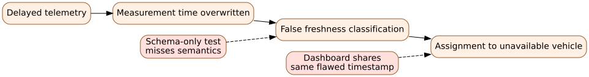

# Chapter 10 — Failures Travel Through Interfaces and Organizations

*EN.645.662 · Week 10. Builds on controlled architecture and management reasoning from [Chapter 9](09-managing-the-technical-baseline.md). Apply the reasoning in [Hypothetical Lab 10](../labs/lab-10-red-team.md).*

## Why blaming the last person is not failure analysis

Northstar operates a simulated passenger service. A dispatch algorithm assigns a vehicle that is actually unavailable. The operator later approves the trip despite a telemetry warning. The visible incident is an incorrect assignment, and the final human action seems easy to blame. But this description hides the architecture and organizational factors that made the action possible: ambiguous timestamp semantics, a readiness interface that used receipt time instead of measurement time, suppressed alerts during high load, and a review board that accepted test results from an unrepresentative ideal network.

Complex failures propagate through **interfaces, assumptions, defenses, and decisions**. Responsible failure analysis seeks mechanisms and failed controls, not a convenient villain. This does not mean individual accountability is irrelevant; it means that changing one person's behavior will not prevent recurrence if the system still encourages or permits the same unsafe outcome.

## 10.1 Separate event, cause, condition, and missing barrier

The **proximate event** may be “an assignment was issued to an unavailable vehicle.” A **causal mechanism** may be “dispatch accepted state whose measurement time was stale.” A **contributing condition** may be “the supplier's interface schema had two fields both called time.” A **failed control** may be “interface acceptance tests checked payload shape but not timestamp semantics.” A **latent organizational condition** may be a schedule incentive that rewarded integration demonstrations while postponing negative testing.

These categories are not mutually exclusive, and an analysis rarely discovers one final root cause that explains every level. Draw a causal map with arrows that mean something specific: `schema ambiguity → incorrect freshness interpretation → invalid assignment`, with additional contributing links from test coverage and anomaly escalation. Ask how evidence supports each arrow. Treat unproven connections as hypotheses.

## The mechanism beneath the method

Failures propagate when shared dependencies, organizational handoffs and hidden modes connect components that seemed independent in isolated tests.

### Distinguishing related ideas

Fault, failure, hazard and loss are different categories: a sensor fault may be harmless under one operating mode and hazardous under another.

### Interpretation and boundary conditions

Analysis should trace triggering conditions and control responses, not merely count defective components or multiply isolated reliability figures.

## 10.2 The hierarchy of defenses

Controls can prevent an initiating event, detect an evolving unsafe condition, limit its consequences, or support recovery. In the fictional Northstar system:

- **Prevention:** enforce a single source-timestamp semantic in the interface contract; reject ambiguous schema revisions.
- **Detection:** compare message age to the approved freshness requirement; flag missing telemetry separately from vehicle unavailability.
- **Limitation:** prevent new trip assignments when confidence in vehicle status is insufficient.
- **Recovery:** notify the operator and rider; log the failed decision path; support safe rescheduling.

A barrier is only as strong as its actual implementation and its dependence on other barriers. If both the dispatch algorithm and the monitoring dashboard use the same incorrect timestamp, they can fail together. Counting two checks as independent would overstate protection. Independence claims require evidence about distinct logic, data sources, and failure modes.

## 10.3 Fault trees and event sequences answer different questions

A **fault tree** begins with an undesired top event and decomposes logical combinations of contributing conditions. For the simplified top event `Unsafe assignment`, suppose a minimal teaching model says it can occur when stale data are accepted **and** the independent operator gate fails. If the events were independent with probabilities 0.05 and 0.10 on a defined demand exposure, the joint illustrative probability would be \(0.05\times0.10=0.005\), or 0.5%. But independence is a strong assumption. A common software-clock defect could affect both checks and make this product misleading. A fault tree is not a source of probabilities by itself.

An **event tree** follows an initiating event forward through successive barriers and outcomes. A telemetry interruption might be detected or undetected; if detected, it might lead to safe fallback or unsuccessful recovery. The branch probabilities must be conditional on preceding events and operating context. Use both methods to structure scenarios; do not turn invented probabilities into a safety certification.

A **failure modes and effects analysis** (FMEA) proceeds from component or function failures to local and higher-level effects, controls, and possible corrective actions. Each method illuminates different questions. No single worksheet guarantees completeness, and safety-relevant projects need suitable formal methods and independent review.

## 10.4 Learn from a real historical case without overfitting it

The course guide asks you to study NASA's Mars Climate Orbiter mishap. The well-known unit inconsistency between an interface output and downstream interpretation is important, but the professional lesson is broader: interfaces need common semantics; analysis processes must detect inconsistent evidence; anomalies must be investigated; and organizational communication must enable corrective action. A weak interpretation says “always check units.” A stronger one asks why the existing review, test, and cross-team communication controls failed to surface the mismatch early enough. For authoritative details, use the original guide's NASA sources rather than treating this fictional shuttle chapter as a historical investigation report.

## 10.5 Red-team the system from multiple roles

Give six reviewers distinct obligations: passenger accessibility, operations, safety, software, interface supplier, and assurance. Each receives the same controlled architecture but examines different assumptions. The accessibility reviewer may ask whether a nominally available shuttle can reach an accessible stop; the operator may ask how false alarms are triaged; the software reviewer may find that duplicate commands can overwrite a safe degraded state; the assurance reviewer may notice that simulation results were generated under assumptions different from the approved operational domain.

A red-team finding should not merely announce a concern. It should identify a scenario, an explicit failure path, violated expectation, evidence for the concern, risk and severity, proposed control, owner, and closure test. Avoid equating “we held a meeting” with completion. The point is to revise the architecture, requirements, interfaces, or tests where the finding shows the original argument is unsound.

## Deeper theory: accidents emerge from interacting control and failure mechanisms

### Failure probability is a model of pathways, not a list of bad parts

An FMEA starts from potential failure modes of elements and traces their local and higher-level effects. A fault tree starts from a defined undesirable top event and reasons backward through combinations of causes. Neither representation is complete by itself: component-centered analysis can miss unsafe interactions between individually functioning elements, while an event tree is useful for propagating an initiating event through success and failure of successive barriers. The direction of reasoning matters. If the top event is “unsafe door opening while the vehicle moves,” the analyst must specify the physical state, operating mode, and boundary; “door failure” is not a sufficiently testable top event.

For a simplified AND gate with two *independent* failures, `P(A ∩ B) = P(A)P(B)`; for an OR gate, `P(A ∪ B) = P(A) + P(B) − P(A ∩ B)`. A common supply fault can defeat both supposedly redundant sensors. Substituting independent probabilities then understates top-event probability. Moreover, a fault tree built from instantaneous states is not automatically a time-dependent reliability model. Exposure duration, maintenance, latent faults, repair, and sequencing must be represented when they change the result. Numbers with many decimals are not evidence of credible independence assumptions.

### Safety also depends on control actions that are wrongly timed

Some losses occur without a component breaking. A healthy dispatch service could instruct boarding before a roadside attendant confirms a clear zone; a healthy controller could issue a correct command using stale location data. Control-oriented hazard analysis asks whether a required control action was omitted, an unsafe action provided, a valid action issued too early or late, or a command sustained for an unsafe duration. That broader lens supplements component failure analysis. Represent the controlled process, controller's beliefs about its state, feedback delays, and constraints on authority. A controller can be internally consistent while its process model is wrong.

Consider two barriers: an onboard interlock preventing motion with an open door and a remote supervisory check. Independence cannot be inferred from different labels if both rely on the same door-status message. Safety architecture should distinguish prevention, detection, containment, recovery, and consequence mitigation. A diagnostic that reports a fault but cannot force a safe response is not a preventive barrier. Likewise, a warning dependent on the very network that fails in the initiating event provides little protection during loss of connectivity.

### Defense in depth is an argument about conditional failure

Suppose an unsafe command has probability `p` per relevant exposure and an independent protective interlock fails on demand with probability `q`. The illustrative joint probability `pq` is valid only if the independence and exposure definitions hold. If both failures respond to a common software update, the conditional probability `P(interlock failure | unsafe command)` may be far larger than `q`. Safety analysis therefore asks not only how many barriers exist, but what makes them *diverse*, how each is tested, whether faults can remain latent, and how adverse conditions can disable several simultaneously.

Human intervention is also a dynamic control, not a generic “operator will notice” barrier. It requires detectable cues, time to diagnose, a practicable action, training, and authority. If the time between hazard onset and irreversible consequence is two seconds, an unquantified manual rescue cannot credibly close the argument. Northstar's corrective action should name the hazard causal pathway, change the control constraint or architecture, and specify what evidence would show that pathway is interrupted. Residual risk remains tied to operational context; no count of completed checklist items makes a system intrinsically safe.

## 10.6 Worked corrective-action example

Finding: “Dispatch accepts telemetry that includes a receipt time but not a trusted measurement time. During network delay, the system may wrongly treat old vehicle status as current.” Immediate **corrective action**: stop accepting ambiguous payloads for safety-relevant assignments, revise interface validation, and audit current test cases. **Preventive action**: add unit/semantics review to all interface changes, establish contract tests for delayed and reordered events, and require independent review of time-sensitive safety controls. **Closure evidence**: controlled schema revision, implemented checks, tests of 4.9/5.0/5.1-second boundary cases under stated clock rules, and confirmation that degraded operation is defined. Merely changing a requirement sentence does not close the failure path.

## 10.7 Practice with explanations

**A. Distinguish.** What is the difference between the initiating failure and a failed barrier? **Answer:** The first starts or contributes to the sequence; the second was intended to prevent, detect, limit, or recover from it but did not do so.

**B. Compute.** Two independent modeled barrier-failure events have probabilities 0.05 and 0.10. **Answer:** Their conjunction has probability 0.005, but that result depends on independence and a consistent exposure definition.

**C. Critique.** “The operator clicked the wrong button, so retrain operators.” **Answer:** Incomplete. Investigate interface design, procedures, alarm meaning, authority, workload, and why the action could have a hazardous consequence.

**D. Verify.** Is a passing schema validator enough to prove timestamp freshness? **Answer:** No. Semantics, epoch, clock discipline, delay, reorder, missing data, and accepted fallback behavior must be addressed.

**E. Close.** What demonstrates corrective-action closure? **Answer:** A configuration-controlled change and evidence that the identified failure mechanism is now prevented, detected, or managed under stated conditions.

## Read, rehearse, produce

Perform [Hypothetical Lab 10](../labs/lab-10-red-team.md). Then complete the original Week 10 `662_W10_FailureRedTeam_v1.0` with a multi-causal failure analysis, a red-team review from distinct roles, and revisions to at least three artifacts. The fictional exercise is preparatory and is not a substitute for studying the required NASA investigation.

**Next:** [Chapter 11 — Realization and verification](11-realization-and-evidence.md).

## Phase 4 technical reading: Causal paths and common-cause failure

In a release review, define the unacceptable loss first, then the hazardous system state, the unsafe control action, the allocated preventive constraints, and the evidence for those constraints. For a small example, an unsafe-open command occurs when \(C\lor(A\land B)\): an assumed shared bypass event \(C\), or an erroneous command \(A\) together with failed interlock \(B\). Under invented independent event probabilities of 0.003, 0.02 and 0.01, the modeled demand probability is 0.0031994. Treating redundant defenses as independent and omitting the common-cause event yields only 0.0002. The discrepancy is a mechanism to inspect, not an estimate of real accident frequency. The [complete fault-tree and assurance chapter](../../methods/safety-fault-trees-and-assurance.md) derives minimal cut sets, sensitivity, limitations and evidence defeaters; the [integrated case](../../methods/campus-mobility-engineering-case.md) carries the control into an engineering baseline.

## Step 03 technical studio — why redundancy fails under shared causes

The Northstar reference case includes a **synthetic**, per-demand failure model with a common-cause event `C` and two nominally redundant channels `A` and `B`. Let `P(C)=0.003`, `P(A|not C)=0.01`, and `P(B|not C)=0.02`, and assume the channels are conditionally independent when the common cause is absent. A top-event model is

\[
T=C\ \cup\ (\neg C\cap A\cap B),
\qquad
P(T)=P(C)+[1-P(C)]P(A\mid\neg C)P(B\mid\neg C).
\]

The numerical result is `0.003 + 0.997(0.01)(0.02) = 0.0031994` per demand. A naive independent-only calculation reports 0.0002, understating the top-event probability by almost a factor of 16 under **this specific assumed model**. Redundancy helps only when its channels do not fail together under the hazards that matter.

### Turn the fault model into a control and verification argument

A fault tree identifies causal combinations but does not show that proposed controls actually work. Candidate controls might include independent power, dissimilar status paths, watchdogs, operational fallback, and operator procedures. For each control, state the **hazard mechanism**, **control claim**, **verification method**, **configuration**, and **residual uncertainty**. A quantitative probability derived from invented inputs is not a safety acceptance argument.

### Solved hazard-review exercise

If a common-cause rate is reduced to 0.001 while conditional channel probabilities stay unchanged, the top event becomes `0.001 + 0.999(0.0002) = 0.0011998`. The top-event reduction is 0.0019996 per demand under the model. Does this demonstrate achieved risk reduction? **No.** The new common-cause parameter requires empirical or justified engineering evidence, and the fault tree may omit dependencies, maintenance errors, or operational contexts. A lower input number is a *scenario*, not a verified control.

## Step 03 reference deepening — sensitivity reveals where assurance effort matters

For a synthetic redundant status path, assume a common-cause failure probability \(q=0.003\) per demand and independent channel failures of \(p_A=0.01\) and \(p_B=0.02\), *conditional on the common cause not occurring*. The top-event probability is

\[
P(T)=q+(1-q)p_Ap_B=0.003+0.997(0.0002)=0.0031994.
\]

If the shared cause were ignored, the model would estimate 0.0002, understating the hypothetical probability by almost a factor of 16. The model is a **demonstration of sensitivity**, not an observed field failure probability. Its partial derivatives are \(\partial P/\partial q=1-p_Ap_B=0.9998\) and \(\partial P/\partial p_A=(1-q)p_B=0.01994\). Under these assumed parameter values, reducing the common cause is often a more consequential leverage point than a small improvement to channel A alone.

The causal story matters: both channels may share a power supply, corrupted configuration, timing reference or operator procedure. A review should identify plausible common causes and verify claimed independence before crediting redundancy. Fault-tree probability alone cannot prove adequate hazard control; severity, exposure, operational mode, model structure, and real verification evidence determine the acceptance claim.

**Practice:** If common-cause probability is halved to 0.0015, recompute the top-event probability. **Answer:** \(0.0015+0.9985(0.0002)=0.0016997\). State which real design or evidence change would support the assumption that \(q\) is lower; merely changing the spreadsheet input is not a mitigation.
