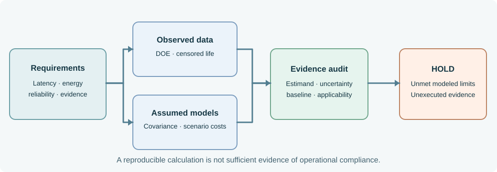

# NS-QA10.1 — Winter Operations Quantitative Evidence Dossier

**Book 10 · EN.645.756 · Controlled baseline QA-B10 · fictional instructional scenario**

This case connects all twelve chapters of *Metrics, Modeling and Simulation for Systems Engineering*. The modeled shuttle controller is under winter operations review. Its quantitative analysis intentionally leads to a **HOLD**, not to an automatically approved release. Every row and probability assumption is synthetic; do not mistake the examples for empirical qualification.



## Controlled artifacts

| File | What it provides | Important limitation |
|---|---|---|
| [requirements.csv](requirements.csv) | Five named technical and evidence requirements | Teaching thresholds, not actual system acceptance criteria |
| [factorial-trials.csv](factorial-trials.csv) | 24 response-time observations in a balanced 2×2 experiment | Designed data, not production-tail data |
| [reliability-life.csv](reliability-life.csv) | Eight life-test modules; three failures, five right-censored | Constant-hazard model requires independent validation |
| [model-assumptions.json](model-assumptions.json) | Units, dependent energy inputs, lifecycle decision costs | Assumed input distribution and scenario likelihood |
| [evidence-register.csv](evidence-register.csv) | Executed, stale and planned records | Test records are synthetic; links do not imply sufficiency |
| [step03_book10_quantitative_check.py](../tools/step03_book10_quantitative_check.py) | Standard-library, reproducible calculations | Checks arithmetic and data shape, not field model validity |

Run from the repository root with:

```bash
python3 SE/K/B10/tools/step03_book10_quantitative_check.py
```

## Decision-related results

| Question | Modeled calculation | Implication |
|---|---|---|
| Controller improvement | Mild effect −50 ms; cold effect −30 ms; interaction +20 ms | Environment changes optimization benefit |
| Cold p95 latency ≤500 ms | Cold optimized **mean** 490 ms; six trials | The p95 compliance claim is **not demonstrated** |
| Fifty-hour module reliability ≥0.95 | \(\hat\lambda=3/2410\) /hour, \(\hat R(50)=0.93966\) | Conditional point estimate below target |
| Winter energy p95 ≤29 kWh | Correlated-normal p95 29.13 kWh | Conditional model violates the limit; validate covariance model |
| Incremental lifecycle cost | A: $68k; B: $78k at p=0.2 | A wins expected-cost screen only if feasible |
| Evidence currency | One record `QA-B9`; one planned study | Release package incomplete |

## How the chapters use this dossier

1. **Measurement strategy:** define estimands and actions before collecting data.
2. **Distribution:** distinguish conditional tails from pooled averages.
3. **Provenance:** document sampling, clocks, baselines, and missingness.
4. **Inference:** distinguish a mean interval from tail compliance.
5. **DOE design:** randomize independent shifts or runs and define blocking.
6. **DOE analysis:** calculate the controller–environment interaction.
7. **Performance models:** fit a saturated model, then test out-of-sample.
8. **Reliability:** write the censored exponential likelihood.
9. **Uncertainty:** propagate correlated energy inputs and compare tails.
10. **Requirements:** calculate margin for the actual required statistic.
11. **Lifecycle choice:** find the cost-switch threshold and information value.
12. **Technical review:** reproduce the calculations, challenge assumptions, and justify HOLD.

## Reproduction and challenge

The model intentionally combines several kinds of evidence. A functioning program establishes reproducible arithmetic, not a valid stochastic representation of a shuttle fleet. Reviewers should substitute alternative correlation assumptions, introduce a long-tail latency observation, correct the stale configuration, and rerun the checker. Each change must be accompanied by an explanation of whether it affects **computation**, **statistical inference**, **model credibility**, or **decision authority**.

[Return to Book 10](../README.html) · [Read the book](../OPEN-BOOK.html) · [Course guide](../../../C/P3/EN645756.html)
