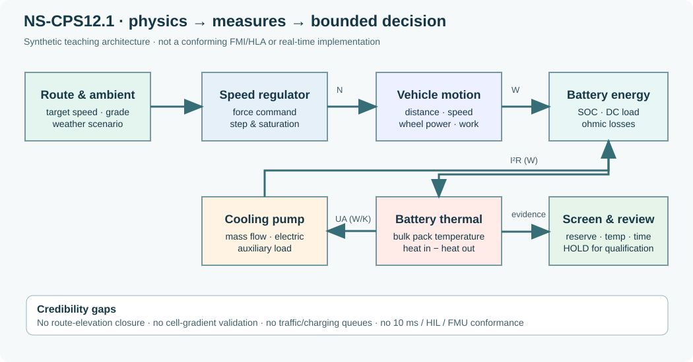

# NS-CPS12.1 — Controlled multi-domain mobility engineering case

*Book 12, Advanced Systems Modeling and Simulation · EN.645.758 · Version 1.0*

[Read the twelve chapters](../OPEN-BOOK.html) · [Course outcomes](../../../C/P3/EN645758.html) · [Book 11 operational simulation](../../B11/case/INDEX.html)

## Intended use and top-level decision

This is a **synthetic single-vehicle screening and teaching model** for mechanical, battery/electrical and thermal coupling. It inherits the campus mobility *context* of Book 11 without inheriting any false claim that its 24 periodic route loops represent measured fleet operations. The present decision is **HOLD for deployment, procurement, cell-temperature qualification, controller/HIL readiness and FMI/HLA interoperability claims**; the model *is* reproducible for a bounded teaching sensitivity comparison.

The full plant [Python source](../tools/step03_book12_coupled_vehicle.py) consumes [controlled inputs](model-inputs.json) and writes [80 experiment rows](experiment-results.csv) plus a [machine-readable summary](summary.json). Inputs use the source course's **2,850 kg curb mass**, with **300 kg assumed passenger load**, **145 kWh usable battery**, **650 V fixed current proxy**, **180 kW motor limit**, and **0.39 m wheel radius**. Each scenario repeats five road segments (total 3.5 km) **24 times** (84 km) using 0.5-second explicit Euler integration. The simulation integrates motion, state of charge and a single bulk pack temperature. It omits tire slip, regenerative pack acceptance, spatial battery gradients, realistic stops, controller sample-rate separation and charging events.



[Open the editable evidence flow diagram](multidomain-evidence.svg).

## How the numerical system works

The motor force request is bounded by \(P_{\mathrm{wheel}}\) limits, after subtracting rolling, grade and aerodynamic road resistance. Electrical consumption includes traction inefficiency, cabin and pump loads and a fixed-voltage estimate of ohmic heat; a first-order lumped thermal state integrates heating and flow-dependent heat transfer to ambient. The simulation computes mechanical, electrical and thermal balance residuals. These are **internal checks**, not validation against real systems.

The route has a **net positive grade-weighted elevation change per period**. Its repetition is an intentionally simple teaching scenario but **not** a valid closed-loop physical route; absolute range and charger scheduling must not be inferred from the 84 km figure. All scenarios start the pack at 31°C; hot soak and cell gradients are not modeled. An assumed `charger_kw=100` is recorded for analytical charging exercises but is **not used as a simulated event**.

## Worked results, regenerated from the controlled baseline

| Scenario | Mean modeled energy used (kWh) | Mean of modeled peak temperature (°C) | Mean ending SOC |
|---|---:|---:|---:|
| Mild (22°C), high flow (0.30 kg/s) | 28.16 | 31.00 | 0.6858 |
| Hot (38°C), low flow (0.05 kg/s) | 32.38 | 41.88 | 0.6567 |
| Hot (38°C), high flow (0.30 kg/s) | 33.36 | 40.98 | 0.6499 |
| Cold (−15°C), high flow | 36.49 | 31.00 | 0.6284 |
| Hot (38°C), low flow, +25% grade sensitivity | 35.14 | 42.07 | 0.6377 |

The high-flow hot case is about **0.90°C cooler** than the low-flow hot case but uses about **0.98 kWh more** battery energy, under the invented pump/heat-transfer formulas. The model shows 16 of 16 bounded parameter draws meet each synthetic algebraic reserve, time and bulk-temperature threshold in each scenario; those passes are **not** a field reliability estimate or a real safety qualification. The average modeled 3.5 km driving repetition takes approximately **6.46 minutes**, explicitly excluding stops, dwell, traffic and queues.

## Reproducing and falsifying claims

From the repository root, use Python 3 with only the standard library:

```bash
python SE/K/B12/tools/step03_book12_coupled_vehicle.py --write
python scripts/check_step03_book12.py
python SE/K/B12/tools/step03_book12_coupled_vehicle.py --laps 1 --dt 1
python SE/K/B12/tools/step03_book12_coupled_vehicle.py --laps 1 --dt 0.25
```

The 1-second versus 0.25-second one-lap teaching convergence gives approximately **1.14516 versus 1.13776 kWh**, respectively; finer steps should be studied at route guard transitions. These values come from the controlled model, not road tests. Run `scripts/check_step03_book12.py` after any source or configuration edit. Both [requirement trace](requirements.csv) and [credibility register](credibility-register.csv) explicitly identify what has not been validated; their `status` fields must not be upgraded merely because a solver completed.

## Interface and review boundaries

The [diagram](multidomain-evidence.svg) separates operational mission, prescribed route, speed regulator, vehicle mechanics, battery storage, thermal state, coolant actuator, requirement checks and independent review. It is an *architectural schematic*: the program uses a monolithic sequential solver, not HLA, FMI, FMU packaging, Simscape, hardware synchronization, or a 10 ms controller implementation. Potential future joint Book 11/Book 12 work must couple a field-calibrated vehicle model to fleet dispatch, traffic, charging, availability and passenger events using explicit timestamps, units and provenance. A reviewer should first correct the route's elevation closure and pack thermal validation before attaching deployment claims.

For coverage, see the [12-week outcome crosswalk](../../../../audit/book12-weekly-outcomes-step03.csv) and [editorial audit](../../../../audit/STEP03-BOOK12-EDITORIAL-AUDIT.md). All costs, physical response curves, route segments, efficiencies, and evidence gaps in this case are teaching constructions.
