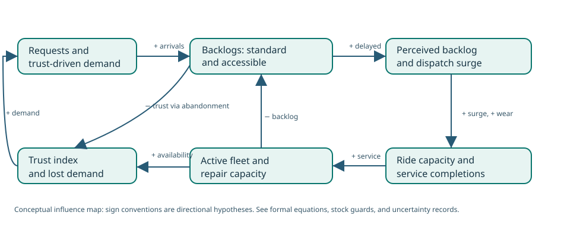

# NS-FB13.1 — Campus mobility feedback and policy laboratory

*Book 13 · EN.645.781 · integrated synthetic policy-learning dossier · coordinated first-pass expansion*

**Engineering question:** Can a campus mobility operator improve long-run demand fulfillment and accessibility by changing the **structure** of service capacity, maintenance, and access allocation rather than reacting only to today’s queue? The model is a compact demonstrator of stock accumulation, reinforcing and balancing feedback, delayed perception, policy trade-offs, and bounded inference. It is not a calibrated university model or operational approval.

[Open Book 13](../OPEN-BOOK.html) · [Original course guide](../../../C/P3/EN645781.html) · [Controlled configuration](model-inputs.json) · [Source code](../tools/step03_book13_feedback.py) · [20 policy/uncertainty results](experiment-results.csv) · [Daily stock trace](status-quo-daily.csv) · [Vensim equation crosswalk](vensim-equation-crosswalk.md) · [Credibility register](credibility-register.csv) · [Editable causal diagram](feedback-structure.svg)



## Inherited evidence and deliberate separation of models

The [original eight-quarter observations](course-quarter-observations.csv) reproduce the synthetic baseline in EN.645.781: requests/day rise from 920 in quarter 1 to 1,370 in quarter 5, while 90th-percentile wait changes from 18.0 to 21.4 minutes, maintenance backlog increases from 24 to 71 vehicle-days, and trust changes from 63 to 61. These observations support a *dynamic question*, **not** a causal estimate or a numerical calibration. A finding about one observed quarter cannot identify the causal direction among demand, staffing, availability, and trust. Do not use the eight-quarter records as if they were time steps from the following daily simulator.

Book 11 has a separate event/queue model about dispatch and individual waits; Book 12 represents different vehicle physics and thermal assumptions. NS-FB13.1 adds a policy-level feedback **representation** at daily-equivalent resolution. Its 14-vehicle synthetic baseline is independent of, and not derived from, either former model's empirical data. None of the three models is cross-calibrated.

## State, units, and numerical integration

Five stocks are advanced by explicit Euler integration at \(\Delta t=0.5\) **day** for 360 days: unavailable fleet \(U\) (vehicles), standard and accessible request backlogs \(B_s,B_a\) (requests), perceived backlog \(P\) (requests), and trust \(T\) (0–100 index). The total fleet \(N=14\) is fixed and active fleet \(A=N-U\) is derived. Request arrivals, completions, abandonment are measured in requests/day; breakdown and repair rates in vehicles/day.

\[
\frac{dB_g}{dt}=a_g-c_g-r_g,\qquad \frac{dU}{dt}=f-m,
\]

for each group \(g\in\{s,a\}\), with \(a\) arrivals, \(c\) realizable completions, \(r\) abandonment, \(f\) breakdowns, and \(m\) repairs. At each numerical step completions and abandonment are capped by the count available from prior backlog plus new arrivals; repair and breakdown rates are similarly stock-constrained. The group reserves are **capacity-allocation rules**: unused reserved capacity is transferable to standard requests and remaining unused capacity can serve accessible demand above the reserved share. They are not predictions of disability-access law compliance. The trust update includes invented response coefficients; the lack of surveys, rider segments, cost accounting, and structural calibration prevents behavioral validation.

The nominal daily demand calculation at time zero is \(1260[0.75+0.25(63/70)]=1,228.5\) requests/day. With \(U=1.9\), active vehicles are \(12.1\), the status-quo surge fraction is \(0.12(310)/(310+380)=0.05391\), and nominal service capacity is \(12.1(93)(1.05391)=1,185.97\) trips/day. The initial accessible reservation is \(0.14(1,185.97)=166.04\) trips/day, less than the \(171.99\) accessible requests/day arriving at the initial trust state. A backlog can thus persist despite many completed rides. These intermediate calculations permit independent checking of the software.

## Controlled results and policy interpretation

The [summary JSON](summary.json) is regenerated from `model-inputs.json` with the checked Python script. These outcomes are a **single 360-day deterministic experiment per policy and condition**, not confidence intervals, forecasts or approval estimates.

| Policy, nominal case | Completion / arrivals | Accessible abandonment / arrivals | Mean active vehicles | Repair cost index |
|---|---:|---:|---:|---:|
| Current capacity and policies | 92.74% | 7.28% | 11.995 | 360 |
| Surge-only overtime | 94.97% | 5.06% | 11.869 | 360 |
| Maintenance-first | 95.73% | 4.31% | 12.709 | 594 |
| Access-priority reservation | 92.57% | 0.014% | 11.993 | 360 |
| Combined maintenance + priority | 95.63% | 0.013% | 12.708 | 594 |

The arbitrary **repair cost index** is a policy-effort surrogate \(360\times\text{repair multiplier}\), *not dollars* or an economic evaluation. The access-priority policy reallocates modeled capacity: it nearly eliminates accessible abandonment under nominal assumptions but raises standard-group abandonment from about 7.28% to 8.66%. The combined policy improves the accessible metric while raising modeled repair effort. No policy is established as preferable to stakeholders without accepted trade-offs and credible input data.

The controlled 20-run experiment grid pairs five policies with four conditions: nominal, demand −8%, demand +8%, and breakdown hazard +20%. **For the status-quo policy**, completion fraction moves from about 97.0% under low demand to **88.7% under high demand**; maintenance-first drops from 95.7% nominal to about 91.8% under high demand. These are structured stresses, not probability distributions. See the [full experiment CSV](experiment-results.csv).

## Supply and human-service transfer demonstrations

[Position-aware inventory trace](inventory-position-aware.csv) and [naive inventory trace](inventory-naive.csv) use the same simplified 35-day demand shock (20 to 28 units/day on day eight) and four-day supply pipeline. The position-aware controller includes outstanding orders when setting its next order; naive ordering ignores that pipeline and overshoots. Max daily orders are 28 vs 100 units in these particular deterministic runs. These traces demonstrate *pipeline awareness*, not universal bullwhip reduction.

[Human-service flow trace](human-service.csv) uses 18 beds, 15 initially occupied, mean modeled stay of six days, and 3.5 arrivals/day. At full occupancy the steady departure capacity is only three clients/day; modeled waiting demand increases to about 13.11 by day 30. Real care systems involve acuity, outcomes, triage, discharge placement, variable stays, service quality and equity; this example is not clinical advice.

## Reproduction and evidence controls

From the repository root, using the Python standard library:

```bash
python3 SE/K/B13/tools/step03_book13_feedback.py --write
python3 scripts/check_step03_book13.py
python3 SE/K/B13/tools/step03_book13_feedback.py --dt 0.25 --policy combined --sensitivity high_demand
```

Changing parameters requires updating [inputs](model-inputs.json), regenerating [results](summary.json), checking [tests](../../../../scripts/check_step03_book13.py) and recording the reason in the review log. The source, reader, and Encyclopedia synchronization is controlled by `scripts/sync_step03_book13.py`, and its release checks are in the GitHub Pages workflow.

## Decision status and key limits

**HOLD for real policy design, safety, accessibility compliance and procurement.** Invariants and deterministic examples can be numerically verified; feedback structure, measurement processes, social response, intervention feasibility, external validity, human consequences, and Vensim parity are not. A real decision requires reliable observational data, transparent governance for rider groups, field-calibrated service and failure processes, and independently reviewed policy ethics. See [requirement trace](requirements.csv), [credibility record](credibility-register.csv), and [Vensim crosswalk](vensim-equation-crosswalk.md).
