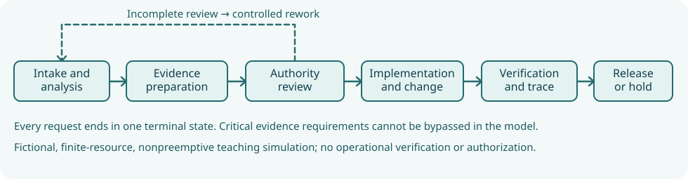

# NS-PI17.1 — Northstar Integrated Change-to-Evidence Improvement Laboratory

**Book 17 · Systems Engineering Process Improvement · EN.645.783**

**Purpose and evidence boundary.** This is a fully synthetic **instructional process-policy screening** case. The course guide describes an earlier 180-day, 96-change evidence baseline, including 14 interviews and an accessibility escape, but that underlying 96-case history is **not** supplied as an auditable detailed event dataset in this repository. The new `synthetic-requests.csv` is independently generated using the explicitly labeled `controlled-inputs.json`; it is not a reconstruction of that historical log. A much smaller *shared Phase 4 sample* at `../../P4-LAB/data/process-events.csv` remains separate and includes one provable example of ordering nonconformance. This case must not be used to claim operational process capability or actual organizational improvement.

## The engineering problem

The change-to-evidence process receives requests spanning requirements, interfaces, suppliers, safety/accessibility, cybersecurity, software and test. It must transmit a request through **analysis → evidence preparation → authority review → implementation → verification**, returning incomplete reviews for revision while preserving historical identity and the right to stop. Northstar's fictional sponsor wants shorter delays without bypassing mandatory evidence, shifting burden to suppliers, or burying difficult cases as "closed." The goal is to teach controlled hypotheses, process measurement, design of experiments, and independent red-team reasoning.



The simulation generates exactly **96 requests** using exponential interarrival intervals with mean parameter **1.8 days**, a class-specific service multiplier, and a correlated item-complexity factor. The realized last submission is approximately **day 154.59**. There are **47 routine**, **23 supplier**, **16 safety/accessibility**, and **10 cybersecurity** cases. Neither arrival distribution nor prevalence is observationally calibrated. Service duration is a bounded triangular factor multiplied by class, complexity and base stage time. This is a pedagogical approximation of a staged workload, not a conforming BPMN interpreter.

## Reproduce the controlled results

From the repository root:

```bash
python3 SE/K/B17/tools/step03_book17_process.py --build
python3 scripts/check_step03_book17.py
```

The Python standard library is sufficient for the model. The site itself runs as static HTML. Files generated by `--build`:

- [`synthetic-requests.csv`](synthetic-requests.csv): stable item identifiers, arrival days, risk classes, complexity, structural evidence obligation.
- [`baseline-event-log.csv`](baseline-event-log.csv): each stage visit, queue arrival, start/end, and revision visit index.
- [`baseline-case-outcomes.csv`](baseline-case-outcomes.csv): all-request end times, holds, revisions and queue waits.
- [`single-run-policy-results.csv`](single-run-policy-results.csv): one controlled-seed candidate comparison.
- [`replication-results.csv`](replication-results.csv) and [`replication-summary.csv`](replication-summary.csv): 24 stochastic replications and normal-approximation intervals conditional on the assumed model.
- [`factorial-results.csv`](factorial-results.csv): 2×2 study, 24 runs per cell, with meeting cadence and base review-rework probability varied while staffing remains fixed.
- [`arrival-stress-results.csv`](arrival-stress-results.csv): same 96 identities with arrivals compressed by 35%; stress frequency is not inferred.
- [`illustrative-pilot-groups.csv`](illustrative-pilot-groups.csv): four deliberately invented DID aggregate means, separate from the model.
- [`shared-lab-event-violations.csv`](shared-lab-event-violations.csv): order-only inspection of the **different** three-case Phase 4 sample.
- [`assurance-and-risk-register.csv`](assurance-and-risk-register.csv): unresolved model, evidence, adoption, governance and release questions.

## Nominal policy evidence (single seed)

| Policy | Released / held | Reworked cases | All-request mean (days) | All-request p90 (days) |
|---|---:|---:|---:|---:|
| Baseline (weekly review) | 94 / 2 | 32 | 182.4153 | 338.7099 |
| Extra reviewer only | 93 / 3 | 29 | 98.1228 | 196.1943 |
| Evidence-readiness + two-day cadence | 96 / 0 | 9 | 18.4819 | 26.6123 |
| Combined with additional resource guardrails | 96 / 0 | 15 | 15.9362 | 24.3184 |

This finite-horizon experiment makes review scheduling and rework visible. Queue capacity is deliberately restrictive in the baseline, so the backlog drains long after the last synthetic request: **the baseline simulation ends approximately day 482.45**. Its 182.4-day mean is not an estimate of Northstar's stated historical 34-day median, and no calibration is asserted.

The *illustrative* screen requires all-request mean ≤28 days, p90 ≤55 days, no held changes and no critical release without a simulated evidence station visit. Only evidence-readiness and combined are nominally eligible. **Do not interpret structural evidence visits as valid safety cases.** The thresholds are pedagogical inputs, not issued organizational requirements.

Under the 35%-compressed interarrival stress, evidence-readiness rises to **35.2614 mean days** (fails the 28-day screen), while combined rises to **21.2886 mean days**. Both are conditional predictions: real adoption, staffing, service distributions, labor calendars, critical-case handling, supplier access, and safety evidence integrity are unvalidated.

## Core engineering mathematics and qualifications

For request \(i\) at station \(s\), \(W_{is}=t_{is}^{start}-t_{is}^{queue}\) is waiting time. With finite request population, **conservation** requires \(N_{arrived}=N_{released}+N_{held}=96\); repeated stage visits do not generate new arrivals. If board meetings occur every seven days with only two modeled slots, its approximate maximum calendar capacity is \(2/7\approx0.286\) reviews/day before revision loops. This is materially below the realized first-pass arrival intensity \(96/154.59\approx0.621\)/day. The comparison is a structural bottleneck diagnosis, **not** an application of a stationary queue theorem to a nonstationary transient.

For the factorial 2×2 screen, 24-run mean lead times are approximately 174.76 (weekly, 0.27 rework), 139.36 (weekly, 0.15), 27.20 (two-day, 0.27), and 23.42 (two-day, 0.15) days. Their difference-in-differences interaction is approximately **+31.62 days**. It is interaction within a simulation, not a causal field estimate. The separate fictional pilot example yields DID \((25-38)-(33-36)=-10\) days, with parallel-trends and contamination assumptions unverified.

### Credibility chain

1. **Purpose:** compare illustrative policy mechanisms, not authorize a deployment.
2. **Inputs:** fixed controlled JSON, reproducible pseudorandom draws, bounded revision cap, and explicit worker/cadence parameters.
3. **Verification:** deterministic reruns, queue-time ordering, state conservation, positive service and staffing inputs, negative-case rejection, and all 12 publication copies.
4. **Validation gaps:** no independent 96-event historical log, real task-duration samples, staff calendars, work-class transition data, intervention implementation evidence, or independent process-assessment audit.
5. **Decision:** allow a **bounded supervised pilot plan** only after measurement and independent assurance prerequisites; **HOLD for scale and operational qualification**.

An actual assurance gate must validate right-version requirements, signatures, evidence content and role authority. No simulator shortcut is an acceptable substitute. Follow the [Book 17 chapters](../README.html) and [working course guide](../../../C/P4/EN645783.html) for the teaching sequence and assessed outputs.
