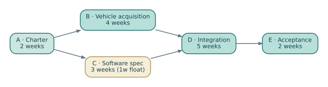

# Northstar NS-M1 — a controlled project management case

This **fictional** case provides one reproducible set of quantities across all twelve chapters of the Management of Systems Projects companion (EN.645.667). It is intentionally linked to the technical **NS-B1** case in Book 1, but the management and technical baseline identifiers are different.

## Three distinct kinds of controlled facts

- **Technical baseline NS-B1:** requirement IDs, hazard assumptions, interface allocation and test-evidence configuration. [Book 1 case](../../B1/case/INDEX.html).
- **Management baseline NS-M1:** five cost accounts totaling **$7.2M**, plus separately defined **$0.6M management reserve** and **$0.6M illustrative fee** for a teaching offer of **$8.4M**.
- **Illustrative status at month five:** **PV $3.0M, EV $2.4M, AC $2.7M**. The earned-value formulas produce **CPI 0.8889**, **SPI 0.8000** and a sustained-CPI **EAC $8.1M**. These are synthetic reporting quantities, not real performance observations.

The 13-week five-activity network is a *small network demonstration*, not the whole program schedule or a forecast to complete the entire shuttle project. Its result is 13 weeks, with one week of float on activity C. Changing C from 3 to 5 weeks moves the finish to 14 weeks.

## Inspect and reproduce

- [Controlled management assumptions (JSON)](northstar-management-baseline.json)
- [Editable control accounts (CSV)](control-accounts.csv)
- [Decision register with intentionally open decisions (CSV)](decision-register.csv)
- [Schedule network source (DOT)](../figures/ns-m1-schedule.dot) and [diagram (SVG)](../figures/ns-m1-schedule.svg)
- [Cross-baseline claim chain (SVG)](../figures/ns-m1-claim-chain.svg)
- [Python arithmetic and consistency checker](../tools/step03_book2_project_check.py)

Run `python3 SE/K/B2/tools/step03_book2_project_check.py` from the repository root. It checks the agreement between the CSV and JSON inputs, financial totals, EV measures, schedule logic and risk arithmetic. A green result **does not establish actual supplier delivery, estimate accuracy, safety, or contractual authorization**.

## Investigations

1. Reduce CA-02 earned value to $0.50M without changing actual spending. Recalculate aggregate CPI, EAC and the variance at completion. Why is this not merely a reporting correction?
2. Increase activity C to six weeks. Recompute the early dates and explain the changed controlling path.
3. If an unbudgeted test fixture requires $150,000, decide whether the issue is omitted in-scope work, changed scope or a risk realization. Show how each interpretation would alter the authorized control process.
4. Attempt to change NS-B1 to a new technical revision without updating the evidence in the decision register. Explain which proposed readiness claim can no longer be supported.

**Editorial note:** These materials are original synthetic teaching examples. No proprietary standards are reproduced. For source-specific cost, schedule and EVM methods consult [GAO Cost Guide](https://www.gao.gov/products/gao-20-195g), [GAO Schedule Guide](https://www.gao.gov/products/gao-16-89g), the [DOE EVM guidance](https://www.energy.gov/documents/integrated-project-management-using-earned-value-management-system), and the [NASA Systems Engineering Handbook](https://www.nasa.gov/reference/systems-engineering-handbook/).
