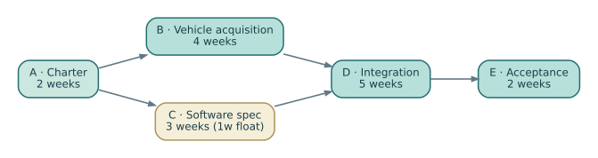

# Chapter 5 — The Schedule Is a Model of Causality

*EN.645.667 · Week 5 · Critical path, network logic and schedule quality · Preceded by [Chapter 4](04-estimating-and-reserves.md); continue with [Chapter 6](06-integrated-baseline-review.md).*

> **Study contract.** This chapter teaches the concepts behind Week 5; practice them in [Hypothetical Lab 5](../labs/lab-05-schedule-networks-and-float.md), then complete the [original Week 5 coursework](../../../C/P0/EN645667.md). These fictional examples are not contractual or safety approvals.

## The management problem

A Gantt chart can imply that the project is progressing simply because bars extend across a calendar. A credible schedule starts instead with **causal logic**: which deliverable must exist before another activity can begin, and which constraints are real? A late software interface specification may hold up test-fixture design even if hardware fabrication remains on time. A schedule without that dependency reports a comforting fiction.

In a precedence network, activity durations and dependencies determine the earliest possible completion. Forward passage computes early starts and finishes; backward passage computes latest starts and finishes consistent with the project finish. Total float is the permissible delay before an activity shifts that modeled completion date. Zero float identifies the *current* critical path under modeled assumptions. Float may change after resequencing, progress, calendar changes or resource leveling.

Do not equate a critical path with “the most important work.” Safety assurance can be crucial while possessing float, and a routine purchase can be critical because nothing else can proceed without it. Nor does critical path alone yield a probability of meeting the date. Duration uncertainty and common causes must be studied separately.

## Develop the method

Create an activity list that maps back to WBS deliverables and technical milestones. Record predecessor type, duration estimate, resource assumptions, constraints, and completion evidence. Reject open ends except genuine project start and finish, and explain any hard date constraints or negative lags. The schedule is auditable only if a reviewer can reconstruct why every significant dependency exists.

After computing earliest and latest dates, challenge the network: can the supplier really deliver before a configuration freeze? Does an interface demonstration require the software integration bench? Are there resource conflicts between two parallel test campaigns? Make a second schedule with a realistic resource cap, noting any change in date and criticality.

### Schedule logic is conditional causality

A critical-path network encodes assumptions about **which work enables other work**; it is not a photograph of the future. Finish-to-start links imply that one activity's completion is a prerequisite for another, but some links are technological necessities and others are management preferences. If a simulation review can begin on a controlled preliminary model, a strict dependency on the entire physical build may be avoidable. Removing a truly necessary integration dependency, however, merely makes the chart look faster.

The longest path identifies zero-slack activities for the assumed durations and logic. It does not tell us which task is most dangerous under uncertainty. A near-critical path with highly variable supplier delivery may dominate actual completion risk. Shared test facilities and specialist personnel also create resource dependencies absent from a simple precedence graph. Distinguish *logical feasibility*, *resource feasibility*, and *probability of meeting a date*. These are different models, and a schedule is trustworthy only when the reader knows which questions it was constructed to answer.

## Deeper theory: schedules as causal networks, not promises about dates

A project schedule is often displayed as bars, which encourages the mistaken idea that dates are the fundamental objects. Dates are derived from a more basic structure: a network of activities connected by constraints. Some constraints are physical—for example, a hardware integration test cannot occur until the hardware has been delivered. Others are organizational or optional—a review might be scheduled after two specifications even though partial review is possible earlier. Distinguishing hard technical precedence from chosen planning conventions is essential because only the former necessarily constrains the feasible execution order.

For an activity \(i\) with duration \(d_i\), the earliest finish is \(EF_i=ES_i+d_i\). If it has finish-to-start predecessors \(P(i)\), then \(ES_i=\max_{j\in P(i)}EF_j\). The **maximum** expresses causality: an activity cannot begin until the slowest required predecessor becomes ready. The forward pass is therefore a longest-path computation on a directed acyclic dependency network. A backward pass computes how late each activity may finish without delaying the chosen milestone. Total float is a property of this network **under its current durations, calendars, and constraints**, not a permanent allowance owned by a work package.

### A small example reveals the mechanism

Imagine Northstar needs three parallel preparations before integration: docking controls take four weeks, software integration takes six, and operator procedures take three. Final system integration requires two additional weeks after all three are ready. With no resource constraint, the project duration is \(\max(4,6,3)+2=8\) weeks. Docking has two weeks of schedule freedom relative to software and procedures have three. If a common specialist must work on both docking and software, however, parallelism is no longer fully feasible. A pure critical-path calculation assumes infinite or already accounted-for resources. The engineer must perform resource-constrained scheduling or revise the network to reflect the shared specialist.

That example explains why a schedule can be logically consistent and physically impossible. Resource limits, working calendars, contractual delivery windows, rework loops, and uncertain durations all matter. A negative-float path may arise when a required completion date is earlier than the network can achieve. Negative float is a diagnostic of infeasibility relative to that constraint; it does not create time. Changing the target date or deleting a dependency to improve a dashboard does not eliminate the underlying work.

### Uncertainty changes the meaning of “critical”

A deterministic network identifies the longest route under one set of durations. With uncertain activity times, the identity of the longest route may change across scenarios. Suppose two paths have estimated durations 10 and 9 weeks, respectively. The first is currently critical, but if the second contains a supplier delivery with a long right tail, it may dominate the completion-time risk. Monte Carlo scheduling samples durations and recomputes the finish date, producing a distribution rather than a single prediction. The resulting probability that each path becomes critical is different from its deterministic float.

Correlations matter. If weather delays both civil works and vehicle delivery, sampling those delays independently understates the chance of simultaneous lateness. If the same engineering team estimates several tasks, optimistic-estimation bias may be shared. Probabilistic scheduling is credible only when its uncertainty model has a defensible connection to the work and its dependencies. A very large simulation run cannot compensate for a false resource model.

### Recovery decisions are experiments in the project model

When a schedule slips, management may add staff, run tasks concurrently, or defer scope. None is universally effective. Adding staff to a serial verification activity may have little effect; compressing integration by overlapping hardware and software may create extra rework and risk. *Crashing* asks which duration reductions are feasible at what incremental cost, subject to changing critical paths. *Fast tracking* changes precedence and therefore often changes risk. A schedule model should make those causal claims explicit before a recovery action is authorized.

Finally, time progress and technical maturity are different variables. A path can be “on schedule” while the evidence needed for a review remains missing. A healthy integrated project model joins activity completion to deliverable acceptance, configuration, risk retirement, and review criteria. The schedule then becomes a tool for reasoning about what must happen before a decision is responsible—not merely an attractive chronology.

## Worked Northstar project example

Consider A charter approval (2 weeks); B vehicle acquisition (4 weeks after A); C software specification (3 weeks after A); D integration (5 weeks after B and C); E acceptance test (2 weeks after D). Forward calculation gives A [0,2], B [2,6], C [2,5], D [6,11], E [11,13]. The finish is week 13 and critical path A–B–D–E has duration 13. C has one week of float: a one-week delay to C does not alter the modeled finish, but a two-week delay would. This network is an illustrative subset, not the full 18-month baseline.

## From a deterministic finish date to schedule confidence

The thirteen-week example gives a critical path, but not a probability that the project will finish in thirteen weeks. Activity B might take four weeks if the supplier ships on time and eight weeks if an interface change forces a new build. Activity C may share a testing resource with B, despite being shown as parallel. A deterministic network supplies the logic needed to understand the plan; uncertainty analysis tests what happens when the assumptions are disturbed.

A more reliable schedule review separates *logic quality* from *duration realism*. For every predecessor link, write the technical reason. For every activity with no predecessor, ask if it truly can begin immediately. Inspect calendar constraints, artificial milestone dates, open ends, and activities with unexpectedly large float. Then rerun the forward/backward calculation after a plausible disruption. If B rises from four to six weeks, completion rises from 13 to 15 weeks, assuming other dependencies remain unchanged. If C rises from three to five weeks, it becomes co-critical with B while D starts at week 7 and finish occurs at week 14. These scenarios reveal which activities can become controlling.

**Resource-constrained variant.** Suppose C and B each require the only integration engineer for their first week. The baseline network permits concurrent work, but actual execution might not. You must either sequence those portions, add qualified capacity, or explicitly accept a resource conflict. A resource-loaded schedule may differ from the logic-only network in date and controlling chain.

Schedule confidence should be expressed through named assumptions and repeatable scenarios, not a statement that a chart “looks achievable.” When a supplier promises the same delivery date despite a known failure, record what evidence changed to support that promise.

## Reproduce and challenge the numbers

Run the [Week 5 calculation notebook](../notebooks/02-critical-path.ipynb) against the [editable dataset](../data/activity-network.csv) in the Markdown source package. Change at least one assumption, recompute the result, and write down which conclusion changes. This exercise checks arithmetic and reasoning within a fictional model; it does not validate the real-world estimate or program.

## Boundary of the method

A hard-constrained milestone can hide negative float or make an unrealistic finish appear feasible. The schedule must describe the work, not merely fit the requested date.

## Retrieval questions and explained answers

1. **Question:** Why does the longest individual activity not necessarily define the critical path?
   **Explanation:** Completion depends on the longest dependent chain, not the longest single activity.
2. **Question:** What does one week of total float mean?
   **Explanation:** Within the modeled logic and calendars, that activity can slip one week without moving the designated finish.
3. **Question:** Why might a nominally parallel plan fail?
   **Explanation:** Shared scarce resources, missing interface dependencies or physical access constraints can prevent true concurrency.

## Put this into practice

Work through [Lab 5: The Thirteen-Week Network](../labs/lab-05-schedule-networks-and-float.md), then write a short paragraph on how the laboratory simplifies the real-world management problem. Use the [existing short Week 5 primer](../../P0-text/lessons/645-667-w05.md) for a second explanation. The assessed deliverable is defined in the original course guide, not by the hypothetical lab.

## Step 03 integrated reference — forward and backward passes with a controlled network

A critical path is not a visually highlighted bar but the longest necessary chain through a **directed acyclic dependency network** under specified duration/calendar assumptions. The NS-M1 [five-activity network](../case/northstar-management-baseline.json) deliberately uses a 13-week teaching subset, **not** the full program's longer project schedule. Its finish-to-start constraints are A (2 weeks), B (4 after A), C (3 after A), D (5 after both B and C), and E (2 after D).

For activity \(i\) with duration \(d_i\), let the early start be the maximum predecessor early finish:

\[
ES_i=\max_{j\in P(i)}EF_j,\qquad EF_i=ES_i+d_i.
\]

The forward pass produces A [0,2], B [2,6], C [2,5], D [6,11], and E [11,13]. Next reverse the network using the project finish at 13: for a terminal activity set \(LF_i=13\); otherwise \(LF_i=\min_{k\in S(i)}LS_k\), then \(LS_i=LF_i-d_i\). For C, \(LF_C=6\) and \(LS_C=3\), so total float is \(LS_C-ES_C=3-2=1\) week. A–B–D–E is critical in the stated network.

### Different disruptions cause different controlling chains

Increase B from four to six weeks: D cannot start until week eight; completion becomes week 15. Increase C instead from three to five: D starts at week seven; completion becomes week 14, and C rather than B now controls the start of D. These calculations assume unlimited resources and no additional rework. A specialist required simultaneously by B and C invalidates the presumed parallel schedule; add the real resource constraint rather than simply declaring more float.

A **schedule risk assessment** goes beyond a PERT point estimate. Sample defensible durations and any shared risk drivers, recompute the network each simulation, and report a completion-time distribution. Do not report a P80 date without specifying whether correlations, calendars, supplier lead times and recovery loops were included. A path may be near-critical under the baseline and dominate the tail under uncertainty.

### Exact schedule-risk calculation before Monte Carlo

To demonstrate what a probabilistic schedule actually means, suppose the *duration* of B is four weeks with probability 0.80 or six with probability 0.20, while C is three weeks with probability 0.90 or six with probability 0.10. For this small numerical example only, assume the two durations are independent; A, D and E have fixed durations. Project duration is then

\[
T=2+\max(B,C)+5+2=9+\max(B,C).
\]

The project finishes at week 13 only if \(B=4\) **and** \(C=3\), with probability \(0.80(0.90)=0.72\). Otherwise one path takes six weeks and the project finishes in week 15, probability 0.28. Thus \(P(T\le13)=0.72\), and the model's minimum week satisfying an 80% completion probability is **week 15**. The expected finish is \(0.72(13)+0.28(15)=13.56\) weeks, but the mean is not a promise that the project can finish in fractional weeks.

This exact enumeration is available because the model has only four scenarios. For a large activity network, Monte Carlo can evaluate the same logic under richer distributions. A supposedly precise simulation cannot fix absent resource constraints or a false independence assumption. If common supplier disruption delays both B and C, their joint probability changes; so may the finish-date distribution even if marginal durations are unchanged.

**Practice with answer.** If C takes six weeks while B remains four, completion is \(\max(2+4,2+6)+5+2=15\) weeks. Both the date and critical-path identity change. A manager cannot erase the delay by replacing the network finish with a hard target milestone.

**Reference:** [GAO Schedule Assessment Guide](https://www.gao.gov/products/gao-16-89g) addresses logical completeness, realistic durations, resource loading and schedule-risk analysis.
