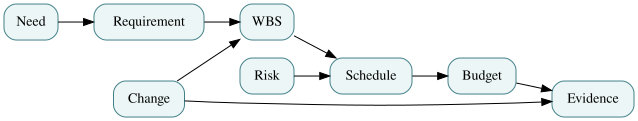

# Chapter 6 — A Baseline Is a Defensible Agreement

*EN.645.667 · Week 6 · Integrated baseline review and management control · Preceded by [Chapter 5](05-schedule-networks-and-float.md); continue with [Chapter 7](07-earned-value-and-forecasting.md).*

> **Study contract.** This chapter teaches the concepts behind Week 6; practice them in [Hypothetical Lab 6](../labs/lab-06-integrated-baseline-review.md), then complete the [original Week 6 coursework](../../../C/P0/EN645667.md). These fictional examples are not contractual or safety approvals.

*Figure — teaching diagram, showing relationships rather than evidence of system readiness.*

## The management problem

A team can have a scope document, a schedule, a cost spreadsheet, and a risk register yet still possess no integrated baseline. The documents may disagree about how many vehicles will be delivered or which interface must be verified before acceptance. An Integrated Baseline Review (IBR) is a structured opportunity to establish whether the planned work is understood, resourced, logically scheduled, realistically budgeted, and measurable.

The point is not to ask whether every file exists. It is to ask whether the person who owns a work package can explain its scope, boundaries, dependencies, resources, schedule, budget, progress criteria, and risks—and show that those answers agree with their neighbors’ plans. An IBR can legitimately conclude “not ready” while still helping the organization move toward readiness.

Baseline control is not a freeze on learning. It creates a known reference against which authorized changes and genuine performance can be judged. If actual scope changes, compare the current approved baseline with the historical one, and preserve an audit trail. Otherwise every forecast revision can quietly rewrite the record of what was promised.

## Develop the method

Run the review in layers. First reconcile the WBS with the technical products and contract. Next reconcile schedule activities with each work package and associated logic. Then reconcile budget to the work-package and control-account structure. Finally interview the managers: “How will you know this is done? What could prevent it? Which change would force a new estimate?”

Document discrepancies with unique IDs, owners, due dates, and objective exit criteria. Distinguish a missing document from an unresolved technical assumption; the latter can be much more consequential. Authorize work subject to appropriate gates instead of treating a favorable presentation as proof of baseline credibility.

## The mechanism beneath the method

An integrated baseline reconciles scope, schedule, budget and performance measures into one coherent account of what the project has authorized.

### Distinguishing related ideas

A baseline review does not prove the plan will occur; it tests whether resource, duration, dependency and acceptance claims can coexist.

### Interpretation and boundary conditions

An activity can be on schedule while its product lacks the required verification evidence, which is why progress cannot be inferred from elapsed time alone.

## Worked Northstar project example

A software package reports $480,000 of planned effort and a September integration finish. Its WBS dictionary promises a fault-tolerant offline mode; the software schedule contains only nominal acceptance tests and the supplier's contract excludes degraded mode. The budget and date might be numerically coherent while the work is incomplete. An IBR finding should connect all three artifacts: add/clarify contractual scope, update interfaces and tests, assess schedule/cost, and reapprove the controlled baseline before claiming readiness.

## The interview is the real baseline test

Imagine a control-account manager whose package has a clean budget spreadsheet and an attractive green milestone chart. In an IBR interview, ask for the evidence that will establish 100% completion. The manager says, “We will be done when the team feels satisfied.” That answer exposes a progress-measurement defect. Ask what must be delivered, who will independently receive it, and what a failed test does to the forecast. The interview should surface uncertainty while there is still time to change the plan.

There is a difference between **baseline integrity** and **baseline perfection**. A credible project may have identified risks, immature but bounded planning packages, and explicitly staged authorization. It does not need to pretend every future task is known. An unreliable baseline conceals unresolved scope, artificially constrains activities to target dates or budgets technical work without enough resources to achieve its acceptance conditions. An IBR can approve only a limited subset of work while requiring maturity before the next gate.

**Worked discrepancy chain.** An offline-operation requirement is found in the technical requirements list, omitted from the supplier's statement of work, and present as a test line in an unfunded verification plan. A superficial review might mark the three documents individually complete. Integrated review reveals an impossible commitment. Correct it by clarifying obligation, allocating WBS ownership, adding activity logic and costs, revising the risk register, and obtaining change authority. After implementation, verify the new documents agree—mere issuance is not closure.

A useful IBR summary has three parts: credible commitments, conditional commitments, and decisions outside the review's authority. This keeps the review from becoming a blanket certificate for a system it has not tested.

## Boundary of the method

Mistaking the IBR for ceremonial approval or using it to demand false precision. An honest open finding is superior to a fabricated schedule or risk score.

## Retrieval questions and explained answers

1. **Question:** What distinguishes an integrated baseline from several approved documents?
   **Explanation:** Their scope, schedule, budget, resources and evidence are mutually consistent and owned.
2. **Question:** Should an IBR automatically approve work because milestones are listed?
   **Explanation:** No; it tests planning realism and identifies conditions for authorization.
3. **Question:** Why preserve prior baselines?
   **Explanation:** To compare performance against historical commitments and explain authorized changes.

## Deeper theory: configuration baselines as causal and informational controls

### A baseline is a state of agreement, not a folder of final files

A technical baseline consists of controlled claims, definitions, allocations, interfaces, budgets, and evidence that are mutually consistent for a stated purpose. Freezing a list of documents is only a crude proxy. A configuration record must distinguish what was approved, the alternatives rejected, the assumptions that made approval rational, and the authority that can change the decision. A baseline can remain stable while new measurements are collected, but a measurement that contradicts its assumptions creates an obligation to assess impact. Stability is valuable because it makes change intelligible; it is not an argument for ignoring newly discovered reality.

Model a baseline as a directed dependency graph. Nodes represent requirements, system functions, design choices, interface agreements, test cases, and delivered components. An edge means that changing one node may affect the truth, feasibility, or evidence status of another. A change in vehicle timestamp precision may propagate into localization logic, dispatch interfaces, stale-data guards, test fixtures, and acceptance criteria. The affected subgraph is found by following dependency paths, though not every reachable node necessarily needs modification. An impact review must distinguish **possible influence** from **demonstrated consequence**.

### Change control is a value-of-information decision

A proposed change has a distribution of consequences rather than one guaranteed cost. Let `U(change, θ)` be the net benefit if unknown environmental state or parameter `θ` takes a particular value. The rational comparison considers expected benefits, expected costs, safety constraints, reversible choices, and the cost of delay. A design that improves average throughput may still be unacceptable if it increases an intolerable hazard. Waiting for more evidence can also carry cost. This means the change board is not simply counting modifications; it is governing a trade between learning, stability, rework, and exposure.

For a concrete example, suppose a proposed protocol update is estimated to save 15 engineer-days per integration cycle over four cycles, while migration consumes 35 engineer-days. The nominal net is `4 × 15 − 35 = 25` engineer-days. That arithmetic ignores compatibility failures, testing effort, the probability that all four cycles occur, and the possibility that the new protocol reduces a hazardous ambiguity. A defensible decision documents the scenario assumptions and reserves, rather than treating 25 as a certain return. If only one of the four cycles remains, the nominal economics reverse.

### Traceability makes the baseline inspectable, but not automatically correct

Trace links can be syntactically present and semantically wrong. A test “traced” to a requirement may never exercise its limiting condition; a software component may be connected to a function it does not truly perform. Trace quality therefore depends on typed relationship meanings: *derives*, *satisfies*, *verifies*, *constrains*, and *depends on* are not interchangeable. Before baselining, a reviewer should sample links in both directions and ask whether the claimed inference survives a counterexample. The problem is analogous to provenance in scientific computation: without identified inputs, assumptions, and transformations, the result cannot reliably be reproduced or revised.

A mature baseline preserves decision history without preserving every obsolete artifact in the active configuration. Supersession, effective dates, deviations, and field applicability must remain visible. The limit of configuration management is epistemic: perfectly controlled records can still encode an incorrect model. Technical challenge and independent evidence remain indispensable.

## Put this into practice

Work through [Lab 6: The Baseline Hearing](../labs/lab-06-integrated-baseline-review.md), then write a short paragraph on how the laboratory simplifies the real-world management problem. Use the [existing short Week 6 primer](../../P0-text/lessons/645-667-w06.md) for a second explanation. The assessed deliverable is defined in the original course guide, not by the hypothetical lab.
