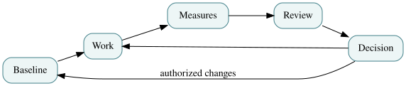

# Chapter 7 — Earned Value Distinguishes Work from Spending

*EN.645.667 · Week 7 · PV, EV, AC, CPI, SPI and credible forecasts · Preceded by [Chapter 6](06-integrated-baseline-review.md); continue with [Chapter 8](08-risk-change-and-quality.md).*

> **Study contract.** This chapter teaches the concepts behind Week 7; practice them in [Hypothetical Lab 7](../labs/lab-07-earned-value-and-forecasting.md), then complete the [original Week 7 coursework](../../../C/P0/EN645667.md). These fictional examples are not contractual or safety approvals.

*Figure — teaching diagram, showing relationships rather than evidence of system readiness.*

## The management problem

How much did the shuttle project accomplish this month? Money spent cannot answer: a team can consume its budget while a required interface remains unverified. Earned value management introduces three distinct measures: **planned value (PV)**, budgeted value of authorized work scheduled; **earned value (EV)**, budgeted value of authorized work actually performed under defined measurement rules; and **actual cost (AC)**, cost incurred for that work.

Their differences are diagnostic, not moral judgments. Cost variance CV = EV − AC and schedule variance SV = EV − PV. The indices CPI = EV/AC and SPI = EV/PV measure cost and schedule performance against baseline value. These are not the same as calendar days of delay or engineering quality. A high EV can still be attached to poorly defined completion criteria; a favorable CPI can mask deferred assurance work.

Measurement must begin with reliable work-package rules: discrete milestone completion, weighted milestones, or other justified methods. Crediting “80% done” because a manager feels confident is not an objective progress measure. Software story counts require careful translation before being used to support integrated system-level value.

## Develop the method

At each reporting point: establish the correct approved baseline version; validate reported completion evidence; reconcile costs to the same scope; calculate variances; identify technical causes; then forecast. For BAC, budget at completion, one common independent forecast is EAC = BAC/CPI when past cost efficiency is assumed to persist. Another is EAC = AC + ETC, a fresh estimate of remaining work. The first is a diagnostic formula, not a magical forecast, and its assumption must be declared.

Forecasts should include uncertainty and known changes. Keep technical performance measures next to EVM: an improving CPI cannot compensate for a braking-test failure or a deteriorating false-stop rate. Explain which measures are lagging and which are leading indicators.

## The mechanism beneath the method

Earned value translates budgeted scope completion into a common unit for comparison against planned progress and actual spending.

### Distinguishing related ideas

CPI measures cost efficiency for earned scope, not technical quality; SPI measures budget-weighted schedule progress, not necessarily the true critical path.

### Interpretation and boundary conditions

A favorable index can mask a dangerous unfinished integration test, so forecasts require schedule logic and evidence of product maturity.

## Deeper theory: earned value is a measurement system with a particular boundary

### The algebra is simple; the meaning of progress is difficult

Earned value management distinguishes planned value `PV`, earned value `EV`, and actual cost `AC` against a time-phased scope baseline. `CPI = EV/AC` describes cost performance on the earned-value basis, and `SPI = EV/PV` describes schedule performance on that same basis. Neither ratio is a physical estimate of engineering quality or a direct probability of meeting a deployment date. A subsystem could consume little budget and report excellent CPI while its safety-critical interface remains unverified. That is why work-package completion rules, objective milestones, and configuration-specific acceptance evidence must be set before anyone sees the reporting-period results.

An illustrative package budgeted at $100,000 reports 50 percent accomplishment and $70,000 actual cost. Then `EV = $50,000`, `CPI ≈ 0.714`, and cost variance `EV − AC = −$20,000`. Yet “50 percent accomplishment” may mean half the code written, half the tests passed, or half the required capability accepted. These are not equivalent accomplishments. A weighted-milestone method may improve reproducibility if milestones map to deliverables; a vague percent-complete judgment will remain vulnerable to optimism or incentive pressure.

### Forecasts need causal assumptions, not just extrapolation

A textbook estimate at completion can be formed as `EAC = BAC/CPI` when the observed cost efficiency is judged representative of *all remaining work*. An alternative is `EAC = AC + ETC`, with estimate to complete `ETC` rebuilt from the remaining engineering scope, resources, and risks. They answer different situations. If early overruns resulted from a one-time integration test that is now complete, projecting the same CPI forever may exaggerate the problem. If the remaining work contains more untested interfaces than the work already completed, an apparently stable CPI can be dangerously optimistic.

Earned-value schedule variance `EV − PV` generally tends toward zero as planned work is eventually earned, even when delivery is late; traditional SPI tends toward one at completion. That is a property of the currency-denominated schedule proxy, not proof of recovered calendar time. Forecast the dates of remaining critical paths and acceptance events using network logic, resource constraints, and credible productivity assumptions. Techniques such as earned schedule help relate earned work to baseline time but do not abolish uncertainty about activities not yet performed.

### Controls must resist metric gaming and baseline erasure

An approved rebaseline changes the reference against which variances are reported; it does not retroactively make lost time or money disappear. Record the before-and-after baseline, rationale, authorization, and effects on scope. Otherwise a manager can repeatedly reset planned value until every report looks healthy. Similar distortions arise from splitting work packages into small easily earned tasks, redefining “done” after the fact, or omitting late defect correction from planned scope. An effective control system cross-checks EV with technical performance measures, staffing and throughput data, integration risk, open defects, and independent acceptance evidence.

The most valuable signal is often a disagreement between measures. When CPI improves while unresolved safety findings accumulate, the right question is not which metric wins but which causal explanation fits both observations. Forecasts should preserve uncertainty ranges, distinguish already incurred cost from future exposure, and disclose where cost efficiency is an invalid proxy for remaining effort. Earned value becomes useful when it triggers informed re-planning; it becomes dangerous when it is treated as a substitute for engineering judgment.

## Worked Northstar project example

The fictional Month 5 case states BAC=$7.20M, PV=$2.40M, EV=$2.04M, AC=$2.55M. Hence SV=−$0.36M, CV=−$0.51M, SPI=0.85 and CPI=0.80. A constant-CPI extrapolation gives EAC=$7.20M/0.80=$9.00M, $1.80M above BAC. This alone is not a contract-price forecast, and it must not be confused with the original $8.4M proposal. A bottom-up ETC may differ because some completed problems will not recur, while future integration risks may be worse.

## Progress rules must precede the reporting period

EVM can be gamed unintentionally by designing measurement rules after observing results. If a work package is “90% done” for three consecutive months, the team may be accounting for effort rather than verified accomplishment. Define in advance whether milestones are all-or-nothing, weighted by tangible products, or measured by another rule accepted by the organization. Each rule has advantages and failure modes. A weighted-milestone plan can provide useful leading information when intermediate artifacts are truly independent, but it can also reward documentation detached from a functioning integrated system.

The fictional Month 5 values provide a diagnostic that should provoke questions. SPI = 2.04/2.40 = 0.85 indicates that the budgeted value of work performed is 85% of the budgeted work planned by that point. It is **not** equivalent to a 15% calendar delay. CPI = 2.04/2.55 = 0.80 indicates that the project has been earning $0.80 of budgeted work value for every $1.00 of actual cost. One extrapolation EAC = BAC/CPI = $9.00M assumes that cumulative cost efficiency persists. For an alternative bottom-up forecast, the team might calculate AC + remaining forecast labor, purchases and risk exposure—but those inputs require independent justification.

**Two interpretations with the same CPI.** Project A has a one-time facility setup overrun with most expensive work finished; Project B has an uncorrected labor productivity problem affecting all remaining packages. Both may show CPI = 0.80 today, yet their credible EAC ranges can differ dramatically. A manager should explain which mechanism is believed and what evidence could falsify that explanation.

When integrating technical performance, beware selection effects: if difficult verification activities are postponed, EV may appear strong while evidence maturity lags. Keep earned progress tied to controlled product acceptance.

## Reproduce and challenge the numbers

Run the [Week 7 calculation notebook](../notebooks/03-earned-value.ipynb) against the [editable dataset](../data/month-5-evm.csv) in the Markdown source package. Change at least one assumption, recompute the result, and write down which conclusion changes. This exercise checks arithmetic and reasoning within a fictional model; it does not validate the real-world estimate or program.

## Boundary of the method

Do not label SPI=0.85 as “the project is 15% late in calendar time.” Nor should a manager hide bad data by changing the progress rules after the fact.

## Retrieval questions and explained answers

1. **Question:** Does spending $2.55M imply $2.55M of earned value?
   **Explanation:** No; AC measures incurred cost, EV measures budgeted accomplishment under approved rules.
2. **Question:** What assumption underlies BAC/CPI?
   **Explanation:** That cumulative cost efficiency is informative for remaining work.
3. **Question:** Why pair EVM with technical measures?
   **Explanation:** Financial performance does not itself demonstrate technical quality, safety or acceptance readiness.

## Put this into practice

Work through [Lab 7: The Month Five Control Room](../labs/lab-07-earned-value-and-forecasting.md), then write a short paragraph on how the laboratory simplifies the real-world management problem. Use the [existing short Week 7 primer](../../P0-text/lessons/645-667-w07.md) for a second explanation. The assessed deliverable is defined in the original course guide, not by the hypothetical lab.
