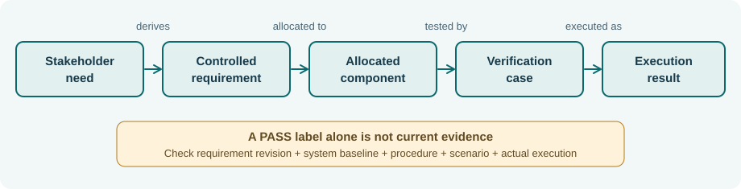
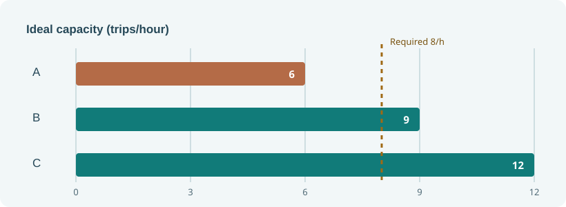

# Northstar NS-MB3 — Model-based engineering study case

*Book III: Introduction to Model-Based Systems Engineering (EN.645.631).* This is one **fictional** dispatch and monitoring system analyzed consistently across twelve chapters. The model describes an engineering decision, not a certified SysML v2 model or a real-world operating system.

[Open Book 3](../OPEN-BOOK.html) · [Book 3 contents](../README.html) · [Editable JSON](model-baseline.json) · [Evidence register](evidence-register.csv) · [Python checker](../tools/step03_book3_model_check.py)

## The review question

Can a campus-shuttle design support eight scheduled trips in the ideal peak hour while maintaining an authorization gate, a telemetry-freshness limit, nominal command timing, energy reserve, and duplicate-token protection? What additional evidence would be needed for a credible deployment decision?

The controlled baseline `NS-MB3.1` has **four stakeholder needs, six technical requirements, five allocated functions, five components, two illustrative interfaces, and six test records**. Data are chosen to expose missing evidence, not to emulate real certification. No field data, conforming SysML parser output or operational approval is included.



## Core quantitative results

| Model claim | Stated inputs | Result | Interpretation |
|---|---|---|---|
| Candidate A ideal capacity | 2 vehicles × 3 trips/h | 6 trips/h | Fails eight-trip necessary bound |
| Candidate B ideal capacity | 3 × 3 | 9 trips/h | Passes necessary bound; not realized throughput |
| Candidate C ideal capacity | 4 × 3 | 12 trips/h | Greater model headroom, higher cost |
| Nominal serial-path delay | 90 + 110 + 80 + 45 ms | 325 ms | 75 ms below nominal 400-ms limit |
| Degraded serial-path delay | 120 + 140 + 120 + 80 ms | 460 ms | 60 ms above nominal number; requires scoped degraded rule |
| Shift energy | 24 × (1.8 km × 0.36 kWh/km + 0.20 kWh) | 20.352 kWh | 9.648 kWh below illustrative 30-kWh limit |



## Controlled verification example

`TEST-03` says PASS for `REQ-03@1`, but `REQ-03` is now at revision 2. Its evidence is **stale**. `TEST-06` is **PLANNED**, so there is no passing execution for the duplicate-token requirement. Four other requirements have a current linked *teaching fixture*, not physical verification. A correct reviewer must not count all six as successfully verified.

Run from the repository root:

```sh
python3 SE/K/B3/tools/step03_book3_model_check.py
```

The checker validates **only this JSON teaching schema** (identities, allocations, interfaces, test revision labels, and arithmetic). It does not parse SysML v1 or v2, prove safety or perform real-world measurement. Consult the [official OMG SysML v2 language specification](https://www.omg.org/spec/SysML/2.0) for normative language semantics and the [ISO/IEC/IEEE 42010:2022 overview](https://www.iso.org/standard/74393.html) for architecture descriptions.

## Chapter-by-chapter use

| Chapter | Engineering question | Artifact or test |
|---|---|---|
| 1 | Why pay for a model? | Hypothetical break-even analysis and capacity contradiction |
| 2 | What is controlled, in which tool? | Baseline schema, stable IDs and model-change transaction |
| 3 | What do stakeholders actually need? | Needs, scenarios and system context |
| 4 | What do model relations mean? | Allocations, test links and evidence currency |
| 5 | Which behaviors are forbidden? | Dispatch-token safety invariant and concurrency counterexample |
| 6 | What constitutes an interface? | Position age and serial command latency budgets |
| 7 | Can logical functions be allocated safely? | Function-to-component mapping and fault boundary |
| 8 | Are quantitative constraints physically possible? | Energy conservation and sensitivity |
| 9 | Which physical candidate is defensible? | Feasibility filter and cost/capacity trade |
| 10 | What counts as verification evidence? | Synthetic test register and revision predicate |
| 11 | Can errors be queried automatically? | Typed references and negative fixtures |
| 12 | What can be approved? | Conditional review decision and evidence gaps |

## Review boundary and exercises

The strongest conclusion supported by this baseline is **continue detailed design and evidence collection for candidate B, withholding operational authorization**. Alter a copy of the JSON to remove a component, change a test revision, or raise demand; rerun the checker and explain which diagnostics are structural, which are numerical, and which remain matters for expert judgment. Do not modify the original fixture to conceal open requirements.
