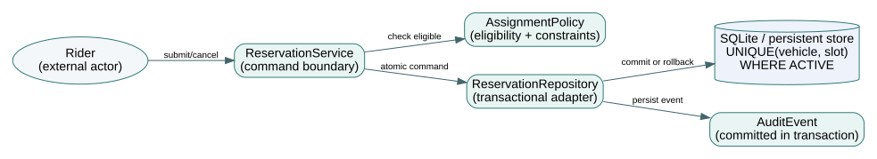

# Northstar NS-OO4.1 — Object-Oriented Analysis and Design case

*Book IV · EN.605.704 · controlled fictional teaching baseline.* This case develops one reservation service from problem-domain analysis to class design, state behavior, transactional persistence, and a qualified design-readiness decision. It does **not** represent live passenger data, an independently audited safety case, a conforming UML model, or formally executed OCL constraints.

[Book 4 overview](../README.html) · [Open Book 4](../OPEN-BOOK.html) · [Controlled JSON](model-baseline.json) · [Scenario fixtures](scenario-fixtures.csv) · [Traceability](traceability.csv) · [Design decisions](design-decisions.csv) · [Editable diagram](../diagrams/oo4-reservation-model.dot) · [Python/SQLite checker](../tools/step03_book4_contract_check.py)

## System boundary and design question

The fictional Northstar Campus Shuttle accepts trip reservations, chooses an eligible vehicle for a service slot, supports cancellation, and records why each committed change occurred. The software must distinguish a rider's intent from a duplicate network request. Its eligibility decision depends on vehicle accessibility and telemetry freshness. The central architecture question is: **can the proposed object responsibilities and persistence transaction maintain reservation invariants when requests fail, repeat, or compete?**

The controlled baseline is `NS-OO4.1`. It defines seven requirements (`SW-01`–`SW-07`), three actor-centered use cases (`UC-01`–`UC-03`), five lifecycle states, six allowed state transitions, three components with accountable responsibilities, three example vehicles, seven executable scenarios, and seven evidence entries. Values are hypothetical. Later revisions should increment the baseline and explicitly review every dependent test.



## The domain model and invariants

A **Reservation** is a durable request identity and lifecycle; an **Assignment** links a reservation to a vehicle and service slot; a **Vehicle** has eligibility characteristics; a **LocationReading** is a timestamped value, not an actor; an **AuditEvent** records a committed change. The `ReservationService` coordinates commands, `AssignmentPolicy` decides eligibility, and a repository implements the transaction boundary. The same domain vocabulary can be realized in another programming language or database if its invariants survive.

For each vehicle \(v\) and slot \(s\), the active-assignment set is

\[
A(v,s)=\{a:\ a.vehicle=v\land a.slot=s\land a.state=ACTIVE\},\quad |A(v,s)|\leq 1.
\]

That is the business invariant, not the SQL schema. The example implementation uses a partial unique index to preserve it for the **discrete-slot** model. Real overlapping trip intervals demand different enforcement. Other required rules: identical tokens plus identical payloads return the same reservation; changed payload under the same token is rejected; accessibility-required requests cannot use ineligible vehicles; observations older than 15 seconds cannot authorize assignment; and cancellation releases the assignment within the same commit.

## Use cases and behavior

| Use case | Actor and success postcondition | Required negative scenarios |
|---|---|---|
| UC-01: Submit reservation | Rider receives durable reservation ID | Duplicate token; changed payload; inaccessible vehicle |
| UC-02: Assign vehicle | Dispatcher commits one eligible active assignment | Occupied slot; stale telemetry; concurrent competing request |
| UC-03: Cancel reservation | Rider changes terminal state and releases the slot | Repeated cancel; failure during audit or release |

Allowed lifecycle transitions are `REQUESTED→OFFERED→ASSIGNED→COMPLETED`, with cancellation from `REQUESTED`, `OFFERED`, or `ASSIGNED`. A transition table is a partial function: `complete(CANCELLED)` is invalid. The database demo simplifies the persisted lifecycle to assigned/cancelled for transaction testing; this separation is intentional. **Do not mistake a limited persistence example for implementation of the entire conceptual state machine.**

## Worked transaction sequence

1. The request enters with a validated token, payload, actor identity, and selected service slot.
2. If the token is already committed, return its original result **only if** immutable payload fields agree. Otherwise reject token reuse.
3. Check that the selected vehicle exists, meets accessibility needs, and has telemetry no older than 15 seconds at the decision time.
4. In one transaction, insert reservation, active assignment and audit event. A database uniqueness constraint protects the active vehicle/slot combination.
5. If the assignment conflicts, roll back the transaction; do not leave a reservation without its intended assignment. Return an explicit conflict.
6. If the server commits but the response is lost, a retry with the same token must identify the already committed reservation.

This describes the single-store teaching implementation. It does not demonstrate distributed exactly-once delivery, production authentication, acceptable user-data retention, or real-time scheduling safety.

## Calculation: latency budget versus observed performance

The illustrative synchronous service path has three serial elements: authentication \(120\) ms, policy evaluation \(80\) ms, commit and audit event \(150\) ms. Its computed budget is

\[
L_{model}=120+80+150=350\ \mathrm{ms}, \qquad 500-350=150\ \mathrm{ms}.
\]

A positive arithmetic margin is **not** a 500-ms response-time verification result. It omits contention, network delay, burst demand, failures and latency distributions. An acceptable performance test would state representative workload and percentile, instrument the entry and exit events, repeat under declared configuration, and report an uncertainty interval. Do not label the model numbers as field measurements.

## Inspect the negative scenarios

Read [`scenario-fixtures.csv`](scenario-fixtures.csv). The sequence includes first booking, identical retry, ineligible accessibility request, eligible booking, duplicate vehicle-slot attempt, stale observation, and a booking later cancelled. The [checker](../tools/step03_book4_contract_check.py) runs them against an in-memory SQLite database and also tests conflicting token reuse, cancellation and rebooking, and direct database enforcement under an attempted duplicate insert.

Run from the repository root:

```sh
python3 SE/K/B4/tools/step03_book4_contract_check.py
```

Its expected high-level output is seven scenario results, a 350-ms budget and 150-ms margin, plus evidence status **5 current synthetic PASS, 1 stale and 1 planned**. Deliberately alter a copy of the case JSON by deleting an owner, changing a test revision, or adding an invalid transition; explain which checks reject the change and why. Keep the baseline fixture unmodified when comparing results.

## Evidence and configuration control

`T-06` reports PASS against revision 1 of requirement `SW-06`, but the declared baseline requirement is revision 2. It is **stale**. `T-07` is only PLANNED and cannot be counted as an observed pass. The five remaining PASS records are **synthetic checks** with matching IDs and versions, not independent demonstration of an operational fleet. A release review that counts seven verified requirements merely because seven evidence IDs exist is unsound.

| Review topic | Disposition | Required follow-up |
|---|---|---|
| Structural ownership of SW-01…SW-07 | Covered by controlled model and schema checker | Independent domain/design review |
| Duplicate booking protection | Demonstrated for fixed-slot SQLite fixture | Concurrent integration and interval-overlap tests |
| Telemetry freshness SW-06 | Stale evidence after revision change | Rerun against revision 2 acceptance criteria |
| Audit lineage SW-07 | Planned, not observed | Execute transaction and provenance tests |
| Performance and human safety | Model-only budget; no operational results | Representative load, hazards, security and assurance analysis |

**Defensible disposition:** approve continuation of detailed software design and targeted integration testing; **do not approve operational deployment or claim formal verification.** The readiness decision is intentionally limited to the evidence provided.

## Chapter crosswalk

| Chapter | Guiding question | Controlled artifact |
|---|---|---|
| 1 | What belongs to the domain? | Classes, invariant statements, system boundary |
| 2 | How do we make requirements testable? | SW-01…SW-07 acceptance and negative scenarios |
| 3 | What outcome does each actor need? | UC-01…UC-03 and scenario fixtures |
| 4 | What do identity and multiplicity mean? | Model diagram and entity/value distinctions |
| 5 | How are responsibilities coordinated? | Command and transaction sequence |
| 6 | What transitions are lawful? | State and transition records |
| 7 | Who owns a rule? | Three component ownership declarations |
| 8 | What happens under retries and failures? | Atomic transaction and token replay |
| 9 | Which design pattern is justified? | Decision log and alternative architecture analysis |
| 10 | What can a formal constraint express? | Illustrative OCL and negative fixtures |
| 11 | What guarantees does the store actually give? | Partial unique index, rollback, cancellation |
| 12 | What can we approve on current evidence? | Traceability and revision-aware test register |

## Exercises with falsifiable results

**Exercise A — interval scheduling.** Replace equality of slot labels with overlap of \([start,end)\) intervals. State which current SQL index no longer proves the invariant and design an explicit transaction or exclusion test. **Evidence standard:** a deliberate two-client race must not produce overlapping active assignments for one vehicle.

**Exercise B — stale policy.** Change the maximum telemetry age to 8 seconds, bump `SW-06`, and identify the fixture, component, acceptance test and evidence whose applicability must be reassessed. An old green test record must not silently remain current.

**Exercise C — inconsistent retries.** Reuse `idem-a` with a different vehicle and show that the checker rejects payload mismatch rather than returning the first reservation as if the requests were equivalent.

**Exercise D — readiness.** Write a one-page design review citing the controlled artifacts. Separate structural evidence, synthetic test outcomes, measurements not yet made, and operational concerns beyond this teaching case.

## Sources and interpretive boundaries

- [Object Management Group, UML 2.5.1 specification](https://www.omg.org/spec/UML/2.5.1) — normative UML language definitions, not evidence that this diagram has been validated by a UML tool.
- [Object Management Group, OCL 2.4 specification](https://www.omg.org/spec/OCL/2.4) — normative semantics for OCL constraints; the chapter's fragment is illustrative, not parser-validated.
- [SQLite documentation: partial indexes](https://www.sqlite.org/partialindex.html) — implementation mechanism for the fixed-slot database invariant.
- [SQLite documentation: transactions](https://www.sqlite.org/lang_transaction.html) — the local commit/rollback scope, not distributed transaction guarantees.

The `.dot` diagram is a domain-responsibility aid and should not be misrepresented as a standards-conformant UML interchange artifact. The Python checker is a narrowly scoped teaching regression suite and should not be described as a general OCL interpreter or software safety verification tool.
