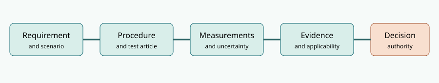

# NS-TE8.1 — System Test and Evaluation case

**Fictional engineering study.** This package receives the unresolved NS-DI7.1 design baseline from Book 7. *NS-TE8.1* names the evaluation campaign, **not a new qualified product configuration**. All measurements, decisions and datasets in this package are invented to teach engineering reasoning. Nothing constitutes operational certification.

## Trace the evidence chain

The [requirements](requirements.csv), [test plan](test-plan.csv), [synthetic 40-trial timing dataset](latency-synthetic.csv), [evidence register](evidence-register.csv) and [discrepancy register](discrepancies.csv) are editable. Run the [standard-library Python audit](../tools/step03_book8_te_check.py) to reproduce the numerical examples and to identify stale, missing and failed evidence. Read the full treatment in [Book 8](../OPEN-BOOK.html). The inherited design assumptions are developed in [Book 7](../../B7/case/INDEX.html).

## Sampling is not the same as qualification

The controlled synthetic degraded latency set has 40 trials and **zero values above 500 ms**. With independent, identically distributed Bernoulli exceedance indicators and no failures, the exact one-sided 95% upper confidence bound for exceedance probability is

\[
p_U=1-0.05^{1/40}\approx0.07216.
\]

This is far above the 0.01 exceedance fraction associated with a p99 requirement. Under the same optimistic assumptions, **299 independent zero-exceedance trials** are needed for the one-sided 95% upper bound to fall below 0.01. Those assumptions can fail for correlated requests or an unrepresentative test environment. Even 299 favorable tests cannot establish extrapolation to untested operating conditions.

A separate boundary measurement of 493 ms can satisfy a raw 500-ms threshold but fail a *predeclared illustrative 12-ms guard band*: an upper-limit acceptance rule requiring measured time no greater than 488 ms. The 12 ms is assumed expanded uncertainty for teaching, not an estimate from the dataset. No single guard-band rule fits every contractual or risk context.

## Inherited engineering defects stay open

- Eight-hour modeled reliability with shared hazards: **0.97863**, below **0.98**.
- Logistics-adjusted modeled availability: **0.98644**, below **0.99**.
- Accessibility trials: **19/20** observed within the fictional limit, without sufficient confidence to establish a 95% population fraction.
- Recovery drill: **14 min**, failing the **12 min** requirement.
- One HIL record applies to **NS-DI7.0**, not the received **NS-DI7.1** baseline; the cyber replay test remains planned.

**Readiness recommendation: HOLD**, pending disposition of the design shortfalls, execution of missing tests, applicable baselines, and a defensible sampling and uncertainty plan. Passing a subset of laboratory checks cannot convert a failing model or stale evidence into compliance.

## Practitioner references

- [NASA Systems Engineering Handbook V&V implementation outline](https://www.nasa.gov/reference/system-engineering-handbook-appendix/): verification/validation flow, test articles, test environments and qualification.
- [NIST Technical Note 1297](https://www.nist.gov/pml/nist-technical-note-1297): combined and expanded measurement uncertainty.
- [NIST conformity decision rules](https://www.nist.gov/publications/assessment-conformity-decision-rules-and-risk-analysis): acceptance risk and guard bands.

These references guide method selection; the actual fictional test rules and assumptions are defined in the case artifacts, not claimed to come from any standard.
