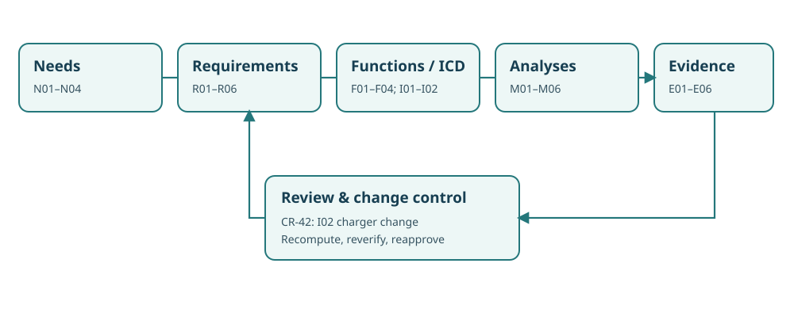

# Northstar NS-MBA9.1 — Integrated model analytics dossier

This fictional, self-contained model accompanies all twelve chapters of **Book 9: Applied Analytics for Model-Based Systems Engineering**. It models a proposed winter/accessibility mobility expansion rather than claiming field performance or qualification. Its purpose is to expose the engineering logic linking a requirement, a model relation, a numerical estimate, and the evidence required to make a release decision.

## Controlled artifacts

- [Canonical model and architecture candidates](model.json): stakeholder needs, requirements, functions, owned interfaces, alternatives, relations, assumptions, and analysis runs.
- [Requirement register](requirements.csv): six requirements with measurable attributes and verification routes.
- [Evidence register](evidence-register.csv): model-derived results, a missing accessibility experiment, and a stale concurrency test.
- [Supplier change CR-42](configuration-change.csv): charger power and efficiency move from 30 kW/90% to 27 kW/82%, requiring model re-evaluation.
- [Reproducible standard-library Python model audit](../tools/step03_book9_model_check.py): execute with `python3 step03_book9_model_check.py` from any directory.

## Key engineering decisions

The baseline alternatives assume **20 kWh per vehicle per operating day**, a peak nominal throughput requirement of **14 trips/hour**, daily energy no greater than **260 kWh**, and a **2.5-hour** charging opportunity. Variant A has 10 vehicles with a 45-minute cycle; variant B has 12 with a 48-minute cycle; variant C has 14 with a 50-minute cycle. Variant B passes the deterministic capacity and energy screens, while A lacks modeled capacity and C exceeds the daily-energy limit. These are screening outcomes, not throughput guarantees under stochastic demand.

Variant B requires **240 kWh/day**. Four 30-kW chargers over 2.5 hours at assumed 90% efficiency deliver **270 kWh**, a nominal **30 kWh** charging margin. After supplier change CR-42, four 27-kW chargers at 82% efficiency deliver **221.4 kWh**, a **18.6 kWh deficit**. A proposed fifth charger would raise modeled recovery to **276.75 kWh**, before physical interface or procurement validation. This illustrates how one interface change can invalidate a prior analysis.

**Review disposition: CONDITIONAL STUDY ONLY.** The modeled results support selecting variant B for further testing but not authorizing winter operations. Accessible-service statistics have not been collected on the current baseline, the assignment-safety demonstration applies to an old baseline, and a model-generated 440-ms response is not percentile compliance evidence.

## Reproducibility and limitations

Run the audit to calculate the trade-space screens, report evidence applicability, and traverse the typed dependency links affected by CR-42. Inject invalid IDs, stale baselines, incompatible units, or malformed relations to see automated checks fail. Its JSON graph is **not** a SysML v1/v2 parser or a proof of formal language conformance; model consistency does not substitute for tool validation, physical measurement, safety assessment, or acceptance authority. All data are synthetic.

## Method references

- NASA, [*Systems Modeling Handbook for Systems Engineering*, NASA-HDBK-1009A](https://standards.nasa.gov/node/3111) (2025), for modeling plans, model content, analysis integration and engineering products.
- Object Management Group, [*SysML v2.0 Language Specification*](https://www.omg.org/spec/SysML/2.0) (2025), for normative language semantics and conformance. The standalone Python graph checker does not claim that conformance.
