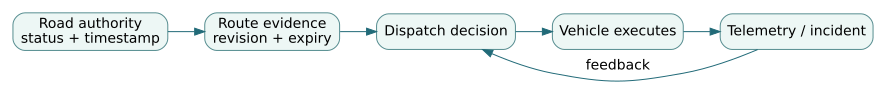

# 1. Safety as a system-level control problem

*Graduate engineering sequence · Safety and Human Factors · Northstar regional mobility case*

**Prerequisites:** requirements, architecture and interfaces, probability, system state and control loops. **Read alongside:** System Design and Integration, System Test and Evaluation, and Management of Complex Systems. This chapter concerns a fictional dispatch service; no operational safety certification is implied.

## 1.1 Why component reliability is not the definition of safety

Safety is an emergent property of a system operating in a particular context. A component may work according to its specification while the overall system produces an unacceptable outcome. Consider a dispatch controller that correctly forwards an authenticated route recommendation, but does so after a road closure. The software may pass every conventional functional test of authentication, message integrity, and correct serialization. Nevertheless, a route based on stale information can create a hazardous control action. The relevant question is not merely *did this component fail?* but *could the system's control structure allow a hazardous state?*

We will distinguish four statements. A **loss** is a consequence society or stakeholders want to avoid (for example, passengers entering a blocked evacuation corridor). A **hazard** is a system state which, combined with environmental conditions, could lead to that loss (for example, a vehicle dispatched on a route that is no longer known to be open). A **safety constraint** is a required restriction on system behavior that prevents or mitigates a hazard. A **control action** is an instruction, permission, or feedback that can influence the controlled process. These categories are related, but they are not interchangeable. An organization cannot verify a vague aspiration to 'be safe'; it can evaluate specific control constraints under stated environmental assumptions.

For Northstar, consider loss L1: dispatching a vehicle into a route that is presently restricted. Hazard H1: the scheduler grants a departure permission while its route-status knowledge is obsolete. Constraint SC1: a departure permission must not be issued unless the route's authorization evidence is current under a defined freshness policy, or a separately approved degraded-operation procedure is active. The *scope* matters. A system may keep operating with cached data in a noncritical visualization; the same caching policy may be unacceptable for a permission that directly initiates motion.

## 1.2 Deriving unsafe control actions

Start with the control structure: the authority supplies road status; the route service converts it to an authorized route; the scheduler issues a departure permission; an operator or vehicle executes it; telemetry and event reports return to the controller. Each arrow is a hypothesis about timing, authority, and semantics. For every important control action ask whether it can become unsafe when: (i) not provided when required; (ii) provided when it should not be; (iii) provided too early, too late, or in the wrong order; or (iv) applied too long or stopped too soon.

Take `authorize_departure(vehicle, route, revision)`. An authorization may be unsafe if it is issued with a route that became restricted, if it arrives after its expiry but appears valid, if it authorizes two conflicting routes, or if the controller assumes the vehicle consumed a cancellation that the network dropped. These failure modes need not involve a coding defect. The same hazard could arise from poor authority coordination, time synchronization, ambiguous operational responsibility, or incentives to maintain throughput during an incident.

A useful hazard log therefore records **causal scenarios**, not only failure labels. The entry 'message delay' is incomplete. A reviewable scenario is: 'At 09:03 the road authority closes segment C; a route service with a 90-second cache continues to sign routes using the 09:02 state; the scheduler accepts a token based only on signature validity; the vehicle departs at 09:04.' Each step can be assigned prevention and detection mechanisms, telemetry needs, test cases, and responsible owners.

## 1.3 Formalizing a safety constraint

Define the age of route evidence at decision time as $a=t_{decision}-t_{observed}$. Let $a_{max}$ be the engineering freshness budget, and let $valid$ require a recognized authority, matching route, unexpired decision token, correct revision, and an uncompromised signature. A simplified safety property is

$$
G\left(\operatorname{depart}\Rightarrow (valid\land 0\le a\le a_{max})\lor approved\_degraded\right).
$$

Read $G$ as 'globally, at every observed state.' This is a **safety property**: a finite sequence ending in a departure without acceptable evidence can refute it. Compare the liveness requirement $G(requested\Rightarrow F(resolved))$, which says something good eventually happens. Neither one implies a deadline; if an emergency response must be completed in 30 seconds, the property must include an explicit clock bound or an appropriate timed formalism.

The formal expression is not sufficient by itself. What is the clock source? Can `observed` be an estimate generated by an offline process? Does a delayed cancellation invalidate an already issued token? Who grants `approved_degraded`, under what restrictions, and for how long? A credible specification must answer these operational questions; otherwise the mathematics hides ambiguity behind attractive symbols.

**Worked calculation.** The route service timestamps observation at 10:00:00. Authorization arrives at 10:00:18; scheduling takes 4 seconds; the vehicle may execute up to 7 seconds later. At execution the evidence is at most 29 seconds old if all clocks are aligned. With a 30-second policy the nominal case has 1 second of margin. If timestamp skew can be as large as 3 seconds, the conservative age upper bound is 32 seconds. The design is **not demonstrably compliant**. Merely adding 18 + 4 + 7 and overlooking timestamp uncertainty would produce a false pass. Reducing the dispatch validity window, synchronizing clocks, or rechecking evidence at execution are different design options; each changes the assurance argument and must be tested under faults.

## 1.4 Fault trees, event sequences and epistemic limits

A fault tree asks which combinations of basic events could produce a top event. If 'unsafe departure' could occur when *stale route evidence AND authorization accepted*, a simple gate representation is useful for exploring prevention opportunities. But static fault trees do not automatically represent feedback, timing, organizational authority, or adaptive operator response. A control-theoretic hazard analysis is complementary, not equivalent.

A simple event sequence illustrates risk arithmetic. Suppose a stale authorization is issued with probability $0.02$ per request, and an independent validator misses it with conditional probability $0.1$. The model yields $0.002$ expected unsafe authorizations per request. That arithmetic is correct **only if** the probabilities describe the operational population and the validator miss probability is conditional on the stale case. If the validator reads the same stale database, common-cause dependence can make the actual conditional miss probability much higher. A safety analyst should not multiply convenient nominal numbers while ignoring shared infrastructure.

For rare losses, model uncertainty may dominate statistical uncertainty. Ten thousand uneventful synthetic dispatches from an incorrect traffic model cannot establish safety in unmodeled emergency conditions. Evidence should include adversarial scenarios, operator practice, independent route observations where feasible, and an explicit statement of residual unverified assumptions.

## 1.5 From constraint to testable evidence

Build the claim-evidence chain: loss L1 → hazard H1 → safety constraint SC1 → allocated controllers and interfaces → test conditions → configured results → residual risk argument. An executable test suite should include stale-but-signed evidence, forged revisions, unsynchronized clocks, delayed cancellations, operator overrides, communication partitions, and recovery after connectivity returns. Each test needs a pass criterion and provenance: source revision, test data, clock policy, runtime environment, evaluator, and decision date.

A green automated test does not settle questions of operational authority or human-machine understanding. For example, a correctly functioning override button may still be unsafe if its labeling implies a different action. The system assurance argument must join software properties, interface semantics, human behavior, and institutional governance.

## 1.6 Counterarguments and common errors

A strict fail-closed policy prevents some unsafe actions but may harm access in a rapidly evolving evacuation. A permissive policy preserves throughput but may allow stale permissions. This is a real engineering trade, not a choice between 'safe' and 'unsafe' personalities. Derive bounded degraded modes: restricted routes, reduced speed, human confirmation, heightened monitoring, or temporary refusal to service specific corridors. Assess consequences of each for different user groups.

Common errors include treating a signed token as current; treating zero observed losses as proof of negligible risk; evaluating safety only through component failure rates; omitting the operating context; and using a hazard register as a substitute for test and operational evidence. Record each claim in a form an independent reviewer can falsify.

## Problems — work before revealing solutions

1. An observation timestamp is 08:00:00; processing is 12 seconds, scheduling 9 seconds, execution delay 8 seconds, and clock uncertainty 4 seconds. Can the system defend a 30-second freshness limit?
2. An authorization failure occurs with probability 0.04, and a validator misses that failure with conditional probability 0.15. Calculate the simple top-event estimate. Explain how a shared stale cache could change it.
3. Formulate two unsafe control actions involving an operator override. State which can be checked by a finite bad trace and which requires additional operational evidence.
4. Explain how a fail-closed policy might create a separate mission loss in an evacuation context. Propose a constrained degraded mode and the evidence it would require.

Worked solutions and reviewer notes

1. Conservative age bound is $12+9+8+4=33$ seconds. It fails the 30-second constraint by 3 seconds, even though the nominal 29-second age appears compliant.
2. $0.04(0.15)=0.006$ per authorization under the modeled conditional probability. A common cause may increase $P(miss\mid failure)$, so the product is not reliable without operational evidence of conditional behavior.
3. Unsafe provision: override allowed while a segment is restricted; a finite trace showing that action can refute the safety property. Unsafe absence: no override available during a documented safe-recovery condition; a complete operational evaluation is required to establish whether delay or omission causes harm.
4. A total dispatch halt may prevent transportation of vulnerable passengers. A constrained mode could require an independently observed open corridor, an explicitly authorized human decision, and shorter authorization validity; it needs exercises testing the human workflow and fault resilience.

## Transfer to the course and laboratory

[Conduct the stale-permission laboratory](../labs/01-safety.html) · [Download the Python constraint checker](../code/system_models.py) · [Open the accompanying notebook](../notebooks/01-safety.ipynb). The assessed course assignment should include hazards and safety constraints, evidence ownership, and the assumptions under which the decision is valid.

**Independent reference:** [NASA Systems Engineering Handbook (human systems integration)](https://www.nasa.gov/reference/system-engineering-handbook-appendix/). See also [NIST SP 800-160 Vol. 1 Rev. 1](https://csrc.nist.gov/pubs/sp/800/160/v1/r1/final) for security and trustworthiness as system engineering concerns.

<!-- STEP04-ADVANCED-STUDIES-START -->
## Integrated case NS-G4.1 — Safety contract and evidence age

> **NS-G4.1 case convention.** Every number in this extension comes from a controlled, fictional emergency-dispatch dataset, unless explicitly identified as an illustrative assumption. A Python screening result is not an operational safety finding, a validated queue model, or an authorization from independently managed agencies. The case is shared with the other five advanced-studies chapters; use the same `revision: 1.0` throughout.

**Reproduce:** [controlled JSON](../data/ns-g4.1-case.json) · [Python model](../code/ns_advanced_case.py) · [computed results](../outputs/ns-g4.1-results.json) · [integrated laboratory](../labs/INTEGRATED-CASE.html).

### G1. Safety claim as an executable obligation

The regional dispatch mission asks the scheduler to authorize a mobility movement only when the road authority's route status is acceptably current. Trace the **loss** (passengers enter a closed corridor) to the **hazard** (departure permitted under obsolete knowledge), then to an operational **constraint**: *Do not issue departure permission if the effective upper bound on route-evidence age exceeds 30 s or the currently authorized route revision differs from the token revision.* The owner of an approved degraded operating mode is separate from the route cache; the teaching predicate does **not** model such authorization.

The code checks one decision predicate, not the entire temporal logic requirement. For a clock bound at decision time, combine observation-to-decision delay, possible execution latency, and adverse clock skew:

\[
A_{\max}=(t_d-t_o)+\Delta_{execute}+\epsilon_{clock},
\qquad m=30\,\mathrm{s}-A_{\max}.
\]

Here \(t_o\) is the observation timestamp and \(t_d\) is the permission decision timestamp, both in seconds on the stipulated clock reference. \(\Delta_{execute}\) bounds delayed actuation and \(\epsilon_{clock}\) is a one-sided worst-case clock error—not a stochastic standard deviation. If timestamps can come from unrelated clocks, the bound needs a synchronization specification and empirical error evidence; arithmetic alone does not fix that omission.

**Worked calculation.** The baseline observation is at 100 s, decision at 126 s, maximum execution delay 5 s and clock uncertainty 3 s. Then \(A_{\max}=26+5+3=34\) s, and \(m=-4\) s: a signed baseline authorization fails even without a known road closure. In the coordinated policy the observation is refreshed to 110 s, yielding \(A_{\max}=16+5+3=24\) s, or **6 s** of nominal margin. In the compound disruption, extra clock uncertainty of 5 s gives 29 s, leaving just 1 s; that case still fails other engineering constraints. A route-interface revision drift from R2 to R3 defeats the nominal permission even though its age remains 24 s.

### G2. Why this is an incomplete safety demonstration

A finite trace containing a departure with \(A_{\max}>30\) is a counterexample to this constrained property. But a *passing* predicate cannot establish the invariance of the property over every controller state, message ordering, network partition, and operator action. The case assumes valid signatures, bounded skew, and an authoritative route-source revision; cryptographic verification and certificate revocation are not implemented. An authorization may also be harmful when a fail-closed response prevents accessible evacuation. That competing loss requires a separately reviewed degraded-mode design, not a silent exception coded into the predicate.

Allocate evidence by claim: test the clock and scheduling bound, independently check revision provenance, exercise cancellation/delay race conditions, observe operator override behavior, and record signed institutional permissions. For each evidence item store baseline revision, intended use, evaluator, test date, and unresolved hazards. A passing latency regression is **necessary evidence within scope**, not a substitute for a safety case.

### G3. Sensitivity and counterexample

At the coordinated policy's 24-second nominal bound, an additional 7-second skew makes \(A_{\max}=31\) s and changes a pass into a fail. Under the stipulated 30-second limit, the maximum additional one-sided skew is 6 seconds. Do not describe a stochastic confidence bound as a hard worst-case bound without deriving the tail risk. In a real system, build a timed state model for issued, revoked, received and executed permissions and check the cancellation race rather than only testing isolated messages.

### Worked exercise with explained solution

**Problem.** Keep the coordinated policy's 16-second observation-to-decision age and 3-second skew, but increase execution latency from 5 to 12 seconds. Determine the permission decision, the margin, and one change that restores the screen.

**Solution.** \(A_{\max}=16+12+3=31\) s, hence margin \(-1\) s and the simplified screen fails. Reducing the execution bound by at least 1 second would meet the inclusive limit if all other assumptions hold; refreshing the authoritative observation later is another option, but would need a new measured delay budget and an interface-specific validity mechanism. Neither change by itself authorizes deployment.

**Review question.** Which independent agency grants road-closure authority, and where is its permission verified? The JSON records `road_authority: false`. Even a numerical pass must therefore remain **HOLD**.
<!-- STEP04-ADVANCED-STUDIES-END -->
