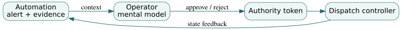

# 2. Human-systems integration as architecture

*Graduate engineering sequence · Safety and Human Factors · Northstar operations room*

**Prerequisites:** Chapter 1, sampling and experimental design, requirements allocation, systems dynamics. **Course connections:** Systems Design and Integration, Test and Evaluation, Agile Systems Engineering and Management of Complex Systems.

## 2.1 The human is not an exception handler

Many system architectures show an operator as a box connected to an automated controller, with a note that 'the human takes over on failure.' That is not a meaningful allocation of responsibility. Humans have sensory, cognitive, physical, organizational and training constraints. A transition that transfers authority at the moment of maximum ambiguity can make a seemingly resilient design fragile. Human-systems integration (HSI) therefore belongs at concept formulation and architecture selection, not only at the end when the control-room screens are designed.

In the Northstar regional dispatch system, an operator may approve an emergency reroute, coordinate a failed vehicle recovery, or interpret contradictory telemetry. Each task has an **information requirement**, a **decision timescale**, and an **authority boundary**. Suppose the system offers only a red 'route conflict' alert without showing the conflicting road restriction, timestamp, and pending departures. An experienced operator might resolve the case using external channels, but the system has displaced missing design requirements onto individual improvisation.

A meaningful role specification distinguishes **detect**, **diagnose**, **decide**, **authorize**, **execute**, and **verify recovery**. Allocation is not merely a row in a RACI chart; it is a hypothesis about whether people, software, and organizations can jointly meet required performance in adverse conditions. Your design evidence should examine normal operations, rare but plausible cases, training interruptions, handoffs, staff turnover and simultaneous incidents.

## 2.2 Workload, queues, and the fallacy of average utilization

A control room receives requests for human intervention. Its workload is not determined only by task duration; it also depends on the arrival process, variability, context switching, prioritization, and whether unresolved cases block subsequent work. A first approximation uses queueing theory. With a Poisson arrival process of rate $\lambda$ and exponentially distributed service time with rate $\mu$, the M/M/1 model gives

$$
\rho=\frac{\lambda}{\mu},\qquad W_q=\frac{\lambda}{\mu(\mu-\lambda)},\qquad W=\frac{1}{\mu-\lambda}.
$$

These equations apply only when $\lambda<\mu$, the system has a single continuously available server, and the stipulated stochastic assumptions are reasonable. For Northstar, if interventions arrive at 5 per hour and an operator can complete 8 per hour, utilization is $0.625$ and average queue waiting is $5/(8\cdot3)=0.2083$ hours, or 12.5 minutes. Average time in the system is 20 minutes. That is radically different from the mean 7.5-minute service time.

Now imagine a promotional briefing reports 'operator utilization just 62.5%' to justify one operator. The briefing omits that a 12.5-minute average waiting time may already violate a 2-minute decision deadline. The *mean* also hides the tail distribution and the fact that rare incidents may arrive in bursts, particularly during severe weather. Increased utilization is not always improvement: in a stochastic queue, small reductions in spare capacity can amplify delay nonlinearly.

If a second trained operator is introduced, the queue becomes an M/M/2 model, not two independent M/M/1 queues unless tasks really are partitioned. Modeling availability, skill mix, shift changes and triage requires richer data. The simple queue formula is a mechanism to reveal structural risk, not a staffing certification model.

## 2.3 Authority allocation and mode confusion

Automation often has distinct operating modes: normal, degraded, maintenance, and emergency. The safe meaning of a button can change by mode. Mode confusion occurs when the operator's mental model diverges from the automation's actual mode and behavior. For example, a 'resume dispatch' command after a network partition might mean 'resume using the last cached map' to the machine and 'revalidate all routes' to the operator. Both may be internally consistent but operationally incompatible.

Model an authority-transfer protocol explicitly. Let $A\in\{machine,human,locked\}$ denote who has authority to permit departure. A proposed handoff might require: (1) machine declares degraded mode; (2) pending permissions are revoked; (3) operator acknowledges the current route and its evidence age; (4) authority changes to human; (5) the system records the authorization. An invariant is 'at most one authority can issue a valid permission for a given vehicle and interval.' A liveness property might require that, after recovery and review, the system can eventually return to normal authority. Handoff should have explicit rollback and timeout behavior.

Some duties cannot be safely automated without changing institutional authority. A regional road authority may be legally responsible for closure status, while a private dispatch vendor may execute the decision. The interface must distinguish **information**, **recommendation**, and **authorization**. Training an operator to click a well-designed button does not resolve an ambiguous legal delegation.

## 2.4 Designing experiments with human participants

A usability demo where an engineer operates the interface is not evidence that trained dispatchers can meet emergency response requirements. An HSI evaluation should specify tasks, participant populations, exposure to abnormal conditions, dependent variables, potential confounds, and ethical safeguards. Time-to-detect, time-to-understand, correct decision rate, unsafe action rate, workload ratings, false-alarm acceptance, and recovery quality all matter. The dataset should record failures and missing observations, not just successful completion times.

**Worked experiment.** Twelve participants each complete a matched scenario with interface A and interface B; suppose the average paired time improvement $d_i=A_i-B_i$ is 18 seconds with sample standard deviation 20 seconds. An approximate paired 95% confidence interval is

$$
\bar d\pm t_{0.975,11}\frac{s_d}{\sqrt{12}}=18\pm 2.201\frac{20}{\sqrt{12}},
$$

or approximately $[5.3,30.7]$ seconds. The result supports faster average completion **within the studied tasks and participants**. It says nothing on its own about error severity, distribution tails, training retention, or whether the study had counterbalanced task order. If all operators used A before B, learning effects could explain some improvement. A crossover design must counterbalance or randomize order and define how to handle learning and carryover.

A more dangerous case is 'B is faster but produces one unsafe route approval under high workload.' Pure time optimization may increase loss. Safety-related decisions should use constraints on unacceptable errors and examine rare or adverse tasks, not solely aggregate throughput.

## 2.5 Alarm design and false-positive dynamics

An alarm is a demand on attention. High sensitivity can generate many false alarms and encourage habituation; high specificity may miss important events. The base rate changes the positive predictive value. If a true hazard occurs in 1% of cases, a detector is 95% sensitive, and the false-positive rate is 5%, then

$$
P(H\mid alarm)=\frac{0.95(0.01)}{0.95(0.01)+0.05(0.99)}\approx0.161.
$$

Only about 16% of alarms correspond to the specified hazard under these assumptions. A false-alarm burden is therefore not evidence of careless operators. The design must provide evidence, prioritize criticality, support rapid confirmation and measure the effect of alarms on competing tasks. Increasing a threshold to reduce alert volume can worsen missed hazards; changing the response workflow may be safer than changing the detector alone.

## 2.6 Synthesis: the integrated design claim

A defensible HSI claim is conditional: 'For trained operators in the defined staffing regime, the interface permits correct reroute decisions within the required time under specified faults, with no observed unsafe approvals in the tested scenarios.' The statement should name the untested workload regimes, sample limitations, and dependence on external authority. Human performance is not an afterthought delegated to a training document: it is an architecture property whose evidence must be developed throughout the lifecycle.

## Problems — attempt before solutions

1. Intervention arrivals increase to 7 per hour while a single operator still serves 8 per hour. Compute $\rho$ and mean queue waiting. Why is this evidence insufficient for emergency staffing?
2. For a hazard prevalence of 2%, sensitivity 90%, and specificity 98%, compute the positive predictive value. Explain why that differs from sensitivity.
3. A proposed recovery workflow changes authority from software to human while outstanding tokens remain valid. Describe one counterexample and a safer protocol.
4. A 12-person paired evaluation improves average completion by 18 seconds, but one participant makes a critical error only with interface B. Explain what data and decision process are needed before a release recommendation.

Worked solutions

1. $\rho=7/8=0.875$; $W_q=7/[8(8-7)]=0.875$ hours, or 52.5 minutes. The M/M/1 assumptions and tails may be invalid, and the result conflicts with time-critical decision needs even before addressing bursty demand.
2. $0.9(0.02)/[0.9(0.02)+0.02(0.98)]\approx0.479$. Sensitivity conditions on the actual hazard; positive predictive value conditions on an alarm and therefore depends on base rate.
3. Both authorities may issue conflicting permissions during transfer. Revoke or expire tokens, require acknowledgement, log transfer and use an atomic or independently reconciled authority rule; test packet loss during each step.
4. Preserve severity-weighted error observations, task order, participant differences, uncertainty bounds, workload and scenario exposure. Investigate whether the error violates a hard safety constraint; average improvement alone cannot override it.

## Transfer and references

[Run the operator-workload laboratory](../labs/02-human.html) · [Open analysis notebook](../notebooks/02-human.ipynb). Revisit the relevant course's HSI or integration deliverable and include a separate operator-performance evidence plan.

**Reading:** [NASA Systems Engineering Handbook — human systems integration](https://www.nasa.gov/reference/system-engineering-handbook-appendix/). Its HSI guidance emphasizes roles, work allocation, lifecycle integration, and risk management.
