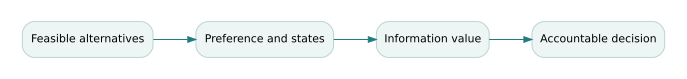

# Decision analysis, risk preferences, and value of information

*Graduate study for Book 14 — Decision Science and Analytics. Companion to the existing course materials; the definitions, mathematics and decisions below are educational rather than operational approvals.*

## The governing question

> How can two technically informed decision makers rationally choose different architectures from the same data?

## Theory and conceptual structure

Engineering decisions require a distinction among **feasibility**, **facts**, **preferences**, and **uncertainty**. Hard safety and legal constraints should reject infeasible options before compensatory scoring. Within the feasible set, a value or utility model makes preferences explicit. A weighted sum is legitimate only when scales, independence conditions and tradeoff meaning have been justified. A weight of 0.6 does not automatically mean an attribute is “60% important”; it specifies a marginal tradeoff under the chosen scaling.

Expected-value decisions are not equivalent to expected-utility decisions when stakeholders are risk-averse or outcomes have asymmetric consequences. The distinction is acute for emergencies: an option with slightly lower expected waiting time but a fat tail of dangerous delays may be unacceptable. Use scenario trees or utility functions and show who bears the downside. Avoid collapsing an entire distribution into a single mean without an accompanying constraint or risk measure.

Value of information asks whether learning can change a decision enough to justify its cost. **Expected value of perfect information (EVPI)** provides an upper bound on the benefit from any test; **expected value of sample information (EVSI)** depends on how informative the test is and how its results update the prior. Neither quantity alone certifies that a test is safe or feasible. Tests also consume calendar time and may expose participants to risk.

The analyst should perform preference and probability sensitivity analyses separately. A recommendation that reverses for modest changes in either should be conditional, perhaps requiring a pilot or a staged investment. Governance requires an accountable decision owner and an explicit rule for revisiting the choice when new evidence arrives.

## Formal model and derivation

\[a^*=\arg\max_{a\in\mathcal F}\sum_s P(s)\,U(a,s).\]
\[EVPI=\sum_s P(s)\max_{a\in\mathcal F}U(a,s)-\max_{a\in\mathcal F}\sum_sP(s)U(a,s).\]
The perfect-information decision is an unattainable benchmark; EVPI is not the value of an actual imperfect sensor or field trial.

The formalism is useful only inside an explicit **model contract**: a defined system boundary, input ranges, configuration, assumptions, uncertainty sources, and an intended decision. Check both units and the semantics of the variables before executing the arithmetic. The result is a conditional engineering claim, not an unconditional guarantee.

## Fully worked Northstar case

Suppose severe demand occurs with probability 0.30. Architecture A yields utilities 90 in normal demand and 40 in severe demand; B yields 75 and 70. Expected utilities are A = 0.7×90 + 0.3×40 = 75 and B = 0.7×75 + 0.3×70 = 73.5. The current choice is A. With perfect demand information, choose A in normal conditions and B in severe conditions: expected utility 0.7×90 + 0.3×70 = 84, hence EVPI = 9 utility units. If the state probability rises above 1/3, B becomes preferable. The probability threshold and feasible pilot cost should be part of the decision memo.

## Counterexample and critical review

**Counterexample:** A scoring model permits exceptional convenience to compensate for inadequate emergency stopping performance. If stopping is a hard constraint, the model is invalid even if stakeholders agree on the weights. Reject the unsafe alternative first.

An independent reviewer should be able to reproduce the favorable result and find at least one material scenario in which it changes. A sensitivity study that does not touch an important assumption can be technically reproducible but decision-irrelevant. Record the source of every number, identify the accountable acceptance authority, and state what the evidence cannot establish.

## Graduate problem set

Attempt each problem before opening the worked solution. In a graded submission, supply units, formulas, assumptions, and a reasoned interpretation—not just the numerical result.

### Problem 1

Verify the expected utilities for A and B in the two-state example.

Worked answer and engineering interpretation

A = 75; B = 73.5, hence A wins by 1.5 under the stated utility scale and probabilities.

### Problem 2

Calculate EVPI and explain its units.

Worked answer and engineering interpretation

84−75 = 9 utility units. Converting that to dollars needs an explicitly elicited utility-to-money tradeoff; it is not automatically $9.

### Problem 3

Find the severe-demand probability p where preferences reverse.

Worked answer and engineering interpretation

90−50p = 75−5p; p=15/45=1/3. Above this threshold B has higher expected utility.

## Laboratory and research transfer

Complete [the accompanying graduate laboratory](../labs/14-decision-science.html). Produce the artifact described there, compare your result to at least one alternative hypothesis, and record what additional evidence would change your recommendation.

## Connections to the curriculum

- [Open Book 14 and its existing weekly lessons](../../B14/OPEN-BOOK.html).
- [Find supplementary calculations and datasets](../INDEX.html).
- The canonical curriculum remains the source of assessed requirements; this study explains one demanding conceptual thread and does not replace its assignments.

## Additional reference reading

These external resources complement the fictional examples; they are not required for offline use.

- [NIST/SEMATECH Engineering Statistics Handbook](https://www.nist.gov/programs-projects/nistsematech-engineering-statistics-handbook)
- [Guide to the Systems Engineering Body of Knowledge](https://sebokwiki.org/wiki/Main_Page)

<!-- STEP04-GRADUATE-METHODS-START -->
## NS-GS4.1 extension — preference models behind non-compensatory gates

The Northstar design alternatives are status quo, throughput push, assurance first, and integrated controls. Their timely and accessible service fractions are **synthetic conditional outcomes** for clear, storm and compound conditions, not estimated population statistics. Scenario weights are deliberately illustrative: 0.50, 0.30 and 0.20.

### Model the constraint before the utility

Let \(t_{ps}\) and \(a_{ps}\) be the timely and accessible fractions for policy \(p\) in scenario \(s\). Hard acceptance criteria require \(t_{ps}\ge0.90\) and \(a_{ps}\ge0.90\), for every declared required scenario. The integrated policy has \(t=(0.97,0.92,0.86)\) and \(a=(0.96,0.91,0.82)\). Its scenario-weighted timely value is \(0.5(0.97)+0.3(0.92)+0.2(0.86)=0.933\), while accessible value is \(0.917\). Those weighted means exceed 0.90, but **compound disruption fails both hard constraints**. Weighted utility cannot compensate for a nonnegotiable safety or equity failure.

### Failure probability versus probability estimates

Under the invented weights, the integrated policy passes both screens in clear and storm, giving 0.80 scenario-weight screening coverage. The assurance-first policy passes only clear, giving 0.50. This is arithmetic on a constructed scenario set, **not** a verified 80% or 50% probability of mission success. Choosing the “best” among infeasible alternatives would conceal the need for redesign or scope negotiation. Value of information should target decisions likely to change with new data, for example whether the compound scenario's service mechanisms are captured accurately.

### Worked exercise and explained solution

**Problem.** A sponsor proposes selecting the integrated policy based on its 0.933 weighted timely score. What two counterchecks prevent approval?

**Solution.** First compute the **worst scenario**: compound \(t=0.86<0.90\) and \(a=0.82<0.90\). Second inspect the separate [digital evidence](../integrated/outputs/ns-gs4.1-results.json): only one of four requirement paths is actionable, and authorities are missing. Approval remains HOLD even if utility weights are unanimously endorsed. Recompute threshold changes in the [integrated lab](../integrated/labs/INTEGRATED-CASE.html), preserving the non-compensatory distinction.

**Canonical overlap.** [Decisions-and-architecture flagship](../../U/flagships/F02-decisions-and-architecture.html) provides general decision theory; the new method focuses on a cross-scenario constraint misread.

**Reproducibility record.** Re-run the [controlled executable model](../integrated/code/ns_gs_case.py) using the [shared case data](../integrated/data/ns-gs4.1-case.json), then compare with the [computed evidence record](../integrated/outputs/ns-gs4.1-results.json). The numerical outputs do not establish field validation or an authorized operating decision.
<!-- STEP04-GRADUATE-METHODS-END -->
