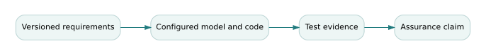

# Versioned digital-thread evidence and configuration-specific assurance

*Graduate study for Book 16 — Digital and Mission Engineering. Companion to the existing course materials; the definitions, mathematics and decisions below are educational rather than operational approvals.*

## The governing question

> Can a perfectly linked digital thread still support a false engineering claim?

## Theory and conceptual structure

A digital thread is an information architecture for connecting authoritative design, implementation, test and operational artifacts through controlled identities and relationships. Link completeness does not guarantee correctness. A green traceability dashboard can conceal stale test evidence, wrong environment configuration, incompatible units or an obsolete requirement revision. Assurance needs **meaningful provenance**, not merely graph reachability.

Represent artifacts as typed, versioned nodes: requirement, architecture decision, interface definition, executable model, test procedure, test result and acceptance claim. Relationships have semantics, such as `satisfies`, `verified_by`, `derived_from`, or `uses_configuration`. A `verified_by` link is legitimate only if the procedure actually tests the relevant predicate under the documented preconditions. The link must also state which revision was exercised.

Configuration baselines create the context for claims. If a software scheduler changes from revision 3 to 4, evidence collected for revision 3 does not automatically verify revision 4. Impact analysis walks the dependency graph to identify potentially invalidated evidence, but the result remains a conservative candidate set that engineers must review. False positives cost retesting; false negatives may hide an unsafe release.

A digital twin adds another requirement: synchronization with a physical asset and an explicit intended use. A dashboard that displays a delayed fleet state is not an acceptable real-time control sensor merely because it is called a twin. Specify freshness thresholds, latency, uncertainty and degradation behavior. Semantic interoperability and governance must be considered when different suppliers own constituent data.

## Formal model and derivation

\[\text{current}(e,r,c)=[e.\text{requirement}=r]\land[e.\text{configuration}=c]\land[e.\text{status}=\text{pass}].\]
An assurance claim is accepted only when every required predicate is supported by configuration-matched evidence. Reachability of a graph path is necessary in many workflows but not sufficient.

The formalism is useful only inside an explicit **model contract**: a defined system boundary, input ranges, configuration, assumptions, uncertainty sources, and an intended decision. Check both units and the semantics of the variables before executing the arithmetic. The result is a conditional engineering claim, not an unconditional guarantee.

## Fully worked Northstar case

Requirement R-17 revision 4 limits emergency-stop response to 180 ms. Test T-9 records 142 ms, but it was performed against software revision 3 and R-17 revision 3's 220 ms threshold. The old test passes a stricter number by coincidence, yet it may lack the new actuator or communication path. The correct evidence state is “not current,” pending delta analysis and a revision-specific test. A requirement-to-test count of 100% would conceal this distinction.

## Counterexample and critical review

**Counterexample:** An artifact graph has no missing edges, but a unit conversion changes a distance threshold from 100 m to 100 ft. Every link resolves; the operating behavior is wrong. Model contracts need semantic unit validation and responsible review.

An independent reviewer should be able to reproduce the favorable result and find at least one material scenario in which it changes. A sensitivity study that does not touch an important assumption can be technically reproducible but decision-irrelevant. Record the source of every number, identify the accountable acceptance authority, and state what the evidence cannot establish.

## Graduate problem set

Attempt each problem before opening the worked solution. In a graded submission, supply units, formulas, assumptions, and a reasoned interpretation—not just the numerical result.

### Problem 1

What is the evidence status for a passing test against obsolete requirement and software revisions?

Worked answer and engineering interpretation

Historical pass, not current verification. Preserve the historical record and open an impact decision for the new baseline.

### Problem 2

Give an example where a `verified_by` relationship is semantically wrong.

Worked answer and engineering interpretation

A test measuring average dispatch throughput cannot prove a worst-case emergency-stop latency requirement, even if the IDs and configurations match.

### Problem 3

A twin receives telemetry at t=100 s and is used at t=108 s; the maximum freshness is 5 s. What must happen?

Worked answer and engineering interpretation

Age is 8 s, exceeding the freshness contract. Mark state stale and invoke the defined degraded/manual mode; do not silently continue a normal decision.

## Laboratory and research transfer

Complete [the accompanying graduate laboratory](../labs/16-digital-thread.html). Produce the artifact described there, compare your result to at least one alternative hypothesis, and record what additional evidence would change your recommendation.

## Connections to the curriculum

- [Open Book 16 and its existing weekly lessons](../../B16/OPEN-BOOK.html).
- [Find supplementary calculations and datasets](../INDEX.html).
- The canonical curriculum remains the source of assessed requirements; this study explains one demanding conceptual thread and does not replace its assignments.

## Additional reference reading

These external resources complement the fictional examples; they are not required for offline use.

- [NASA Systems Engineering Handbook](https://www.nasa.gov/reference/systems-engineering-handbook/)
- [Guide to the Systems Engineering Body of Knowledge](https://sebokwiki.org/wiki/Main_Page)

<!-- STEP04-GRADUATE-METHODS-START -->
## NS-GS4.1 extension — actionable traceability is configuration-specific

A connected requirements graph is not necessarily an actionable assurance argument. Every supporting record needs a valid type, configuration revision, evidence date, acceptance decision and owner. The synthetic case has four requirement-to-artifact paths, with a maximum instructional evidence age of 20 days. The case intentionally includes three distinct failures.

### Predicate for eligible evidence

For requirement \(r\), define \(A(r)=V(r)\land F(r)\land P(r)\), where \(V\) indicates exact revision match, \(F\) indicates age within 20 days, and \(P\) denotes an authorized approval of the evidence itself. The operational release decision must satisfy still more gates outside \(A\). This model permits exactly one actionable record: R-ACCESS. R-SAFETY is 22 days old and unapproved; R-INTEROP references interface revision 1.0 where revision 2.0 is required; R-PRIVACY is current and matching but unapproved.

Actionable coverage is therefore \(1/4=25\%\). The percentage is a **record coverage diagnostic**, not a service success fraction. Remediating R-INTEROP's revision alone would raise coverage to \(2/4\) if its evidence remained authorized and current. Rebuilding an index or running a link checker does not fix a stale experiment.

### Assumptions, adverse tests and operational limits

The case simplifies evidence validity to three predicates. Real assurance needs test environment, instrument calibration, requirements semantics, independence of reviewers, scope, chain of custody and retained negative results. Configuration mismatch should fail closed. An explicit negative test must reject an approval flag recorded as text (`"yes"`) rather than Boolean true; coercing strings into truth values would allow an authorization bypass.

### Worked exercise and explained solution

**Problem.** R-SAFETY has age 22 days and no approval. A new record is attached at age 4 days, but nobody signs it. Does it become actionable?

**Solution.** No. Updating freshness makes \(F=\mathrm{true}\), but \(P=\mathrm{false}\). By conjunction, \(A=\mathrm{false}\). The [integrated laboratory](../integrated/labs/INTEGRATED-CASE.html) asks students to identify all missing predicates before proposing the minimum new evidence.

**Canonical overlap.** The [software-intensive-architecture flagship](../../U/flagships/F05-software-intensive-architecture.html) describes software contracts; this extension concentrates on *version-specific claim eligibility*.

**Reproducibility record.** Re-run the [controlled executable model](../integrated/code/ns_gs_case.py) using the [shared case data](../integrated/data/ns-gs4.1-case.json), then compare with the [computed evidence record](../integrated/outputs/ns-gs4.1-results.json). The numerical outputs do not establish field validation or an authorized operating decision.
<!-- STEP04-GRADUATE-METHODS-END -->
