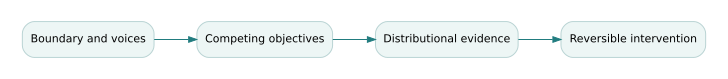

# Boundary critique, conflicting values, and responsible complex-system intervention

*Graduate study for Book 20 — Management of Complex Systems. Companion to the existing course materials; the definitions, mathematics and decisions below are educational rather than operational approvals.*

## The governing question

> When an engineering optimization succeeds but some affected groups are worse off, was the system improved?

## Theory and conceptual structure

Complex systems involve interaction, adaptation, feedback and incomplete control. A systems model necessarily selects a boundary: some stakeholders, costs and consequences are represented while others are excluded. That boundary is a political and ethical decision as well as a technical convenience. A critical systems approach asks who defines success, who has expertise and authority, and whose experiences are treated as legitimate evidence.

Optimization often hides contested preferences inside one objective function. A regional mobility algorithm might reduce aggregate wait time while increasing delays in rural or low-demand communities. The mean is mathematically correct but incompatible with a mission of equitable emergency access. Distribution-sensitive outcomes, minimum-service constraints and participatory review should complement aggregate performance.

Interventions produce adaptation. When a subsidy changes dispatch priority, agencies may modify reporting, residents may change demand, and contractors may optimize to the new metric. A static before-and-after evaluation can mistake strategic response for the intended benefit. Use multiple models: quantitative system dynamics, stakeholder narratives, causal comparison and scenario testing. Disagreement among models is information about boundary and assumption differences, not necessarily a defect to erase.

A responsible intervention specifies monitoring, complaint mechanisms, escalation rights and reversibility. A pilot must identify possible harms, consent and authority conditions, and what evidence triggers a pause. Rare catastrophic harm cannot be averaged away by benefits to many other participants. Graduate-level analysis should distinguish factual disagreement from value disagreement and document both.

## Formal model and derivation

\[\min\ \bar W=\sum_g w_g\,W_g\qquad\text{subject to}\qquad W_g\le W_g^{max}\ \forall g.\]
The aggregate mean \(\bar W\) can improve while one group violates its maximum tolerated delay. Constraint selection and weights \(w_g\) require stakeholder justification; mathematics cannot choose the legitimate boundary.

The formalism is useful only inside an explicit **model contract**: a defined system boundary, input ranges, configuration, assumptions, uncertainty sources, and an intended decision. Check both units and the semantics of the variables before executing the arithmetic. The result is a conditional engineering claim, not an unconditional guarantee.

## Fully worked Northstar case

Before an intervention, average delays for urban and rural users are 12 and 20 minutes, with 80% urban demand. Aggregate mean = 0.8×12 + 0.2×20 = 13.6 minutes. After priority optimization, urban delay falls to 8 while rural rises to 32. Aggregate mean becomes 0.8×8 + 0.2×32 = 12.8 minutes. The overall metric improves by 0.8 minutes even though rural users lose 12 minutes. If the rural service requirement is at most 25 minutes, the “improved” architecture is infeasible. Evaluate the distribution and the authority behind the boundary, not only the average.

## Counterexample and critical review

**Counterexample:** Officials describe a community as a “low-utilization edge case” and omit it from a pilot's denominator. Subsequent success reports are internally consistent but exclude a group bearing the largest harm. Publication of the boundary and accessible grievance routes are essential safeguards.

An independent reviewer should be able to reproduce the favorable result and find at least one material scenario in which it changes. A sensitivity study that does not touch an important assumption can be technically reproducible but decision-irrelevant. Record the source of every number, identify the accountable acceptance authority, and state what the evidence cannot establish.

## Graduate problem set

Attempt each problem before opening the worked solution. In a graded submission, supply units, formulas, assumptions, and a reasoned interpretation—not just the numerical result.

### Problem 1

Compute aggregate delay before and after for 80% urban demand and the stated group delays.

Worked answer and engineering interpretation

Before 13.6 minutes; after 12.8. Aggregate improvement masks a 12-minute rural deterioration.

### Problem 2

What changes when rural delay must remain ≤25 minutes?

Worked answer and engineering interpretation

The proposed intervention is infeasible under that rule, even though it improves the average. Redesign dispatch policy or resources.

### Problem 3

Who should have authority to approve the boundary and fairness rule?

Worked answer and engineering interpretation

Legitimate governance should include accountable public authorities and affected groups, with transparent justification and appeal. A model developer alone should not decide the distributive norm.

## Laboratory and research transfer

Complete [the accompanying graduate laboratory](../labs/20-critical-interventions.html). Produce the artifact described there, compare your result to at least one alternative hypothesis, and record what additional evidence would change your recommendation.

## Connections to the curriculum

- [Open Book 20 and its existing weekly lessons](../../B20/OPEN-BOOK.html).
- [Find supplementary calculations and datasets](../INDEX.html).
- The canonical curriculum remains the source of assessed requirements; this study explains one demanding conceptual thread and does not replace its assignments.

## Additional reference reading

These external resources complement the fictional examples; they are not required for offline use.

- [Guide to the Systems Engineering Body of Knowledge](https://sebokwiki.org/wiki/Main_Page)
- [NIST/SEMATECH Engineering Statistics Handbook](https://www.nist.gov/programs-projects/nistsematech-engineering-statistics-handbook)
