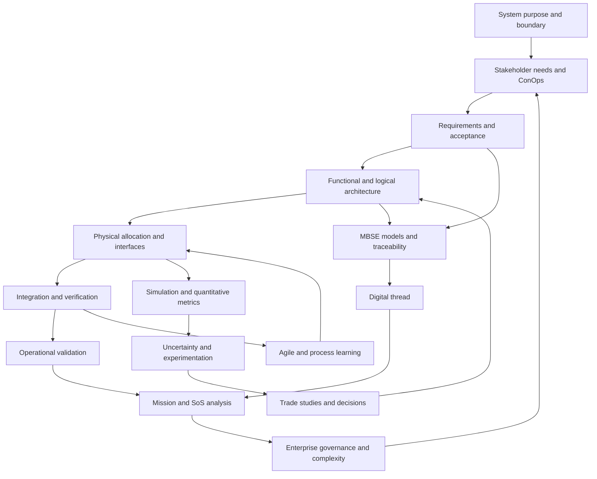

# Concept dependency map — cross-course view

This graph shows a *learning progression*, not a strict university prerequisite rule. Individual concepts loop back and strengthen one another. The original phase READMEs contain the authoritative recommended course sequencing for this independent packet.

## Four relationships worth remembering

1. **Needs → requirements** translates stakeholder value into controlled obligations. If requirements change without revisiting needs, compliance can drift away from usefulness.
2. **Architecture → interfaces → integration** transforms decomposition into end-to-end behavior. Local component success does not guarantee service success.
3. **Model → evidence → decision** connects simulation, assumptions, uncertainty and intended use. A model cannot justify a decision merely by producing a number.
4. **Enterprise and SoS behavior → new needs** is a feedback path. Governance, incentives and adaptation change what is feasible and valuable.

[Explore concept encyclopedia](CONCEPT-ENCYCLOPEDIA.md) · [See course maps](COURSE-MAPS.md)
