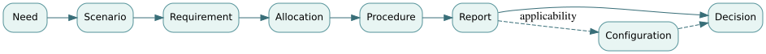

# D01 · From a stakeholder need to defensible verification evidence

**Skill:** Turn a vague operational outcome into a testable chain without mistaking component compliance for mission success.

## The conceptual chain

A need identifies a stakeholder outcome: *People with limited mobility can dependably reach the library*. The outcome is broader than any vehicle specification. It motivates operational scenarios and system requirements; design elements satisfy or realize those requirements; test procedures produce evidence about realized behavior; validation checks fitness in the real service context.

Use distinct link types:

`need → motivated-by → requirement → allocated-to → design element → verified-by → procedure → evidenced-by → report`

The path is **not** proof by itself. Review each relationship's meaning, direction, and applicability. The test report is tied to a particular firmware, route, temperature, demand, date and calibration. A result from an obsolete configuration must not silently verify the current build.

## Derive a measurable requirement

Need: *Passengers can request safe stopping in emergencies.* Scenario: operating at a defined maximum speed, connected over a defined network, with authenticated operator control.

A candidate requirement is:

> When the onboard controller receives a valid authenticated emergency-stop command while the vehicle is operating within the specified speed range, the controller shall begin commanded braking no later than 250 ms after message receipt.

This statement has an event boundary and a measurable output, but it is **not finished** until engineers define “begin commanded braking,” timestamp location, clock synchronization, message validity, operating configurations and sensor error. Also ask whether measuring only the controller ignores total operator-to-vehicle delay. A complete response-time budget might be `notification + communication + authentication + controller + actuation`.

Consider budgets of 80, 100, 60 and 250 ms for four stages: an initial envelope of 490 ms. If the end-to-end system requirement is 400 ms, the architecture is infeasible even when every stage meets its separate limit. Engineers must revise allocations or the top-level claim, not average the numbers.

## Evidence protocol

For each test case include: requirement identifier, test objective, controlled initial conditions, independent observable, measurement uncertainty, pass threshold, calibration, executed procedure revision, source data hash, software/hardware configuration and disposition. Attach any deviation and its waiver authority. Record both confirming and disconfirming evidence.

Verification asks whether a realized item meets specified conditions; validation asks whether the system in context meets real stakeholder needs. A technically compliant stop may still be inappropriate if it triggers unsafe braking behavior for standing passengers or cannot be invoked by the intended operator.

## Failure modes

- A **broken link**: requirement R-17 has no test. Remedy: plan evidence before design freeze.
- A **false link**: T-4 tests a nominal stop but R-17 is emergency braking. Remedy: review semantics, not just link counts.
- A **stale link**: result E-52 belongs to a different controller revision. Remedy: gate on configuration applicability.
- A **missing outcome**: accessible trip completion was never validated. Remedy: conduct representative operational trials.

## Practice and solved answer

**Question:** A braking unit starts acting within 230 ms of the onboard command in every test, but communication sometimes adds 400 ms. Has an operator-to-vehicle 500 ms stop requirement been verified?

Worked response

No. Its worst observed end-to-end response is at least 630 ms plus any upstream delay. The 230 ms result supports a subsystem claim, not the complete system requirement. Evidence must include every allocated segment under representative conditions.

**Transfer artifact:** A typed eight-column claim-to-evidence chain with a configuration identifier and one counterexample for each significant claim.

See also [requirements primer](../../encyclopedia/good-requirements.md), [verification matrix](../../encyclopedia/verification-matrix.md) and [traceability graph](../../encyclopedia/traceability-graph.md).
