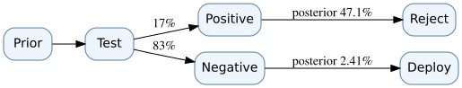

# D03 · Bayesian evidence and the value of a diagnostic test

**Skill:** Separate posterior belief from the economic value of observing a signal.

## Update a prior correctly

Let `H` mean a route-control subsystem has an unacceptable defect. Prior probability is `P(H)=0.10`. A diagnostic test is positive 80% of the time when H is true (sensitivity 0.8), and is positive 10% when H is false (false-positive rate 0.1). The total chance of a positive signal is:

`P(+) = P(+|H)P(H) + P(+|not H)P(not H)`

`= 0.8×0.10 + 0.1×0.90 = 0.17`.

Bayes' rule gives `P(H|+) = 0.08/0.17 ≈ 0.470588`. Despite the 80% sensitivity, a positive result does **not** mean an 80% chance of a defect. For a negative signal, `P(−)=0.83` and `P(H|−)=0.02/0.83≈0.024096`.

## Turn belief into a decision

Assume two actions: **deploy** or **reject**. Deploying a defective subsystem has illustrative expected loss 100; deployment when not defective has loss 0; rejecting always has loss 18. Without testing, expected loss of deploy is `0.10×100 = 10`, less than rejection's 18. Thus deploy is chosen.

If test positive, the conditional expected loss of deploying is `47.06`, so reject (loss 18). If negative, deploy (expected loss `2.4096`). The expected loss under the test-informed policy is:

`0.17×18 + 0.83×(100×0.02/0.83) = 3.06 + 2 = 5.06`.

Expected value of sample information (EVSI), *before test cost*, is `10−5.06 = 4.94` loss units. If testing costs 6 units, it is not economical under this simplified loss model. The expected value of perfect information (EVPI) is an upper bound: perfect information deploys when safe and rejects when defective, giving expected loss `0.9×0+0.1×18=1.8`; EVPI = `10−1.8=8.2`.

## What could invalidate the conclusion?

Test performance may depend on defect severity or operating environment. A signal may not be independent across repeated tests. The loss of a safety incident may not be expressible as a commensurate financial value, and a legal safety gate may prohibit deployment regardless of expected loss. Priors must be elicited transparently and stress-tested.

## Practice

**Question:** Why can a new test with high sensitivity produce zero decision value?

Solution

If each possible result leaves the same action optimal—or if no authorized decision can change—there is no improvement in expected decision value. Information is useful for action only through its effect on the decision policy.

**Transfer artifact:** State/action/loss matrix, signal likelihoods, prior/posterior table, EVSI and break-even test cost. See [Bayesian value of information](../../encyclopedia/bayesian-value-of-information.md).

<!-- STEP04-FLAGSHIP-U1-START -->
### D03 extension · Evidence update with an explicitly conditional independence assumption

Using $P(B)=.15$, sensitivity $P(+|B)=.80$ and false-positive probability $P(+|\neg B)=.10$, compute $P(+)=.80(.15)+.10(.85)=.205$. Therefore $P(B|+)=.12/.205\approx.58537$. Under an **additional**, unverified conditional-independence assumption a second positive produces $[.80(.58537)]/[.80(.58537)+.10(.41463)]\approx.91866$. If the alarms share one camera or weather sensor, using the update twice would double-count information. Posterior probability describes belief under the stated likelihood model; it does not authorize an unsafe route.

**Exercise and solution.** With false positive .20 instead, $P(B|+)=.12/(.12+.17)=.41379$. A lower-specificity alarm is weaker evidence. [Run](../flagship-integration/code/ns_u_case.py).
<!-- STEP04-FLAGSHIP-U1-END -->
