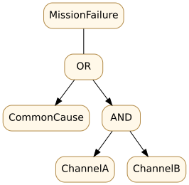

# D07 · Reliability with common-cause failure

**Skill:** Detect when independence assumptions make redundancy claims dramatically overoptimistic.

## Independent redundancy

For two independent identical channels that each fail on demand with probability `p=0.02`, the probability of both failing on one demand is `p²=0.0004` (0.04%). The “parallel system survives if either channel survives” logic is only valid if failure definitions and independence assumptions hold in the specified environment.

## Add one common cause

Let `C` be a common power or configuration event with probability `q=0.01` per demand. When C occurs, both channels fail. Conditional on *no* C, assume independent channel failure probability `p=0.02`. Total probability of joint failure is:

`P(both fail) = P(C) + P(not C) × P(A fail and B fail | not C)`

`= q + (1−q)p² = 0.01 + 0.99×0.0004 = 0.010396`.

This is about **1.0396%**, more than 25 times the naive independent-channel estimate. The numbers are synthetic but the logic is widely applicable: common software, power, thermal loads, cyber compromise and operator procedure can defeat redundant hardware.

## Reliability is not resilience

Reliability describes successful behavior under a specified mission, interval and conditions. Resilience asks how the system contains a disturbance, maintains a minimum viable mission and recovers. A failover that keeps a vehicle controllable at reduced speed may be a successful resilience response, even if the normal performance specification is temporarily unavailable.

Evaluate fault trees, state dependencies, diagnostic coverage and recovery logic. A cut set is a combination of basic events sufficient to cause the defined top event; a minimal cut set has no redundant member. But a fault tree's probabilistic aggregation still needs dependence analysis.

## Practice

**Question:** Why is a third identical channel not necessarily an effective answer to common-cause failure?

Solution

An added channel can reduce independent random failures, but may remain vulnerable to the same power, software, environment or governance failure. Diversity, isolation, detection and recovery may be necessary to address the shared cause.

**Transfer artifact:** Top event definition, conditional probability tree, independence rationale, dependency audit, fault-injection scenario and recovery measure. See [probability and dependence](../../encyclopedia/probability-and-dependence.md) and [resilience](../../encyclopedia/resilience-adaptability.md).

<!-- STEP04-FLAGSHIP-U1-START -->
### D07 extension · The common-cause gate changes the conclusion

For two independent components with availability $a$, parallel availability is $A_{ind}=1-(1-a)^2$. With $a=.985$, $A_{ind}=.999775$, above a 99% threshold. Let a separate common-cause event with probability $q=.03$ disable both; assuming that event is independent of the residual component-failure process, $A=(1-q)A_{ind}=.97(.999775)=.96978175$. Independence is a *model choice*, not a property conveyed by a block diagram. A shared power supply, supplier firmware or dispatch authority can invalidate redundancy claims.

**Exercise and solution.** At $q=.005$, $A=.995(.999775)=.994776125> .99$; this sensitivity does not establish that $q=.005$ is true. The availability gate still needs field evidence and configuration-specific scope. [Parameters](../flagship-integration/data/ns-u4.1-case.json).
<!-- STEP04-FLAGSHIP-U1-END -->
