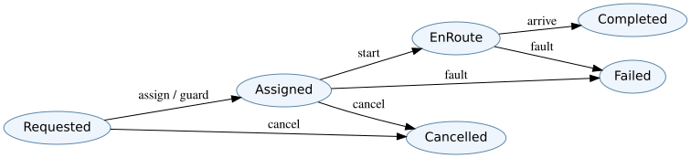

# D11 · Behavioral state machines and interface contracts

**Skill:** Prevent illegal transitions and define observable software behavior without mistaking a diagram for verification.

## States and invariants

A trip request might move through `Requested → Assigned → EnRoute → Completed`, with alternative `Cancelled` and `Failed` states. A finite-state model is an abstraction of allowed system behavior. Transitions have events, guards, actions and postconditions. Invariants must hold in every reachable state: for example, a `Completed` trip has exactly one final charge record, and an unassigned trip cannot have a live driver instruction.

A transition table makes the rules auditable:

| Current | Event | Guard | Next | Action |
|---|---|---|---|---|
| Requested | assign | eligible vehicle available | Assigned | reserve vehicle |
| Assigned | start | driver authenticated | EnRoute | record departure |
| EnRoute | arrive | destination confirmed | Completed | close trip |
| Requested/Assigned | cancel | policy permits | Cancelled | release reservation |

The same event in a different state may be rejected, ignored or handled idempotently; decide deliberately. “Happy path only” state machines hide most integration failures.

## Concurrency and retries

Distributed calls can be delayed, duplicated or reordered. If an assignment command is retried, the same trip must not allocate two vehicles. Use an idempotency key tied to the logical operation, transactional reservation where possible, and a reconciliation path when responses are lost. Exactly-once delivery is not a general property of the network; design behavior so at-least-once execution is safe where appropriate.

## Model checking mindset

Check reachability (can Completed be reached?), safety (can two trips claim the same exclusive vehicle?), and liveness under fair conditions (can a valid request eventually progress or terminate?). A unit test of one method doesn't prove those properties across concurrency and failure states. Derive transition-based test cases, including forbidden transitions and race conditions.

## Practice

**Question:** The same `assign(trip42)` request arrives twice after a timeout. What response protects the booking state?

Solution

Recognize the identical logical operation via its stable idempotency key and return or reconstruct the existing outcome rather than creating a second reservation. Still verify the underlying storage transaction and timeout-reconciliation rules.

**Transfer artifact:** State-transition table, invariant list, negative tests and duplicate/reorder fault-injection scenarios. See [object responsibilities](../../encyclopedia/object-responsibilities.md) and [interface control](../../encyclopedia/interface-control.md).

<!-- STEP04-FLAGSHIP-U1-START -->
### D11 extension · Identity, ordering and revision as separate invariants

A minimal per-request protocol has states $NEW\to COMMITTED\to ACKNOWLEDGED$. An `ACK` must reference an already committed request; immutable event identifiers must not be replayed with changed payloads; and message revision must match the approved contract. In NS-U4.1, `E2` is an exact duplicate, counted once; `E3` acknowledges `R2` before commit; a later `E1` replay changes its digest; `E4` uses obsolete revision 1.0. The three latter conditions are violations independent of throughput. A Python state-machine checker samples declared properties but does not prove correctness under arbitrary concurrency.

**Exercise and solution.** A new revision-2.0 `COMMIT` for `R2` arriving *after* its premature `ACK` cannot retroactively make the earlier history conforming. Reject and review the exception rather than rewriting the order. [Event trace](../flagship-integration/data/ns-u4.1-case.json).
<!-- STEP04-FLAGSHIP-U1-END -->
