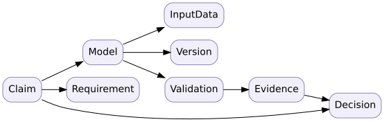

# D12 · Digital thread provenance and bounded digital-twin claims

**Skill:** Define what must be true before a model, build or sensor-backed dashboard can be trusted for an engineering decision.

## The evidence graph

An engineering claim should point to a requirement or mission need, the model or test configuration, method, inputs, data provenance, execution result, uncertainty and review disposition. Store typed links and immutable identifiers; otherwise a reused file name can silently redirect evidence to an incompatible revision.

For example, battery model M-9 revision 3 predicts range for controller firmware 4.2, battery type C and ambient temperatures 5–35°C. A field observation from firmware 5.0 outside that temperature window cannot validate the original prediction without additional argument. The model may still be useful, but the original assurance claim is out of scope.

## Freshness is a requirement, not decoration

A digital twin refers to a specified real-world asset or process and updates at a cadence suitable for its use. Suppose operational decisions require sensor data no older than five minutes. If an incoming reading has timestamp 10:02 and the decision is made at 10:11, its age is nine minutes: reject it for that decision or switch to a documented degraded procedure. Showing the last known point on a map is not equivalent to a current operational estimate.

Other credibility dimensions include representativeness, measurement calibration, state synchronization, uncertainty, model discrepancy and change control. A high-frequency update to a poorly validated model can increase confidence in a wrong answer.

## Maintain a minimum provenance record

- Claim and intended decision; scenario and validity envelope.
- Artifact identifiers, versions, dependency and software bill-of-materials where applicable.
- Observation sources, units, time standard, calibration and data quality.
- Analysis or test procedure, environment and checksums.
- Reviewer, decision authority, approved exceptions and expiry/revalidation trigger.

Treat security as a system property: provenance can be tampered with, and control of a data flow may cross organizations. NIST's systems security engineering guidance can help frame trustworthiness across a lifecycle, but implementation assurance still demands project-specific evidence.

## Practice

**Question:** A digital twin predicts acceptable vehicle range on the basis of stale telemetry but passes all simulation unit tests. Can it authorize dispatch?

Solution

Not without an operational argument that permits the data age and uncertainty. Unit tests address implementation correctness, not freshness, calibration, or fitness for that dispatch decision.

**Transfer artifact:** Provenance graph, time-validity contract, out-of-envelope response and evidence review checklist. See [digital thread and twin](../../encyclopedia/digital-thread-and-twin.md), [model credibility](../../encyclopedia/model-vv-and-credibility.md) and [software lifecycle evidence](../../encyclopedia/software-lifecycle-evidence.md).

<!-- STEP04-FLAGSHIP-U1-START -->
### D12 extension · Evidence status is a typed relation, not a green link

A claim-to-evidence relation is actionable only when the evidence exists, matches the claim's configuration revision, applies to its operating scope, has passed review, and has the required approval. Formally, $A(c,e)=exists(e)\land match\_revision(c,e)\land covers\_scope(c,e)\land reviewed(e)\land approved(e)$. The NS-U4.1 synthetic register has five claims and one actionable match. C2 is stale, C3 has the wrong scope, C4 lacks approval and C5 has no evidence. A checksum protects file integrity, not measurement correctness or legal authority.

**Exercise and solution.** Re-signing stale evidence C2 without re-running the revision-2.0 interface test does not repair the revision mismatch; $A(C2,e)$ remains false. A live mission release also requires permissions from road authority, labor and privacy stakeholders, all unrecorded in this fixture. [Evidence result](../flagship-integration/outputs/ns-u4.1-results.json).
<!-- STEP04-FLAGSHIP-U1-END -->
