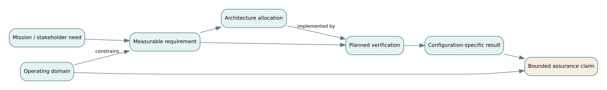

# F01 · From mission need to defensible assurance

*Flagship textbook chapter · foundations, MBSE, software, integration and test · approximate study time: 6–9 hours including exercises.*

**Learning outcome.** Given a vaguely expressed public-service goal, construct an auditable chain of operational claims, requirements, architecture allocations, hazards, verification activities and configuration-specific evidence. Explain what the chain establishes and what it does not.

**Prerequisites:** [system boundaries](../../encyclopedia/system-of-interest.md), [requirements engineering](../../encyclopedia/good-requirements.md), and [verification and validation](../../encyclopedia/v-and-v.md). See also [D01: need to verification evidence](../derivations/01-from-need-to-verification.md). The prerequisite map is curated, not a mandatory universal ordering.

## 1. The engineering question is a claim, not a document

A system program is ultimately trying to justify claims about behavior in a stated environment, with stated uncertainty and limits. A design specification is a proposal about what should exist. A test result describes what happened under particular conditions. Neither by itself proves an operational claim. A legitimate argument connects the intended use, the configured system, credible observations and known gaps.

We will follow a fictional **Northstar regional mobility service**. It dispatches accessible autonomous vehicles to transit stops and medical facilities. The operating authority asks: “Make sure residents can get urgent rides quickly, safely and fairly.” The statement is important, but it is not testable as written. It contains at least four distinct questions: Who qualifies as a user? What qualifies as urgent? How fast is quick? What is safe or fair enough, in what operating domain? These questions cannot be resolved solely by inventing a numerical requirement. They require stakeholder agreement, operational analysis and value judgments.

A useful hierarchy is **mission outcome → scenario and operating domain → stakeholder requirement → system requirement → allocated design commitment → verification evidence → validation evidence**. Trace links should carry rationale and baseline versions, not just IDs. A completeness indicator is never a substitute for persuasive evidence.

## 2. Decide what is inside the boundary

Suppose the service includes dispatch software, vehicles, curbside docking equipment, a remote operations center and a public booking application. Weather, road geometry, third-party mobile networks and emergency-service priorities are external conditions or dependencies. The interfaces with them are nevertheless engineered commitments.

Boundary choice changes accountability. If cellular connectivity is “outside the system,” the design still needs a loss-of-connectivity behavior; assigning it outside does not eliminate the hazard. A useful boundary review asks: Which entity controls this? What is exchanged? What can fail? Who must coordinate a change? What evidence could demonstrate tolerable behavior at this boundary?

Write an operational scenario as a time-ordered interaction, not a list of features: a rider requests a mobility-assistance pickup; a route planner checks the permitted operating domain; a vehicle is offered; the passenger accepts; dispatch allocates a vehicle; network connectivity drops; the vehicle executes a bounded fallback; the rider and remote operator receive a status update. The exception path often reveals more engineering obligations than the happy path.

### Operating-domain definition

A demonstration at 10 km/h on a closed campus does not support an unqualified urban deployment claim. Domain dimensions may include speed, weather, road classes, traffic interactions, accessibility requirements, geofence, network delay, vehicle load, maintenance state and human supervision. A credible release claim states the domain explicitly and treats domain expansion as a change needing fresh evidence.

## 3. Turn mission language into measurable requirements

Consider the proposed statement, “The system shall respond to urgent bookings quickly.” It has an actor and an action, but the response event, measurement method, population and threshold are ambiguous. A stronger version might be:

> **SYS-PERF-014 (illustrative):** For accepted priority ride requests initiated within the approved operating domain, the dispatch service shall issue either a confirmed vehicle assignment or a machine-readable rejection reason within 8 seconds for at least 99% of requests during a defined 24-hour acceptance test with an offered load of up to 10 requests per second.

This is still not a complete requirement until someone defines how the request start and response timestamps are measured; whether retries count; which failure modes are excluded, if any; and why 99% within 8 s is sufficient for the intended outcome. “Response time” here is **dispatch response**, not **vehicle arrival**. These are different measures; a fast booking API cannot establish a short actual wait.

A requirement record should carry: ID, precise statement, parent need, rationale, responsible owner, applicability conditions, verification method, planned pass/fail rule, assumptions and revision. The measurable property must be located on the right boundary. For vehicle pickup, a separate requirement would define elapsed time from *accepted request* to *vehicle at curb*, stratified by relevant populations and conditions.

### Distinguish requirements from design choices

“The dispatcher shall use a PostgreSQL database” is a solution constraint, not a pure performance need. Such constraints can be legitimate when mandated by interoperability or security, but their source and tradeoff should be explicit. Conversely, “minimize pickup time” is an objective with no pass/fail threshold and belongs in a multiobjective decision framework until stakeholders set an acceptance criterion.

## 4. Architecture is a hypothesis about responsibility

A functional architecture identifies **what transformations must occur**: authenticate request, classify urgency, check operational domain, generate candidate assignments, authorize dispatch, monitor progress, manage exceptions, record evidence. A logical architecture describes collaborating elements and the contracts between them. A physical architecture chooses deployed components, networks and devices. These are related but not interchangeable views.

Allocation is many-to-many. A priority-handling requirement might allocate to policy configuration, dispatch scheduler, vehicle interface and operator console. An interface contract may specify a message schema, units, ordering guarantees, acknowledgment rules, timeout behavior and error handling. A payload with a field named `time` is incomplete without its reference clock, unit and timezone or monotonic-clock convention.

A small contract for a vehicle offer could read: `request_id` is globally unique; `offer_id` is idempotent; `expiry_at` uses a specified UTC timestamp representation; an offer cannot be accepted after expiry; duplicate acceptance must not create two assignments. This is where requirements become implementation and verification obligations.

### Failure-oriented architecture reasoning

Ask what happens if messages are lost, duplicated, delayed, reordered or delivered after a restart. For a dispatch service, “exactly once delivery” is not safe to assume merely because a queue vendor advertises delivery guarantees; the whole transaction includes a database state change and vehicle actuation. A robust design might combine durable request IDs, idempotency checks, transactional state transitions, compensation behavior and monitoring.

## 5. Formalize the evidence graph

Represent the engineering record as a directed labeled graph. Nodes may be needs (N), requirements (R), architecture elements (A), hazards (H), verification cases (T), results (E), and claims (C). Useful typed edges include `derived_from`, `allocated_to`, `mitigates`, `verified_by`, `executed_as`, `supports` and `version_of`.

A **traceability check** can detect missing links: for each approved requirement, require at least one verification method, and for each planned test require a requirement or hazard objective. That is a *structural* check; it cannot tell whether the test is relevant, the requirement is correct, or the evidence is credible. A test linked to a requirement about pickup time but measuring API latency is a graph with all green links and the wrong semantic claim.

Let $R$ be the set of approved requirements and $E(r)$ the set of accepted results applicable to requirement $r$. A basic coverage indicator is

$$C = |\{r\in R: E(r)\ne\varnothing\}|/|R|.$$

If 18 out of 20 approved requirements have accepted results, $C=0.90$. The figure says nothing about the severity of the two gaps, evidence quality or unrecorded needs. Report **coverage, criticality and exceptions** separately. Never average a safety-critical failure into a 95% compliance score and conclude the system passes.

A deeper audit tests *semantic alignment*: requirement variable, tested variable, operating domain, baseline version, acceptance rule and uncertainty must match. A result from build 4.1 does not automatically verify an altered design in build 4.2. Change-impact analysis asks which requirements, safety arguments, interfaces, tests and results are potentially invalidated by a modification.

## 6. Verification is not validation

**Verification** asks whether an implementation satisfies specified requirements. **Validation** asks whether the system satisfies stakeholder needs in intended use. Both may involve tests, analysis, inspections or demonstrations, but they answer different questions. NASA's *Systems Engineering Handbook* emphasizes this distinction; see the official [NASA Systems Engineering Handbook](https://www.nasa.gov/reference/systems-engineering-handbook/).

An API throughput test may verify SYS-PERF-014 under a controlled load. To validate mobility access, the authority must additionally examine rider experience, actual pickup delays, denied service, accessibility and operating constraints. The system may perfectly meet a badly chosen requirement and still fail its mission.

Verification evidence needs a **configuration key**: hardware serial or build, software commit, calibration state, test data revision, procedure version, environment, examiner, timestamps and deviations. Evidence provenance answers who did what to which artifact, when and under what controls. Checksums can detect content changes; they cannot prove that a test was well designed.

## 7. Quantitative case: an apparently good acceptance result

Northstar tests 500 priority booking requests; 496 receive a dispatch assignment or rejection within 8 seconds. The observed proportion is $496/500=0.992$. The numerical objective is 99%, but a point estimate above 99% **does not by itself establish** a population claim at a specified confidence level. Under independent Bernoulli sampling, a one-sided lower confidence limit or an appropriately justified acceptance-sampling rule is needed. More importantly, if all 500 requests occur under idle network conditions, the experiment does not represent a busy-day claim.

Separate the layers:

1. **Observed result:** 496 successes of 500, using a defined timing instrument.
2. **Statistical inference:** the plausible performance range under the sampling assumptions.
3. **Design applicability:** which loads, rider types, network conditions and versions the sample represents.
4. **Mission impact:** whether this dispatcher result moves actual pickup time, access and safety in the desired direction.

Conflating these layers causes false assurance. The statistical laboratory in [F03](F03-statistical-assurance.md) revisits exact binomial confidence bounds.

## 8. A change-control exercise

A vendor replaces the vehicle's onboard radio with a lower-cost unit. Procurement argues the interface is unchanged, so no new systems engineering is necessary. Yet the new unit has a different reconnection profile and timing variability. Trace the possible impact: communication-loss hazard → vehicle fallback requirement → timeouts and interface sequence → mission interruption behavior → integration test → evidence baseline → operator training. A disciplined change review may conclude that most evidence can be reused; it must make that conclusion by argument, not assumption.

**Decision gate:** approve the design change only after the affected assurance claims are identified, the retained evidence is justified, missing tests are planned and responsibility for residual risk is accepted by an authorized decision maker.

## 9. A complete miniature assurance case

**Top claim C0:** The configured dispatch service is suitable for a *limited supervised pilot* within a stated operating domain, not for unrestricted public-road deployment.

**Argument strategy:** decompose C0 into functional service correctness, controlled failure behavior, measurable timing performance, accessibility and operational support. **Evidence:** linked requirement tests, integration fault injection, field exercises, incident procedures and stakeholder pilot evaluations. **Assumptions:** communication latency within specified bounds and trained remote operators available. **Defeaters:** untested severe weather, unresolved duplicate-booking defects and missing accessible boarding validation.

The key is not that every box is filled. The key is that another engineer can audit why the conclusion follows, challenge the weak assumptions and identify the unproven remainder. An assurance case is a structured argument subject to critical review, not a substitute for evidence.

## 10. Common misconceptions and corrections

- **“Requirements coverage is proof of safety.”** It measures links or tested requirements; omitted hazards and wrong requirements remain invisible.
- **“A model with a formal notation is automatically correct.”** A rigorous syntax improves consistency but cannot ensure that stakeholder needs or assumptions are right.
- **“If a component passes, the system passes.”** Integration interactions, timing, emergence and shared resources create system-level behavior.
- **“The latest software commit is close enough to the tested version.”** That may be true for a specific change after impact review; it cannot be presumed.
- **“Validation happens only at the end.”** Early scenarios, mockups and simulation can find a wrong problem definition before substantial investment.

## 11. Worked problems and full solutions

### Problem 1 · Trace coverage versus safety coverage

A baseline has 24 requirements. Test evidence is accepted for 21. Two of the three gaps are safety-critical. Calculate basic coverage and advise the review board.

Worked solution

$C=21/24=0.875$ or 87.5%. Do not approve the safety claim from the score. Identify the two critical gaps by ID and hazard, seek targeted evidence or formally restrict the pilot domain, and separately handle the remaining gap. Even 100% structural coverage would not establish the quality of the tests.

### Problem 2 · Wrong observable

A requirement states a maximum 12-minute accepted-request-to-curb arrival time. A report claims compliance because 99.5% of API replies take less than two seconds. Diagnose the error and design a valid observation.

Worked solution

The report measures the dispatch API response, not physical arrival. Record a common, reproducible request-acceptance event and an independently observed at-curb event, including canceled or failed assignments according to a predeclared rule. Stratify by zone and operating domain; quantify measurement uncertainty. The fast API may be useful supporting evidence but not direct verification of curb arrival.

### Problem 3 · Interface unit error

One subsystem sends a timeout as integer `5000`, intending milliseconds; another interprets seconds. Describe one prevention and two detection mechanisms.

Worked solution

Prevent with a typed schema or clearly constrained field such as `timeout_ms` with range and unit metadata. Detect using contract tests at boundary extremes and an end-to-end failure-injection test that measures actual fallback timing. A code-review checklist and telemetry alerts can complement, but not replace, these mechanisms.

### Problem 4 · Baseline mismatch

A passing safety test was run with radio firmware 2.0. The pilot will use 2.1; release notes say “improved reconnect speed.” What evidence reuse argument is needed?

Worked solution

Identify changed communication and fault-recovery functions; compare both firmware configurations and interface contracts; assess affected hazards and test coverage; retest relevant reconnection and fallback paths; document which unaffected tests remain valid with rationale. Treat “improved” as an unverified supplier assertion until supported under the project's domain.

### Problem 5 · Acceptance data

Out of 500 dispatch transactions, 496 satisfy the time criterion. Compute the observed success fraction, then say whether that alone warrants “at least 99% of all future transactions.”

Worked solution

Observed fraction $=496/500=99.2\%$. It is only a point estimate. A population claim needs a sampling and inference framework plus evidence that the tested conditions represent future conditions. It also requires an explicit confidence or acceptance criterion; the numerator alone cannot justify it.

### Problem 6 · Hazard without a parent requirement

A fault-injection experiment reveals duplicate ride assignments after a network retry. No approved requirement mentions idempotency. Should the defect be ignored because trace coverage is technically complete?

Worked solution

No. The observation is evidence of an omitted behavioral obligation and potentially a hazard. Raise a change request, analyze consequences, define an invariant (“one active assignment per request”), allocate responsibility, and add tests that challenge retries, races and restarts. Configuration control should track both the requirement and implementation changes.

### Problem 7 · Distinguish four artifacts

Classify: (a) “The service shall be fair”; (b) “The 90th-percentile pickup time for eligible trips in region A shall be at most 12 min during the pilot”; (c) “The scheduler uses weighted earliest-deadline-first”; (d) “432 of 450 eligible trips met 12 min.”

Worked solution

(a) Stakeholder aspiration or underspecified objective; (b) measurable system performance requirement, provided population, timing definition and acceptance method are fixed; (c) design choice; (d) observed evidence. The raw figure $432/450=96\%$ requires interpretation against a declared acceptance rule and a representative sample.

### Problem 8 · Build an evidence path

Create an evidence graph for “a disabled passenger can safely board,” with two verification routes and one validation activity.

Worked solution

Need N-ACCESS → measurable boarding and restraint requirements → physical lift, interlocks and user-interface allocations. Verification: dimensional/force inspection and fault-injection interlock tests, using recorded device configuration. Validation: observed boarding trials with representative passengers and accessibility experts under agreed ethical/safety controls. Record exclusions, residual risks and the release envelope.

## 12. Practice lab and transferable artifact

Open [Lab 1: evidence graph](../flagship-notebooks/01-evidence-graph.ipynb) or run `python flagship-labs/evidence_graph.py` from the `U/` directory. It checks missing and stale evidence and raises an explicit warning about semantic validity. Use [evidence-chain worksheet](../flagship-worksheets/evidence-chain.csv) to record a small but traceable argument. Your deliverable is a five-page engineering case consisting of: mission statement, operational scenario, 6–10 quantified requirements, interface/architecture allocations, test and validation matrix, and a release claim with explicit limitations.

**Cross-course continuations:** [architecture decisions](F02-decisions-and-architecture.md) · [statistical evidence](F03-statistical-assurance.md) · [dynamic operating behavior](F04-dynamics-and-resilience.md).

**Further authoritative reading:** [NASA Systems Engineering Handbook](https://www.nasa.gov/reference/systems-engineering-handbook/); [INCOSE Systems Engineering Handbook](https://www.incose.org/resources-publications/technical-publications/se-handbook/); [SEBoK](https://sebokwiki.org/). These resources inform method and vocabulary but do not validate the fictional example.
