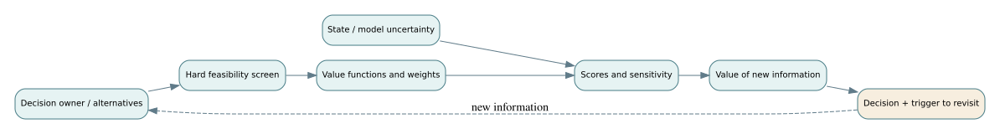

# F02 · Architecture decisions under competing objectives and uncertainty

*Flagship textbook chapter · conceptual design, decision science, project governance · approximate study time: 7–10 hours.*

**Learning outcome.** Formulate a technically defensible trade study, identify when scores are misleading, derive a preference-reversal threshold, and calculate the expected value of imperfect information before committing to costly evidence gathering.

**Prerequisites:** [system architecture](../../encyclopedia/views-and-viewpoints.md), [trade studies](../../encyclopedia/engineering-trades.md) and [decision uncertainty](../../encyclopedia/bayesian-value-of-information.md). Related: [D02 trade reversals](../derivations/02-weighted-trades-and-reversal.md), [D03 Bayesian value of information](../derivations/03-bayesian-test-and-information.md).

## 1. Define a decision before calculating anything

A typical architecture meeting begins with proposals: “centralize dispatch,” “use a broker,” “add another vehicle class.” This is not yet a decision problem. A well-posed decision identifies the **decision owner**, alternatives, decision date, constraints, consequences, preferences, uncertain states and information available at that date. All alternatives should be evaluated against a common mission scenario and baseline.

For fictional Northstar mobility operations, suppose the architecture board must choose among three dispatch architectures:

- **A — centralized control** with a single managed region-wide scheduling service.
- **B — federated coordination** with local dispatchers and a shared policy/control plane.
- **C — hybrid fallback** with central optimization and local degraded-mode dispatch.

The alternatives must describe actual architectures, not slogans. For each, draw major components, interfaces, failure domains, operational staffing, deployment constraints and graceful degradation. An attractive score for “resilience” is meaningless if the scenario used to assign it has no documented connection to actual failure behavior.

## 2. Separate hard constraints from preferences

Imagine a regulatory or safety commitment that emergency dispatch shall not be capable of remotely disabling vehicle emergency stop. Such a safety invariant is a **constraint**, not merely a low-scoring criterion to be compensated for by attractive cost. The decision pipeline should first reject infeasible alternatives; then compare viable ones using preferences.

Let $F$ be the feasible alternative set, where each alternative satisfies $g_j(a)\le 0$ for all hard constraints $j$. A weighted multiattribute score may then be written as

$$S(a)=\sum_{i=1}^k w_i v_i(x_i(a)),\qquad w_i\ge0,\quad\sum_i w_i=1,$$

where $v_i$ is a **value function**, not an arbitrary normalization. A linear value function assumes a constant marginal preference over its range. That may be inappropriate for life-safety outcomes, threshold service levels or cost overruns.

Before choosing weights, make the direction of improvement explicit; state the worst/best anchors; document whether a 0.1 change in one scale is genuinely comparable to a 0.1 change in another. Avoid counting the same outcome twice, such as putting latency, travel time and perceived responsiveness into three heavily weighted criteria without recognizing their dependence.

## 3. Worked weighted score and preference reversal

Suppose stakeholder elicitation yields these hypothetical **value scores**, each in $[0,1]$. They are teaching inputs, not measured attributes of real technologies.

| Architecture | Response value | Safety-case value | Affordability value |
|---|---:|---:|---:|
| A · centralized | 0.85 | 0.75 | 0.95 |
| B · federated | 0.75 | 0.95 | 0.70 |
| C · hybrid | 0.65 | 0.88 | 0.90 |

With weights $(w_R,w_S,w_A)=(0.35,0.45,0.20)$:

- $S(A)=0.35(0.85)+0.45(0.75)+0.20(0.95)=0.8250$.
- $S(B)=0.35(0.75)+0.45(0.95)+0.20(0.70)=0.8300$.
- $S(C)=0.35(0.65)+0.45(0.88)+0.20(0.90)=0.8035$.

B wins, but by **0.005**, a margin small relative to plausible model or elicitation uncertainty. A presentation that lists only B as the winner hides decision fragility.

Now keep response weight at 0.35, let safety weight be $s$, and let affordability weight be $0.65-s$. Then

$$S(A)=0.915-0.20s,\qquad S(B)=0.7175+0.25s.$$

Set them equal: $0.915-0.20s=0.7175+0.25s$. Thus

$$s^*=0.1975/0.45=0.438\overline{8}.$$

If stakeholders' true safety weight is below 0.4389, A outranks B (with response weight fixed). Above that value, B outranks A. A 0.45 stated preference is close to the crossover. The appropriate next step is **preference validation** and **uncertainty analysis**, not false precision.

### What sensitivity analysis can and cannot tell us

Changing one weight while forcing the others to sum to one is a specified preference path; other paths can produce different thresholds. Ranking sensitivity does not by itself show whether either design satisfies hard safety requirements. Uncertain performance estimates and uncertain preferences are different variables and should be analyzed separately.

## 4. Pareto dominance before preference weighting

An alternative is **Pareto dominated** if another is at least as good on every relevant criterion and strictly better on at least one, with consistent preference directions. Dominated choices ordinarily need no further weighted ranking unless they possess an omitted strategic advantage. The nondominated set is a starting point for eliciting tradeoffs, not a single optimal answer.

For example, if a fourth architecture D has response 0.70, safety 0.80 and affordability 0.60, B beats D on response (0.75>0.70), safety (0.95>0.80) and affordability (0.70>0.60). D is dominated by B. The three alternatives A, B and C above are not obviously dominated by one another. A board should inspect **why** a dominated choice was proposed: perhaps a missing maintainability or workforce-integration criterion matters.

## 5. Quantitative uncertainty is more than a range on a slide

Separate three classes:

1. **Aleatory variability:** real operational variation such as passenger arrival times, weather and traffic.
2. **Epistemic uncertainty:** limited knowledge about a model parameter, architecture maturity or supplier performance.
3. **Preference ambiguity:** stakeholders disagree about the desirability of outcomes.

These distinctions drive different actions. More data may reduce epistemic uncertainty, but it cannot eliminate traffic variability. Stakeholder engagement can clarify weights but cannot eliminate random events. A Monte Carlo distribution does not make an incorrect model correct; it only propagates assumed inputs through it.

When multiple attributes depend on the same latent factor—for example, traffic congestion drives both pickup delay and energy use—independent random sampling of those attributes can make architecture risk look too small. Record plausible joint distributions or dependence assumptions; test alternate scenarios when data are sparse.

## 6. Expected value of perfect information

Let uncertain state $\theta$ influence loss $L(a,\theta)$. Without further information, choose $a^*=\arg\min_a E[L(a,\theta)]$. With perfect knowledge of $\theta$, choose the optimal action separately in each state. The expected value of perfect information (EVPI) for minimizing loss is

$$EVPI=\min_a E[L(a,\theta)]-E[\min_a L(a,\theta)].$$

EVPI is an upper bound on what it is rational to pay for **information alone** under this loss model, without additional implementation benefits. It must be nonnegative; if a calculation is negative, revisit the decision logic.

Consider two actions, ship a dispatcher release or fix a potential defect. Let prior defect probability be 0.12; shipping produces loss 100 if defective and 0 otherwise; fixing costs 14 and eliminates this modeled defect. Without testing, expected shipping loss is $0.12\times100=12$, versus fix cost 14. Ship is preferred under the stated simplified model.

With perfect defect knowledge, fix only when defective. Expected loss is $0.12\times14=1.68$, hence $EVPI=12-1.68=10.32$.

## 7. Bayesian update with an imperfect test

A proposed diagnostic test has **sensitivity** $P(+\mid D)=0.80$ and **false-positive rate** $P(+\mid\neg D)=0.10$. Prior $P(D)=0.12$.

Compute the probability of a positive result:

$$P(+)=0.80(0.12)+0.10(0.88)=0.184.$$

Bayes' rule gives

$$P(D\mid +)=0.096/0.184\approx0.52174.$$

For a negative result, $P(-)=0.816$, and

$$P(D\mid -)=0.20(0.12)/0.816\approx0.02941.$$

After a positive result, shipping has expected loss about 52.17, so fix at cost 14. After a negative result, shipping has expected loss about 2.94, so ship. The expected loss **before paying the test price** is

$$0.184(14)+0.816(100\cdot0.0294118)=2.576+2.400=4.976.$$

Therefore $EVSI=12-4.976=7.024$. If the test itself costs 2 (in the same monetary units), the net expected benefit relative to not testing is $7.024-2=5.024$; testing is favored. Verify $EVSI\le EVPI$; here $7.024\le10.32$.

This is not a universal go/no-go rule. It depends on a credible test calibration, the prior defect probability, assumed loss consequences, and the action following each observation. If the test changes the system by inducing damage, or fixing does not eliminate the defect, the model must change.

## 8. Robust decisions and regret

A weighted score ranks alternatives under a point set of weights and performance estimates. A robust design asks how much the decision degrades over a plausible uncertainty set. One useful diagnostic is **regret**:

$$R(a,\theta)=L(a,\theta)-\min_{a'}L(a',\theta).$$

Minimax regret chooses the action whose worst regret across scenarios is smallest. This is *not* identical to minimizing worst absolute loss. Different decision attitudes—expected value, constrained optimization, CVaR, minimax regret—represent different governance preferences; do not quietly swap them while presenting the same answer as “optimal.”

For public-facing systems, also examine subgroup and tail outcomes. Two dispatch architectures can have the same mean pickup time but materially different 95th-percentile wait times or accessibility disparities. If fairness and distributional consequences matter, include appropriate constraints and separate distributional reporting; average utility can mask them.

## 9. Evidence to decision: architecture review package

A useful architecture decision record contains: decision ID and scope; alternatives considered; non-negotiable constraints; baseline assumptions; measures and value scales; source and provenance of data; elicited preferences; trade scoring; sensitivity and risk; unresolved questions; rejected alternative rationale; expected change triggers; and decision owner/date. It should be readable by reviewers who did not participate in the meeting.

Apply [F01](F01-requirements-to-assurance.md): each performance claim used in scoring should connect to a measured result or a calibrated model. If a score depends on an unvalidated simulation, the uncertainty belongs in the record. Apply [F03](F03-statistical-assurance.md) to distinguish estimate precision from model applicability.

## 10. Common traps

- **Arbitrary normalization:** a linear rescaling of dollars into 0–1 points silently imposes willingness-to-pay assumptions.
- **Weight laundering:** numbers from an unstructured vote are presented as a validated stakeholder preference model.
- **Double counting:** highly correlated response time, throughput and customer satisfaction dominate other criteria.
- **Unquantified downside:** 0.90 average safety score hides a rare catastrophic failure mode that should be an explicit constraint.
- **False independence:** multiple failure modes share software, power or communications dependencies.
- **Information without a decision:** collecting more measurements is not valuable if no credible observation can change an action.

## 11. Worked exercises with solutions

### Exercise 1 · Score all three alternatives

Recalculate A, B and C using weights 0.35/0.45/0.20; report margin of winner over runner-up.

Worked solution

$A=0.8250$, $B=0.8300$, $C=0.8035$. Winner B exceeds A by 0.0050. Report the margin and recommend preference/performance sensitivity analysis.

### Exercise 2 · Derive the crossover

With response weight fixed at 0.35 and affordability $0.65-s$, find safety weight $s$ that makes A and B tie.

Worked solution

$S_A=0.915-0.20s$ and $S_B=0.7175+0.25s$. Equality gives $0.45s=0.1975$, so $s=0.438888\ldots$. For $s>0.4389$ B wins; for $s<0.4389$ A wins.

### Exercise 3 · Detect dominance

D scores (0.70,0.80,0.60). Identify a dominating architecture, if any.

Worked solution

B scores (0.75,0.95,0.70), better on all three desirability-oriented attributes, so B dominates D. Before discarding D, make sure no omitted criterion changes feasibility or preferences.

### Exercise 4 · Perfect information

For prior defect probability 0.12, ship loss 100 if defective, and fix cost 14, calculate the optimal action without a test and EVPI.

Worked solution

Ship has expected loss 12, fixing costs 14, so ship. With perfect information, fix only for the 12% defective state; expected loss 1.68. EVPI $=12-1.68=10.32$.

### Exercise 5 · Posterior positive probability

Use sensitivity 80%, false-positive rate 10%, prior defect probability 12%.

Worked solution

$P(+)=0.80(0.12)+0.10(0.88)=0.184$. $P(D\mid+)=0.096/0.184=0.521739\ldots$. A positive result is far from proof of a defect; it materially increases the posterior probability.

### Exercise 6 · Value of imperfect information

Use the optimal “fix positive / ship negative” policy. Calculate expected loss with test and the largest acceptable test price, holding all assumptions fixed.

Worked solution

Pre-test loss under policy: positive contribution $0.184\times14=2.576$; negative defective-and-shipped contribution $0.12\times0.20\times100=2.4$. Total 4.976. Gross EVSI $12-4.976=7.024$; a test priced below 7.024 has positive modeled expected value, before additional operational and implementation consequences.

### Exercise 7 · Sensitivity of a decision

A board's safety weight may be between 0.43 and 0.47, with response fixed at 0.35. Is the preferred architecture stable?

Worked solution

No. The crossover 0.4389 lies inside the plausible interval. A can win at 0.43 while B wins at 0.47. Record the preference ambiguity and test whether a credible discussion or evidence could resolve it.

### Exercise 8 · Value of information under a no-go constraint

A critical invariant has failed for B but passed for A. The prior weighted ranking favored B. What is the immediate decision step?

Worked solution

Remove B from the feasible set or hold it pending an accepted corrective action and renewed verification. Do not offset the critical failure against cost or performance points. Reassess whether A meets all constraints and examine alternatives if it does not.

### Exercise 9 · Correlated metrics

Response-time and throughput metrics are strongly driven by the same utilization parameter. Why might including both overstate evidence for one architecture?

Worked solution

The two criteria may double count the same underlying operational effect and create a misleading impression of independent benefits. Revisit the objective hierarchy, use an appropriately structured multiattribute model, and model correlated performance uncertainty jointly.

### Exercise 10 · Governance translation

Describe a decision trigger after architecture selection that would justify reopening the decision.

Worked solution

Example: the federated option's measured tail network latency rises above its acceptance envelope, violating the bounded fallback claim. Record the measured condition, affected assumptions and requirement IDs, then reopen the architecture review with corrected performance data and feasible mitigation alternatives.

## 12. Lab, worksheet and reading path

Use [Lab 2: architecture decision](../flagship-notebooks/02-trade-decisions.ipynb) or the pure-Python module `flagship-labs/decision_analysis.py`. Reproduce the ranking, reversal threshold, posterior calculations and EVSI. Change one numerical assumption and explain why the preferred decision changes. Use [architecture trade worksheet](../flagship-worksheets/architecture-trade.csv) as the record of alternatives and rationale.

**Deliverable:** an architecture decision record with a feasibility screen, transparent value functions, elicitation rationale, numerical trade results, at least two sensitivity paths, an information-value calculation, and a stated re-review trigger.

**Continuations:** [F03: statistical assurance](F03-statistical-assurance.md) · [F04: dynamics and resilience](F04-dynamics-and-resilience.md). **Further reading:** [SEBoK](https://sebokwiki.org/) and [NASA Systems Engineering Handbook](https://www.nasa.gov/reference/systems-engineering-handbook/).
