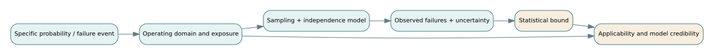

# F03 · Statistical verification, reliability and model credibility

*Flagship textbook chapter · test & evaluation, uncertainty, reliability, simulation · approximate study time: 8–12 hours.*

**Learning outcome.** Design a statistically coherent engineering acceptance argument; calculate exact zero-failure bounds and simple reliability models; distinguish statistical precision, coverage and model credibility; and identify when a claimed system-level reliability is unsupported.

**Prerequisites:** [verification and validation](../../encyclopedia/v-and-v.md), [probability](../../encyclopedia/probability-and-dependence.md), [reliability](../../encyclopedia/probability-and-dependence.md). Companion: [D04 confidence and coverage](../derivations/04-binomial-confidence-and-test-coverage.md) and [D07 dependent reliability](../derivations/07-reliability-dependence.md).

## 1. Specify the estimand before selecting a test

A reliability percentage has no standalone meaning. It must specify the event counted, operating conditions, exposure and population. “99.9% reliable” could mean that a transaction succeeds, a vehicle completes a trip without safety-relevant intervention, a software process remains available for an hour, or a subsystem survives 10,000 operating hours. These quantities are not interchangeable.

For Northstar's illustrative pilot, define a **mission success** as the completion of one accepted passenger pickup and arrival within its operating domain without a safety-critical intervention. That definition forces us to address cancellations, operator interventions, route restrictions, departures outside the domain, retries and multiple rides by the same vehicle.

Write the target estimand $p=P(\text{mission failure}\mid\text{specified operational domain and exposure})$. The conditional phrase is part of the technical definition. A target for service-wide failures may differ from targets for rare safety hazards; each needs its own risk model, acceptance rules and evidence.

## 2. The exact zero-failure upper bound

Assume $n$ independent, identically distributed Bernoulli trials, each with constant unknown failure probability $p$. The probability of seeing zero failures is

$$P(X=0\mid p)=(1-p)^n.$$

To calculate a one-sided exact frequentist upper confidence bound with coverage $1-\alpha$, set the probability of zero failures at the bound equal to $\alpha$:

$$(1-p_U)^n=\alpha\quad\Rightarrow\quad p_U=1-\alpha^{1/n}.$$

At 95% confidence $\alpha=0.05$. For 300 valid independent identical trials with zero failures,

$$p_U=1-0.05^{1/300}\approx0.009936=0.9936\%.$$

This does **not** prove the failure probability is below 0.1%. The colloquial “rule of three,” $p_U\approx3/n$, gives about 1%, which is useful as a rough check. At $n=3,000$, the exact upper bound is about 0.09981%; the threshold for below 0.1% is 2,995 zero-failure trials (taking care with the integer ceiling).

The confidence statement is about long-run procedure coverage under its assumptions. It is not a 95% probability distribution over $p$. A posterior probability statement requires a Bayesian model and prior.

## 3. Sample-size inversion

For a planned one-sided upper bound no larger than target $p_0$ after **zero** failures, solve

$$1-\alpha^{1/n}\le p_0\quad\Rightarrow\quad n\ge\frac{\ln\alpha}{\ln(1-p_0)}.$$

For $p_0=0.001$ and $\alpha=0.05$, $n\ge2994.23\ldots$, so **at least 2,995** successful identical trials. Notice the conditional requirement: the planned sample size only achieves this result **if no failures occur**. It is not a guarantee of passing the experiment. The choice of test duration, stopping rules and failure classification must be settled in advance.

## 4. Why “zero observed failures” is easy to misuse

The Bernoulli model requires a meaningful trial. A hundred runs of one repeated software image under one repeated seed are not necessarily a hundred independent real-world opportunities for distinct faults. Shared latent defects, unvaried scenarios, correlated environmental conditions and the same underlying physical specimen create dependence.

A sample can be statistically very large yet **operationally narrow**. For a shuttle, success at low speed in clear weather cannot justify an unrestricted claim for snow, dense traffic, degraded sensors or unmaintained equipment. Report the operational design domain, scenario sampling plan, exposure hours, exclusions, and the fraction of intended field operation actually represented.

If exposure differs, per-mission Bernoulli modeling may be the wrong tool. A one-minute test and a ten-hour test have different hazard exposure. A constant-rate time-to-failure model or survival-analysis framework may be more suitable, provided its assumptions are tested.

## 5. Binomial likelihood and Bayesian updating

If there are $x$ failures among $n$ comparable trials, the binomial likelihood is proportional to $p^x(1-p)^{n-x}$. With a $\operatorname{Beta}(a,b)$ prior, the posterior is

$$p\mid x,n\sim\operatorname{Beta}(a+x,b+n-x).$$

For a uniform $\operatorname{Beta}(1,1)$ prior and 0 failures in 300 trials, the posterior is $\operatorname{Beta}(1,301)$. Its posterior mean is $1/302\approx0.00331$ (0.331%) and its 95% upper posterior quantile is $1-0.05^{1/301}\approx0.009903$. This differs slightly from the frequentist bound; the probabilistic interpretations are different. A different prior changes the posterior.

**Prior sensitivity matters most when data are limited.** A strong prior based on historical vehicles may be inappropriate if the architecture or operating domain changes. Report the prior provenance and repeat the calculation under reasonable alternatives; do not label a favorable prior “objective.”

## 6. Reliability block diagrams: series and redundancy

Assuming independent component success events, a strict series system that succeeds only if all components succeed has

$$R_{\text{series}}=\prod_{i=1}^k R_i.$$

If power has reliability 0.98, sensing 0.99 and dispatch link 0.97 for the mission exposure, then $R=0.98\times0.99\times0.97=0.941094$.

This is **not** proof of true field reliability: the component values might be uncertain, dependent or measured under incompatible conditions. It also assumes the mission logic genuinely requires all three components to work. Some failures could be recovered or masked by degraded-mode operation, changing the logic.

For two redundant independent channels, each with failure probability 0.08, the probability that both fail is $0.08^2=0.0064$; system success for that function is $1-0.0064=0.9936$. But suppose a separate common-cause event fails both channels with probability 0.02. Under the *additional simplifying assumption* that this event is independent of channel-specific failures, functional reliability is

$$R=(1-0.02)(1-0.08^2)=0.973728.$$

A naive independent-redundancy calculation would overstate reliability by almost two percentage points. A fault tree with common-cause events is often more informative than a simplistic block diagram.

## 7. Continuous-time survival and exposure

Under a constant hazard rate $\lambda$ for a nonrepairable device, survival over time $t$ is

$$R(t)=e^{-\lambda t}.$$

For $\lambda=10^{-4}$ failures/hour and $t=100$ hours, $R=e^{-0.01}\approx0.99005$. The constant-rate assumption is often unreasonable during early-life defects or wear-out; operating stress and maintenance regimes can change the hazard substantially. The formula describes a model, not a certification.

If a system is repairable, **availability** and **reliability** differ. In a simple steady-state two-state repair/failure model, $A\approx MTBF/(MTBF+MTTR)$ under the model's assumptions. A dispatch server may be highly available after rapid restarts yet fail a safety-critical mission during the interruption. Define which property matters to the acceptance decision.

## 8. Measurement uncertainty and traceability

Suppose two unsynchronized timing clocks each have unknown bounded error of ±0.3 s. A recorded duration of 8.1 s may correspond to a true interval from 7.5 to 8.7 s under a conservative worst-case difference of ±0.6 s. If the acceptance threshold is 8.0 s, the observation is **indeterminate under that bound**, not a decisive pass or fail.

If instead errors are independent, approximately zero-mean with known standard uncertainties, root-sum-square propagation may be suitable. That procedure should not be applied to unknown systematic timing offsets. A credible test specification defines calibration, time synchronization, uncertainty budget, decision rule near thresholds and retained raw data.

## 9. Model verification, validation and uncertainty quantification

Engineering teams use models for situations too costly, hazardous or rare to test physically. Keep three questions distinct:

- **Code/solution verification:** Are equations implemented correctly and numerical errors controlled? Examples include conservation checks, analytical benchmark problems and time-step refinement.
- **Model validation:** Does the model adequately represent relevant real behavior for a declared use? Compare with observations not used solely to tune the model, across important domains and failure regimes.
- **Uncertainty quantification:** How do input, parameter, structural and measurement uncertainties influence predictions and decisions?

A numerical solver passing unit tests does not validate the equations; agreement with one scenario does not justify extrapolation to every scenario; and a visually smooth Monte Carlo histogram does not imply correct input distributions. Model **credibility is decision-specific**: a coarse model may be adequate for comparing two staffing plans and wholly inadequate for a rare-event safety claim. For an applied modern discussion, see NIST's [uncertainty quantification in computational modeling and simulation](https://www.nist.gov/publications/methods-uncertainty-quantification-computational-modeling-and-simulation-harmonizing) (2026).

## 10. Demonstration design that connects to operations

A defensible test campaign contains (a) requirement and decision context; (b) explicit estimands and failure definitions; (c) operating-domain strata and exposure plan; (d) measurement design; (e) statistical hypotheses/confidence method selected before seeing results; (f) data integrity and configuration records; (g) execution and deviations; (h) inference; (i) applicability limits; and (j) residual risks.

Do not average over deliberately different subgroups without checking them. A pilot with 95% success overall can still impose unacceptable failure burden on mobility-assistance requests. Safety-critical decisions may require scenario coverage, hazard analysis, physical evidence and independent review in addition to overall statistics.

## 11. Exercises with worked answers

### Exercise 1 · Exact zero-failure bound

Calculate the one-sided 95% upper failure-probability bound for zero failures in 300 valid trials.

Worked solution

$1-0.05^{1/300}=0.009936\ldots=0.9936\%$. The assumptions of independent identically distributed mission trials remain essential.

### Exercise 2 · Plan a sample

How many zero-failure identical trials are required for a one-sided 95% bound below 0.1%?

Worked solution

$n\ge\ln(0.05)/\ln(0.999)=2994.23\ldots$; round up to 2995. The demonstration must actually have zero failures, and the sampling domain must match the stated claim.

### Exercise 3 · Component series logic

Compute independent series reliability from 0.98, 0.99, and 0.97.

Worked solution

$0.98(0.99)(0.97)=0.941094$. If common environmental causes exist, this product need not apply.

### Exercise 4 · Common cause

Two redundant channels fail independently with probability 0.08 each, except a 0.02 common-cause event defeats both. Calculate modeled function reliability.

Worked solution

Conditional on no common cause, $1-0.08^2=0.9936$. Multiply by $0.98$: $R=0.973728$, assuming the common-cause event is independent of channel-specific failures.

### Exercise 5 · Constant-hazard survival

Find survival probability for $\lambda=10^{-4}/h$ and 100 hours.

Worked solution

$R(t)=e^{-\lambda t}=e^{-0.01}\approx0.9900498$. Reassess the constant hazard assumption before treating this as field performance.

### Exercise 6 · Beta posterior

With a uniform Beta(1,1) prior and 0 failures in 300 trials, give the posterior distribution and mean.

Worked solution

Posterior Beta(1,301). Its mean is $1/(1+301)=1/302\approx0.0033113$. This is a posterior mean under a chosen prior, not a frequentist upper confidence bound.

### Exercise 7 · Timing uncertainty

Two devices each have independently unspecified but bounded ±0.3 s absolute clock error. A measured interval is 8.1 s and maximum permitted interval is 8.0 s. Can you assert a failure?

Worked solution

The conservative interval bound is 8.1±0.6 s = [7.5,8.7] s, so it includes values both below and above 8.0. The result is indeterminate under the stated metrology model. Improve synchronization or use a predeclared uncertainty-aware decision rule.

### Exercise 8 · Representative coverage

A team tests 10,000 simulation runs only under sunny, uncongested conditions and claims reliability across heavy snow and dense traffic. Identify the inference error.

Worked solution

The sampling domain does not cover the claimed operating domain. Increasing $n$ in the same narrow stratum reduces uncertainty about that stratum but supplies no direct empirical assurance about excluded conditions. Design new credible validation and operating-domain-specific tests.

### Exercise 9 · Verification versus validation

A simulator reproduces an exact analytical queue formula on a benchmark, but predicted vehicle waits disagree with field observations. What passed, and what failed?

Worked solution

A solution/code verification benchmark passed. The model's validity for field wait-time prediction is in doubt. Check input arrival processes, service-time distributions, priority behavior, balking, network delays and measurement definitions before using predictions for deployment decisions.

### Exercise 10 · Choosing the right measure

A service fails once every 100 hours on average but restarts in 2 minutes. The program wants uninterrupted safe trips. Is steady-state availability the sufficient metric?

Worked solution

No. Even excellent long-run availability does not show probability of completing a trip without interruption. Define per-mission survival or hazard/event probability and include restart consequences, degraded modes and operational recovery arrangements.

## 12. Lab and field-transfer artifact

Use [Lab 3: statistical assurance](../flagship-notebooks/03-statistical-assurance.ipynb) or `python flagship-labs/reliability_evidence.py`. It reproduces exact bounds, sample planning, series and common-cause reliability. Complete the [test campaign worksheet](../flagship-worksheets/test-campaign.csv). Your deliverable is an evidence plan stating claim, domain, estimand, exposure, failure taxonomy, sampling strategy, uncertainty budget, stopping rule, pass/fail decision, configuration baseline and residual gaps.

**Continue:** [F01: traceable claims](F01-requirements-to-assurance.md) · [F04: operating dynamics](F04-dynamics-and-resilience.md). **Authoritative reading:** [NASA Systems Engineering Handbook](https://www.nasa.gov/reference/systems-engineering-handbook/), [SEBoK](https://sebokwiki.org/), and [NIST engineering statistics resources](https://www.itl.nist.gov/div898/handbook/).

<!-- STEP04-FLAGSHIP-U1-START -->
### F03 extension · Sampling precision, subgroup performance, and diagnostic evidence

**Define the estimand.** In NS-U4.1 the measured dispatch success fraction $\hat p=k/n$ is 72/80 under the nominal 8-second rule, not the probability of safe arrival or a 90% confidence statement. If, purely for teaching, observations were independent and identically distributed Bernoulli trials, a two-sided 95% Wilson interval uses $z=1.96$:

$$\frac{\hat p+z^2/(2n)\pm z\sqrt{\hat p(1-\hat p)/n+z^2/(4n^2)}}{1+z^2/n}.$$

The lower Wilson endpoint for $72/80$ is below 90%: the observed threshold is not statistically established. Clustering by incident, vehicle, radio network, or operating shift invalidates the simple i.i.d. interpretation. The conservative timing count is only 67/80. The accessible group has 10 guarded successes among 16 requests; one cannot infer that its population service level is 85%.

**Diagnostic example.** For a route blockage, set prior $P(B)=0.15$, alarm sensitivity $P(+|B)=0.80$, and false-positive rate $P(+|\neg B)=0.10$. Bayes gives

$$P(B|+)=\frac{0.80(0.15)}{0.80(0.15)+0.10(0.85)}=0.58537.$$

If a second alarm were independent *conditional on blockage state*, another positive produces approximately 0.91866. If the alarms share a sensor or weather source, this second posterior overstates the gain; repeat observations do not automatically supply independent evidence.

**Credibility gate.** Measurement definition, calibration, population coverage, experiment power, and external validation are distinct. Explicitly document a decision threshold before observing the data, retain excluded cases, and report subgroup denominators; otherwise the analysis can silently select for success.

**Worked exercise and solution.** Change the alarm's false-positive rate to 0.20 while retaining the prior and sensitivity. The posterior becomes $0.12/(0.12+0.17)\approx0.4138$, a substantial decrease. The posterior is an *uncertain belief* about blockage, not an instruction to override a route closure; authorization must be checked separately.

**Reproduce:** [D03](../derivations/03-bayesian-test-and-information.md), [D04](../derivations/04-binomial-confidence-and-test-coverage.md), [runner](../flagship-integration/code/ns_u_case.py).
<!-- STEP04-FLAGSHIP-U1-END -->
