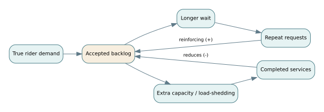

# F04 · Dynamic systems, queues, feedback and resilience

*Flagship textbook chapter · applied analytics, modeling and simulation, system dynamics, SoS and enterprise engineering · approximate study time: 8–12 hours.*

**Learning outcome.** Build, analyze and challenge a minimal dynamical model of mobility operations; distinguish stock-flow models from stochastic queues; explain stability, feedback, cascading failure and recovery; and design experiments that could falsify the model before relying on it.

**Prerequisites:** [system dynamics](../../encyclopedia/stocks-flows-feedback.md), [modeling and simulation](../../encyclopedia/conceptual-m-and-s.md), [queueing](../../encyclopedia/flow-wip-and-queues.md). Also see [D06 queue utilization](../derivations/06-queue-utilization.md), [D08 numerical integration](../derivations/08-stocks-flow-numerics.md) and [F03 model credibility](F03-statistical-assurance.md).

## 1. A system is dynamic when today changes tomorrow

Static architecture diagrams identify components and connections; they do not reveal how backlogs grow, how operators adapt, how maintenance debt accumulates or how an emergency consumes capacity. Dynamic systems engineering asks how **rates, delays, inventories, feedback and decision policies** jointly produce behavior over time.

Continue with Northstar's fictional regional mobility service. During a rail disruption, many riders simultaneously request a shuttle. Dispatch backlog rises, pickup times grow, more customers retry, and those retries increase arrival load further. The demand surge is not the sole issue: the service's own response policy can amplify demand. Adding vehicles may help, but additional vehicles may also overwhelm curb capacity or charging infrastructure. This is a coupled system problem.

Different modeling approaches answer different questions. A **stock-flow model** asks how quantities accumulate and how rates change; a **discrete-event queue** represents individual arrivals, service completions, rules and resource contention; an **agent-based model** may represent heterogeneous rider/operator choices; a **network model** focuses on dependencies and paths. Choosing among them requires a decision question, not a preference for visual complexity.

## 2. Conservation as a modeling invariant

Let $B(t)$ be the number of pending accepted bookings, $a(t)$ the accepted arrival rate, and $c(t)$ the completed service rate, both in bookings/hour. A continuous approximation satisfies

$$\frac{dB}{dt}=a(t)-c(t),$$

subject to $B(t)\ge0$ and a physically meaningful service-capacity condition. This is a **conservation equation**. Requests do not vanish unless we explicitly model abandonment, cancellation, expiration or rejection. A model whose backlog decreases without a corresponding outflow is missing a process.

For a simplified example, arrivals are 12/hour, departures 9/hour and $B(0)=4$ bookings. Over the next two hours with both rates constant and no capacity limits, backlog grows by $(12-9)2=6$ to $B(2)=10$ bookings. This arithmetic is useful to check simulation output before modeling stochastic events.

If service varies with backlog, one idealized model is $c(B)=\mu\,B/(K+B)$ for nonnegative $B$. Here $\mu$ is the maximum throughput and $K$ controls how quickly service approaches capacity. This *phenomenological* relation may be useful for experiments, but it is not a law of dispatch; its parameters need calibration and its behavior should be checked at $B=0$ and large $B$.

## 3. Numerical integration and error control

For $\dot{x}=f(x,t)$, explicit Euler integration with step $h$ uses

$$x_{k+1}=x_k+h f(x_k,t_k).$$

For the test equation $\dot{x}=-kx$ with $x(0)=1$, the exact solution is $x(t)=e^{-kt}$. Euler gives $x_N=(1-kh)^N$ at time $Nh$. With $k=1/h_{unit}$, $h=0.25h_{unit}$ and four steps to $t=1h_{unit}$, Euler gives $(0.75)^4=0.31640625$ whereas the exact value is $e^{-1}\approx0.36787944$; the absolute error is about 0.05147.

Halving $h$ should generally reduce error for a convergent method in a smooth regime, but an apparently stable plot is not a numerical accuracy test. For Euler on $\dot{x}=-kx$ with positive $k$, numerical stability of the linear iteration requires $|1-kh|<1$, i.e. $0<kh<2$. That condition alone does not guarantee physical plausibility or sufficient accuracy. For nonnegative stocks, aggressive steps may create spurious negative quantities.

Models should include invariant checks (e.g. conservation), solver comparison, time-step sensitivity, boundary conditions and parameter uncertainty. If a proposed policy decision changes when step size is halved, report numerical uncertainty rather than disguising it as a real system phenomenon.

## 4. Little's law: an accounting identity under conditions

A stable, flow-balanced service system observed over an appropriate long period satisfies **Little's law**:

$$L=\lambda W,$$

where $L$ is the long-run average number in system, $\lambda$ is the effective arrival/throughput rate, and $W$ is the average time in system. For a stable service with 12 completed requests per hour and a measured average system time of 0.25 hours, $L=12\times0.25=3$ requests.

Little's law does not require exponential interarrival or service distributions. But it does require careful definitions of the same population and boundary, plus suitable stability/steady operation. In an emergency that continuously grows backlog, quoting a steady-state wait from Little's law without checking these conditions is misleading. Abandoned requests and rejected jobs must be accounted for consistently.

## 5. The M/M/1 model and utilization cliffs

An **M/M/1** queue assumes Poisson arrivals with rate $\lambda$, independent exponential service times with rate $\mu$, a single server, infinite buffer, first-in-first-out service and stable utilization $\rho=\lambda/\mu<1$. Under these strong assumptions,

$$W=\frac1{\mu-\lambda},\qquad W_q=\frac{\lambda}{\mu(\mu-\lambda)},\qquad L=\frac{\lambda}{\mu-\lambda}.$$

These formulas represent **mean** quantities in steady state, not guaranteed service-level percentiles.

For $\lambda=12$/hour, $\mu=15$/hour: $\rho=0.8$, mean total time $W=1/3$ hour = 20 min; mean queue wait $W_q=12/(15\cdot3)$ hour = 16 min. Increasing service rate to 18/hour gives $\rho=2/3$, $W=1/6$ hour = 10 min, and $W_q=12/(18\cdot6)$ hour = 6.667 min. A 20% capacity increase cuts the modeled mean queue wait by more than half because the system was approaching saturation.

A general statement like “one extra server cuts waits by a third” is not justified from this model. A second server is an **M/M/2** system with different equations; two servers can also share bottleneck resources. When arrival processes are bursty, service times are deterministic, booking priorities exist or dispatch is interrupted, empirical or discrete-event modeling is more appropriate.

## 6. Capacity sizing from a target mean wait

Suppose the architecture decision requires mean queue wait no more than 5 minutes (1/12 hour), under the M/M/1 model with arrival rate 12/hour. Solve

$$\frac{12}{\mu(\mu-12)}\le\frac1{12}.$$

Multiplying by positive denominators for $\mu>12$ yields $\mu^2-12\mu-144\ge0$, with positive root

$$\mu\ge\frac{12+\sqrt{720}}2\approx19.4164\text{ services/hour}.$$

Thus the model says the service capacity must exceed about 19.42 per hour. In an actual design, add margin for uncertainty, downtime, variation and nonexponential behavior; validate that the measured service distribution supports this queue approximation. Do not round down to 19 and claim the bound is met.

## 7. Feedback structure and unintended consequences

A **reinforcing loop** occurs when an effect intensifies the process that created it: long waits → more repeated booking attempts → greater API demand → more latency → longer waits. A **balancing loop** acts to oppose change: backlog rises → dispatch activates extra capacity → service completion rises → backlog declines. These causal sketches are hypotheses until their links, delays and units are translated into observable mechanisms.

A robust model distinguishes **demand** from **measured requests**: repeated calls may inflate an API arrival counter without representing new riders. Without idempotency, a model may falsely recommend adding vehicle capacity to solve what is actually a retry-policy problem. This connects directly to [F01](F01-requirements-to-assurance.md): architecture semantics determine what the sensor is measuring.

Feedback delays matter. Adding vehicles may take 30 minutes; public booking demand may shift within two minutes. An aggressive feedback controller responding to stale measurements can overshoot, causing wasteful repositioning or oscillation. A policy can be locally sensible and systemically unstable.

## 8. Resilience as a trajectory, not a label

Resilience analysis asks how a system **absorbs, adapts, recovers and learns** after disruptions. A useful trajectory includes pre-event level, disturbance magnitude, degraded performance, time to restore, and a post-event configuration. One illustrative loss-of-service integral is

$$\mathcal{L}=\int_{t_0}^{t_1}[P_{\text{target}}(t)-P(t)]_+\,dt,$$

where $P$ is a clearly chosen performance measure and $[x]_+=\max(x,0)$. The integral is an area under a deficiency curve, with units of performance×time. Lower $\mathcal L$ is better under this one metric, but it may not capture safety or distributional harm. A system that restores average service quickly by deprioritizing wheelchair users might score well on mean throughput while failing accessibility goals.

For constant target 100 units and performance 60 units for two hours, loss area is $(100-60)\times2=80$ unit-hours. If an alternative maintains 80 units for three hours, its loss is $(100-80)\times3=60$ unit-hours. The latter has lower integrated service loss but longer recovery; which is preferable depends on stakeholder priorities and minimum acceptable service levels.

## 9. Network dependencies and cascading failure

System-of-systems behavior depends on technical and organizational relationships. Vehicles may be independently operated but share mapping updates, cellular gateways, charging sites, public API authentication and emergency-communications contracts. A network drawing should distinguish physical dependence, information dependence, contractual dependence and common cause.

Simple network connectivity may reveal a single point of failure but not its probability, repair time or consequence. A hub with high graph centrality is not automatically the most important safety item; a low-degree component may be essential for an emergency mission. The mission consequence of a cut set should be assessed against operational scenarios, not inferred from topology alone.

An especially important distinction is **resilience versus redundancy**. Two dispatch servers in the same floodplain and on the same power circuit are replicated, but not independent against flood or power loss. Alternative recovery procedures, information pathways, organizational decision rights and geographically separated operations may matter more than another copy of the same hardware.

## 10. Model calibration, challenge and credibility

Build model credibility through staged tests:

1. **Dimensional and conservation audit:** are all stocks, rates and time units consistent, and do events conserve bookings?
2. **Code verification:** do numerical results reproduce analytic special cases like constant-rate accumulation and $\dot{x}=-kx$?
3. **Structural validation:** does the model represent priority queues, retries, cancellation and fallback mechanisms relevant to the decision?
4. **Empirical comparison:** do predictions match withheld field observations in different operating regimes?
5. **Sensitivity and uncertainty:** which input assumptions can reverse the recommended action?
6. **Operational envelope:** where is the model not credible enough to drive policy?

If a model predicts 6.7 minutes of mean queue wait under exponential assumptions but observations show 18 minutes, do not patch the output with an arbitrary constant and call it validated. Investigate arrival burstiness, hidden processing stages, class priorities, departures, resource contention, queuing discipline and measurement definitions. A useful model helps identify causes; it does not merely interpolate seen data.

## 11. Worked problems with explained answers

### Exercise 1 · Stock-flow accounting

Initial backlog 4, arrivals 12/hour, completions 9/hour, constant for two hours. Calculate final backlog, ignoring cancellation.

Worked solution

$B(2)=4+(12-9)2=10$ accepted bookings. Six additional bookings are accounted for as net inflow.

### Exercise 2 · Conservation defect

A simulation starts at 10 jobs, accepts 5 more, completes 7 and abandons 2, but reports 9 remaining. Is it consistent?

Worked solution

No. Conservation requires $10+5-7-2=6$ remaining. The discrepancy of 3 must be explained by another modeled flow or a bug; inspect event accounting.

### Exercise 3 · Euler versus exact decay

For $\dot{x}=-x$, $x(0)=1$, step 0.25, four Euler steps, find $x(1)$ and compare with exact.

Worked solution

Euler $x_4=(1-0.25)^4=0.31640625$; exact $e^{-1}=0.36787944$. Absolute error about 0.05147; Euler underestimates here.

### Exercise 4 · Little's law

Stable throughput 12 jobs/hour, average system time 15 minutes. Find mean work in system.

Worked solution

$W=0.25$ hour; $L=\lambda W=12(0.25)=3$ jobs, with matching system boundary and population.

### Exercise 5 · M/M/1 baseline

For $\lambda=12$/hour and $\mu=15$/hour compute utilization, mean queue wait, and mean total time.

Worked solution

$\rho=12/15=0.8$, $W_q=12/[15(15-12)]=0.266\overline6$ hour = 16 min, $W=1/(15-12)$ hour = 20 min.

### Exercise 6 · Increased service capacity

At arrival 12/hour, increase service to 18/hour. Calculate mean wait and explain why change is nonlinear.

Worked solution

$W_q=12/[18(18-12)]=1/9$ hour = 6.667 min; $W=1/6$ hour = 10 min. As capacity margin $\mu-\lambda$ increases, expected backlog and delay fall nonlinearly near saturation.

### Exercise 7 · Find a capacity threshold

At arrival 12/hour, what service rate gives mean queue wait at most five minutes in M/M/1?

Worked solution

Solve $12/[\mu(\mu-12)]\le1/12$: $\mu\ge(12+\sqrt{720})/2\approx19.4164$/hour. A design should use capacity margin and verify the model assumptions.

### Exercise 8 · Recovery-area metric

Compare service levels 60/100 for two hours versus 80/100 for three hours; which has smaller integrated performance deficiency?

Worked solution

First: 80 unit-hours; second: 60 unit-hours. Second is better on this metric, though its longer disruption or distributional impact could matter under other criteria.

### Exercise 9 · Reinforcing-loop intervention

Repeated booking attempts rise when delays are high. Identify an intervention that breaks the loop without requiring more vehicles.

Worked solution

Make request operations idempotent and publish a reliable status with bounded backoff and retry behavior; one original booking should not create multiple active requests. Validate under network faults and measure both unique demand and raw API attempts.

### Exercise 10 · Misleading redundancy

Two servers share one electrical switchboard. Explain why multiplying their individual availability values is a poor estimate of joint mission availability.

Worked solution

The servers' failures are correlated through the common switchboard. A common-cause power failure can disable both; separate component calculations omit it. Model shared dependencies, recovery options and cut sets, then validate assumptions against failure data and fault injection.

## 12. Hands-on laboratory and project deliverable

Open [Lab 4: dynamics and queues](../flagship-notebooks/04-dynamics-queues.ipynb) or run `python flagship-labs/operational_dynamics.py`. Use the [operations experiment worksheet](../flagship-worksheets/operations-experiment.csv). Required experiments: check conservation; compare Euler steps; reproduce an M/M/1 capacity calculation; simulate a demand shock with an explicit backlog outflow; examine an intervention that reduces retries; identify where the steady-state queue formula is no longer applicable.

**Deliverable:** a small model credibility package with problem statement, system boundary, equations and units, input provenance, verification benchmarks, at least two validation comparisons (or a documented data gap), sensitivity experiments, decision implications and declared limits. A robust recommendation should survive reasonable changes to numerical resolution and disputed assumptions.

**Connections:** [F01 assurance](F01-requirements-to-assurance.md) · [F02 decisions](F02-decisions-and-architecture.md) · [F03 statistical evidence](F03-statistical-assurance.md). **References:** [NASA Systems Engineering Handbook](https://www.nasa.gov/reference/systems-engineering-handbook/) and [SEBoK](https://sebokwiki.org/).
