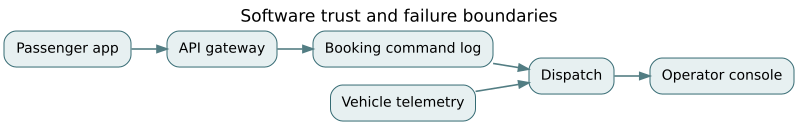

# F05 · Software-intensive architecture: contracts, failure, and operational assurance

*Flagship textbook chapter · EN.605.704, EN.645.764, EN.645.631, EN.645.782 · suggested study time: 8–12 hours. All case numbers are synthetic.*

**Outcome.** Derive and defend a software architecture from operational scenarios; specify stateful service contracts; reason about retries, consistency, failures, security, and monitoring; and produce traceable verification evidence rather than diagrams alone.

**Prerequisites:** [software quality](../concepts/04-software-quality.md), [architecture and behavior](../concepts/03-architecture-states.md), [software state-machine contracts](../derivations/11-state-machines-contracts.md), and [mission-to-assurance](F01-requirements-to-assurance.md).

## 1. Start with a scenario that can fail

Northstar's fictional regional mobility platform dispatches accessible shuttle rides during normal service and emergency rail disruptions. A booking request crosses several boundaries: passenger app, API gateway, reservation service, dispatch optimization, vehicle telemetry, and the operator console. The deployment is **not** the architecture merely because it has named microservices. Architecture is the set of decisions about responsibilities, state ownership, interfaces, timing assumptions, failure containment, and evidence.

Write the operational scenario before picking technology: a passenger requests an accessible pickup; the system must decide within two seconds whether a request has been **accepted for processing**; within 30 seconds it should communicate either a confirmed assignment or an explicit pending state; network retries must not create a second active reservation; operators must still see degraded-mode conditions. These are fictional design targets to be challenged. An asynchronous acknowledgment is not the same as an accepted ride or guaranteed pickup.

Turn this into an architecture decision record (ADR): *Decision*: use a durable reservation command log with a stable idempotency key; *options*: synchronous distributed transaction, event-driven saga, single transactional owner; *forces*: partial outages, duplicate calls, latency, auditability; *consequences*: the booking state is eventually visible to downstream services, but the command owner must be authoritative for uniqueness.

## 2. Allocate quality attributes to mechanisms and tests

A quality attribute is testable only with a **stimulus, environment, artifact, response and response measure**. Saying “highly available and secure” is not a requirement. A scenario might read: under one failed dispatch node during a planned load test, 99% of valid booking acknowledgments finish within 2 seconds, as measured at the public API over a stated 30-minute window. That test says nothing by itself about vehicle arrival or system safety.

Connect the scenario to mechanisms: replicated ingress endpoints, durable command storage, bounded queues, caller backoff, health checks, state-reconstruction procedures, and failure injection. Each mechanism creates new risks. Replication can introduce concurrent writers. Caches can serve stale fleet state. Circuit breakers can reject useful traffic. Write the failure mode next to the claimed benefit.

If requests arrive at 12 per second and the service can complete 15 per second under the assumed workload, a single-server M/M/1 toy model predicts average system time $W=1/(15-12)=0.333$ seconds. This is not a latency service-level objective prediction: real service is batched, multicore, priority-based and network-dependent. Use the result as a reasonableness check, then collect latency percentiles in a load test. See [F04](F04-dynamics-and-resilience.md).

## 3. Model state rather than merely CRUD endpoints

Let booking state be $S\in\{\mathrm{Requested},\mathrm{Pending},\mathrm{Assigned},\mathrm{Cancelled},\mathrm{Completed}\}$. An allowed transition has a guard and an event. For example, `assign(id, vehicle)` requires `state == Pending`, available vehicle capacity, and a compatible accessibility profile; after the transition, exactly one active vehicle assignment exists. `complete(id)` requires `state == Assigned` and an authorized completion event.

An invariant for each booking $b$ is $\sum_v 1[\mathrm{activeAssignment}(b,v)]\le 1$. A global invariant also prevents one vehicle from being simultaneously assigned to incompatible trips. These are stronger than checking that API endpoints return HTTP 200. Unit tests exercise guards; property-based tests generate event sequences; model checking may explore concurrency interleavings; integration tests verify storage and messaging semantics.

A reservation command with an idempotency key $k$ should yield the same logical outcome if repeated. It is **not** sufficient to deduplicate only while a process is running. The deduplication record needs a defined lifetime, persistence domain and retention policy; after expiration the caller must understand the replay risk. Idempotent logical effects are different from exactly-once network delivery, which is generally not guaranteed across arbitrary failure boundaries.

## 4. Draw boundaries around failure and trust

Inside a single database transaction, reservation uniqueness may be enforceable through a unique key. Across separately committed services, a confirmation event can be delivered more than once or arrive after a cancellation. Make consumers replay-safe: compare version numbers, reject stale transitions, and maintain an audit history. If two services each declare themselves authoritative for the same state, an integration outage will expose the ambiguity.

A simple order-of-events hazard illustrates the issue: `Requested` → `Assigned` → `Cancelled`, then delayed `Assigned` event arrives. Without monotonic revision checking, a previously cancelled booking can appear active again. An event is a claim about a prior transition, not permission to overwrite current state. A revision-aware consumer accepts it only when consistent with the authorized state machine.

Security architecture cuts across these boundaries. Treat caller identity, authorization scope, message authenticity, retention limits, secret storage, and dependency provenance as separate concerns. For example, a support operator may read a booking but cannot silently change accessibility requirements; a dispatch service may assign vehicles but should not retrieve payment details. Audit records must avoid unnecessary exposure of passenger location. NIST's [Secure Software Development Framework](https://csrc.nist.gov/pubs/sp/800/218/final) is a source for development practices, **not** a guarantee that a particular design is secure.

## 5. Availability arithmetic and its traps

A simple independent series path with component availabilities $A_1,A_2,A_3$ has $A_{path}=A_1A_2A_3$. If $A_i=0.99$ independently, $A_{path}=0.99^3=0.970299$. But end-to-end service may have bypasses, shared infrastructure, different failure horizons and correlated incidents. Adding three nines together is wrong, and multiplying them without independence is also wrong.

For two independent replicas each available with probability 0.99 at a random instant, a parallel model yields $A=1-(1-0.99)^2=0.9999$. Under a shared-failure probability $c=0.02$ that takes both down, a conditional toy model gives $A=(1-c)[1-(1-0.99)^2]=0.979902$. This dramatic drop is why independent failure domains and incident evidence matter as much as replica counts. The model is illustrative, not an empirically estimated availability claim.

Availability, correctness, recovery time and recovery point must be separate claims. A service might answer quickly with a stale assignment that is operationally unsafe; that is not success. Define what degraded operation may do, the maximum acceptable loss of confirmed decisions, how reconciliation works, and who can authorize recovery.

## 6. Evidence from code to operation

An assurance thread should read: requirement → architecture decision → contract/invariant → test case → recorded execution result → reviewed release baseline. Record environment, test version, model assumptions, timestamps, and unresolved discrepancies. A green pipeline proves only what it actually exercised. It does not prove resilience to network partitions, unavailable vehicles, malicious messages, or unmodeled stakeholder needs.

Operational indicators can include duplicate active bookings, conflicting state versions, percentage of commands rejected by backpressure, retries by endpoint, time to reconcile delayed messages, and accessibility-related assignment reversals. Define a response to each signal and a threshold for temporarily restricting operation. A trace is valuable only if it supports diagnosis and decisions while protecting personal data.

## 7. Worked exercise set (solutions are intentionally below each problem)

**Problem 1 — Contracts.** A `POST /rides` endpoint sometimes times out after storing a ride. What must the retry protocol guarantee?  
**Solution.** Reuse a stable client-generated command key, persist its association with one logical outcome, and return the original outcome on replay. Specify error and expiry semantics; network delivery remains at-least-once in the scenario.

**Problem 2 — Invariant.** A booking transitions `Pending → Assigned → Cancelled`; an old `Assigned` event arrives. What protects the invariant?  
**Solution.** A monotonic booking revision or state-machine guard rejects the stale event. Deduplicating by message identifier alone cannot reject a delayed event with a distinct identifier.

**Problem 3 — Series availability.** Calculate $0.99^3$.  
**Solution.** $0.970299$ (97.0299%) if the three series availability events are independent under a consistent measurement horizon.

**Problem 4 — Parallel availability.** Two independent 99% replicas: chance at least one is available?  
**Solution.** $1-(0.01)^2=0.9999$; validate that infrastructure, deployment, and network dependencies are actually independent.

**Problem 5 — Shared cause.** With a 2% shared outage, compute $(1-0.02)(1-0.01^2)$.  
**Solution.** $0.979902$, conditional on the specified common-cause model.

**Problem 6 — Quality attribute.** Rewrite “fast reservation service” as a testable scenario.  
**Solution.** State stimulus, environment, percentile, measurement boundary, duration, workload, acceptance threshold, and failure behavior. A mean alone hides tails.

**Problem 7 — Security.** Why is a valid authentication token insufficient for editing an accessibility requirement?  
**Solution.** Authentication establishes identity; authorization must independently check scope, resource ownership, role, and audit policy.

**Problem 8 — Evidence.** Does 100% line coverage prove booking consistency?  
**Solution.** No. Test sequences, concurrency, integration contracts, failure injection and operational observation are additional evidence domains.

## 8. Applied studio and competency check

Create a four-page architecture package: an ADR with three evaluated options; a context/trust-boundary diagram; a transition table with at least two formal invariants; and a verification matrix with one normal, one stale-event, one outage and one malicious-client test. Reproduce the availability toy models in [the F05 notebook](../flagship-notebooks/05-software-architecture.ipynb) and change the common-cause rate. Passing the arithmetic is not sufficient; explain whether independence is plausible.

**Further reference:** [NIST SSDF 1.1](https://csrc.nist.gov/pubs/sp/800/218/final) (final 2022; its later revision was only a public draft as of this edition); [SEBoK](https://sebokwiki.org/wiki/Guide_to_the_Systems_Engineering_Body_of_Knowledge_%28SEBoK%29); [NASA Systems Engineering Handbook](https://www.nasa.gov/reference/systems-engineering-handbook/). Return to [F01](F01-requirements-to-assurance.md) for assurance argument structure.
