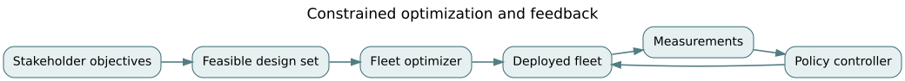

# F06 · Optimization and control: from feasible architecture to stable policy

*Flagship textbook chapter · EN.645.767, EN.645.758, EN.645.781, EN.645.784 · suggested study time: 8–12 hours. Hypothetical numbers are for learning only.*

**Outcome.** Formulate constraints, separate feasibility from preference, derive basic optimization conditions, test a feedback controller's stability, and interpret uncertainty and actuator limits before recommending a policy.

**Prerequisites:** [trade analysis](../../encyclopedia/engineering-trades.md), [decision science](../concepts/05-trades-uncertainty.md), [stocks and flows](../../encyclopedia/stocks-flows-feedback.md), [F02 architecture decisions](F02-decisions-and-architecture.md), [F04 dynamics](F04-dynamics-and-resilience.md).

## 1. Differentiate design optimization from operational control

Design decisions choose relatively durable structure: fleet size, depots, charging infrastructure and staffing. Control chooses actions repeatedly as conditions evolve: dispatch rates, charging priority, maintenance thresholds and emergency fleet reallocation. A beautiful single-period optimum can be a terrible policy if delays, uncertainty or behavior changes are ignored.

A general decision model is $\min_x f(x)$ subject to $g_i(x)\le 0$, $h_j(x)=0$ and $x\in X$. Writing only the objective hides the real engineering task. Units, stakeholder priorities, regulatory constraints, resource ceilings and operational envelopes must be explicit. A cheapest design that cannot support wheelchair access is not a cheap feasible design; it is outside the acceptable set.

For Northstar, suppose each ordinary vehicle provides 4 unit-hours of peak capacity per shift and costs 2 budget units; each accessible vehicle provides 3 unit-hours and costs 3 budget units. The synthetic requirement is at least 24 peak capacity units and at least two accessible vehicles. With $x,y$ as nonnegative integers, formulate $\min 2x+3y$ subject to $4x+3y\ge24$, $y\ge2$. Evaluate candidates: $x=5,y=2$ yields capacity 26, cost 16; $x=6,y=2$ yields 30, cost 18; $x=4,y=3$ yields 25, cost 17. In fact enumeration shows $x=5,y=2$ is optimal for these toy assumptions. Additional range, depot and accessibility constraints could change it completely.

## 2. Pareto efficiency is not preference

Consider dispatch strategy A with cost 10 and average wait 8 minutes, B with cost 12 and wait 5, C with cost 14 and wait 7 (all synthetic). If lower values are desirable, C is dominated by B: B is no worse on either criterion and is strictly better on both. A and B are nondominated. A Pareto set removes evidently inferior choices; it does not tell you which nondominated choice is socially preferable.

Weighted scores $J=w_c\hat c+w_w\hat w$ require comparable normalizations and justified weights. If normalization ranges or stakeholder utility are changed, ranking can reverse. Document the break-even weights and show alternatives before recommending. A weighted sum can miss portions of a nonconvex Pareto frontier; integer constraints frequently create discrete trade surfaces.

Constraints can also be uncertain. A mean battery energy requirement does not establish chance of meeting a minimum reserve. With stochastic demand $D$, a chance constraint $P(C\ge D)\ge0.95$ requires a distributional model or defensible empirical bound. A single assumed normal distribution, fitted to sparse data, is no substitute for stress testing tails.

## 3. Optimality conditions and engineering interpretation

For a differentiable unconstrained scalar objective $f(x)$, a candidate interior minimum requires $f'(x)=0$, with $f''(x)>0$ sufficient for a strict local minimum under standard smoothness assumptions. Let $f(x)=(x-3)^2+5$. Then $f'(x)=2(x-3)$, $f''(x)=2$, so $x^*=3$ is a global minimum with value 5. Add a constraint $x\le 2$ and the optimum moves to the boundary $x=2$, value 6.

For a simple constrained problem $\min_x (x-3)^2$ subject to $x-2\le0$, the Lagrangian is $L=(x-3)^2+\lambda(x-2)$. Karush–Kuhn–Tucker conditions here are stationarity $2(x-3)+\lambda=0$, primal feasibility $x\le2$, dual feasibility $\lambda\ge0$, and complementarity $\lambda(x-2)=0$. The solution is $x=2,\lambda=2$. The multiplier is a local shadow price: relaxing the constraint modestly can improve the objective. It is not automatically a real-dollar valuation.

In nonconvex problems, these conditions can describe saddles or local extrema; in integer programs, a continuous relaxation may produce an infeasible fractional fleet. Use solvers and proof bounds as evidence, but also validate the model against operational reality.

## 4. A discrete feedback controller you can analyze

Let $e_k$ be backlog deviation from a desired level and $u_k$ an adjustment in service capacity each sampling interval. A simplified linear process is $e_{k+1}=a e_k-b u_k+d_k$, where $d_k$ is an unmodeled demand disturbance, and $a,b>0$. A proportional feedback policy $u_k=K e_k$ gives $e_{k+1}=(a-bK)e_k+d_k$.

Without disturbance and without actuator saturation, the discrete closed-loop system is asymptotically stable when $|a-bK|<1$. Take $a=1,b=0.5$. Then $|1-0.5K|<1$ gives $0<K<4$. With $K=1$, the error multiplier is 0.5; a 16-unit deviation decays as 16, 8, 4, 2. With $K=3$, it oscillates in sign with multiplier -0.5. With $K=5$, multiplier -1.5 and the linearized error grows. This demonstrates why “respond more aggressively” is not universally wise.

An actual dispatcher cannot command negative trucks or instant capacity. With $u_k=\mathrm{clip}(Ke_k,0,u_{max})$, the system becomes nonlinear. Lower-bounded actuation cannot correct every negative deviation; a delayed controller can become unstable even when the no-delay formula predicts stability. Test saturation, delay, hysteresis, sensor bias and unavailable vehicles before adopting a policy.

## 5. Model-predictive control and robustness

Model-predictive control (MPC) optimizes a finite-horizon sequence of moves subject to dynamic equations and constraints, applies the first move, receives new information, and solves again. A typical objective might combine queue delay, energy usage and change penalties. It can handle actuator constraints directly but requires a sufficiently accurate model and dependable computation time.

For uncertain demand, distinguish robust optimization (guarantees across a specified uncertainty set) from stochastic optimization (performance under an assumed probability model). “Robust to all futures” is not meaningful unless the set of futures is explicit. Unbounded uncertainty makes many constraints infeasible. In safety-critical decisions, use hard limits and protective fallbacks separate from efficiency optimization.

## 6. Worked exercise set

**Problem 1 — Fleet feasibility.** For $x=5,y=2$, compute capacity and cost.  
**Solution.** Capacity $4(5)+3(2)=26\ge24$; cost $2(5)+3(2)=16$; accessible count $y=2$.

**Problem 2 — Domination.** Why reject C=(14,7) relative to B=(12,5)?  
**Solution.** Both objectives are minimized and B is strictly smaller on both.

**Problem 3 — Unconstrained minimum.** Minimize $(x-3)^2+5$.  
**Solution.** Derivative zero at $x=3$, positive second derivative, objective 5.

**Problem 4 — Bound-constrained minimum.** Same function with $x\le2$.  
**Solution.** $x=2$, objective 6; unconstrained optimum is infeasible.

**Problem 5 — KKT shadow multiplier.** For $(x-3)^2$ with $x\le2$, find $\lambda$.  
**Solution.** Stationarity at $x=2$: $-2+\lambda=0$, so $\lambda=2$.

**Problem 6 — Control stability.** With $a=1,b=0.5$, identify stable positive gains.  
**Solution.** $0<K<4$, given the simple no-delay, unconstrained scalar model.

**Problem 7 — Closed-loop path.** With $K=1$, $e_0=16$, what is $e_3$?  
**Solution.** $e_3=16(0.5)^3=2$.

**Problem 8 — Oscillation.** With $K=3$, predict $e_1$ for $e_0=16$.  
**Solution.** $e_1=(1-1.5)16=-8$; it alternates signs while decaying under the idealized model.

**Problem 9 — Chance constraint.** Why does a mean of 24 units not satisfy a 95% demand guarantee?  
**Solution.** A mean does not describe dispersion or upper-tail probabilities; distribution and relevant uncertainty must be justified.

## 7. Applied studio

Prepare a two-stage decision: first solve an integer fleet design with explicit accessible-vehicle constraints, then define a policy for responding to backlog disturbances. Simulate at least three feedback gains using [the F06 notebook](../flagship-notebooks/06-optimization-control.ipynb). Report feasibility, Pareto screening, stability, saturation and how results change when arrival rate or control delay is perturbed. Your recommendation must distinguish a mathematical result from an operationally evidenced claim.

**Further reading:** [NASA Systems Engineering Handbook](https://www.nasa.gov/reference/systems-engineering-handbook/); [SEBoK](https://sebokwiki.org/wiki/Guide_to_the_Systems_Engineering_Body_of_Knowledge_%28SEBoK%29). Return to [F02](F02-decisions-and-architecture.md) for uncertainty-aware preference decisions.

<!-- STEP04-FLAGSHIP-U1-START -->
### F06 extension · Hard constraints, robustness, and bounded controllers

**Separate engineering tasks.** Constrained design chooses architecture parameters; operational control chooses actions as state changes. NS-U4.1's optimization problem seeks minimum added cost subject to $q_s\ge0.90$ and $a_s\ge0.85$ for every required scenario $s$. Under the controlled four-option set, **no option is robustly feasible**. Integrated costs 2.1 million illustrative units and passes only normal operation (0.45 scenario weight); it is *not* a deployable optimum. Reporting it as 'best feasible' would silently drop surge, grid, and compound constraints.

**Why weighted averages can mislead.** If an investigator replaces hard requirements with $\sum_s w_s q_s$, a strong normal result can compensate numerically for a disastrous compound case. A weighted expectation describes one preference calculation; it does not enforce an independent severe-event limit or equitable accessible service. A useful screening worksheet shows which constraint fails, by how much, under each scenario.

**Control stability.** For feedback $\dot B=u-kB$, a forward-Euler control/model update with step $h$ is stable only for $0<h<5$ minutes when $k=0.4/\text{min}$. Even with a stable continuous controller, stale sensor data, actuation saturation and unmodeled travel delays can produce transient overshoot. A controller cannot create fleet capacity, road permission or signed route-clearance evidence.

**Worked exercise and solution.** Suppose a reviewer lowers only the overall timely target to 0.80. Guardrails then passes normal overall timing ($\approx0.819$) and accessible timing (1.00), but the grid and compound cases still fail. This is a revised *policy constraint*, not new observed evidence. The board must record who is allowed to change that requirement and why it protects the mission.

**Reproduce:** [model output](../flagship-integration/outputs/ns-u4.1-results.json), [D02](../derivations/02-weighted-trades-and-reversal.md), [D08](../derivations/08-stocks-flow-numerics.md).
<!-- STEP04-FLAGSHIP-U1-END -->
