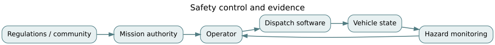

# F07 · Human factors and safety: hazard control in a sociotechnical system

*Flagship textbook chapter · EN.645.662, EN.645.768, EN.645.769, EN.645.742 · suggested study time: 8–12 hours. Case is hypothetical.*

**Outcome.** Translate operational situations into hazards, explain the limitations of probabilistic risk ranking, analyze control actions and human-machine interfaces, and construct an evidence-based safety argument that treats people and organizations as part of the system.

**Prerequisites:** [system boundaries](../../encyclopedia/boundaries-and-interfaces.md), [ConOps](../../encyclopedia/conops-and-scenarios.md), [integration](../../encyclopedia/integration-strategy.md), [F01 assurance](F01-requirements-to-assurance.md), [F05 software architecture](F05-software-intensive-architecture.md).

## 1. Hazards are system states, not component defects

A hazard is a system condition that, together with environmental circumstances, could lead to a loss. A failed relay is a component failure. “An occupied accessible shuttle is routed onto an unverified evacuation segment” is a hazardous system condition, regardless of whether every component is functioning according to its local specification. The loss could be injury, denied evacuation access or unsafe stranded passengers.

Northstar's emergency service has dispatch software, drivers, vehicle subsystems, partner agencies, and a human operator with override authority. Harm may arise from omissions, timing, stale information, inappropriate incentives or conflicting instructions, even when no part is physically broken. That is the essential sociotechnical perspective: safety cannot be inferred by summing component reliability claims.

Separate *losses* (what must be prevented), *hazards* (system states leading to losses), *safety constraints* (what the system must enforce), and *control mechanisms* (how constraints will be maintained). A useful safety constraint reads: “Do not confirm a passenger pickup on a restricted segment unless an authorized source has confirmed segment clearance after the restriction was issued.” This explicitly includes freshness and authority.

## 2. Human performance is part of the architecture

An operator console is an interface to a decision process, not simply a dashboard. Information quality, alarm salience, fatigue, interruption, workload, training, and authority all shape the system's response. A display that says “route valid” without showing the timestamp and underlying source invites automation bias: a human may over-trust a confident-looking result. A flood of low-importance alerts invites alarm fatigue: the important warning becomes indistinguishable from routine noise.

Use scenario-based task analysis. For each time-critical action identify: the operator's goal; information needed; availability and freshness of that information; competing tasks; plausible mistakes; recovery opportunities; and the minimum system support needed. Test under realistic workload and degraded communications. “Human in the loop” is not a safety mechanism unless the person has sufficient information, time, training, authority and a reliable means of stopping the process.

Design controls with layers: prevent an unsafe command when possible; detect violations promptly; contain consequences; and provide recovery paths. A manual override may be essential, but an override without logging and guardrails may itself become the dominant hazard. Record why an override is allowed, what it bypasses, and how it is later reviewed.

## 3. Two complementary hazard-analysis lenses

Failure Modes and Effects Analysis (FMEA) is a useful **bottom-up** technique: identify how an item or function can fail and what follows. A sample row might list `stale vehicle-position packet`, cause `network delay`, effect `incorrect curb assignment`, detection `age check`, and mitigation `refuse automated dispatch when packet age > threshold`. FMEA can miss unsafe interactions involving correctly functioning components.

System-Theoretic Process Analysis (STPA) is a **top-down control-structure** method: identify control actions that could be unsafe because they are not provided, are provided when unsafe, occur too early/late or continue too long. For the command “approve emergency routing,” the same command can be unsafe if issued with stale closure data, omitted when a verified escape route is needed, or applied after the conditions that justified it have expired. Consider control feedback and the controller's process model, not just individual failure rates.

Neither method is a proof of completeness. Both require deliberate selection of losses, system scope, operating scenarios and review participants. A team can execute a method correctly while overlooking a vulnerable population or an organizational dependency.

## 4. Quantitative risk without fake precision

An illustrative risk register may score probability (1–5) and consequence (1–5). Multiplication can order review attention, but ordinal category products are **not** measured expected losses and should not imply proportional precision. Two hazards with equal products may demand very different control strategies. Severe low-frequency events often require explicit barriers even where frequency estimates are poorly supported.

For a genuinely probabilistic model, expected loss can be written $E[L]=\sum_i p_i c_i$ only if the mutually exclusive outcome probabilities and commensurable consequence measures are defensible. Suppose a fictional exposure has an incident probability of 0.002 per shift and a direct repair cost of 50,000 monetary units. The expected direct repair cost is 100 units per shift. That tells us little about life safety, equity, tail events, liability or the acceptability of the hazard. It must not be used as an automatic permission-to-operate rule.

For event-tree reasoning, suppose an initiating event occurs with probability 0.01 per demand, a detection mechanism fails conditional on that event with probability 0.1, and a recovery mechanism then fails conditionally with probability 0.2. Under the *specified conditional structure*, loss probability is $0.01\cdot0.1\cdot0.2=0.0002$ per demand. If detection and recovery share power or the same flawed sensor, multiplying unconditional rates would be unjustified. [F03](F03-statistical-assurance.md) discusses common-cause dependence.

## 5. A goal-structured safety argument

Start with a narrow claim: “For the specified route zones, environment, operating rules and software baseline, the service controls stale-route approvals to an acceptably reviewed level.” Support it with a scenario definition, hazard log, architecture constraint, implementation test, failure-injection evidence, operator performance test, monitoring plan and independent review. Record assumptions explicitly: network delays, external closure-feed quality, operator staffing, data governance and controlled change process.

Evidence can be internally consistent yet incomplete. For example, a test that correctly rejects stale packets may prove a software guard but not that an external agency always timestamps closures accurately. Good assurance arguments expose this residual dependency. An acceptance decision must include who owns the residual risk, what is monitored, and what stops operation if assumptions cease to hold.

## 6. Fairness and accessibility as safety-related design concerns

A dispatch optimizer can improve average wait while increasing evacuation delays for wheelchair users at the edge of a service area. Aggregate metrics can hide subgroup harm. Include constrained accessibility scenarios, outcome differences, and explicit service-denial counts. A policy's fairness is not established simply by giving everyone identical software treatment; differing needs and consequences are central to the evaluation.

Participatory review should include affected operators, passengers and partner agencies. Ask whether users can contest an erroneous routing decision, how an appeal is handled during an emergency, and what records are retained without needlessly collecting personal information. Social legitimacy and operational safety both depend on credible accountability.

## 7. Worked exercise set

**Problem 1 — Hazard identification.** Is “sensor A failed” a hazard?  
**Solution.** It is a failure mode. A hazard is the unsafe system state it may contribute to, such as confirming routing based on obsolete vehicle location.

**Problem 2 — Freshness.** What measurable constraint would prevent stale-clearance use?  
**Solution.** Require a signed clearance issued after the active restriction and within a justified validity period; reject older states and log rejections.

**Problem 3 — Unsafe action.** Give one unsafe provision of a correct command.  
**Solution.** “Approve route” is unsafe when issued after a newly effective closure, even if the command syntax is valid.

**Problem 4 — Probabilistic tree.** Compute $0.01\times0.1\times0.2$.  
**Solution.** $0.0002$ per demand, assuming the conditional rates and scenario are correctly defined.

**Problem 5 — Expected repair loss.** Compute $0.002\times50,000$.  
**Solution.** 100 monetary units per shift of expected direct repair cost, not a complete risk valuation.

**Problem 6 — Risk matrices.** Why isn't score 20 necessarily twice score 10?  
**Solution.** Ordinal categories do not possess ratio scale meaning; multiplying them does not create one.

**Problem 7 — Operator workload.** Why could adding alerts worsen safety?  
**Solution.** Prioritization, attention, alert fatigue and interruptions can reduce detection of time-critical signals.

**Problem 8 — Fairness.** How might average pickup time improve while access worsens?  
**Solution.** The optimizer may prioritize frequent short rides and delay lower-frequency, high-need accessible requests; analyze subgroup metrics and constraints.

**Problem 9 — Assurance.** What does a passing stale-message test fail to establish?  
**Solution.** Validity of external sources, independent scenario completeness, staffing, and continued adherence to assumptions in operations.

## 8. Applied studio

Develop a five-loss hazard record for emergency mobility. For one selected hazard, create a control-loop diagram, four unsafe control actions, a design constraint, a test plan and an assurance claim/evidence table. Use [the F07 notebook](../flagship-notebooks/07-human-factors-safety.ipynb) to explore conditional event trees and sensitivity. Never substitute a toy event-tree probability for professional safety approval.

**Further reading:** [NASA Systems Engineering Handbook](https://www.nasa.gov/reference/systems-engineering-handbook/); [SEBoK](https://sebokwiki.org/wiki/Guide_to_the_Systems_Engineering_Body_of_Knowledge_%28SEBoK%29). Related: [F01](F01-requirements-to-assurance.md), [F03](F03-statistical-assurance.md), [F09](F09-enterprise-systems-of-systems.md).
