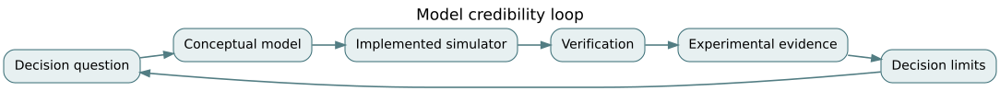

# F08 · Simulation and uncertainty: experiments that earn credibility

*Flagship textbook chapter · EN.645.756, EN.645.757, EN.645.758, EN.645.632 · suggested study time: 8–12 hours.*

**Outcome.** Specify a simulation's decision purpose; partition uncertainty; design stochastic experiments with reproducible seeds, sensitivity analysis and confidence statements; and decide what model evidence is missing.

**Prerequisites:** [conceptual modeling](../../encyclopedia/conceptual-m-and-s.md), [experimental design](../../encyclopedia/design-of-experiments.md), [discrete-event simulation](../../encyclopedia/discrete-event-simulation.md), [F03 evidence](F03-statistical-assurance.md), [F04 queues](F04-dynamics-and-resilience.md).

## 1. A simulation answers a bounded question

The purpose is not “build the most realistic Northstar simulator.” It is to evaluate whether a proposed two-depot plan can keep emergency pickup delay under a specified threshold over a defined event family. The model boundary is deliberate: requests, dispatch, fleet availability, boarding, charging and road travel may matter; advertising, detailed payroll and every internal packet exchange may not.

Build a conceptual-model specification: entities, resources, states, queues, event types, policies, units, time horizon and performance measures. State assumptions about arrivals (time-varying or stationary), travel-time dependence, breakdowns, accessibility requirements, no-shows, charging constraints and human overrides. Stakeholders should challenge omitted causes *before* the code is elaborate.

Verification asks whether the program correctly implements the conceptual model. Validation asks whether that model is adequate for a stated use in the real world. Credibility is purpose-dependent: a spreadsheet might be credible for conservation bookkeeping but not for emergency tail-delay prediction. A “validated model” without a purpose, domain and supporting evidence is an incomplete claim.

## 2. Partition uncertainty before propagating it

**Aleatory uncertainty** represents variability treated as inherent within the modeled process, such as demand fluctuations or travel-time variation. **Epistemic uncertainty** represents uncertainty from limited knowledge, such as an unknown breakdown rate or poorly calibrated rerouting behavior. The distinction is contextual: collecting better data can reduce epistemic uncertainty but does not remove process variability.

For a model $Y=f(X,\theta)$, sample variability in $X$ conditional on a parameter $\theta$, then explore a defensible range or posterior distribution for $\theta$. Reporting a single Monte Carlo output distribution while quietly fixing uncertain parameters can dramatically understate uncertainty. Correlation also matters: traffic congestion may simultaneously increase travel time and demand. Independent inputs can underestimate tail loads.

Suppose $X$ (demand) and $Y$ (travel cost) have standard deviations 3 and 2 and correlation $\rho=0.6$, and the performance index is $Z=X+Y$. Then

$$\operatorname{Var}(Z)=3^2+2^2+2(0.6)(3)(2)=20.2.$$

Treating them as independent would give variance 13. The standard deviation increases from $\sqrt{13}\approx3.606$ to $\sqrt{20.2}\approx4.494$. This is a mathematical sensitivity example, not calibrated empirical data.

## 3. Use independent replications for statistical uncertainty

A discrete-event simulation has transient behavior, autocorrelation and stochastic outputs. If you run $n$ independent replications and observe a scalar performance statistic $Y_i$ for each, estimate $\bar Y=n^{-1}\sum_iY_i$ and standard error $s/\sqrt{n}$, where $s$ is the sample standard deviation of replicate statistics. A conventional approximate confidence interval is $\bar Y\pm t_{n-1,0.975}s/\sqrt{n}$ for approximately normal replicate means and valid independence assumptions.

For five independent replication values (8, 9, 7, 10, 6) minutes, $\bar Y=8$ and sample standard deviation $s=\sqrt{10/4}=\sqrt{2.5}\approx1.5811$. Standard error is $s/\sqrt5\approx0.7071$. A 95% t-interval with four degrees of freedom ($t\approx2.776$) is approximately $8\pm1.963$, or [6.037, 9.963] minutes. The interval estimates the mean across replicated scenarios under the assumptions. It does *not* assert 95% of individual pickup times lie in that range.

Replications should vary their random streams; re-running the same seed is a reproducibility test, not new statistical information. For comparisons of two designs, common random numbers can reduce variance by exposing both to matched scenario draws, but outcomes must still be analyzed as paired differences.

## 4. An experiment needs factors, response measures and falsification checks

Consider factors A=extra charging bay (0/1), B=priority booking policy (0/1), and C=demand surge (low/high). A $2^3$ full factorial has eight combinations, allowing exploration of main effects and interactions in a coded linear contrast model. If policy B helps under low demand but causes queue starvation during high demand, a main-effect-only summary conceals the safety-relevant interaction.

Pre-register comparisons when possible, decide on warm-up duration, number of replications, random-stream policy, stopping rules, and what constitutes meaningful rather than merely statistically detectable improvement. Check conservation invariants, event counts and limiting cases: zero arrivals should yield zero served jobs and no impossible negative waits; infinite capacity should not produce arbitrary service bottlenecks. Verify outputs against simple closed-form special cases such as M/M/1, when the simulator actually implements those assumptions.

Sensitivity is not automatically causal. Varying charging capacity while holding demand policy fixed establishes behavior *inside the model*. To recommend infrastructure investment, validate the demand and travel assumptions with observed operations or sufficiently credible independent evidence.

## 5. Numerical error versus scenario uncertainty

For a continuous dynamics model solved by Euler's method, compare results when time-step $h$ is reduced. On $\dot{x}=-x$, $x(0)=1$ and $t=1$, four steps with $h=0.25$ yield $0.75^4=0.31640625$; eight steps with $h=0.125$ yield $0.875^8\approx0.3436089$; exact $e^{-1}\approx0.3678794$. Reducing time-step improves this example but the result remains biased. Numerical discretization error is not random demand uncertainty and needs a separate check.

When coupling a queue simulator with an energy model, document which system owns time, how events cross boundaries, interpolation conventions, synchronization and inconsistent rollbacks. A stable plot is insufficient proof of coupled fidelity. Conservation of energy, vehicles and passengers can expose coupling mistakes.

## 6. Credibility argument and model risk

A model credibility package needs a decision use case, conceptual-model review, implementation verification, sensitivity analysis, calibration data provenance, independent comparisons, uncertainty quantification, and applicability boundaries. If a regulator, operator or stakeholder asks “what evidence would change your mind?”, you should be able to answer with an actual additional measurement or stress experiment.

A model can be useful even when uncertain, provided the decision is robust to plausible parameter ranges. If two depot strategies rank differently under reasonable travel-time correlation, the model has produced an important finding: the investment decision requires more evidence. That is more honest and useful than selecting a single “best” simulation run.

## 7. Worked exercise set

**Problem 1 — Conceptual model.** Why include passenger cancellation events?  
**Solution.** Without an explicit outflow, conservation will overstate queued or active riders and distort service-performance results.

**Problem 2 — Variance dependence.** Calculate $9+4+2(0.6)(3)(2)$.  
**Solution.** $20.2$, larger than the independent-input estimate of 13.

**Problem 3 — Five replications.** Find the mean of (8,9,7,10,6).  
**Solution.** 8 minutes.

**Problem 4 — Standard error.** For sample variance 2.5 and $n=5$, find SE.  
**Solution.** $\sqrt{2.5/5}=\sqrt{0.5}\approx0.7071$ minutes.

**Problem 5 — t-interval.** Using $t=2.776$, compute $8\pm 2.776(0.7071)$.  
**Solution.** Approximately [6.037, 9.963] minutes under the interval assumptions.

**Problem 6 — Random seeds.** Are ten repeated runs of seed 42 ten independent replications?  
**Solution.** No: they reproduce the same pseudorandom sequence and provide no additional independent evidence.

**Problem 7 — Factorial count.** How many scenarios are in a three-factor two-level full factorial?  
**Solution.** $2^3=8$ before stochastic replications.

**Problem 8 — Euler comparison.** Why does an unchanged policy ranking across two time steps not prove model validity?  
**Solution.** It reduces one concern about numerical error but says nothing about structural assumptions, calibration or missing causal mechanisms.

**Problem 9 — Decision boundary.** When should a model result trigger a data-collection task?  
**Solution.** When plausible epistemic uncertainty changes the preferred decision or causes a critical safety/feasibility constraint to cross its bound.

## 8. Applied studio

Create a one-page model credibility charter. Implement 20 independent synthetic replications of pickup wait, then a paired comparison of two policies using common random scenarios in [the F08 notebook](../flagship-notebooks/08-simulation-uncertainty.ipynb). Include confidence intervals, a correlation sensitivity plot or table, a numerical convergence check and at least three cases that would invalidate the decision conclusion. Explain exactly which observations would be needed before operational deployment.

**Further reading:** [NASA Systems Engineering Handbook](https://www.nasa.gov/reference/systems-engineering-handbook/); [SEBoK](https://sebokwiki.org/wiki/Guide_to_the_Systems_Engineering_Body_of_Knowledge_%28SEBoK%29). Related: [F03](F03-statistical-assurance.md), [F04](F04-dynamics-and-resilience.md).
