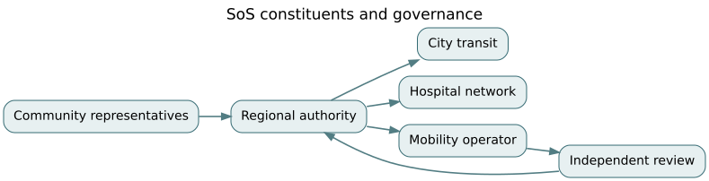

# F09 · Enterprise and systems of systems: governance, emergence, and transformation

*Flagship textbook chapter · EN.645.771, EN.645.753, EN.645.742, EN.645.783 · suggested study time: 8–12 hours.*

**Outcome.** Distinguish technical integration from governance authority; evaluate dependencies, incentives and cascading failures; formulate a portfolio under constraints; and design an adaptive transformation with verifiable outcomes and accountable participants.

**Prerequisites:** [enterprise as system](../../encyclopedia/enterprise-as-system.md), [governance](../../encyclopedia/authority-and-governance.md), [complexity and emergence](../../encyclopedia/complexity-emergence.md), [F04 resilience](F04-dynamics-and-resilience.md), [F07 human factors](F07-human-factors-and-safety.md).

## 1. A system of systems is not just a large system

Northstar coordinates a regional emergency mobility network involving a city dispatch service, independent transit operators, hospitals, emergency managers, mapping vendors and community organizations. These constituents retain their own operational purpose, authority, budgets and change cycles. The combined emergency response exhibits capabilities that no constituent provides alone. That pattern is central to systems-of-systems (SoS) reasoning.

Constituent autonomy creates two simultaneous problems. First, technical interfaces must exchange comprehensible states, permissions, timestamps and units. Second, participating organizations must agree on who may issue commands, who pays, who accepts residual risk and what happens when priorities conflict. A perfectly typed API cannot settle a dispute about evacuation priority or data ownership.

Architecture should distinguish **operational independence** (a constituent can function usefully on its own) from **managerial independence** (it makes its own decisions about resources and evolution). A coordinated SoS often has less centralized control than its designers would like. Planning must accommodate voluntary participation, legal constraints and negotiated service-level commitments.

## 2. Emergent behavior from local rules

Assume each agency prioritizes its own response-time metric. During a shared emergency, one agency reserves vehicles early as a precaution. Others observe shrinking capacity and also reserve early. The network experiences severe capacity lockup even though every local scheduler is executing rational optimization. This is an emergent property of interactions and incentives, not a coding bug in one scheduler.

Use causal diagrams to distinguish reinforcing from balancing feedback. In the example, perceived scarcity increases protective reservations, which creates actual scarcity. A possible balancing intervention is a trusted shared reservation protocol with transparent release rules and a common escalation authority. It might fail if participants do not trust forecasts or experience asymmetric consequences from yielding capacity.

Network analysis can expose dependencies. Model constituents as nodes and required operational links as edges. A cut set is a set of links or nodes whose removal disconnects a specified mission flow. However, graph connectivity alone ignores capacities, deadlines, data semantics and permissions. A connected network can still be incapable of transporting an accessible passenger within an emergency window.

## 3. Governance is a control structure

Describe decision rights with an explicit table: who can publish emergency status, who can approve allocation overrides, who owns traveler data, who can revoke an unsafe route, and who adjudicates disputes. “Everyone collaborates” is not a governance design. For each decision specify trigger, authority, information, time limit, escalation, audit record and appeal.

Incentives determine whether a technical agreement is followed. If agencies are punished for sharing capacity but rewarded for local throughput, cooperation may collapse under stress. A transformation may need financial rules, transparent performance measures and protection for contributors, not just interface standards.

Differentiate **compliance** with a governance process from **effectiveness** of its outcomes. A group can run every meeting and still exclude rural riders or produce a brittle service. Measure mission results, subgroup outcomes, reversibility and coordination latency; invite criticism from affected parties.

## 4. Portfolio choices under resources and dependencies

Suppose three synthetic investments are available: A=interoperability gateway (cost 4, estimated benefit 8), B=shared accessibility dispatch (cost 5, benefit 11), C=communications redundancy (cost 3, benefit 5), with budget 8. Each investment is binary. Maximize $8x_A+11x_B+5x_C$ subject to $4x_A+5x_B+3x_C\le8$.

Feasible interesting portfolios: A+C costs 7 and benefits 13; B+C costs 8 and benefits 16; A+B costs 9 and is infeasible. Thus B+C is optimal for the stated benefit and budget numbers. Yet if B requires gateway A to function, add $x_B\le x_A$. Then B+C becomes infeasible without A. Under that dependency, A+C is best among the listed feasible options, benefit 13. A dependency constraint changes the recommended strategy more than a small change to weighted benefits.

The benefits are estimates, not utility facts. Analyze uncertainty, distributional effects, lock-in and transition burden. A high-average-benefit portfolio can disadvantage one partner or violate a non-negotiable legal condition. Avoid aggregating ethical obligations into a single arbitrary monetary score.

## 5. Adaptive enterprise change

Treat transformation as a series of interventions with testable hypotheses. A sensible sequence is: establish baseline interoperability failures; agree on authority and shared metrics; pilot one regional corridor; compare coordination delays and rider outcomes against baseline; review unintended effects; then expand with explicit rollback criteria. Do not roll out a digital twin or federated identity system solely because it is strategically fashionable.

A useful learning loop connects operations → measured outcomes → independent review → revised agreements and architecture → new controlled pilot. It also has a stopping rule: if a subgroup's safety or access worsens past an agreed threshold, pause and remediate. Without stopping rules and decision ownership, “agile transformation” can become perpetual unaccountable experimentation on public services.

Use the same logic to handle emergent failures. A severe incident review should examine local constraints, interagency instructions, state freshness, measurement incentives and resource scarcity—not merely who pressed the last button. Changes require traceability, renewed partner acceptance and regression checks for neighboring functions.

## 6. Claim-evidence matrix for a regional mission

An SoS-level claim might be: “For specified evacuation regions and operating conditions, the network can coordinate accessible pickup decisions within a reviewed response window while preserving partner authority and passengers' rights.” Evidence must come from multiple entities: technical contract tests, operational drills, cross-partner governance exercises, data-quality audits, community feedback, contingency plans, and documented independent judgments.

The SoS operating envelope will evolve as constituents upgrade software or change policies. A permanently “certified” interface is not automatically reliable when its counterpart changes semantic interpretation. Define notification, compatibility windows, version negotiation, data retention and withdrawal procedures. Governance of change is part of operational assurance.

## 7. Worked exercise set

**Problem 1 — Independence.** A hospital participates in emergency transportation but runs its own operations. Why is this an SoS concern?  
**Solution.** It retains independent missions and authority while depending on a coordinated capability; one enterprise cannot simply order all constituents to change.

**Problem 2 — Governance.** Who should own a cross-agency route closure override?  
**Solution.** An explicitly designated authority under a negotiated process, with timely data, auditability, challenge and emergency escalation—not whoever controls the API endpoint.

**Problem 3 — Portfolio arithmetic.** What is the cost and benefit of B+C?  
**Solution.** Cost $5+3=8$; estimated benefit $11+5=16$.

**Problem 4 — Dependency.** If B requires A, why is B+C invalid?  
**Solution.** Constraint $x_B\le x_A$ is violated by $x_B=1,x_A=0$.

**Problem 5 — Revised portfolio.** Which two-item combination now fits dependency and budget?  
**Solution.** A+C costs 7, benefit 13. A+B is over budget; B+C violates dependency.

**Problem 6 — Emergence.** Explain capacity lockup despite rational local schedulers.  
**Solution.** Feedback among defensive local reservation decisions generates system-level scarcity that was not any one scheduler's intention.

**Problem 7 — Metrics.** Why is global mean response time insufficient?  
**Solution.** It can hide unsafe tail delays and unequal access for specific communities or accommodation needs.

**Problem 8 — Cut sets.** Does network connectivity prove mission feasibility?  
**Solution.** No: links need capacity, timely semantics, valid authorization and appropriate operational envelopes.

**Problem 9 — Pilot.** Give a credible rollback trigger.  
**Solution.** A pre-agreed rise in missed accessible pickups or unauthorized assignments beyond a threshold, with a responsible decision owner and evidence preservation.

## 8. Applied studio

Map six independent constituents, their decision rights and mandatory information flows; identify one mission cut set and one incentive feedback loop; then solve a small investment portfolio with and without dependencies in [the F09 notebook](../flagship-notebooks/09-enterprise-sos.ipynb). Produce a two-page governance agreement outline and an evidence-gathering pilot plan, including equitable access measures and escalation rights. Explain what the technical model cannot tell you about institutional legitimacy.

**Further reading:** [SEBoK](https://sebokwiki.org/wiki/Guide_to_the_Systems_Engineering_Body_of_Knowledge_%28SEBoK%29); [NASA Systems Engineering Handbook](https://www.nasa.gov/reference/systems-engineering-handbook/). Related: [F01](F01-requirements-to-assurance.md), [F07](F07-human-factors-and-safety.md).

<!-- STEP04-FLAGSHIP-U1-START -->
### F09 extension · Joint availability, distributed authority, and change impact

**Shared-cause dependence.** Suppose two redundant communication elements each have 98.5% availability under independent element failures. Parallel availability would be $1-(1-0.985)^2=0.999775$. If a separate common-cause event disables both with probability 0.03, a simple illustrative mixture gives $(1-0.03)(0.999775)=0.96978175$, or 96.978%. That falls below NS-U4.1's 99% mission-availability screening threshold. Independence modeling would incorrectly report a pass. The mixture itself requires validation of the shared-cause definition and event conditioning.

**Capacity is not the whole mission.** The integrated policy's normal throughput is promising; compound disruption reduces weighted overall timely performance to about 13.8% and accessible performance to about 16.7%. This is a system-of-systems coordination problem, not merely a fleet-count optimization: road authority, dispatch network, vehicle service, partner agency information, and accessible operational support have distinct owners.

**Authority gates.** A federated technical configuration is not a federated agreement. The NS-U4.1 evidence register has only one actionable claim out of five, and road authority, labor consent and privacy review are all absent. Do not turn a signed hash into signed permission. A new supplier interface revision makes prior interface tests stale even when the graph remains connected; model change impact must invalidate evidence *by scope and revision*.

**A bounded enterprise intervention.** Begin with a narrowly scoped synthetic rehearsal rather than mission deployment. Name the approving authorities, define accessible outcome measures, establish no-go and rollback criteria, and collect scenario-specific evidence. A pre/post mean decline could reflect weather or staffing; the constructed difference-in-differences example reports −7 minutes only under an unverified parallel-trends assumption. Stakeholder legitimacy cannot be derived from the regression coefficient.

**Worked exercise and solution.** Reduce common-cause probability to 0.005 with unchanged element availability. Joint availability becomes $0.995\times0.999775=0.994776125$, which passes 99%. That numerical change would not restore any missing interface, safety or stakeholder approval. The appropriate next action is evidence collection and assumption validation, not immediate release.

**Reproduce:** [D07](../derivations/07-reliability-dependence.md), [D10](../derivations/10-causal-evaluation.md), [D12](../derivations/12-digital-provenance-and-assurance.md), [integrated lab](../flagship-integration/INTEGRATED-LAB.html).
<!-- STEP04-FLAGSHIP-U1-END -->
