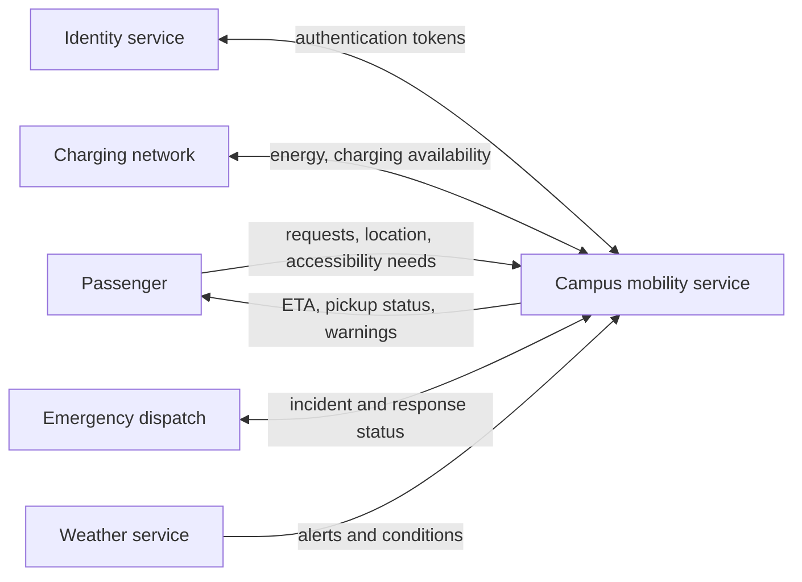

# Deep dive 01 — System boundaries, ownership, and interfaces

> **Suggested starting point:** EN.645.662 Week 1. **You should finish able to:** choose a defensible boundary, produce a context diagram, define meaningful interface contracts, and explain how a boundary move affects scope, risk and responsibility.

## 1. Why a boundary is an engineering decision

Imagine being assigned to improve campus mobility. The sponsor says, "We need an autonomous shuttle." An engineer might immediately list lidar, batteries, maps and path planning. But the sponsor's actual outcome is **people reaching useful destinations reliably, safely and accessibly**. Is a rider mobile app inside the proposed system? What about charging, staffed emergency response, accessible boarding and the university's identity service?

There is no context-free answer. A *system of interest* is chosen to serve an engineering question. A narrow boundary may define a **shuttle vehicle** as the SoI; a broad one may define a **campus mobility service**. The narrower system can meet all its requirements and still fail the mobility mission because a charging station, dispatcher or rider information service fails.

A boundary does at least four things: (1) identifies which behavior the engineering team is responsible for delivering, (2) establishes interfaces and dependencies, (3) influences cost and lifecycle obligations, and (4) determines what evidence is necessary to claim success. Anything outside the boundary does not vanish; it becomes part of the environment or an enabling/neighboring system.

## 2. Build a context model

Start by stating the outcome and the decision. Write the SoI's purpose in one sentence. Then identify external actors and systems, and specify **what is exchanged**. A generic arrow such as "communicates with" is not enough. Ask about data, physical flows, timing, permissions and failure behavior.

This is an operational context, **not** the internal component architecture. Do not confuse interactions crossing the SoI boundary with interactions within the SoI.

## 3. Two defensible boundaries

| Decision property | A. Vehicle-product boundary | B. Mobility-service boundary |
|---|---|---|
| Owned scope | Vehicle plus onboard controls | Vehicles, dispatch, rider support, operating procedures |
| Charging | External infrastructure contract | May be owned/enabled internally |
| Primary evidence | Vehicle-level safety/performance | End-to-end mobility outcomes and operations |
| Advantage | Smaller ownership and test scope | Better control of mission-level experience |
| Main danger | Success depends on weak external interfaces | Greater organizational and technical complexity |

A boundary choice is not correct solely because it is bigger. Broad boundaries can create excessive complexity, duplicate organizational responsibilities, and obscure accountability. Narrow boundaries can hide mission-critical dependencies. Choose the smallest boundary capable of supporting the actual decision **while explicitly managing all external dependencies**.

## 4. Convert context arrows into interface obligations

Consider the mobility service ↔ identity provider interface. A useful first interface contract includes:

- **Purpose:** distinguish an authorized rider from an unauthenticated request.
- **Data:** token identifier, expiration, role/permissions, privacy classification and allowed error codes.
- **Timing:** maximum authentication response time in normal conditions; timeout rules.
- **Failure behavior:** whether an existing booking remains valid if the provider is unreachable; which operations are prohibited.
- **Ownership:** who changes the schema, manages certificates and handles incidents.
- **Verification evidence:** contract tests, simulated outages, version-compatibility tests and service-recovery demonstrations.

This reveals why "the app is outside our boundary" is not the end of design work. It creates an externally owned interface, a requirement on the service's behavior, and a risk about another team's release schedule.

## 5. Follow the lifecycle consequences

A boundary affects more than initial development. If charging is internal, the project needs equipment procurement, maintenance, monitoring, safety inspections, support staffing and eventual replacement/retirement planning. If charging is external, it needs enforceable service levels, escalation agreements, operational fallback plans and acceptance evidence across the interface. Both choices require lifecycle reasoning; the costs sit in different places.

Boundary moves should trigger change-impact analysis across **needs → ConOps → requirements → architecture → interfaces → V&V → operations**. No change is "only a diagram change" until the consequences have been checked.

## 6. Mini worked exercise

**Scenario:** The shuttle supplier wants the university to own all rider communications. The university IT team will support only existing authenticated campus users. Visitors must also be able to ride.

1. Name two incompatible assumptions.
2. Identify the boundary/interface decision.
3. Write one degraded-mode operational scenario.
4. Identify three stakeholders beyond the sponsor.
5. Explain which verification or validation evidence would reveal the problem.

**Reasoned answer:** (1) Supplier assumes universal university ownership of communications; IT restricts accounts to authenticated users. (2) Decide ownership of guest identity, communications and privacy; specify an interface, not an informal promise. (3) A visitor without a campus ID requests a ride and must receive an accessible, safe alternate path. (4) Visitors, disability services, IT security, operations, dispatch and privacy staff are relevant. (5) Guest-journey validation, interface contract tests and an end-to-end operational rehearsal could expose the failure.

## 7. Build a small artifact

Make a **System Framing Decision Record** with these fields: mission outcome; decision to be made; candidate boundaries; included/excluded responsibilities; context exchanges; external owners; failure assumptions; lifecycle costs; recommendation; major uncertainties; next evidence needed. Revisit it after the ConOps and requirements work. A defensible engineer should be able to show how and why the boundary changes as evidence grows.

## Further depth

- [NASA Systems Engineering Handbook](https://www.nasa.gov/reference/systems-engineering-handbook/) — fundamental systems thinking and system design processes.
- [SEBoK](https://sebokwiki.org/wiki/Guide_to_the_Systems_Engineering_Body_of_Knowledge_(SEBoK)) — system context, system boundaries, engineered-system relationships, stakeholder needs.
