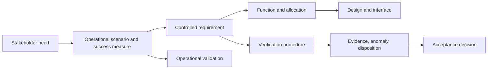

# Deep dive 02 — From stakeholder need to defensible verification evidence

> **Suggested starting points:** EN.645.662 Weeks 3–4 and 11; EN.645.769 Weeks 1–3. **You should finish able to:** turn a need into a testable obligation, distinguish verification from validation, and design a reproducible evidence chain.

## 1. Start with the desired outcome, not the measurement

Suppose riders say: "We need predictable pickup times." This is a **need**, not yet a well-bounded system requirement. It does not define the population, service conditions, measurement point or success threshold. A team that instantly writes "wait time shall be less than five minutes" has invented a contractual obligation without checking demand, accessibility, cost or how wait time should be measured.

First clarify the actual decision: What does *predictable* mean to riders? Is the concern average delay, worst-case delay, accuracy of published times, safety while waiting, or missed classes? An outcome analysis may identify two distinct needs: reliable arrival and truthful information about delays.

## 2. Build a traceable chain

This graph encodes different *kinds* of evidence. The verification procedure checks a requirement. Operational validation checks the mission need with representative users and circumstances. Acceptance is the accountable authority's determination under stated conditions.

## 3. Write the requirement without hiding test assumptions

Candidate requirement: "During scheduled weekday operations under conditions defined in Service Operating Envelope SOE-01, at least 95% of scheduled passenger pickups shall begin no more than five minutes after the published pickup time, measured over each calendar month." 

That statement is stronger than "pickup shall be prompt," but only if supporting artifacts define: which pickups count; how scheduled versus on-demand bookings differ; the actual timestamp event that constitutes "pickup begins"; how clock synchronization is handled; exclusions and off-nominal scenarios; and how missing data is counted. The 95% threshold is **illustrative**, not a justified engineering target; it must be negotiated from stakeholder evidence and feasibility analysis.

A separate requirement might govern the **accuracy of the reported ETA**, because a service can have good punctuality but unreliable messaging, or accurate ETA messages while consistently late.

## 4. Design the verification, including statistical uncertainty

Suppose a team evaluates 200 sampled pickups and observes 192 on-time pickups. The **observed sample fraction** is `192 / 200 = 0.96`. This does not prove the underlying long-run on-time probability is at least 0.95. Sampling variability matters. A rough normal-approximation standard error would be

\[
SE(\hat p) = \sqrt{\frac{\hat p(1-\hat p)}{n}} = \sqrt{\frac{0.96\times0.04}{200}} \approx 0.0139.
\]

A simple normal-approximation 95% interval is approximately `0.96 ± 1.96×0.0139`, or **0.933 to 0.987**. For high-reliability or near-boundary claims, use a more appropriate binomial method (for example Wilson or exact binomial) and pre-specified hypothesis-test rules. The point is conceptual: **96% observed does not automatically establish a 95% underlying performance claim at 95% confidence.**

If the requirement instead defines a calendar-month empirical fraction over the complete population of scheduled pickups, a different decision rule may be appropriate. The verification plan must match the exact requirement claim. Choosing the statistical method after seeing the result creates bias.

## 5. Verification is not validation

Even if the pickup requirement passes, riders may find the service unacceptable because wait areas are unsafe, boarding is inaccessible, or the ETA display is confusing. A **validation** study must therefore include representative people, operational scenarios and meaningful outcomes—not just requirement compliance. This is why stakeholder needs should remain connected to requirements and operational trials throughout the lifecycle.

A lightweight verification record would include:

| Field | Example |
|---|---|
| Requirement ID | SYS-PICKUP-014, revision B |
| Test method | Operational test; observed schedule logs |
| Configuration | Fleet/software/dispatch baseline listed by IDs |
| Population | Weekday scheduled pickups in defined operating envelope |
| Instrumentation | Server event timestamps with clock-drift audit |
| Decision criterion | Preapproved count/statistical acceptance rule |
| Results | `n`, successes, missing observations, measured fraction |
| Exceptions | Weather exclusions, instrumentation failures and rationale |
| Disposition | Pass / fail / inconclusive with approval and follow-up |

## 6. Check your understanding

**Q1.** The system passes a braking test but riders refuse to use it because its loading process is confusing. What passed, and what failed?  
**A1.** A specified braking verification may have passed; user-centered validation has revealed an unmet need.

**Q2.** A test team reports an on-time rate of 97% but omitted 15% of trips with missing timestamps. Is the claim safe?  
**A2.** No. Missingness can be biased. Define the treatment of missing data before declaring success.

**Q3.** Why must a verification report contain software and hardware configuration IDs?  
**A3.** Because evidence applies to a particular system state and may not transfer after design changes.

**Q4.** When is inspection or analysis more suitable than full-scale destructive testing?  
**A4.** When direct testing is impractical, unsafe or destructive and a justified alternative method can credibly establish the obligation.

## 7. Your next artifact

Write one verified and one still-ambiguous requirement for the shuttle. For each, give its parent stakeholder need, operational scenario, design allocation, proposed method, conditions, acceptance criterion and unresolved assumptions. Critique both from the viewpoint of the operator, tester and project sponsor. This exercise turns a requirement from an isolated sentence into part of an **evidence-backed decision architecture**.

## Further depth

- [NASA Systems Engineering Handbook](https://www.nasa.gov/reference/systems-engineering-handbook/) — definition, realization, verification and validation.
- [NIST Engineering Statistics Handbook](https://www.nist.gov/programs-projects/nistsematech-engineering-statistics-handbook) — statistical sampling, variability and measurement.
- [SEBoK](https://sebokwiki.org/wiki/Guide_to_the_Systems_Engineering_Body_of_Knowledge_(SEBoK)) — requirements management and V&V knowledge areas.
